# Техническая лента скриншотов Kenshi

- **Сформировано**: `2026-11-07T21:10:42Z`
- **Окно выборки**: последние 7 суток (с `2026-10-31T21:10:42Z` по `2026-11-07T21:10:42Z`)
- **Всего скриншотов в окне**: 30
- **Сгруппировано серий/кадров**: 30

Техническая лента сгруппированных по сходству кадров с извлеченным текстом интерфейса (OCR). Интерпретация происходящего в игре полностью принадлежит LLM-компаньону по оригинальным изображениям.

---

### Серия 1 (1 кадр)

- **Файловое время**: с `2026-11-01T01:02:41Z` по `2026-11-01T01:02:41Z`
- **Игровое время (OCR)**: `День 120, 11:09`
- **Локация (OCR)**: Не зафиксирована в UI
- **Персонажи в UI (OCR)**: Вьючный бык
- **Задачи/предметы в UI**: Быть рядом: Зелёный, Охранять: Зелёный

**Кадры серии:**
- [screenshot_253-c08bfb5b.jpg](screenshot_253-c08bfb5b.jpg) ([GitHub](https://github.com/asaf1n/Kenshi-Compain/blob/main/published/screenshots/screenshot_253-c08bfb5b.jpg) | [Raw](https://raw.githubusercontent.com/asaf1n/Kenshi-Compain/main/published/screenshots/screenshot_253-c08bfb5b.jpg))

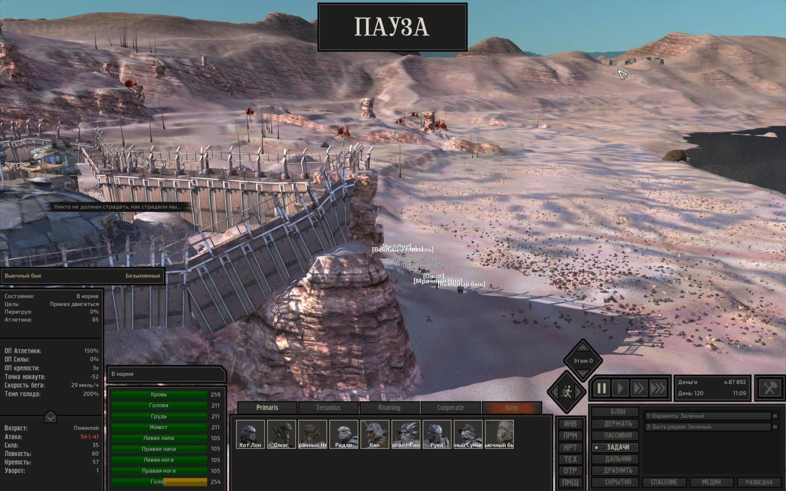

---

### Серия 2 (1 кадр)

- **Файловое время**: с `2026-11-01T03:47:28Z` по `2026-11-01T03:47:28Z`
- **Игровое время (OCR)**: `День 121, 05:09`
- **Локация (OCR)**: Не зафиксирована в UI
- **Персонажи в UI (OCR)**: Седая тень
- **Задачи/предметы в UI**: Работа с машиной, Тащить в

**Кадры серии:**
- [screenshot_261-4738a594.jpg](screenshot_261-4738a594.jpg) ([GitHub](https://github.com/asaf1n/Kenshi-Compain/blob/main/published/screenshots/screenshot_261-4738a594.jpg) | [Raw](https://raw.githubusercontent.com/asaf1n/Kenshi-Compain/main/published/screenshots/screenshot_261-4738a594.jpg))

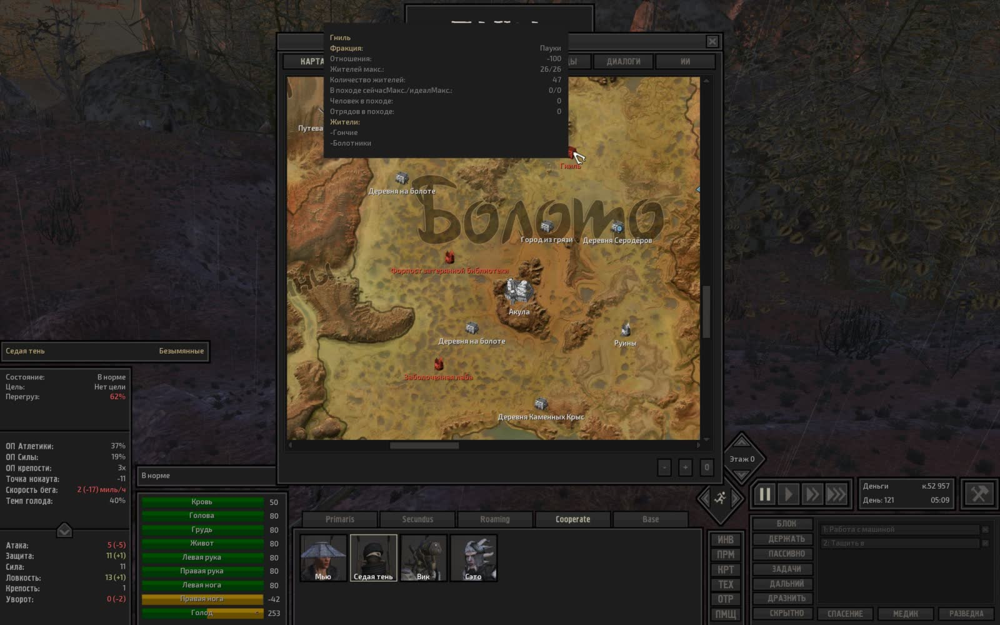

---

### Серия 3 (1 кадр)

- **Файловое время**: с `2026-11-01T09:34:49Z` по `2026-11-01T09:34:49Z`
- **Игровое время (OCR)**: `День 122, 06:03`
- **Локация (OCR)**: Не зафиксирована в UI
- **Персонажи в UI (OCR)**: Вьючный бык
- **Задачи/предметы в UI**: Быть рядом: Хот Лон, Охранять: Хот Лон

**Кадры серии:**
- [screenshot_278-33a651f3.jpg](screenshot_278-33a651f3.jpg) ([GitHub](https://github.com/asaf1n/Kenshi-Compain/blob/main/published/screenshots/screenshot_278-33a651f3.jpg) | [Raw](https://raw.githubusercontent.com/asaf1n/Kenshi-Compain/main/published/screenshots/screenshot_278-33a651f3.jpg))

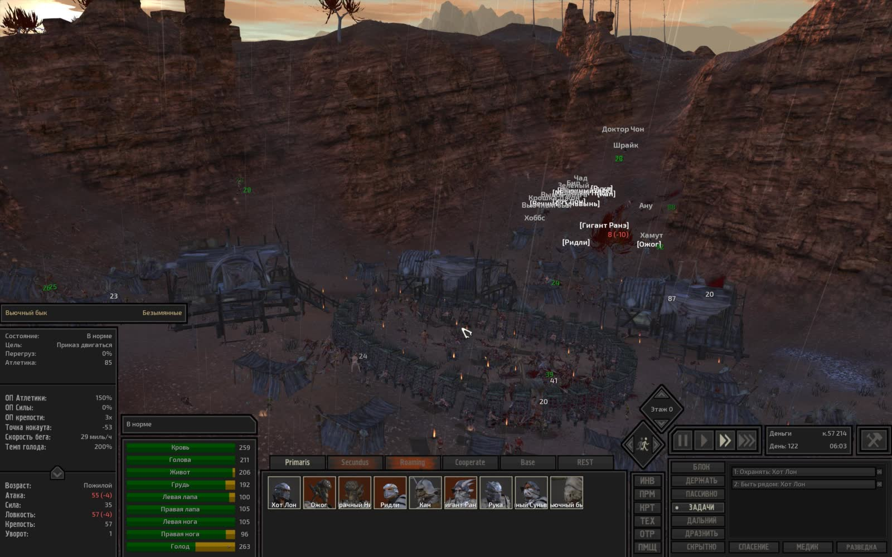

---

### Серия 4 (1 кадр)

- **Файловое время**: с `2026-11-01T10:26:57Z` по `2026-11-01T10:26:57Z`
- **Игровое время (OCR)**: `День 122, 14:03`
- **Локация (OCR)**: Не зафиксирована в UI
- **Персонажи в UI (OCR)**: Великий шаман
- **Задачи/предметы в UI**: Быть рядом: Вьючный бык, Медик, Роботехника

**Кадры серии:**
- [screenshot_287-d01dd799.jpg](screenshot_287-d01dd799.jpg) ([GitHub](https://github.com/asaf1n/Kenshi-Compain/blob/main/published/screenshots/screenshot_287-d01dd799.jpg) | [Raw](https://raw.githubusercontent.com/asaf1n/Kenshi-Compain/main/published/screenshots/screenshot_287-d01dd799.jpg))

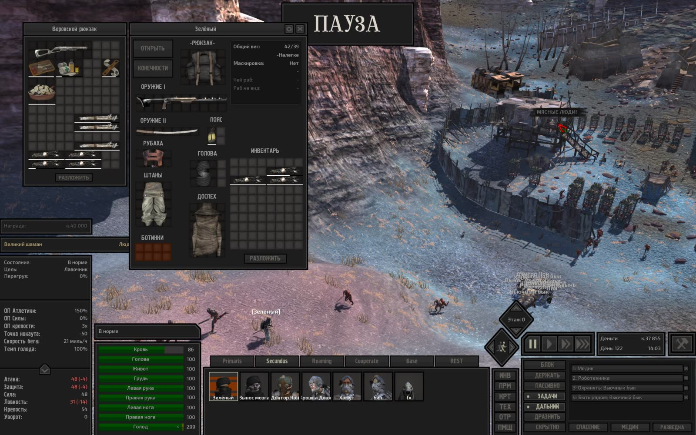

---

### Серия 5 (1 кадр)

- **Файловое время**: с `2026-11-01T10:32:32Z` по `2026-11-01T10:32:32Z`
- **Игровое время (OCR)**: `День 122, 15:40`
- **Локация (OCR)**: Не зафиксирована в UI
- **Персонажи в UI (OCR)**: Гигант Ранэ
- **Задачи/предметы в UI**: Быть рядом: Хот Лон, Медик, Роботехника

**Кадры серии:**
- [screenshot_295-9a995034.jpg](screenshot_295-9a995034.jpg) ([GitHub](https://github.com/asaf1n/Kenshi-Compain/blob/main/published/screenshots/screenshot_295-9a995034.jpg) | [Raw](https://raw.githubusercontent.com/asaf1n/Kenshi-Compain/main/published/screenshots/screenshot_295-9a995034.jpg))

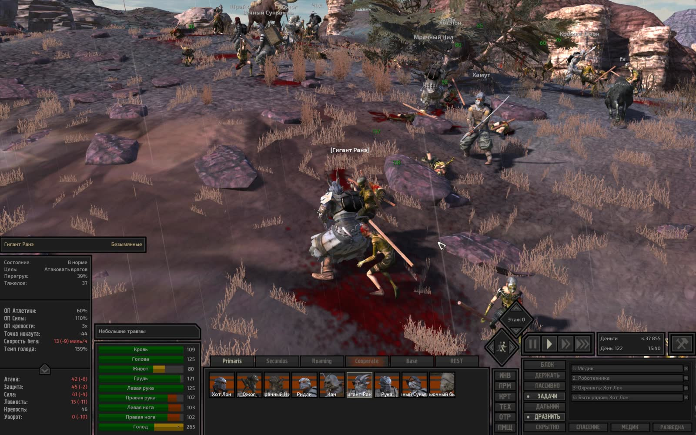

---

### Серия 6 (1 кадр)

- **Файловое время**: с `2026-11-01T11:57:12Z` по `2026-11-01T11:57:12Z`
- **Игровое время (OCR)**: `День 123, 22:07`
- **Локация (OCR)**: Не зафиксирована в UI
- **Персонажи в UI (OCR)**: Вьючный бык
- **Задачи/предметы в UI**: Быть рядом: Вьючный бык, Охранять: Вьючный бык

**Кадры серии:**
- [screenshot_311-20c83140.jpg](screenshot_311-20c83140.jpg) ([GitHub](https://github.com/asaf1n/Kenshi-Compain/blob/main/published/screenshots/screenshot_311-20c83140.jpg) | [Raw](https://raw.githubusercontent.com/asaf1n/Kenshi-Compain/main/published/screenshots/screenshot_311-20c83140.jpg))

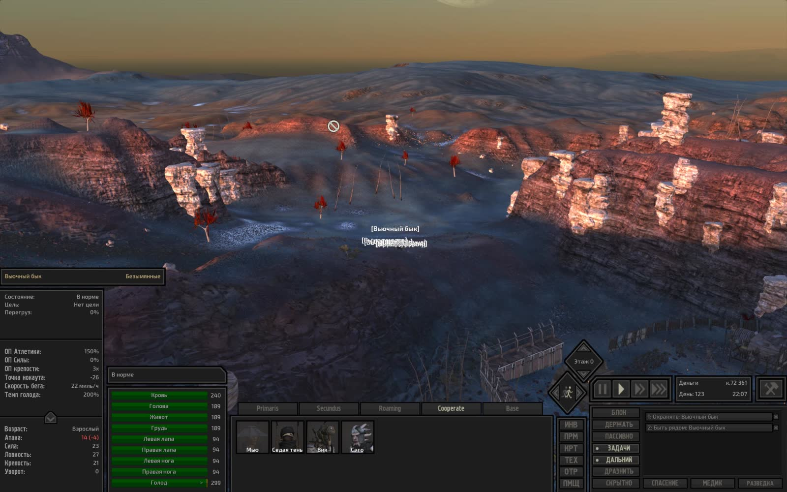

---

### Серия 7 (1 кадр)

- **Файловое время**: с `2026-11-01T12:40:20Z` по `2026-11-01T12:40:20Z`
- **Игровое время (OCR)**: `День 124, 08:26`
- **Локация (OCR)**: Не зафиксирована в UI
- **Персонажи в UI (OCR)**: Хот Лон

**Кадры серии:**
- [screenshot_320-6369b4e1.jpg](screenshot_320-6369b4e1.jpg) ([GitHub](https://github.com/asaf1n/Kenshi-Compain/blob/main/published/screenshots/screenshot_320-6369b4e1.jpg) | [Raw](https://raw.githubusercontent.com/asaf1n/Kenshi-Compain/main/published/screenshots/screenshot_320-6369b4e1.jpg))

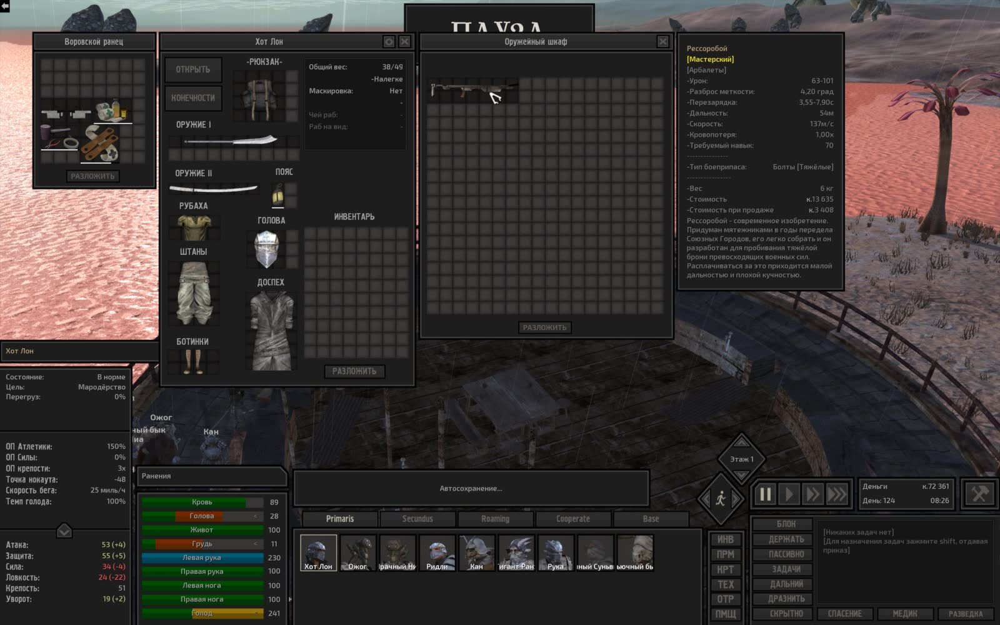

---

### Серия 8 (1 кадр)

- **Файловое время**: с `2026-11-01T13:09:29Z` по `2026-11-01T13:09:29Z`
- **Игровое время (OCR)**: `День 124, 16:53`
- **Локация (OCR)**: Не зафиксирована в UI
- **Персонажи в UI (OCR)**: Мрачный Нил
- **Задачи/предметы в UI**: Медик, Роботехника

**Кадры серии:**
- [screenshot_331-e10270e5.jpg](screenshot_331-e10270e5.jpg) ([GitHub](https://github.com/asaf1n/Kenshi-Compain/blob/main/published/screenshots/screenshot_331-e10270e5.jpg) | [Raw](https://raw.githubusercontent.com/asaf1n/Kenshi-Compain/main/published/screenshots/screenshot_331-e10270e5.jpg))

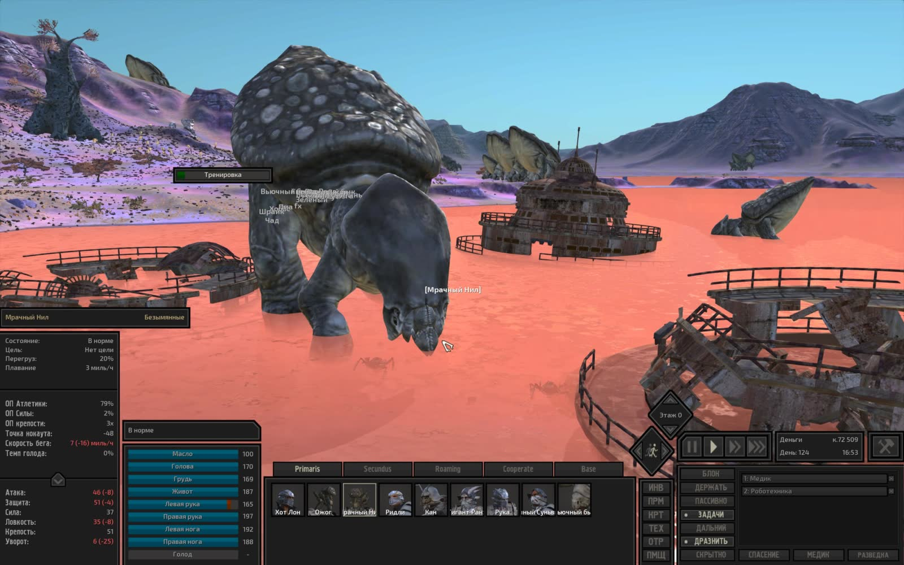

---

### Серия 9 (1 кадр)

- **Файловое время**: с `2026-11-01T17:37:48Z` по `2026-11-01T17:37:48Z`
- **Игровое время (OCR)**: `День 126, 15:27`
- **Локация (OCR)**: Не зафиксирована в UI
- **Персонажи в UI (OCR)**: Крошка Джон
- **Задачи/предметы в UI**: Быть рядом: Зелёный, Медик, Охранять: Зелёный, Роботехника

**Кадры серии:**
- [screenshot_348-14d60829.jpg](screenshot_348-14d60829.jpg) ([GitHub](https://github.com/asaf1n/Kenshi-Compain/blob/main/published/screenshots/screenshot_348-14d60829.jpg) | [Raw](https://raw.githubusercontent.com/asaf1n/Kenshi-Compain/main/published/screenshots/screenshot_348-14d60829.jpg))

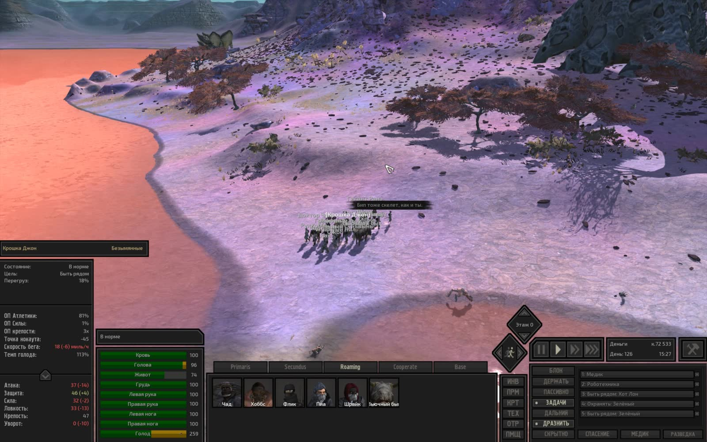

---

### Серия 10 (1 кадр)

- **Файловое время**: с `2026-11-01T17:56:13Z` по `2026-11-01T17:56:13Z`
- **Игровое время (OCR)**: `День 127, 04:47`
- **Локация (OCR)**: Не зафиксирована в UI
- **Персонажи в UI (OCR)**: Людоед
- **Задачи/предметы в UI**: Быть рядом: Хот Лон, Охранять: Хот Лон

**Кадры серии:**
- [screenshot_356-313bb484.jpg](screenshot_356-313bb484.jpg) ([GitHub](https://github.com/asaf1n/Kenshi-Compain/blob/main/published/screenshots/screenshot_356-313bb484.jpg) | [Raw](https://raw.githubusercontent.com/asaf1n/Kenshi-Compain/main/published/screenshots/screenshot_356-313bb484.jpg))

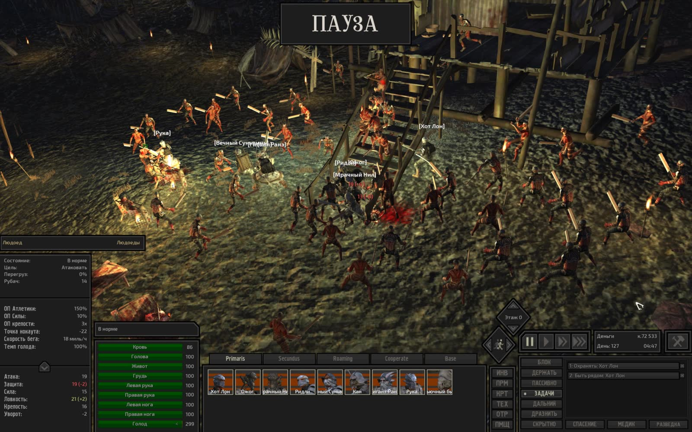

---

### Серия 11 (1 кадр)

- **Файловое время**: с `2026-11-02T00:35:11Z` по `2026-11-02T00:35:11Z`
- **Игровое время (OCR)**: `День 127, 17:06`
- **Локация (OCR)**: Не зафиксирована в UI
- **Персонажи в UI (OCR)**: Не зафиксированы в UI

**Кадры серии:**
- [screenshot_365-7175b352.jpg](screenshot_365-7175b352.jpg) ([GitHub](https://github.com/asaf1n/Kenshi-Compain/blob/main/published/screenshots/screenshot_365-7175b352.jpg) | [Raw](https://raw.githubusercontent.com/asaf1n/Kenshi-Compain/main/published/screenshots/screenshot_365-7175b352.jpg))

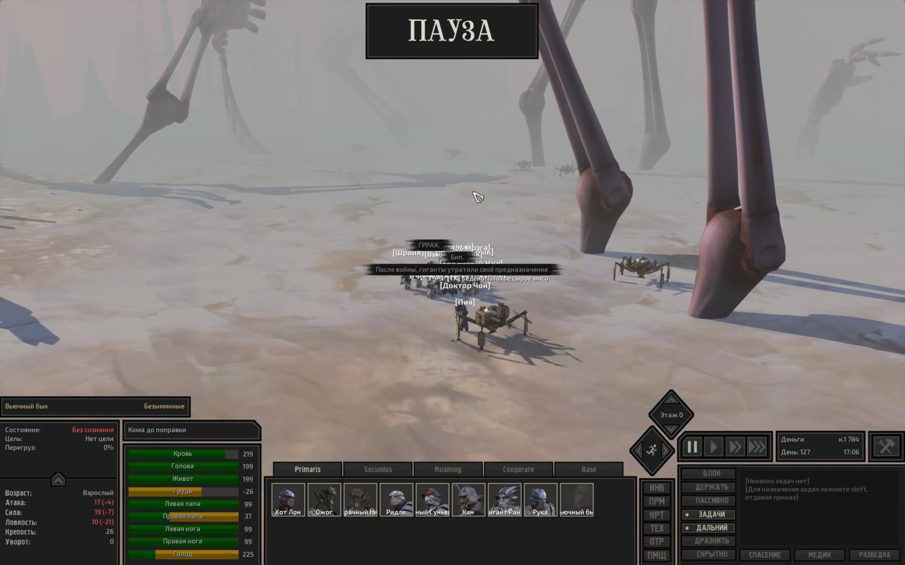

---

### Серия 12 (1 кадр)

- **Файловое время**: с `2026-11-03T01:24:38Z` по `2026-11-03T01:24:38Z`
- **Игровое время (OCR)**: `День 129, 19:59`
- **Локация (OCR)**: Не зафиксирована в UI
- **Персонажи в UI (OCR)**: Сабля

**Кадры серии:**
- [screenshot_381-4ce18b4e.jpg](screenshot_381-4ce18b4e.jpg) ([GitHub](https://github.com/asaf1n/Kenshi-Compain/blob/main/published/screenshots/screenshot_381-4ce18b4e.jpg) | [Raw](https://raw.githubusercontent.com/asaf1n/Kenshi-Compain/main/published/screenshots/screenshot_381-4ce18b4e.jpg))

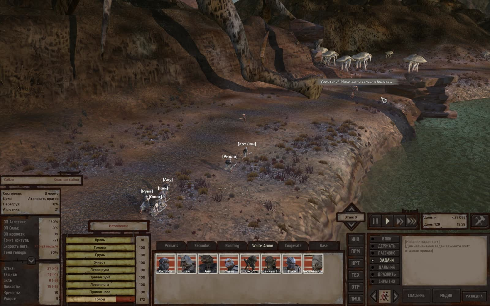

---

### Серия 13 (1 кадр)

- **Файловое время**: с `2026-11-03T01:33:54Z` по `2026-11-03T01:33:54Z`
- **Игровое время (OCR)**: `День 129, 23:41`
- **Локация (OCR)**: Не зафиксирована в UI
- **Персонажи в UI (OCR)**: Вьючный бык
- **Задачи/предметы в UI**: Быть рядом: Зелёный палец, Охранять: Зелёный палец

**Кадры серии:**
- [screenshot_390-737a8667.jpg](screenshot_390-737a8667.jpg) ([GitHub](https://github.com/asaf1n/Kenshi-Compain/blob/main/published/screenshots/screenshot_390-737a8667.jpg) | [Raw](https://raw.githubusercontent.com/asaf1n/Kenshi-Compain/main/published/screenshots/screenshot_390-737a8667.jpg))

---

### Серия 14 (1 кадр)

- **Файловое время**: с `2026-11-03T02:10:47Z` по `2026-11-03T02:10:47Z`
- **Игровое время (OCR)**: `День 130, 06:13`
- **Локация (OCR)**: Не зафиксирована в UI
- **Персонажи в UI (OCR)**: туз эл

**Кадры серии:**
- [screenshot_399-e2338c27.jpg](screenshot_399-e2338c27.jpg) ([GitHub](https://github.com/asaf1n/Kenshi-Compain/blob/main/published/screenshots/screenshot_399-e2338c27.jpg) | [Raw](https://raw.githubusercontent.com/asaf1n/Kenshi-Compain/main/published/screenshots/screenshot_399-e2338c27.jpg))

---

### Серия 15 (1 кадр)

- **Файловое время**: с `2026-11-03T02:48:48Z` по `2026-11-03T02:48:48Z`
- **Игровое время (OCR)**: `День 130, 11:00`
- **Локация (OCR)**: Не зафиксирована в UI
- **Персонажи в UI (OCR)**: флик
- **Задачи/предметы в UI**: Быть рядом: Хот Лон, Охранять: Хот Лон

**Кадры серии:**
- [screenshot_417-602aeaea.jpg](screenshot_417-602aeaea.jpg) ([GitHub](https://github.com/asaf1n/Kenshi-Compain/blob/main/published/screenshots/screenshot_417-602aeaea.jpg) | [Raw](https://raw.githubusercontent.com/asaf1n/Kenshi-Compain/main/published/screenshots/screenshot_417-602aeaea.jpg))

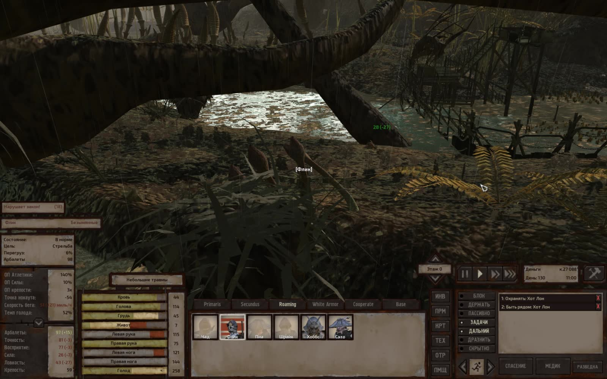

---

### Серия 16 (1 кадр)

- **Файловое время**: с `2026-11-03T07:30:48Z` по `2026-11-03T07:30:48Z`
- **Игровое время (OCR)**: `День 131, 08:39`
- **Локация (OCR)**: Не зафиксирована в UI
- **Персонажи в UI (OCR)**: Зелёный палец
- **Задачи/предметы в UI**: Работа с машиной: Кухонная плита, Работа с машиной: Рисовая ферма, Тащить в: Хранение: еда, Тащить в: Хранение: рис

**Кадры серии:**
- [screenshot_426-dca41523.jpg](screenshot_426-dca41523.jpg) ([GitHub](https://github.com/asaf1n/Kenshi-Compain/blob/main/published/screenshots/screenshot_426-dca41523.jpg) | [Raw](https://raw.githubusercontent.com/asaf1n/Kenshi-Compain/main/published/screenshots/screenshot_426-dca41523.jpg))

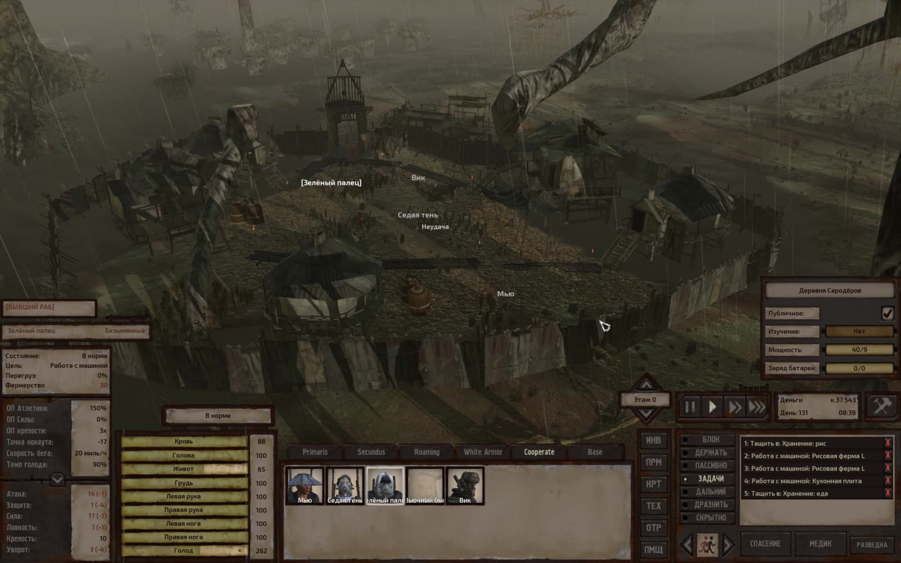

---

### Серия 17 (1 кадр)

- **Файловое время**: с `2026-11-04T08:46:48Z` по `2026-11-04T08:46:48Z`
- **Игровое время (OCR)**: `День 132, 10:57`
- **Локация (OCR)**: Не зафиксирована в UI
- **Персонажи в UI (OCR)**: Зелёный палец
- **Задачи/предметы в UI**: Работа с машиной: Пеньковая ферма 1-, Работа с машиной: Пеньковая ферма L, Работа с машиной: Рисовая ферма 1-, Тащить в: Хранение: рис

**Кадры серии:**
- [screenshot_434-6ff66e61.jpg](screenshot_434-6ff66e61.jpg) ([GitHub](https://github.com/asaf1n/Kenshi-Compain/blob/main/published/screenshots/screenshot_434-6ff66e61.jpg) | [Raw](https://raw.githubusercontent.com/asaf1n/Kenshi-Compain/main/published/screenshots/screenshot_434-6ff66e61.jpg))

---

### Серия 18 (1 кадр)

- **Файловое время**: с `2026-11-06T00:21:21Z` по `2026-11-06T00:21:21Z`
- **Игровое время (OCR)**: `День 133, 12:27`
- **Локация (OCR)**: Не зафиксирована в UI
- **Персонажи в UI (OCR)**: Инквизитор
- **Задачи/предметы в UI**: Медик, Роботехника

**Кадры серии:**
- [screenshot_454-a2e60550.jpg](screenshot_454-a2e60550.jpg) ([GitHub](https://github.com/asaf1n/Kenshi-Compain/blob/main/published/screenshots/screenshot_454-a2e60550.jpg) | [Raw](https://raw.githubusercontent.com/asaf1n/Kenshi-Compain/main/published/screenshots/screenshot_454-a2e60550.jpg))

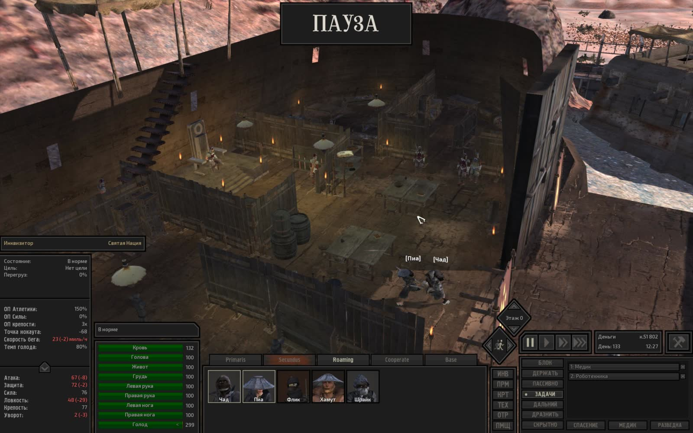

---

### Серия 19 (1 кадр)

- **Файловое время**: с `2026-11-06T00:28:56Z` по `2026-11-06T00:28:56Z`
- **Игровое время (OCR)**: `День 133, 14:44`
- **Локация (OCR)**: Не зафиксирована в UI
- **Персонажи в UI (OCR)**: Хот Лон
- **Задачи/предметы в UI**: Медик, Роботехника

**Кадры серии:**
- [screenshot_466-c71a4ff7.jpg](screenshot_466-c71a4ff7.jpg) ([GitHub](https://github.com/asaf1n/Kenshi-Compain/blob/main/published/screenshots/screenshot_466-c71a4ff7.jpg) | [Raw](https://raw.githubusercontent.com/asaf1n/Kenshi-Compain/main/published/screenshots/screenshot_466-c71a4ff7.jpg))

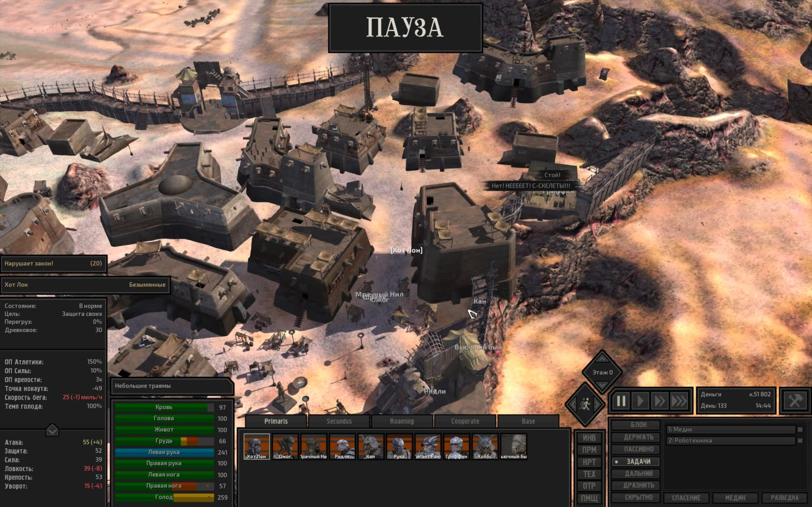

---

### Серия 20 (1 кадр)

- **Файловое время**: с `2026-11-06T00:51:48Z` по `2026-11-06T00:51:48Z`
- **Игровое время (OCR)**: `День 133, 17:19`
- **Локация (OCR)**: Не зафиксирована в UI
- **Персонажи в UI (OCR)**: Зелёный палец
- **Задачи/предметы в UI**: Работа с машиной: Пеньковая ферма, Работа с машиной: Рисовая ферма 1-, Тащить в: Хранение: пенька, Тащить в: Хранение: рис

**Кадры серии:**
- [screenshot_474-52bb0da7.jpg](screenshot_474-52bb0da7.jpg) ([GitHub](https://github.com/asaf1n/Kenshi-Compain/blob/main/published/screenshots/screenshot_474-52bb0da7.jpg) | [Raw](https://raw.githubusercontent.com/asaf1n/Kenshi-Compain/main/published/screenshots/screenshot_474-52bb0da7.jpg))

---

### Серия 21 (1 кадр)

- **Файловое время**: с `2026-11-06T14:26:29Z` по `2026-11-06T14:26:29Z`
- **Игровое время (OCR)**: `День 134, 12:19`
- **Локация (OCR)**: Не зафиксирована в UI
- **Персонажи в UI (OCR)**: Не зафиксированы в UI
- **Задачи/предметы в UI**: Быть рядом: Хот Лон, Медик, Роботехника

**Кадры серии:**
- [screenshot_490-62e8b529.jpg](screenshot_490-62e8b529.jpg) ([GitHub](https://github.com/asaf1n/Kenshi-Compain/blob/main/published/screenshots/screenshot_490-62e8b529.jpg) | [Raw](https://raw.githubusercontent.com/asaf1n/Kenshi-Compain/main/published/screenshots/screenshot_490-62e8b529.jpg))

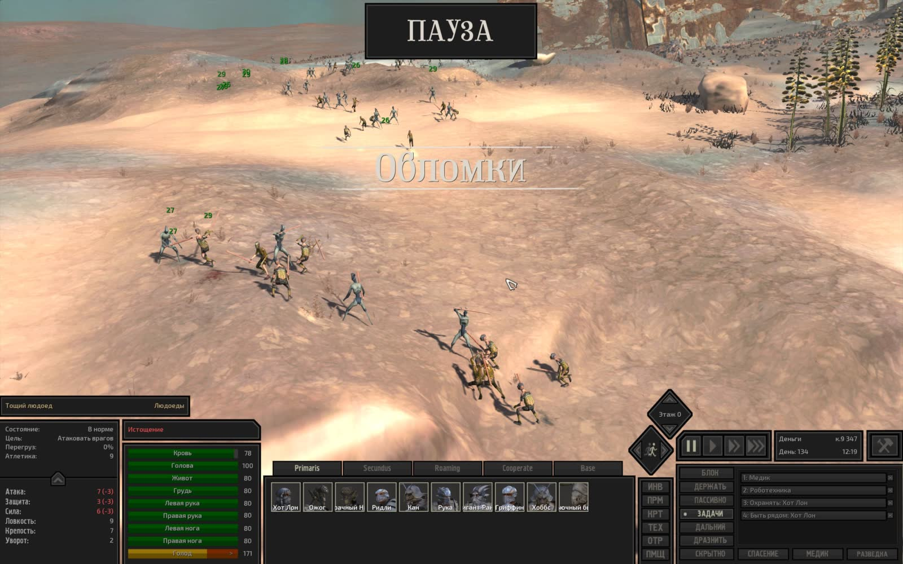

---

### Серия 22 (1 кадр)

- **Файловое время**: с `2026-11-06T20:53:03Z` по `2026-11-06T20:53:03Z`
- **Игровое время (OCR)**: `Не зафиксировано в UI`
- **Локация (OCR)**: Не зафиксирована в UI
- **Персонажи в UI (OCR)**: Не зафиксированы в UI
- **Задачи/предметы в UI**: Быть рядом: Хот Лон, Медик, Роботехника

**Кадры серии:**
- [screenshot_498-2fde89d1.jpg](screenshot_498-2fde89d1.jpg) ([GitHub](https://github.com/asaf1n/Kenshi-Compain/blob/main/published/screenshots/screenshot_498-2fde89d1.jpg) | [Raw](https://raw.githubusercontent.com/asaf1n/Kenshi-Compain/main/published/screenshots/screenshot_498-2fde89d1.jpg))

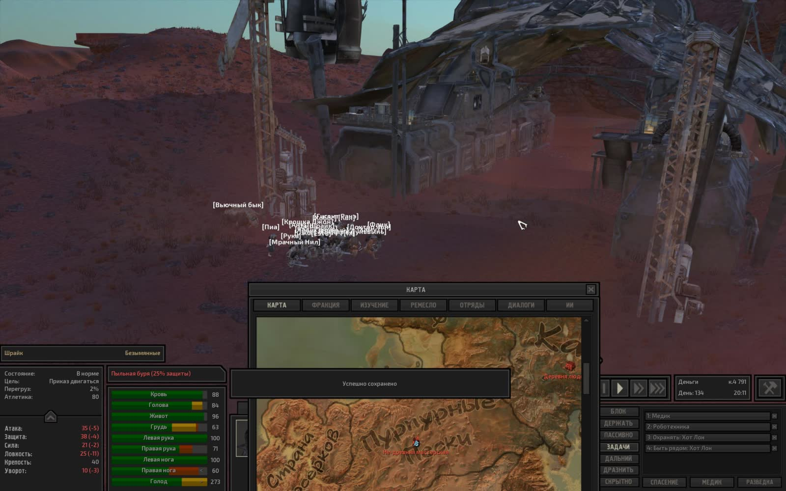

---

### Серия 23 (1 кадр)

- **Файловое время**: с `2026-11-06T22:41:40Z` по `2026-11-06T22:41:40Z`
- **Игровое время (OCR)**: `День 134, 22:07`
- **Локация (OCR)**: Не зафиксирована в UI
- **Персонажи в UI (OCR)**: Не зафиксированы в UI

**Кадры серии:**
- [screenshot_499-4d43d464.jpg](screenshot_499-4d43d464.jpg) ([GitHub](https://github.com/asaf1n/Kenshi-Compain/blob/main/published/screenshots/screenshot_499-4d43d464.jpg) | [Raw](https://raw.githubusercontent.com/asaf1n/Kenshi-Compain/main/published/screenshots/screenshot_499-4d43d464.jpg))

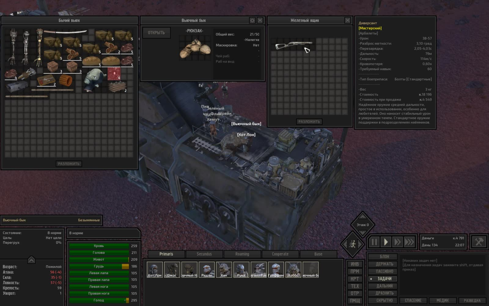

---

### Серия 24 (1 кадр)

- **Файловое время**: с `2026-11-06T22:43:48Z` по `2026-11-06T22:43:48Z`
- **Игровое время (OCR)**: `День 134, 23:16`
- **Локация (OCR)**: Не зафиксирована в UI
- **Персонажи в UI (OCR)**: Не зафиксированы в UI
- **Задачи/предметы в UI**: Медик, Турель, охрана: Арбалет-турель Mkll [свет [8]

**Кадры серии:**
- [screenshot_500-8d631a9c.jpg](screenshot_500-8d631a9c.jpg) ([GitHub](https://github.com/asaf1n/Kenshi-Compain/blob/main/published/screenshots/screenshot_500-8d631a9c.jpg) | [Raw](https://raw.githubusercontent.com/asaf1n/Kenshi-Compain/main/published/screenshots/screenshot_500-8d631a9c.jpg))

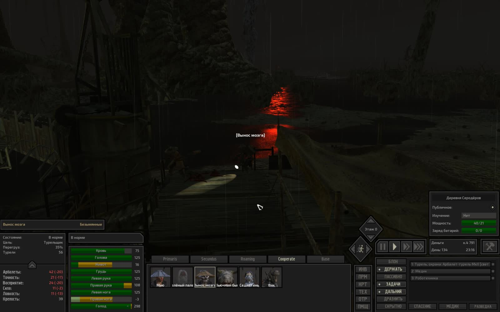

---

### Серия 25 (1 кадр)

- **Файловое время**: с `2026-11-06T22:47:39Z` по `2026-11-06T22:47:39Z`
- **Игровое время (OCR)**: `День 135, 03:37`
- **Локация (OCR)**: Не зафиксирована в UI
- **Персонажи в UI (OCR)**: Не зафиксированы в UI

**Кадры серии:**
- [screenshot_501-7df060dc.jpg](screenshot_501-7df060dc.jpg) ([GitHub](https://github.com/asaf1n/Kenshi-Compain/blob/main/published/screenshots/screenshot_501-7df060dc.jpg) | [Raw](https://raw.githubusercontent.com/asaf1n/Kenshi-Compain/main/published/screenshots/screenshot_501-7df060dc.jpg))

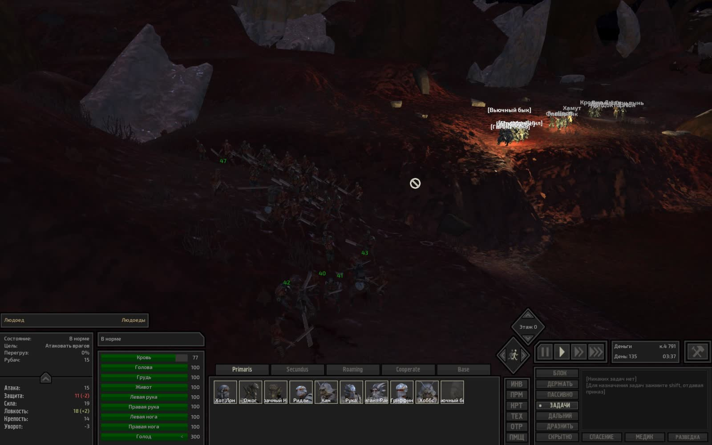

---

### Серия 26 (1 кадр)

- **Файловое время**: с `2026-11-06T22:48:59Z` по `2026-11-06T22:48:59Z`
- **Игровое время (OCR)**: `День 135, 04:19`
- **Локация (OCR)**: Не зафиксирована в UI
- **Персонажи в UI (OCR)**: Не зафиксированы в UI
- **Задачи/предметы в UI**: Работа с машиной: Кухонная плита, Работа с машиной: Рисовая ферма 1-, Тащить в: Хранение: еда, Тащить в: Хранение: рис

**Кадры серии:**
- [screenshot_502-d40116c4.jpg](screenshot_502-d40116c4.jpg) ([GitHub](https://github.com/asaf1n/Kenshi-Compain/blob/main/published/screenshots/screenshot_502-d40116c4.jpg) | [Raw](https://raw.githubusercontent.com/asaf1n/Kenshi-Compain/main/published/screenshots/screenshot_502-d40116c4.jpg))

---

### Серия 27 (1 кадр)

- **Файловое время**: с `2026-11-06T22:49:47Z` по `2026-11-06T22:49:47Z`
- **Игровое время (OCR)**: `День 135, 04:58`
- **Локация (OCR)**: Не зафиксирована в UI
- **Персонажи в UI (OCR)**: Не зафиксированы в UI
- **Задачи/предметы в UI**: Быть рядом: Хот Лон, Медик, Роботехника

**Кадры серии:**
- [screenshot_503-0202b292.jpg](screenshot_503-0202b292.jpg) ([GitHub](https://github.com/asaf1n/Kenshi-Compain/blob/main/published/screenshots/screenshot_503-0202b292.jpg) | [Raw](https://raw.githubusercontent.com/asaf1n/Kenshi-Compain/main/published/screenshots/screenshot_503-0202b292.jpg))

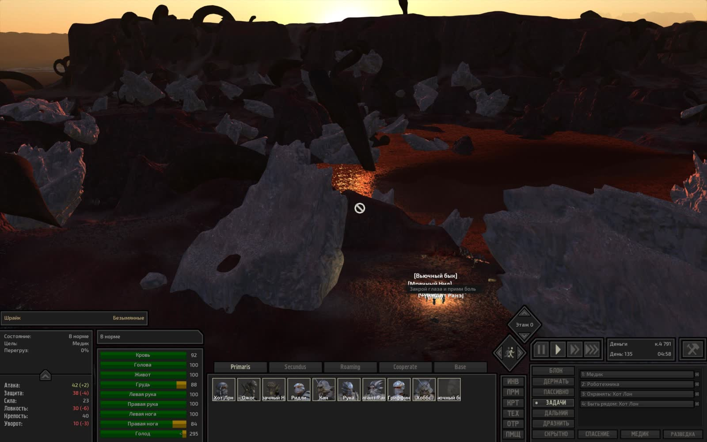

---

### Серия 28 (1 кадр)

- **Файловое время**: с `2026-11-06T22:52:22Z` по `2026-11-06T22:52:22Z`
- **Игровое время (OCR)**: `День 135, 05:45`
- **Локация (OCR)**: Не зафиксирована в UI
- **Персонажи в UI (OCR)**: Не зафиксированы в UI
- **Задачи/предметы в UI**: Быть рядом: Хот Лон, Медик, Роботехника

**Кадры серии:**
- [screenshot_504-55362c6c.jpg](screenshot_504-55362c6c.jpg) ([GitHub](https://github.com/asaf1n/Kenshi-Compain/blob/main/published/screenshots/screenshot_504-55362c6c.jpg) | [Raw](https://raw.githubusercontent.com/asaf1n/Kenshi-Compain/main/published/screenshots/screenshot_504-55362c6c.jpg))

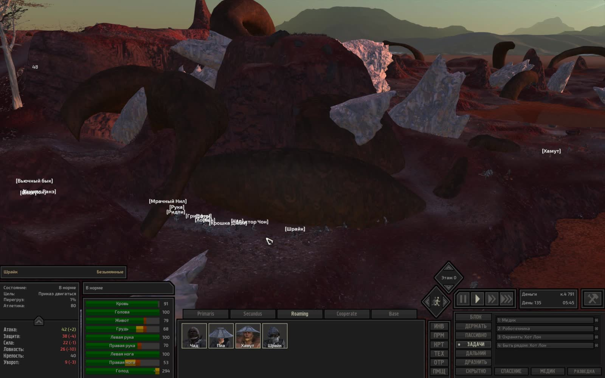

---

### Серия 29 (1 кадр)

- **Файловое время**: с `2026-11-06T22:53:08Z` по `2026-11-06T22:53:08Z`
- **Игровое время (OCR)**: `День 135, 06:01`
- **Локация (OCR)**: Не зафиксирована в UI
- **Персонажи в UI (OCR)**: Не зафиксированы в UI

**Кадры серии:**
- [screenshot_505-1a244c42.jpg](screenshot_505-1a244c42.jpg) ([GitHub](https://github.com/asaf1n/Kenshi-Compain/blob/main/published/screenshots/screenshot_505-1a244c42.jpg) | [Raw](https://raw.githubusercontent.com/asaf1n/Kenshi-Compain/main/published/screenshots/screenshot_505-1a244c42.jpg))

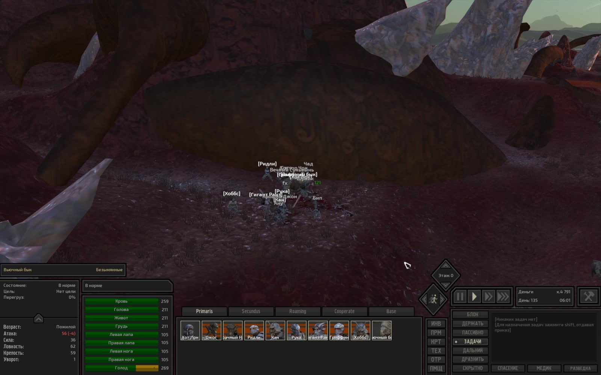

---

### Серия 30 (1 кадр)

- **Файловое время**: с `2026-11-06T22:59:55Z` по `2026-11-06T22:59:55Z`
- **Игровое время (OCR)**: `День 135, 08:55`
- **Локация (OCR)**: Не зафиксирована в UI
- **Персонажи в UI (OCR)**: Генин
- **Задачи/предметы в UI**: Работа с машиной: Кухонная плита, Работа с машиной: Рисовая ферма 1-, Тащить в: Хранение: еда, Тащить в: Хранение: рис

**Кадры серии:**
- [screenshot_506-996d742f.jpg](screenshot_506-996d742f.jpg) ([GitHub](https://github.com/asaf1n/Kenshi-Compain/blob/main/published/screenshots/screenshot_506-996d742f.jpg) | [Raw](https://raw.githubusercontent.com/asaf1n/Kenshi-Compain/main/published/screenshots/screenshot_506-996d742f.jpg))

---
