# Техническая лента скриншотов Kenshi

- **Сформировано**: `2026-11-09T23:07:41Z`
- **Окно выборки**: последние 7 суток (с `2026-11-02T23:07:41Z` по `2026-11-09T23:07:41Z`)
- **Всего скриншотов в окне**: 30
- **Сгруппировано серий/кадров**: 30

Техническая лента сгруппированных по сходству кадров с извлеченным текстом интерфейса (OCR). Интерпретация происходящего в игре полностью принадлежит LLM-компаньону по оригинальным изображениям.

---

### Серия 1 (1 кадр)

- **Файловое время**: с `2026-11-03T01:03:27Z` по `2026-11-03T01:03:27Z`
- **Игровое время (OCR)**: `День 129, 13:48`
- **Локация (OCR)**: Не зафиксирована в UI
- **Персонажи в UI (OCR)**: Вьючный бык

**Кадры серии:**
- [screenshot_374-122c74fa.jpg](screenshot_374-122c74fa.jpg) ([GitHub](https://github.com/asaf1n/Kenshi-Compain/blob/main/published/screenshots/screenshot_374-122c74fa.jpg) | [Raw](https://raw.githubusercontent.com/asaf1n/Kenshi-Compain/main/published/screenshots/screenshot_374-122c74fa.jpg))

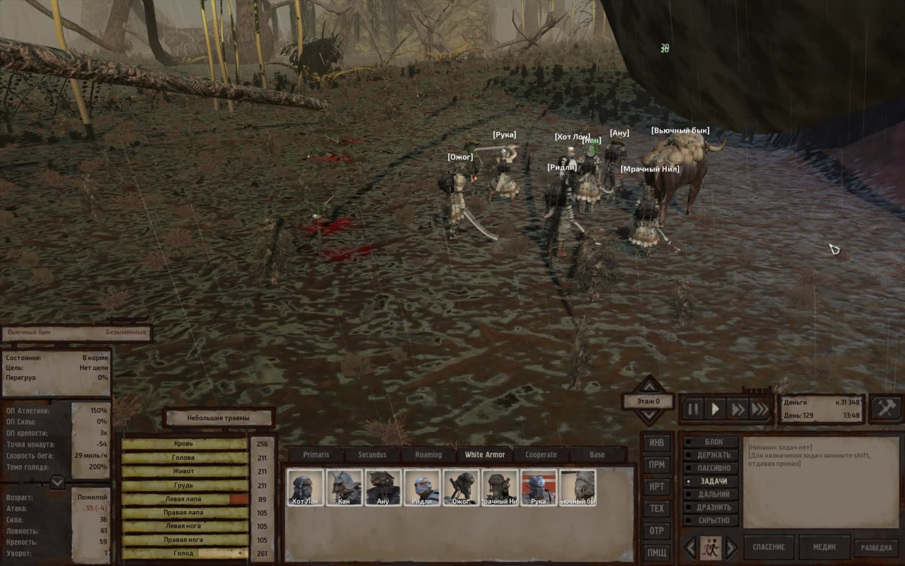

---

### Серия 2 (1 кадр)

- **Файловое время**: с `2026-11-03T01:11:58Z` по `2026-11-03T01:11:58Z`
- **Игровое время (OCR)**: `Не зафиксировано в UI`
- **Локация (OCR)**: Не зафиксирована в UI
- **Персонажи в UI (OCR)**: Не зафиксированы в UI

**Кадры серии:**
- [screenshot_379-67aa3062.jpg](screenshot_379-67aa3062.jpg) ([GitHub](https://github.com/asaf1n/Kenshi-Compain/blob/main/published/screenshots/screenshot_379-67aa3062.jpg) | [Raw](https://raw.githubusercontent.com/asaf1n/Kenshi-Compain/main/published/screenshots/screenshot_379-67aa3062.jpg))

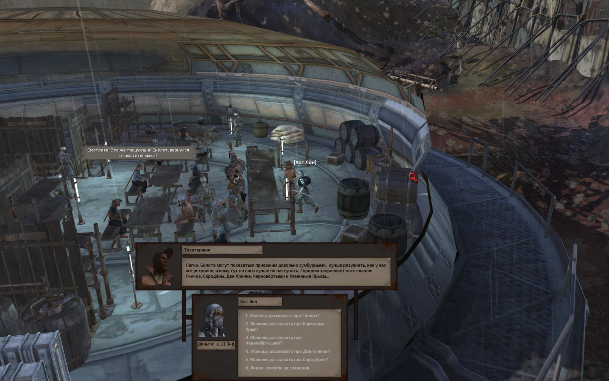

---

### Серия 3 (1 кадр)

- **Файловое время**: с `2026-11-03T01:28:41Z` по `2026-11-03T01:28:41Z`
- **Игровое время (OCR)**: `День 129, 22:17`
- **Локация (OCR)**: Не зафиксирована в UI
- **Персонажи в UI (OCR)**: Тень

**Кадры серии:**
- [screenshot_383-81a5a716.jpg](screenshot_383-81a5a716.jpg) ([GitHub](https://github.com/asaf1n/Kenshi-Compain/blob/main/published/screenshots/screenshot_383-81a5a716.jpg) | [Raw](https://raw.githubusercontent.com/asaf1n/Kenshi-Compain/main/published/screenshots/screenshot_383-81a5a716.jpg))

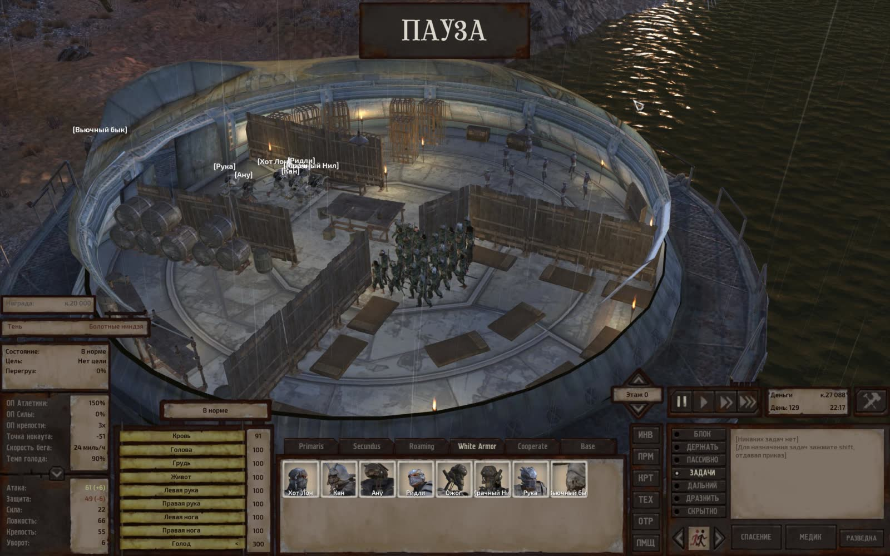

---

### Серия 4 (1 кадр)

- **Файловое время**: с `2026-11-03T01:32:07Z` по `2026-11-03T01:32:07Z`
- **Игровое время (OCR)**: `День 129, 22:43`
- **Локация (OCR)**: Не зафиксирована в UI
- **Персонажи в UI (OCR)**: Чад
- **Задачи/предметы в UI**: Медик, Роботехника

**Кадры серии:**
- [screenshot_389-a4024da2.jpg](screenshot_389-a4024da2.jpg) ([GitHub](https://github.com/asaf1n/Kenshi-Compain/blob/main/published/screenshots/screenshot_389-a4024da2.jpg) | [Raw](https://raw.githubusercontent.com/asaf1n/Kenshi-Compain/main/published/screenshots/screenshot_389-a4024da2.jpg))

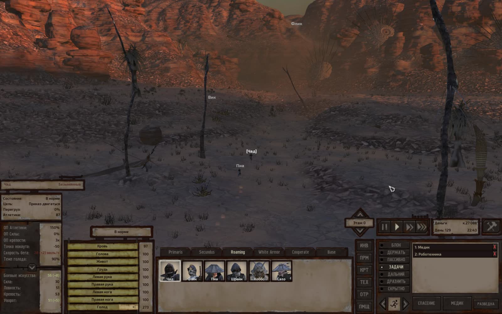

---

### Серия 5 (1 кадр)

- **Файловое время**: с `2026-11-03T01:35:52Z` по `2026-11-03T01:35:52Z`
- **Игровое время (OCR)**: `День 130, 00:12`
- **Локация (OCR)**: Не зафиксирована в UI
- **Персонажи в UI (OCR)**: Сэто
- **Задачи/предметы в UI**: Медик, Роботехника

**Кадры серии:**
- [screenshot_393-0918e9f6.jpg](screenshot_393-0918e9f6.jpg) ([GitHub](https://github.com/asaf1n/Kenshi-Compain/blob/main/published/screenshots/screenshot_393-0918e9f6.jpg) | [Raw](https://raw.githubusercontent.com/asaf1n/Kenshi-Compain/main/published/screenshots/screenshot_393-0918e9f6.jpg))

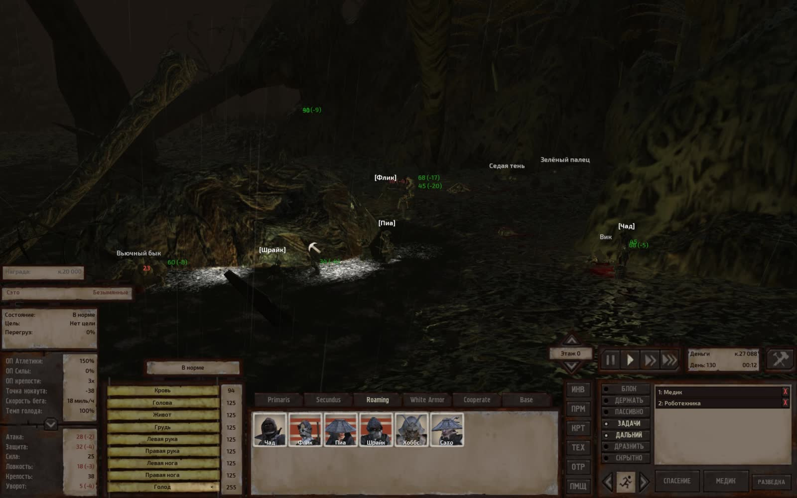

---

### Серия 6 (1 кадр)

- **Файловое время**: с `2026-11-03T02:10:47Z` по `2026-11-03T02:10:47Z`
- **Игровое время (OCR)**: `День 130, 06:13`
- **Локация (OCR)**: Не зафиксирована в UI
- **Персонажи в UI (OCR)**: туз эл

**Кадры серии:**
- [screenshot_399-e2338c27.jpg](screenshot_399-e2338c27.jpg) ([GitHub](https://github.com/asaf1n/Kenshi-Compain/blob/main/published/screenshots/screenshot_399-e2338c27.jpg) | [Raw](https://raw.githubusercontent.com/asaf1n/Kenshi-Compain/main/published/screenshots/screenshot_399-e2338c27.jpg))

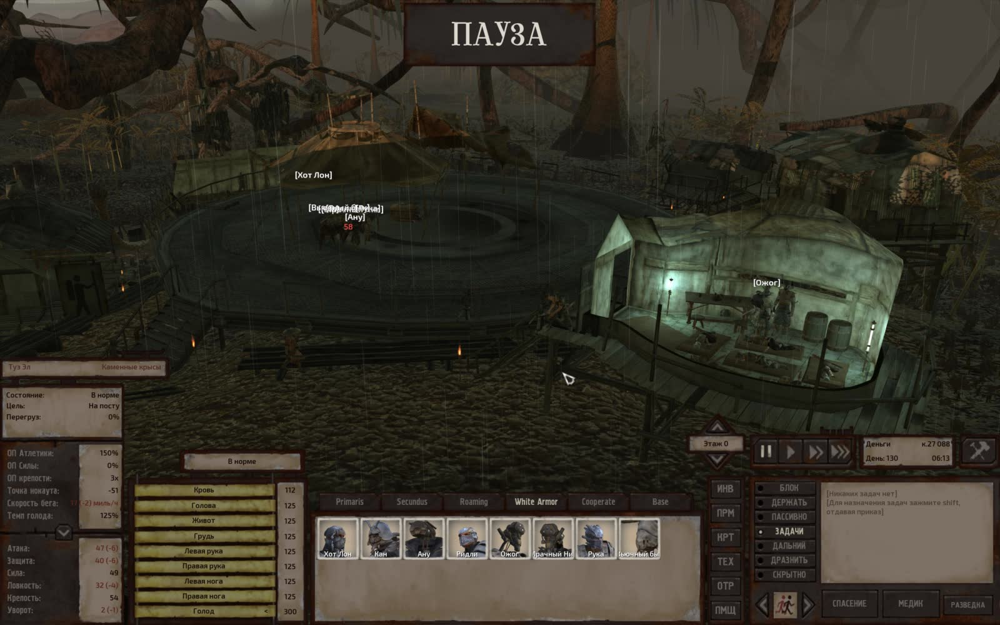

---

### Серия 7 (1 кадр)

- **Файловое время**: с `2026-11-03T02:25:44Z` по `2026-11-03T02:25:44Z`
- **Игровое время (OCR)**: `День 130, 06:47`
- **Локация (OCR)**: Не зафиксирована в UI
- **Персонажи в UI (OCR)**: Хот Лон
- **Задачи/предметы в UI**: Медик, Роботехника

**Кадры серии:**
- [screenshot_405-73acf0d5.jpg](screenshot_405-73acf0d5.jpg) ([GitHub](https://github.com/asaf1n/Kenshi-Compain/blob/main/published/screenshots/screenshot_405-73acf0d5.jpg) | [Raw](https://raw.githubusercontent.com/asaf1n/Kenshi-Compain/main/published/screenshots/screenshot_405-73acf0d5.jpg))

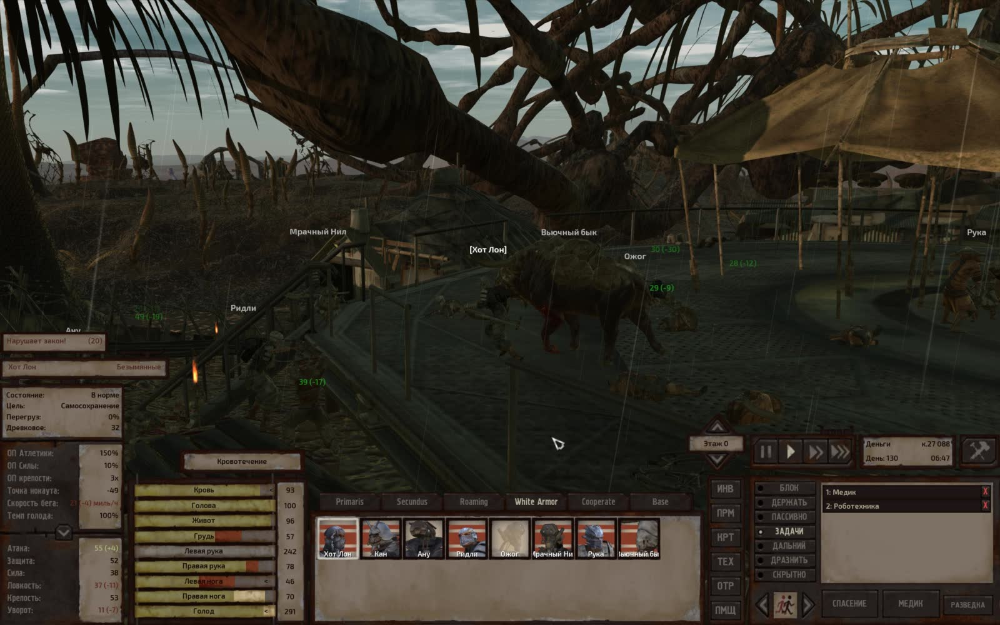

---

### Серия 8 (1 кадр)

- **Файловое время**: с `2026-11-03T02:44:08Z` по `2026-11-03T02:44:08Z`
- **Игровое время (OCR)**: `День 130, 08:58`
- **Локация (OCR)**: Не зафиксирована в UI
- **Персонажи в UI (OCR)**: Хот Лон
- **Задачи/предметы в UI**: Медик, Роботехника

**Кадры серии:**
- [screenshot_410-b469c2b3.jpg](screenshot_410-b469c2b3.jpg) ([GitHub](https://github.com/asaf1n/Kenshi-Compain/blob/main/published/screenshots/screenshot_410-b469c2b3.jpg) | [Raw](https://raw.githubusercontent.com/asaf1n/Kenshi-Compain/main/published/screenshots/screenshot_410-b469c2b3.jpg))

---

### Серия 9 (1 кадр)

- **Файловое время**: с `2026-11-03T02:46:34Z` по `2026-11-03T02:46:34Z`
- **Игровое время (OCR)**: `День 130, 09:59`
- **Локация (OCR)**: Не зафиксирована в UI
- **Персонажи в UI (OCR)**: флик
- **Задачи/предметы в UI**: Быть рядом: Хот Лон, Охранять: Хот Лон

**Кадры серии:**
- [screenshot_415-cafa4aea.jpg](screenshot_415-cafa4aea.jpg) ([GitHub](https://github.com/asaf1n/Kenshi-Compain/blob/main/published/screenshots/screenshot_415-cafa4aea.jpg) | [Raw](https://raw.githubusercontent.com/asaf1n/Kenshi-Compain/main/published/screenshots/screenshot_415-cafa4aea.jpg))

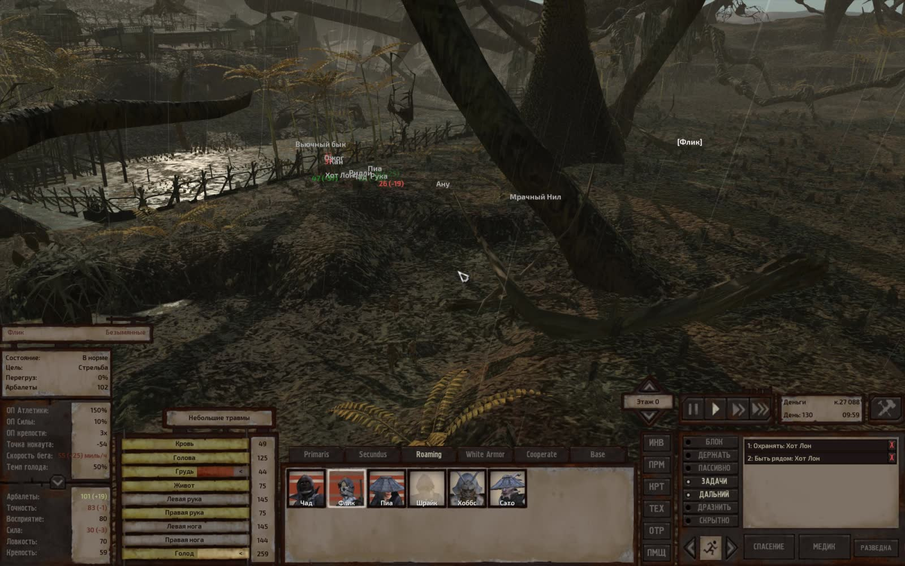

---

### Серия 10 (1 кадр)

- **Файловое время**: с `2026-11-03T04:06:25Z` по `2026-11-03T04:06:25Z`
- **Игровое время (OCR)**: `День 130, 21:30`
- **Локация (OCR)**: Не зафиксирована в UI
- **Персонажи в UI (OCR)**: Ану
- **Задачи/предметы в UI**: Медик, Роботехника

**Кадры серии:**
- [screenshot_420-8e064d65.jpg](screenshot_420-8e064d65.jpg) ([GitHub](https://github.com/asaf1n/Kenshi-Compain/blob/main/published/screenshots/screenshot_420-8e064d65.jpg) | [Raw](https://raw.githubusercontent.com/asaf1n/Kenshi-Compain/main/published/screenshots/screenshot_420-8e064d65.jpg))

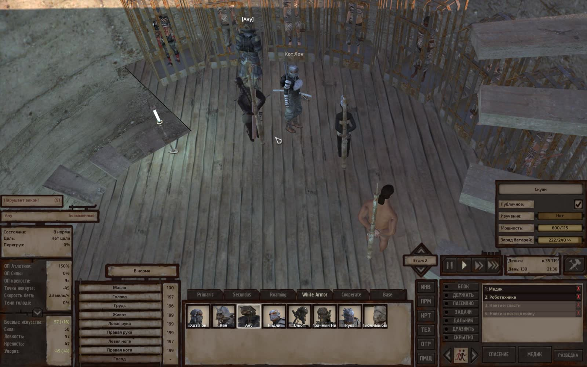

---

### Серия 11 (1 кадр)

- **Файловое время**: с `2026-11-03T06:49:05Z` по `2026-11-03T06:49:05Z`
- **Игровое время (OCR)**: `День 131, 05:27`
- **Локация (OCR)**: Не зафиксирована в UI
- **Персонажи в UI (OCR)**: Мью
- **Задачи/предметы в UI**: Разделка животных, Тащить в: Хранение: мясо, Тащить в: Хранение: рис

**Кадры серии:**
- [screenshot_425-ce8b7b02.jpg](screenshot_425-ce8b7b02.jpg) ([GitHub](https://github.com/asaf1n/Kenshi-Compain/blob/main/published/screenshots/screenshot_425-ce8b7b02.jpg) | [Raw](https://raw.githubusercontent.com/asaf1n/Kenshi-Compain/main/published/screenshots/screenshot_425-ce8b7b02.jpg))

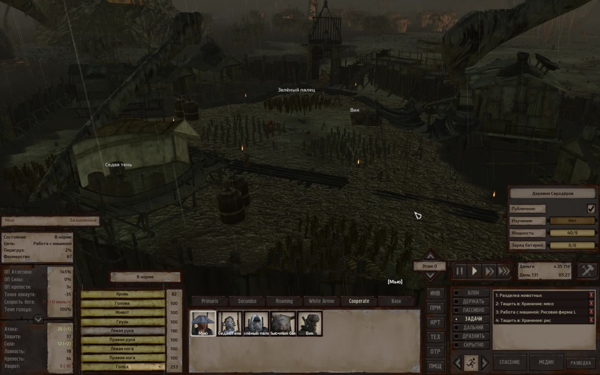

---

### Серия 12 (1 кадр)

- **Файловое время**: с `2026-11-04T08:43:01Z` по `2026-11-04T08:43:01Z`
- **Игровое время (OCR)**: `День 132, 09:13`
- **Локация (OCR)**: Не зафиксирована в UI
- **Персонажи в UI (OCR)**: вьючныи бык

**Кадры серии:**
- [screenshot_430-0b9d0d64.jpg](screenshot_430-0b9d0d64.jpg) ([GitHub](https://github.com/asaf1n/Kenshi-Compain/blob/main/published/screenshots/screenshot_430-0b9d0d64.jpg) | [Raw](https://raw.githubusercontent.com/asaf1n/Kenshi-Compain/main/published/screenshots/screenshot_430-0b9d0d64.jpg))

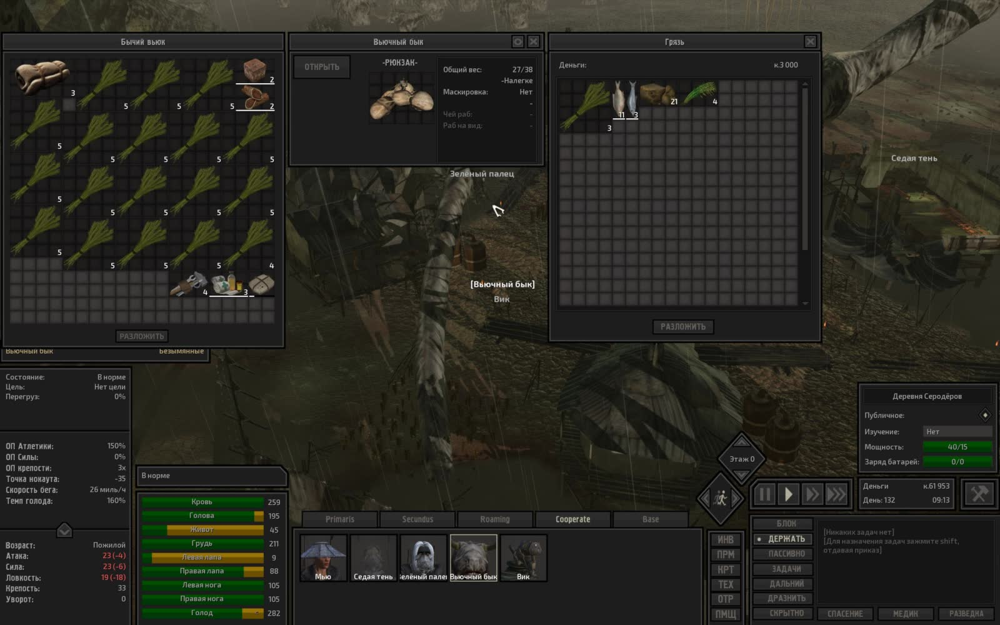

---

### Серия 13 (1 кадр)

- **Файловое время**: с `2026-11-04T08:46:48Z` по `2026-11-04T08:46:48Z`
- **Игровое время (OCR)**: `День 132, 10:57`
- **Локация (OCR)**: Не зафиксирована в UI
- **Персонажи в UI (OCR)**: Зелёный палец
- **Задачи/предметы в UI**: Работа с машиной: Пеньковая ферма 1-, Работа с машиной: Пеньковая ферма L, Работа с машиной: Рисовая ферма 1-, Тащить в: Хранение: рис

**Кадры серии:**
- [screenshot_434-6ff66e61.jpg](screenshot_434-6ff66e61.jpg) ([GitHub](https://github.com/asaf1n/Kenshi-Compain/blob/main/published/screenshots/screenshot_434-6ff66e61.jpg) | [Raw](https://raw.githubusercontent.com/asaf1n/Kenshi-Compain/main/published/screenshots/screenshot_434-6ff66e61.jpg))

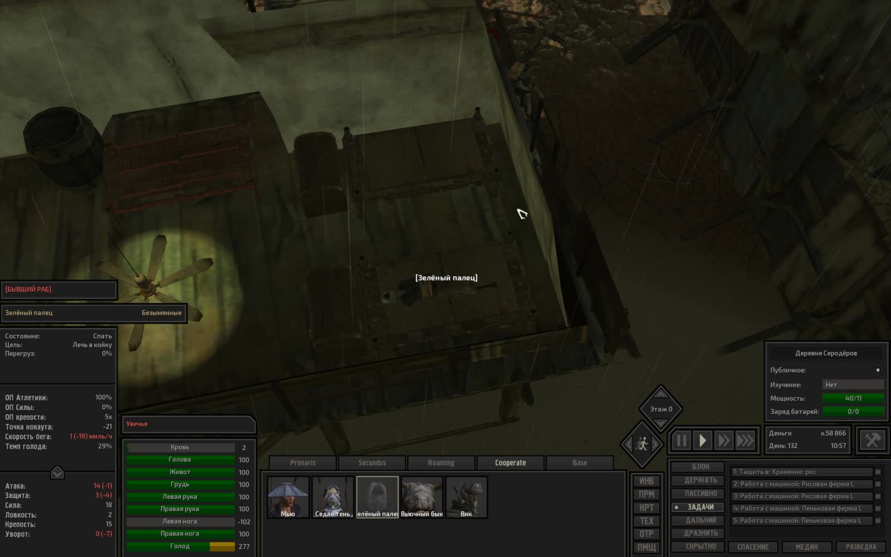

---

### Серия 14 (1 кадр)

- **Файловое время**: с `2026-11-04T16:48:52Z` по `2026-11-04T16:48:52Z`
- **Игровое время (OCR)**: `День 132, 18:22`
- **Локация (OCR)**: Не зафиксирована в UI
- **Персонажи в UI (OCR)**: Седая тень
- **Задачи/предметы в UI**: Быть рядом: Вьючный бык, Охранять: Вьючный бык

**Кадры серии:**
- [screenshot_439-98a2cb8e.jpg](screenshot_439-98a2cb8e.jpg) ([GitHub](https://github.com/asaf1n/Kenshi-Compain/blob/main/published/screenshots/screenshot_439-98a2cb8e.jpg) | [Raw](https://raw.githubusercontent.com/asaf1n/Kenshi-Compain/main/published/screenshots/screenshot_439-98a2cb8e.jpg))

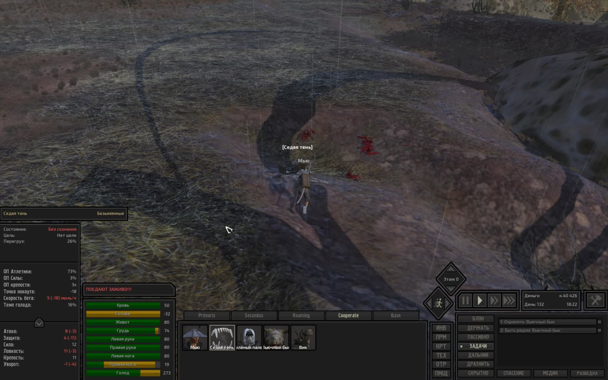

---

### Серия 15 (1 кадр)

- **Файловое время**: с `2026-11-06T00:20:27Z` по `2026-11-06T00:20:27Z`
- **Игровое время (OCR)**: `День 133, 12:18`
- **Локация (OCR)**: Не зафиксирована в UI
- **Персонажи в UI (OCR)**: Не зафиксированы в UI
- **Задачи/предметы в UI**: Медик, Роботехника

**Кадры серии:**
- [screenshot_449-be991bca.jpg](screenshot_449-be991bca.jpg) ([GitHub](https://github.com/asaf1n/Kenshi-Compain/blob/main/published/screenshots/screenshot_449-be991bca.jpg) | [Raw](https://raw.githubusercontent.com/asaf1n/Kenshi-Compain/main/published/screenshots/screenshot_449-be991bca.jpg))

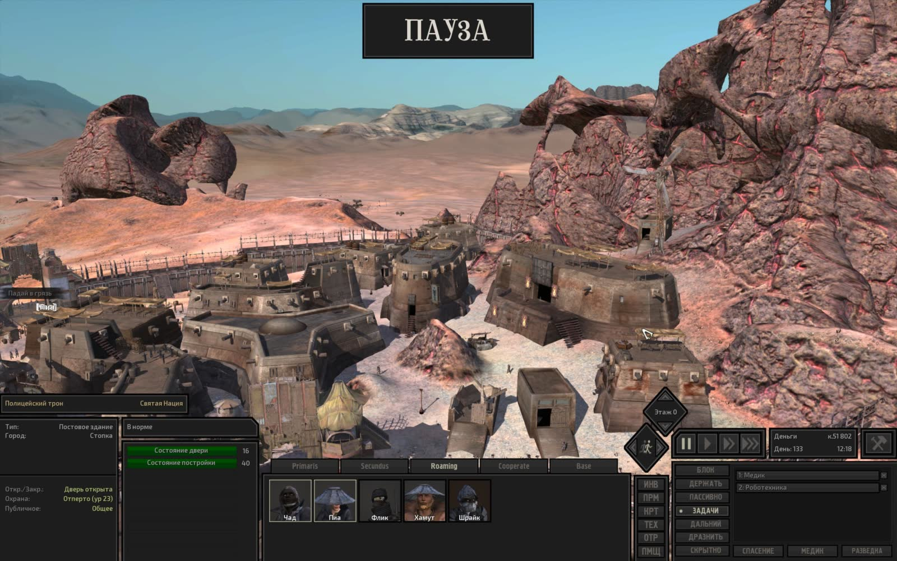

---

### Серия 16 (1 кадр)

- **Файловое время**: с `2026-11-06T00:22:15Z` по `2026-11-06T00:22:15Z`
- **Игровое время (OCR)**: `День 133, 12:35`
- **Локация (OCR)**: Не зафиксирована в UI
- **Персонажи в UI (OCR)**: Пиа
- **Задачи/предметы в UI**: Медик, Роботехника

**Кадры серии:**
- [screenshot_457-371c1c7a.jpg](screenshot_457-371c1c7a.jpg) ([GitHub](https://github.com/asaf1n/Kenshi-Compain/blob/main/published/screenshots/screenshot_457-371c1c7a.jpg) | [Raw](https://raw.githubusercontent.com/asaf1n/Kenshi-Compain/main/published/screenshots/screenshot_457-371c1c7a.jpg))

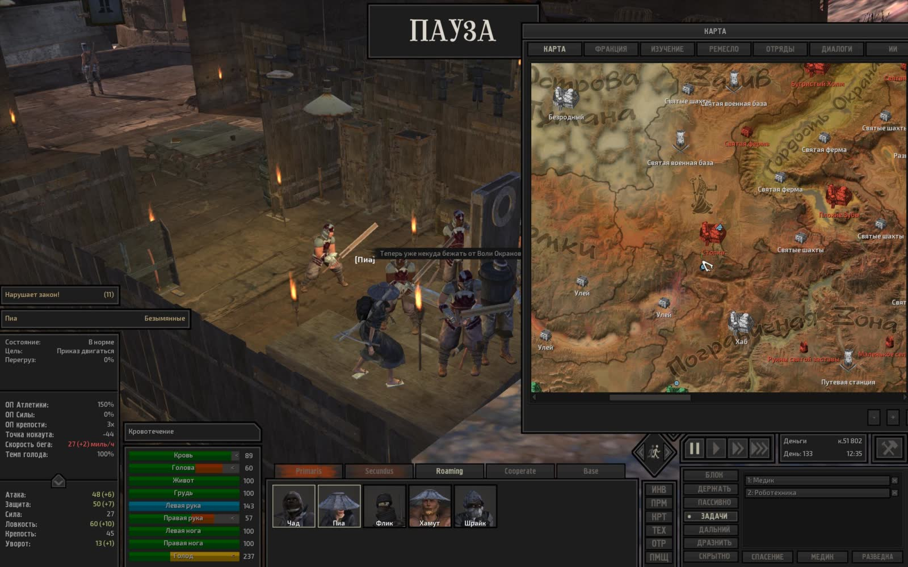

---

### Серия 17 (1 кадр)

- **Файловое время**: с `2026-11-06T00:28:07Z` по `2026-11-06T00:28:07Z`
- **Игровое время (OCR)**: `День 133`
- **Локация (OCR)**: Не зафиксирована в UI
- **Персонажи в UI (OCR)**: Седая тень
- **Задачи/предметы в UI**: Быть рядом: Вик, Охранять: Вик

**Кадры серии:**
- [screenshot_464-ebd23922.jpg](screenshot_464-ebd23922.jpg) ([GitHub](https://github.com/asaf1n/Kenshi-Compain/blob/main/published/screenshots/screenshot_464-ebd23922.jpg) | [Raw](https://raw.githubusercontent.com/asaf1n/Kenshi-Compain/main/published/screenshots/screenshot_464-ebd23922.jpg))

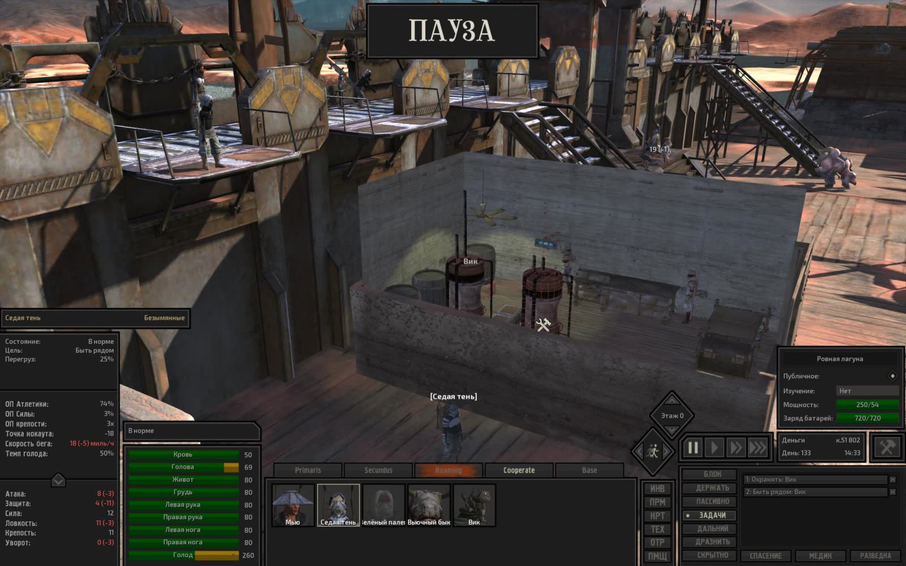

---

### Серия 18 (1 кадр)

- **Файловое время**: с `2026-11-06T00:31:34Z` по `2026-11-06T00:31:34Z`
- **Игровое время (OCR)**: `День 133, 15:18`
- **Локация (OCR)**: Не зафиксирована в UI
- **Персонажи в UI (OCR)**: Не зафиксированы в UI
- **Задачи/предметы в UI**: Быть рядом: Хот Лон, Охранять: Хот Лон

**Кадры серии:**
- [screenshot_469-94f74eea.jpg](screenshot_469-94f74eea.jpg) ([GitHub](https://github.com/asaf1n/Kenshi-Compain/blob/main/published/screenshots/screenshot_469-94f74eea.jpg) | [Raw](https://raw.githubusercontent.com/asaf1n/Kenshi-Compain/main/published/screenshots/screenshot_469-94f74eea.jpg))

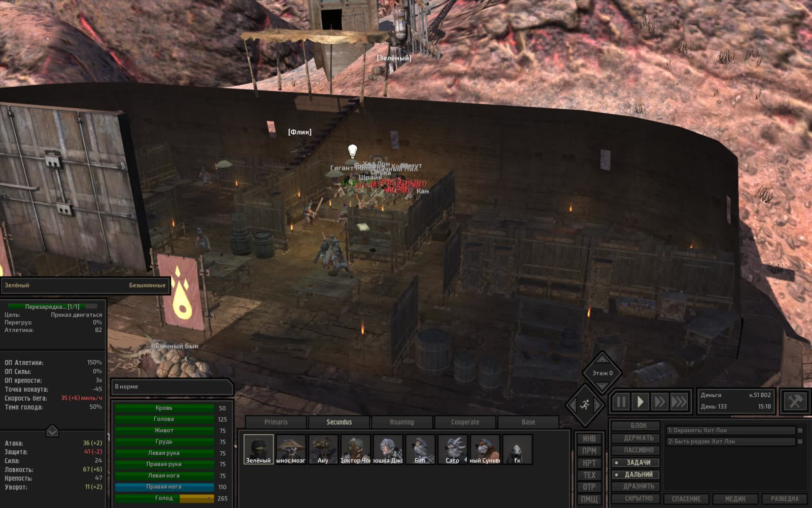

---

### Серия 19 (1 кадр)

- **Файловое время**: с `2026-11-06T00:51:48Z` по `2026-11-06T00:51:48Z`
- **Игровое время (OCR)**: `День 133, 17:19`
- **Локация (OCR)**: Не зафиксирована в UI
- **Персонажи в UI (OCR)**: Зелёный палец
- **Задачи/предметы в UI**: Работа с машиной: Пеньковая ферма, Работа с машиной: Рисовая ферма 1-, Тащить в: Хранение: пенька, Тащить в: Хранение: рис

**Кадры серии:**
- [screenshot_474-52bb0da7.jpg](screenshot_474-52bb0da7.jpg) ([GitHub](https://github.com/asaf1n/Kenshi-Compain/blob/main/published/screenshots/screenshot_474-52bb0da7.jpg) | [Raw](https://raw.githubusercontent.com/asaf1n/Kenshi-Compain/main/published/screenshots/screenshot_474-52bb0da7.jpg))

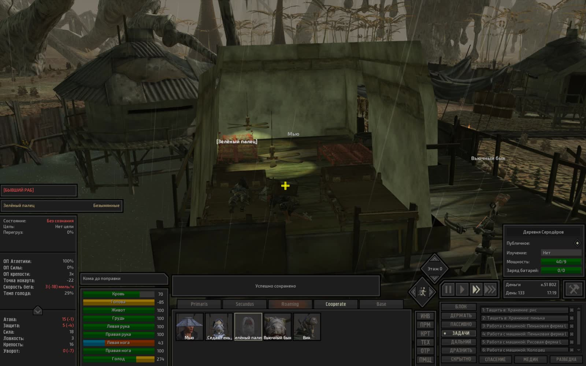

---

### Серия 20 (1 кадр)

- **Файловое время**: с `2026-11-06T01:17:39Z` по `2026-11-06T01:17:39Z`
- **Игровое время (OCR)**: `День 134, 02:43`
- **Локация (OCR)**: Не зафиксирована в UI
- **Персонажи в UI (OCR)**: Вынос мозга
- **Задачи/предметы в UI**: Быть рядом: Мью, Охранять: Мью, Роботехника

**Кадры серии:**
- [screenshot_478-186bff12.jpg](screenshot_478-186bff12.jpg) ([GitHub](https://github.com/asaf1n/Kenshi-Compain/blob/main/published/screenshots/screenshot_478-186bff12.jpg) | [Raw](https://raw.githubusercontent.com/asaf1n/Kenshi-Compain/main/published/screenshots/screenshot_478-186bff12.jpg))

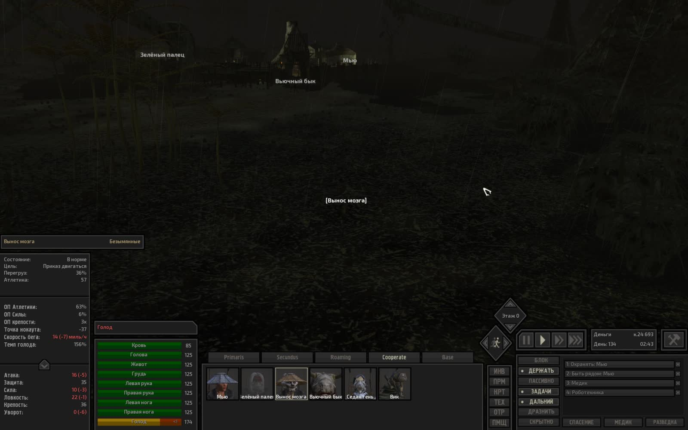

---

### Серия 21 (1 кадр)

- **Файловое время**: с `2026-11-06T01:41:37Z` по `2026-11-06T01:41:37Z`
- **Игровое время (OCR)**: `День 134, 08:06`
- **Локация (OCR)**: Не зафиксирована в UI
- **Персонажи в UI (OCR)**: Вынос мозга
- **Задачи/предметы в UI**: Медик, Турель, охрана: Арбалет-турель МКП [све

**Кадры серии:**
- [screenshot_483-c1cdef7c.jpg](screenshot_483-c1cdef7c.jpg) ([GitHub](https://github.com/asaf1n/Kenshi-Compain/blob/main/published/screenshots/screenshot_483-c1cdef7c.jpg) | [Raw](https://raw.githubusercontent.com/asaf1n/Kenshi-Compain/main/published/screenshots/screenshot_483-c1cdef7c.jpg))

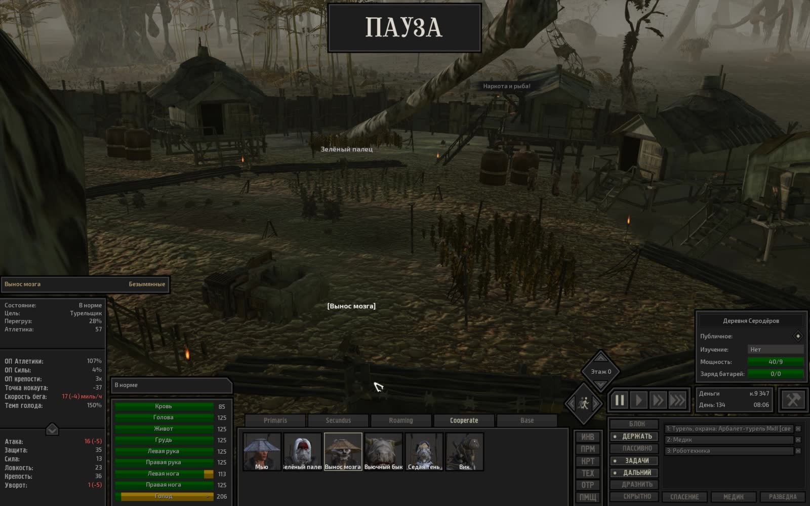

---

### Серия 22 (1 кадр)

- **Файловое время**: с `2026-11-06T14:25:16Z` по `2026-11-06T14:25:16Z`
- **Игровое время (OCR)**: `День 134, 11:46`
- **Локация (OCR)**: Не зафиксирована в UI
- **Персонажи в UI (OCR)**: Не зафиксированы в UI

**Кадры серии:**
- [screenshot_488-78a1f13f.jpg](screenshot_488-78a1f13f.jpg) ([GitHub](https://github.com/asaf1n/Kenshi-Compain/blob/main/published/screenshots/screenshot_488-78a1f13f.jpg) | [Raw](https://raw.githubusercontent.com/asaf1n/Kenshi-Compain/main/published/screenshots/screenshot_488-78a1f13f.jpg))

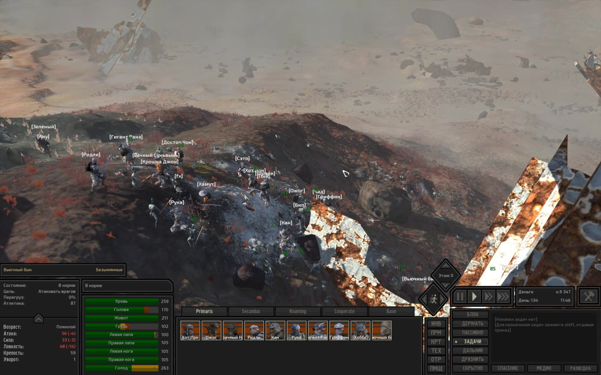

---

### Серия 23 (1 кадр)

- **Файловое время**: с `2026-11-06T14:30:53Z` по `2026-11-06T14:30:53Z`
- **Игровое время (OCR)**: `День 134, 14:19`
- **Локация (OCR)**: Не зафиксирована в UI
- **Персонажи в UI (OCR)**: Шрайк
- **Задачи/предметы в UI**: Быть рядом: Хот Лон, Медик, Роботехника

**Кадры серии:**
- [screenshot_492-a754c5d0.jpg](screenshot_492-a754c5d0.jpg) ([GitHub](https://github.com/asaf1n/Kenshi-Compain/blob/main/published/screenshots/screenshot_492-a754c5d0.jpg) | [Raw](https://raw.githubusercontent.com/asaf1n/Kenshi-Compain/main/published/screenshots/screenshot_492-a754c5d0.jpg))

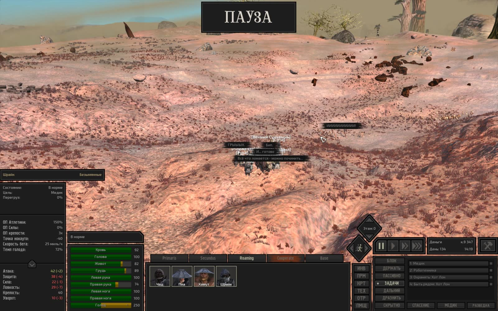

---

### Серия 24 (1 кадр)

- **Файловое время**: с `2026-11-06T20:52:08Z` по `2026-11-06T20:52:08Z`
- **Игровое время (OCR)**: `День 134, 19:41`
- **Локация (OCR)**: Не зафиксирована в UI
- **Персонажи в UI (OCR)**: Не зафиксированы в UI
- **Задачи/предметы в UI**: Быть рядом: Хот Лон, Охранять: Хот Лон

**Кадры серии:**
- [screenshot_497-79329064.jpg](screenshot_497-79329064.jpg) ([GitHub](https://github.com/asaf1n/Kenshi-Compain/blob/main/published/screenshots/screenshot_497-79329064.jpg) | [Raw](https://raw.githubusercontent.com/asaf1n/Kenshi-Compain/main/published/screenshots/screenshot_497-79329064.jpg))

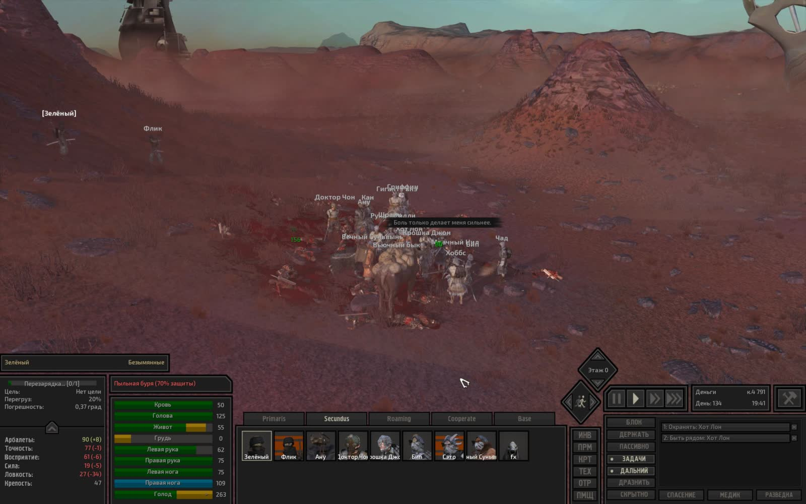

---

### Серия 25 (1 кадр)

- **Файловое время**: с `2026-11-06T22:48:59Z` по `2026-11-06T22:48:59Z`
- **Игровое время (OCR)**: `День 135, 04:19`
- **Локация (OCR)**: Не зафиксирована в UI
- **Персонажи в UI (OCR)**: Не зафиксированы в UI
- **Задачи/предметы в UI**: Работа с машиной: Кухонная плита, Работа с машиной: Рисовая ферма 1-, Тащить в: Хранение: еда, Тащить в: Хранение: рис

**Кадры серии:**
- [screenshot_502-d40116c4.jpg](screenshot_502-d40116c4.jpg) ([GitHub](https://github.com/asaf1n/Kenshi-Compain/blob/main/published/screenshots/screenshot_502-d40116c4.jpg) | [Raw](https://raw.githubusercontent.com/asaf1n/Kenshi-Compain/main/published/screenshots/screenshot_502-d40116c4.jpg))

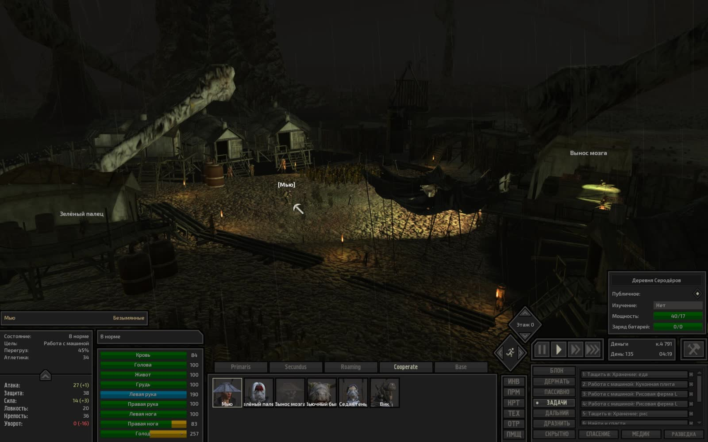

---

### Серия 26 (1 кадр)

- **Файловое время**: с `2026-11-06T22:59:55Z` по `2026-11-06T22:59:55Z`
- **Игровое время (OCR)**: `День 135, 08:55`
- **Локация (OCR)**: Не зафиксирована в UI
- **Персонажи в UI (OCR)**: Генин
- **Задачи/предметы в UI**: Работа с машиной: Кухонная плита, Работа с машиной: Рисовая ферма 1-, Тащить в: Хранение: еда, Тащить в: Хранение: рис

**Кадры серии:**
- [screenshot_506-996d742f.jpg](screenshot_506-996d742f.jpg) ([GitHub](https://github.com/asaf1n/Kenshi-Compain/blob/main/published/screenshots/screenshot_506-996d742f.jpg) | [Raw](https://raw.githubusercontent.com/asaf1n/Kenshi-Compain/main/published/screenshots/screenshot_506-996d742f.jpg))

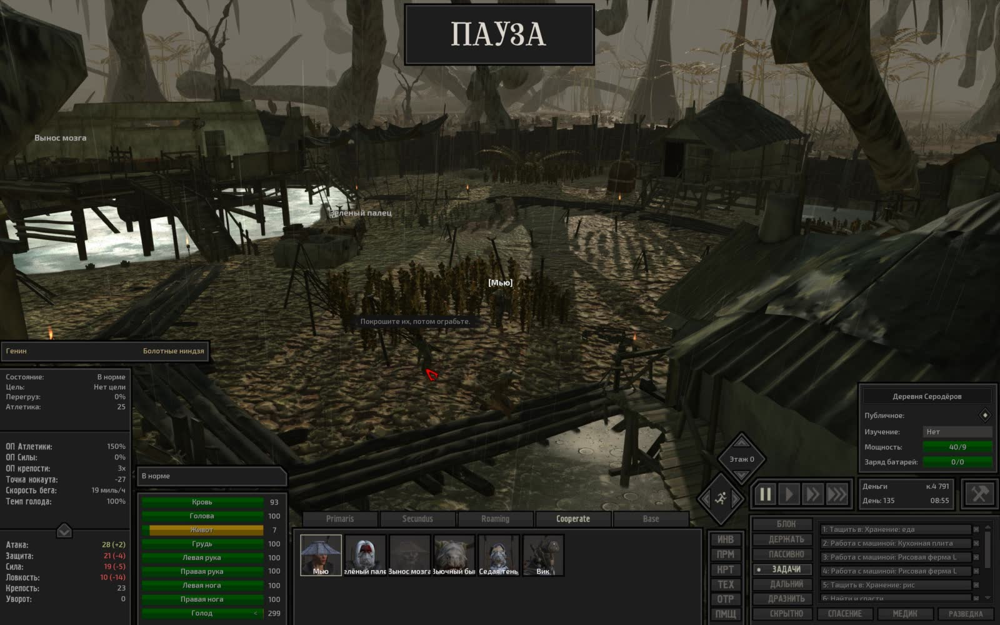

---

### Серия 27 (1 кадр)

- **Файловое время**: с `2026-11-09T04:16:01Z` по `2026-11-09T04:16:01Z`
- **Игровое время (OCR)**: `День 135, 13:21`
- **Локация (OCR)**: Не зафиксирована в UI
- **Персонажи в UI (OCR)**: Не зафиксированы в UI

**Кадры серии:**
- [screenshot_544-24e240fd.jpg](screenshot_544-24e240fd.jpg) ([GitHub](https://github.com/asaf1n/Kenshi-Compain/blob/main/published/screenshots/screenshot_544-24e240fd.jpg) | [Raw](https://raw.githubusercontent.com/asaf1n/Kenshi-Compain/main/published/screenshots/screenshot_544-24e240fd.jpg))

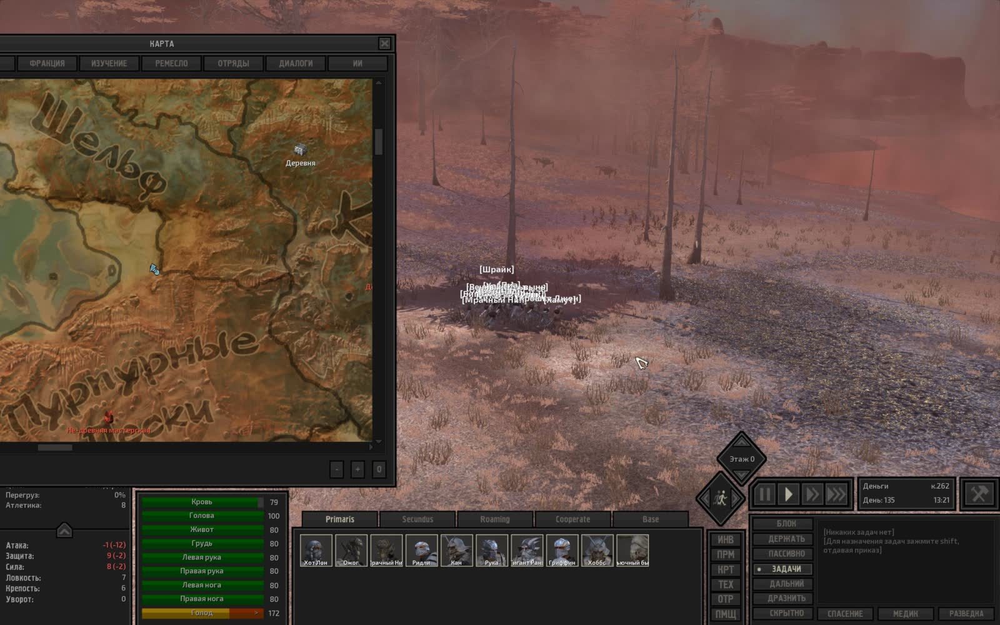

---

### Серия 28 (1 кадр)

- **Файловое время**: с `2026-11-09T05:04:26Z` по `2026-11-09T05:04:26Z`
- **Игровое время (OCR)**: `День 135, 18:48`
- **Локация (OCR)**: Не зафиксирована в UI
- **Персонажи в UI (OCR)**: Не зафиксированы в UI
- **Задачи/предметы в UI**: Медик, Роботехника

**Кадры серии:**
- [screenshot_548-e7fc970b.jpg](screenshot_548-e7fc970b.jpg) ([GitHub](https://github.com/asaf1n/Kenshi-Compain/blob/main/published/screenshots/screenshot_548-e7fc970b.jpg) | [Raw](https://raw.githubusercontent.com/asaf1n/Kenshi-Compain/main/published/screenshots/screenshot_548-e7fc970b.jpg))

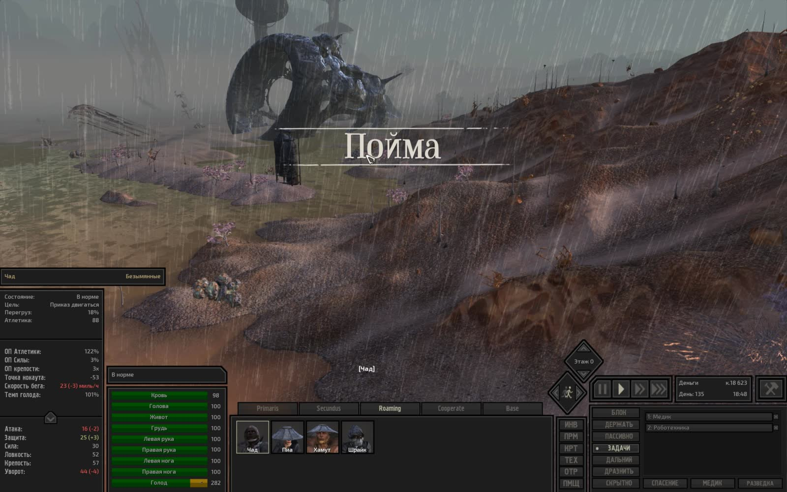

---

### Серия 29 (1 кадр)

- **Файловое время**: с `2026-11-09T23:03:28Z` по `2026-11-09T23:03:28Z`
- **Игровое время (OCR)**: `День 136, 00:03`
- **Локация (OCR)**: Не зафиксирована в UI
- **Персонажи в UI (OCR)**: Не зафиксированы в UI
- **Задачи/предметы в UI**: Медик, Охранять: Вик

**Кадры серии:**
- [screenshot_552-3e994ccb.jpg](screenshot_552-3e994ccb.jpg) ([GitHub](https://github.com/asaf1n/Kenshi-Compain/blob/main/published/screenshots/screenshot_552-3e994ccb.jpg) | [Raw](https://raw.githubusercontent.com/asaf1n/Kenshi-Compain/main/published/screenshots/screenshot_552-3e994ccb.jpg))

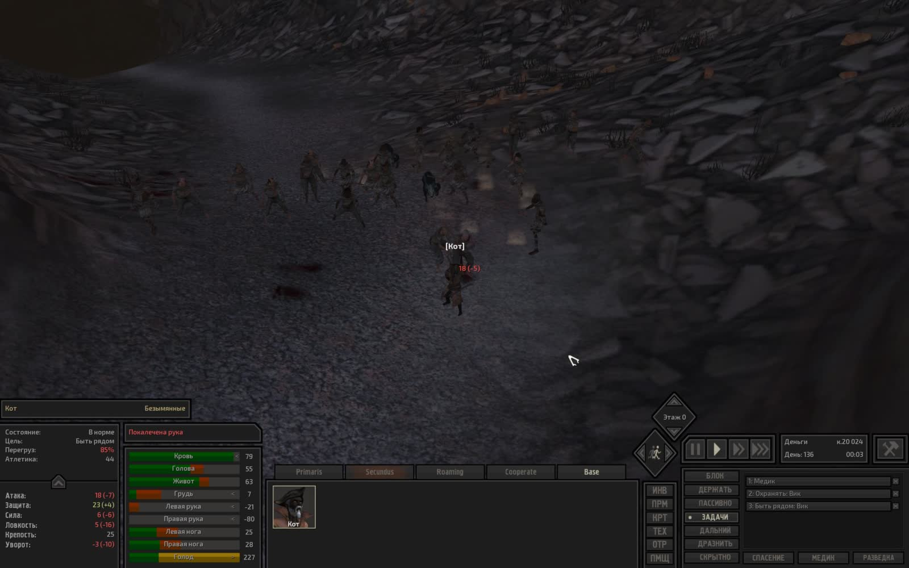

---

### Серия 30 (1 кадр)

- **Файловое время**: с `2026-11-09T23:05:14Z` по `2026-11-09T23:05:14Z`
- **Игровое время (OCR)**: `День 136, 00:07`
- **Локация (OCR)**: Не зафиксирована в UI
- **Персонажи в UI (OCR)**: Не зафиксированы в UI
- **Задачи/предметы в UI**: Атаковать врагов

**Кадры серии:**
- [screenshot_553-bb38c273.jpg](screenshot_553-bb38c273.jpg) ([GitHub](https://github.com/asaf1n/Kenshi-Compain/blob/main/published/screenshots/screenshot_553-bb38c273.jpg) | [Raw](https://raw.githubusercontent.com/asaf1n/Kenshi-Compain/main/published/screenshots/screenshot_553-bb38c273.jpg))

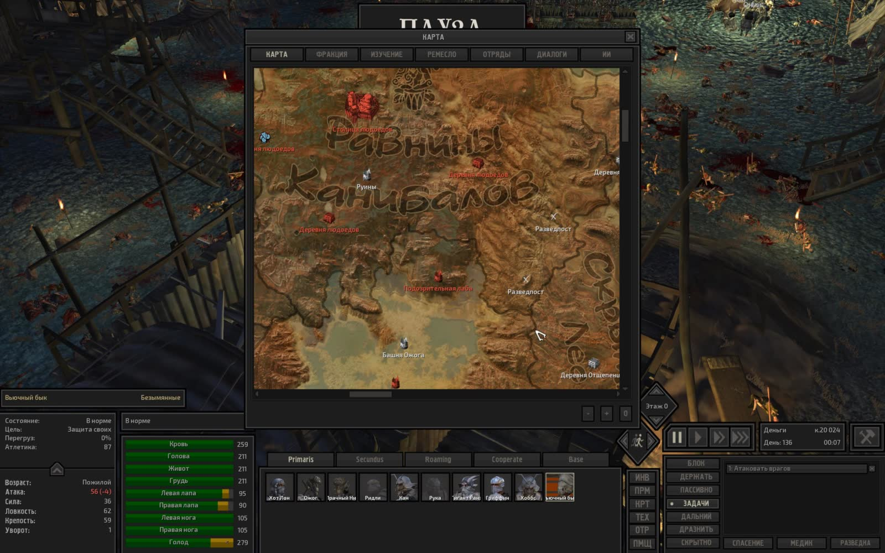

---
