# Техническая лента скриншотов Kenshi

- **Сформировано**: `2026-11-06T21:57:56Z`
- **Окно выборки**: последние 7 суток (с `2026-10-30T21:57:56Z` по `2026-11-06T21:57:56Z`)
- **Всего скриншотов в окне**: 30
- **Сгруппировано серий/кадров**: 30

Техническая лента сгруппированных по сходству кадров с извлеченным текстом интерфейса (OCR). Интерпретация происходящего в игре полностью принадлежит LLM-компаньону по оригинальным изображениям.

---

### Серия 1 (1 кадр)

- **Файловое время**: с `2026-10-31T02:00:06Z` по `2026-10-31T02:00:06Z`
- **Игровое время (OCR)**: `День 116, 17:11`
- **Локация (OCR)**: Не зафиксирована в UI
- **Персонажи в UI (OCR)**: Не зафиксированы в UI
- **Задачи/предметы в UI**: Медик, Охранять: Хоббс

**Кадры серии:**
- [screenshot_199-360b4a1c.jpg](screenshot_199-360b4a1c.jpg) ([GitHub](https://github.com/asaf1n/Kenshi-Compain/blob/main/published/screenshots/screenshot_199-360b4a1c.jpg) | [Raw](https://raw.githubusercontent.com/asaf1n/Kenshi-Compain/main/published/screenshots/screenshot_199-360b4a1c.jpg))

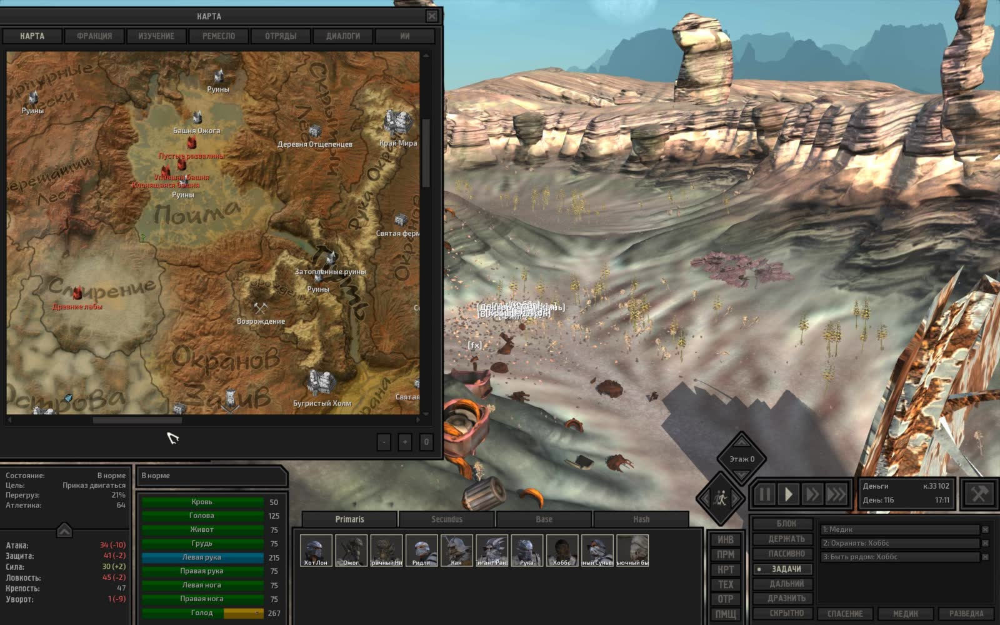

---

### Серия 2 (1 кадр)

- **Файловое время**: с `2026-10-31T04:37:39Z` по `2026-10-31T04:37:39Z`
- **Игровое время (OCR)**: `День 117, 05:19`
- **Локация (OCR)**: Не зафиксирована в UI
- **Персонажи в UI (OCR)**: Святой Лорд Феникс
- **Задачи/предметы в UI**: Медик, Роботехника

**Кадры серии:**
- [screenshot_209-6806fc9e.jpg](screenshot_209-6806fc9e.jpg) ([GitHub](https://github.com/asaf1n/Kenshi-Compain/blob/main/published/screenshots/screenshot_209-6806fc9e.jpg) | [Raw](https://raw.githubusercontent.com/asaf1n/Kenshi-Compain/main/published/screenshots/screenshot_209-6806fc9e.jpg))

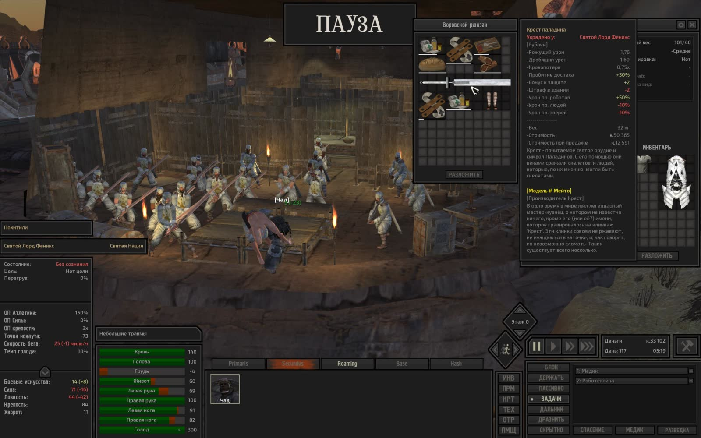

---

### Серия 3 (1 кадр)

- **Файловое время**: с `2026-10-31T08:32:59Z` по `2026-10-31T08:32:59Z`
- **Игровое время (OCR)**: `День 117, 18:58`
- **Локация (OCR)**: Не зафиксирована в UI
- **Персонажи в UI (OCR)**: Баян
- **Задачи/предметы в UI**: Медик, Роботехника

**Кадры серии:**
- [screenshot_218-08fb047d.jpg](screenshot_218-08fb047d.jpg) ([GitHub](https://github.com/asaf1n/Kenshi-Compain/blob/main/published/screenshots/screenshot_218-08fb047d.jpg) | [Raw](https://raw.githubusercontent.com/asaf1n/Kenshi-Compain/main/published/screenshots/screenshot_218-08fb047d.jpg))

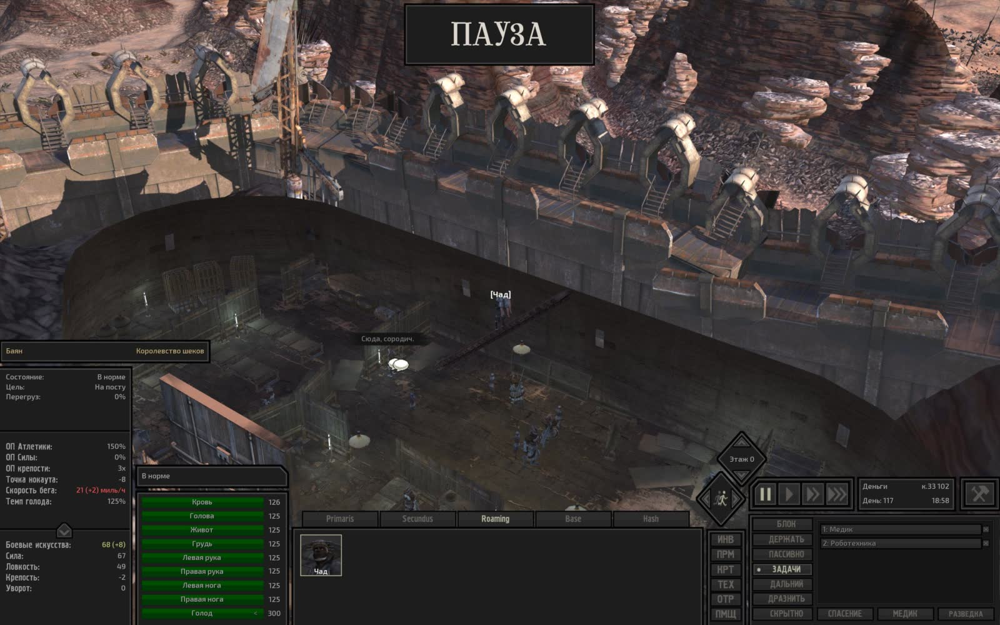

---

### Серия 4 (1 кадр)

- **Файловое время**: с `2026-10-31T11:46:44Z` по `2026-10-31T11:46:44Z`
- **Игровое время (OCR)**: `День 117, 23:23`
- **Локация (OCR)**: Не зафиксирована в UI
- **Персонажи в UI (OCR)**: Сэто

**Кадры серии:**
- [screenshot_228-bea096bd.jpg](screenshot_228-bea096bd.jpg) ([GitHub](https://github.com/asaf1n/Kenshi-Compain/blob/main/published/screenshots/screenshot_228-bea096bd.jpg) | [Raw](https://raw.githubusercontent.com/asaf1n/Kenshi-Compain/main/published/screenshots/screenshot_228-bea096bd.jpg))

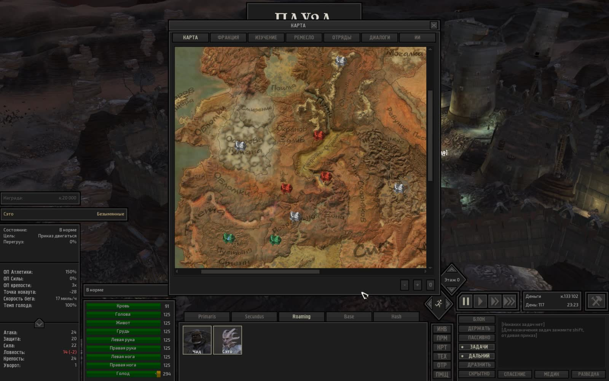

---

### Серия 5 (1 кадр)

- **Файловое время**: с `2026-10-31T12:32:20Z` по `2026-10-31T12:32:20Z`
- **Игровое время (OCR)**: `День 118, 12:04`
- **Локация (OCR)**: Не зафиксирована в UI
- **Персонажи в UI (OCR)**: Не зафиксированы в UI
- **Задачи/предметы в UI**: Быть рядом: Зелёный, Охранять: Зелёный

**Кадры серии:**
- [screenshot_237-960f2c0a.jpg](screenshot_237-960f2c0a.jpg) ([GitHub](https://github.com/asaf1n/Kenshi-Compain/blob/main/published/screenshots/screenshot_237-960f2c0a.jpg) | [Raw](https://raw.githubusercontent.com/asaf1n/Kenshi-Compain/main/published/screenshots/screenshot_237-960f2c0a.jpg))

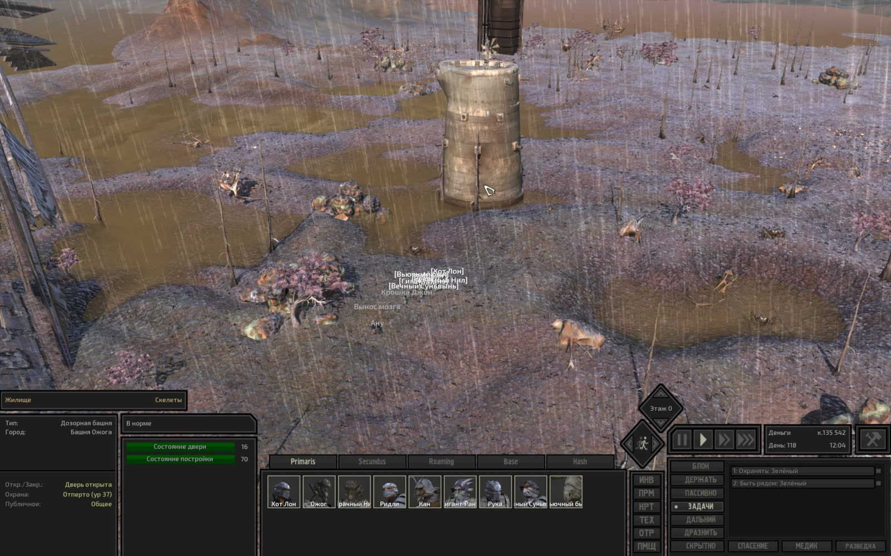

---

### Серия 6 (1 кадр)

- **Файловое время**: с `2026-11-01T01:36:20Z` по `2026-11-01T01:36:20Z`
- **Игровое время (OCR)**: `Не зафиксировано в UI`
- **Локация (OCR)**: Не зафиксирована в UI
- **Персонажи в UI (OCR)**: Гриффин
- **Задачи/предметы в UI**: Быть рядом: Зелёный, Медик, Роботехника

**Кадры серии:**
- [screenshot_258-3b763da3.jpg](screenshot_258-3b763da3.jpg) ([GitHub](https://github.com/asaf1n/Kenshi-Compain/blob/main/published/screenshots/screenshot_258-3b763da3.jpg) | [Raw](https://raw.githubusercontent.com/asaf1n/Kenshi-Compain/main/published/screenshots/screenshot_258-3b763da3.jpg))

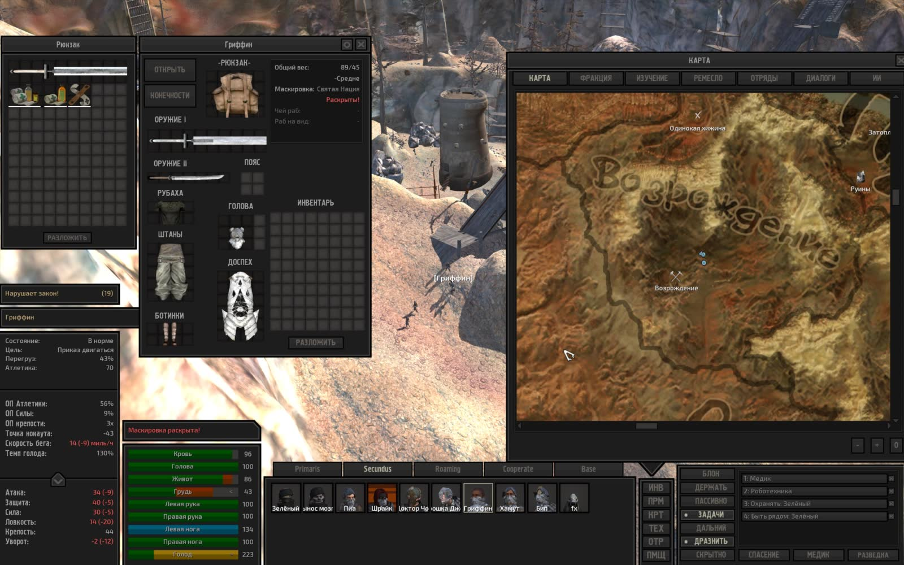

---

### Серия 7 (1 кадр)

- **Файловое время**: с `2026-11-01T04:31:01Z` по `2026-11-01T04:31:01Z`
- **Игровое время (OCR)**: `День 121, 07:37`
- **Локация (OCR)**: Не зафиксирована в UI
- **Персонажи в UI (OCR)**: Не зафиксированы в UI
- **Задачи/предметы в UI**: Медик, Роботехника

**Кадры серии:**
- [screenshot_267-fe6953ba.jpg](screenshot_267-fe6953ba.jpg) ([GitHub](https://github.com/asaf1n/Kenshi-Compain/blob/main/published/screenshots/screenshot_267-fe6953ba.jpg) | [Raw](https://raw.githubusercontent.com/asaf1n/Kenshi-Compain/main/published/screenshots/screenshot_267-fe6953ba.jpg))

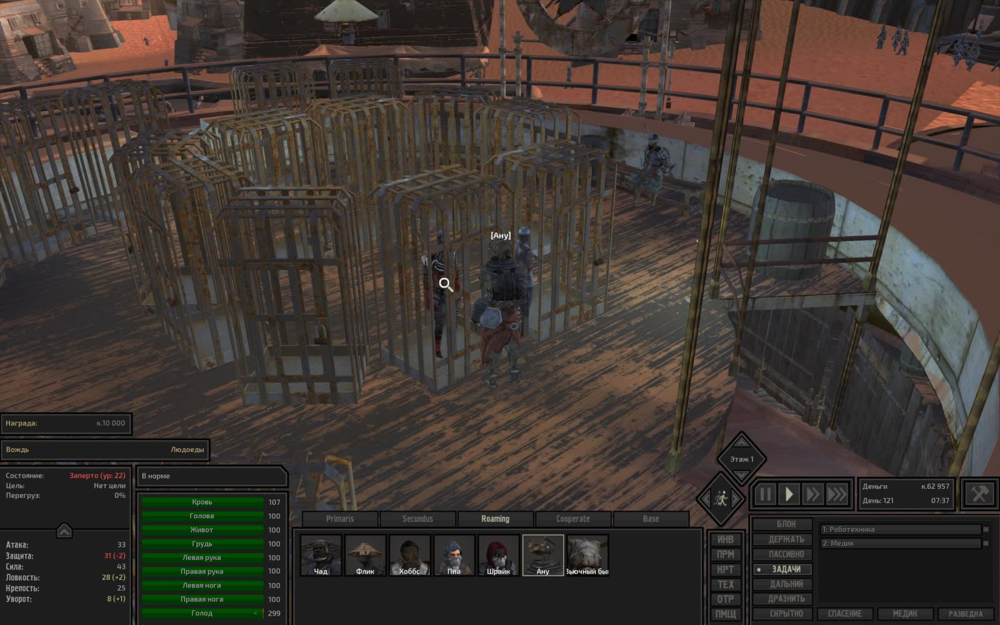

---

### Серия 8 (1 кадр)

- **Файловое время**: с `2026-11-01T09:34:49Z` по `2026-11-01T09:34:49Z`
- **Игровое время (OCR)**: `День 122, 06:03`
- **Локация (OCR)**: Не зафиксирована в UI
- **Персонажи в UI (OCR)**: Вьючный бык
- **Задачи/предметы в UI**: Быть рядом: Хот Лон, Охранять: Хот Лон

**Кадры серии:**
- [screenshot_278-33a651f3.jpg](screenshot_278-33a651f3.jpg) ([GitHub](https://github.com/asaf1n/Kenshi-Compain/blob/main/published/screenshots/screenshot_278-33a651f3.jpg) | [Raw](https://raw.githubusercontent.com/asaf1n/Kenshi-Compain/main/published/screenshots/screenshot_278-33a651f3.jpg))

---

### Серия 9 (1 кадр)

- **Файловое время**: с `2026-11-01T10:28:21Z` по `2026-11-01T10:28:21Z`
- **Игровое время (OCR)**: `День 122, 14:19`
- **Локация (OCR)**: Не зафиксирована в UI
- **Персонажи в UI (OCR)**: Великий шаман

**Кадры серии:**
- [screenshot_289-7187cd80.jpg](screenshot_289-7187cd80.jpg) ([GitHub](https://github.com/asaf1n/Kenshi-Compain/blob/main/published/screenshots/screenshot_289-7187cd80.jpg) | [Raw](https://raw.githubusercontent.com/asaf1n/Kenshi-Compain/main/published/screenshots/screenshot_289-7187cd80.jpg))

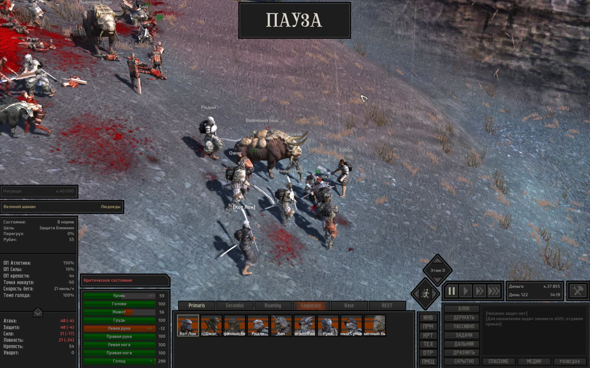

---

### Серия 10 (1 кадр)

- **Файловое время**: с `2026-11-01T10:35:37Z` по `2026-11-01T10:35:37Z`
- **Игровое время (OCR)**: `День 122, 16:47`
- **Локация (OCR)**: Не зафиксирована в UI
- **Персонажи в UI (OCR)**: Хот Лон

**Кадры серии:**
- [screenshot_298-deb3e75d.jpg](screenshot_298-deb3e75d.jpg) ([GitHub](https://github.com/asaf1n/Kenshi-Compain/blob/main/published/screenshots/screenshot_298-deb3e75d.jpg) | [Raw](https://raw.githubusercontent.com/asaf1n/Kenshi-Compain/main/published/screenshots/screenshot_298-deb3e75d.jpg))

---

### Серия 11 (1 кадр)

- **Файловое время**: с `2026-11-01T11:48:31Z` по `2026-11-01T11:48:31Z`
- **Игровое время (OCR)**: `День 123, 18:25`
- **Локация (OCR)**: Не зафиксирована в UI
- **Персонажи в UI (OCR)**: Флик
- **Задачи/предметы в UI**: Медик, Роботехника

**Кадры серии:**
- [screenshot_308-1f02e349.jpg](screenshot_308-1f02e349.jpg) ([GitHub](https://github.com/asaf1n/Kenshi-Compain/blob/main/published/screenshots/screenshot_308-1f02e349.jpg) | [Raw](https://raw.githubusercontent.com/asaf1n/Kenshi-Compain/main/published/screenshots/screenshot_308-1f02e349.jpg))

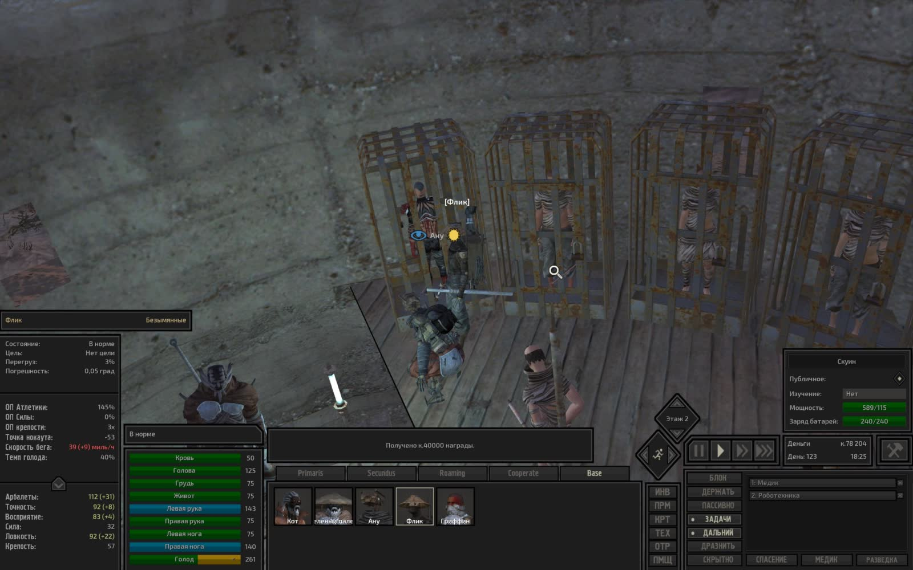

---

### Серия 12 (1 кадр)

- **Файловое время**: с `2026-11-01T12:20:30Z` по `2026-11-01T12:20:30Z`
- **Игровое время (OCR)**: `Не зафиксировано в UI`
- **Локация (OCR)**: Не зафиксирована в UI
- **Персонажи в UI (OCR)**: Ану

**Кадры серии:**
- [screenshot_317-14e1c482.jpg](screenshot_317-14e1c482.jpg) ([GitHub](https://github.com/asaf1n/Kenshi-Compain/blob/main/published/screenshots/screenshot_317-14e1c482.jpg) | [Raw](https://raw.githubusercontent.com/asaf1n/Kenshi-Compain/main/published/screenshots/screenshot_317-14e1c482.jpg))

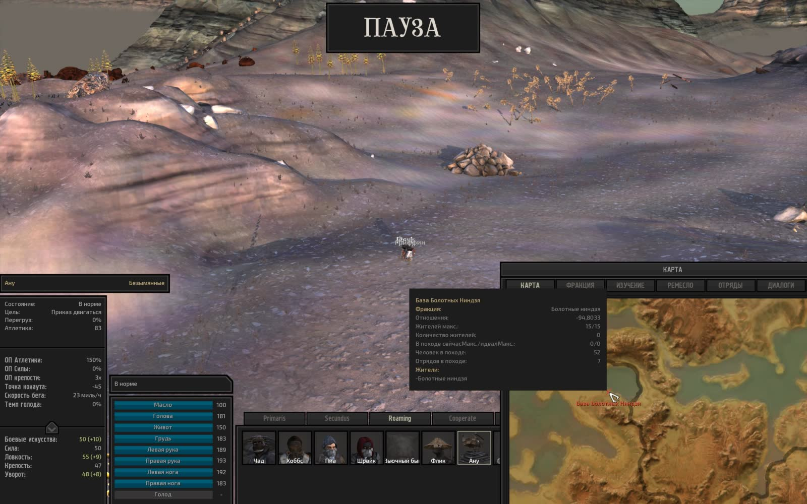

---

### Серия 13 (1 кадр)

- **Файловое время**: с `2026-11-01T13:09:04Z` по `2026-11-01T13:09:04Z`
- **Игровое время (OCR)**: `День 124, 16:39`
- **Локация (OCR)**: Не зафиксирована в UI
- **Персонажи в UI (OCR)**: Охранный паук
- **Задачи/предметы в UI**: Медик, Роботехника

**Кадры серии:**
- [screenshot_330-2f8faa62.jpg](screenshot_330-2f8faa62.jpg) ([GitHub](https://github.com/asaf1n/Kenshi-Compain/blob/main/published/screenshots/screenshot_330-2f8faa62.jpg) | [Raw](https://raw.githubusercontent.com/asaf1n/Kenshi-Compain/main/published/screenshots/screenshot_330-2f8faa62.jpg))

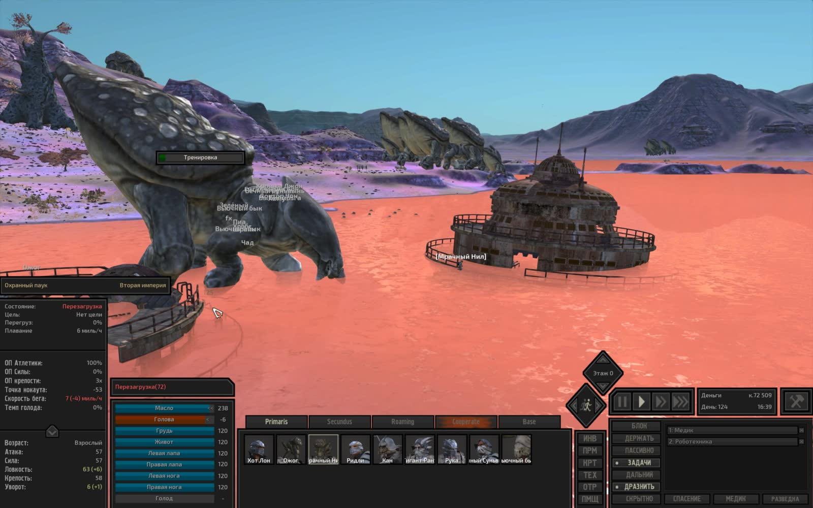

---

### Серия 14 (1 кадр)

- **Файловое время**: с `2026-11-01T17:42:49Z` по `2026-11-01T17:42:49Z`
- **Игровое время (OCR)**: `День 126, 20:29`
- **Локация (OCR)**: Не зафиксирована в UI
- **Персонажи в UI (OCR)**: Не зафиксированы в UI
- **Задачи/предметы в UI**: Быть рядом: Хот Лон, Охранять: Хот Лон

**Кадры серии:**
- [screenshot_350-ad545549.jpg](screenshot_350-ad545549.jpg) ([GitHub](https://github.com/asaf1n/Kenshi-Compain/blob/main/published/screenshots/screenshot_350-ad545549.jpg) | [Raw](https://raw.githubusercontent.com/asaf1n/Kenshi-Compain/main/published/screenshots/screenshot_350-ad545549.jpg))

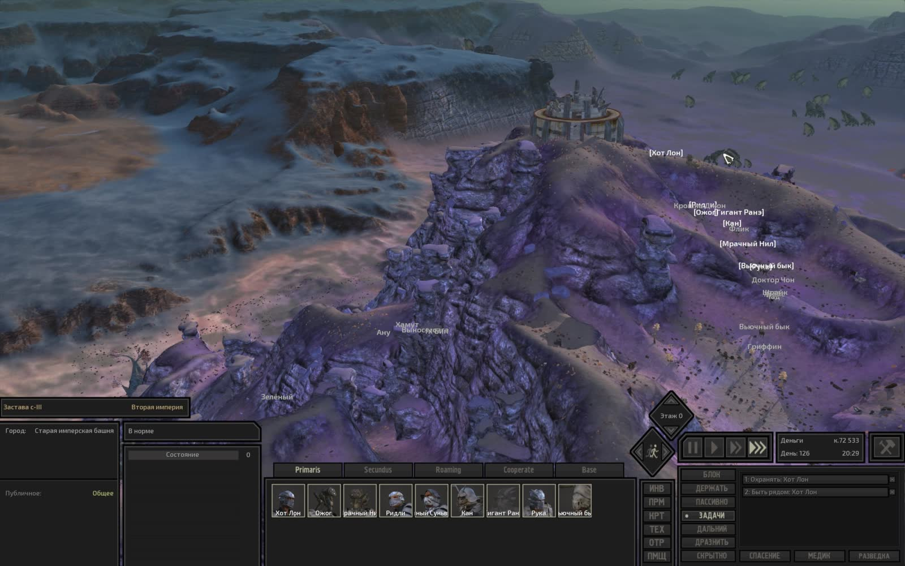

---

### Серия 15 (1 кадр)

- **Файловое время**: с `2026-11-02T00:08:26Z` по `2026-11-02T00:08:26Z`
- **Игровое время (OCR)**: `День 127, 13:26`
- **Локация (OCR)**: Не зафиксирована в UI
- **Персонажи в UI (OCR)**: Вьючный бык
- **Задачи/предметы в UI**: Быть рядом: Вьючный бык, Охранять: Вьючный бык

**Кадры серии:**
- [screenshot_361-59105db9.jpg](screenshot_361-59105db9.jpg) ([GitHub](https://github.com/asaf1n/Kenshi-Compain/blob/main/published/screenshots/screenshot_361-59105db9.jpg) | [Raw](https://raw.githubusercontent.com/asaf1n/Kenshi-Compain/main/published/screenshots/screenshot_361-59105db9.jpg))

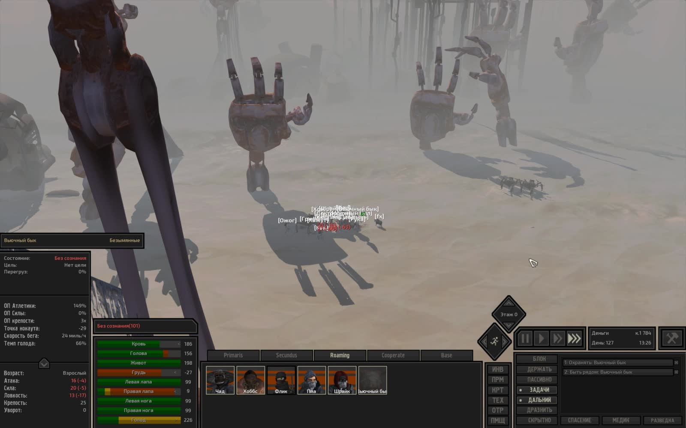

---

### Серия 16 (1 кадр)

- **Файловое время**: с `2026-11-02T01:05:16Z` по `2026-11-02T01:05:16Z`
- **Игровое время (OCR)**: `День 127, 20:41`
- **Локация (OCR)**: Не зафиксирована в UI
- **Персонажи в UI (OCR)**: Хот Лон

**Кадры серии:**
- [screenshot_371-22ba94ff.jpg](screenshot_371-22ba94ff.jpg) ([GitHub](https://github.com/asaf1n/Kenshi-Compain/blob/main/published/screenshots/screenshot_371-22ba94ff.jpg) | [Raw](https://raw.githubusercontent.com/asaf1n/Kenshi-Compain/main/published/screenshots/screenshot_371-22ba94ff.jpg))

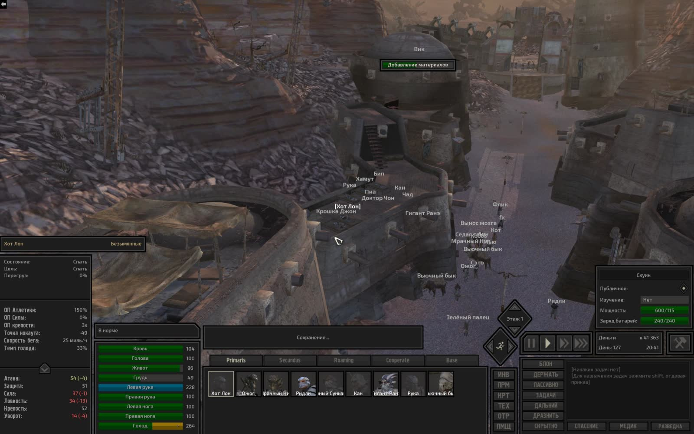

---

### Серия 17 (1 кадр)

- **Файловое время**: с `2026-11-03T01:24:25Z` по `2026-11-03T01:24:25Z`
- **Игровое время (OCR)**: `День 129, 19:52`
- **Локация (OCR)**: Не зафиксирована в UI
- **Персонажи в UI (OCR)**: Вьючный бык

**Кадры серии:**
- [screenshot_380-654b2e7f.jpg](screenshot_380-654b2e7f.jpg) ([GitHub](https://github.com/asaf1n/Kenshi-Compain/blob/main/published/screenshots/screenshot_380-654b2e7f.jpg) | [Raw](https://raw.githubusercontent.com/asaf1n/Kenshi-Compain/main/published/screenshots/screenshot_380-654b2e7f.jpg))

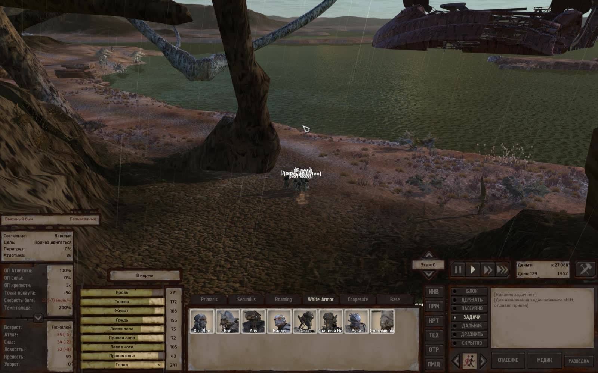

---

### Серия 18 (1 кадр)

- **Файловое время**: с `2026-11-03T01:34:13Z` по `2026-11-03T01:34:13Z`
- **Игровое время (OCR)**: `День 129, 23:42`
- **Локация (OCR)**: Не зафиксирована в UI
- **Персонажи в UI (OCR)**: Сэто
- **Задачи/предметы в UI**: Медик, Роботехника

**Кадры серии:**
- [screenshot_391-e8b02fc2.jpg](screenshot_391-e8b02fc2.jpg) ([GitHub](https://github.com/asaf1n/Kenshi-Compain/blob/main/published/screenshots/screenshot_391-e8b02fc2.jpg) | [Raw](https://raw.githubusercontent.com/asaf1n/Kenshi-Compain/main/published/screenshots/screenshot_391-e8b02fc2.jpg))

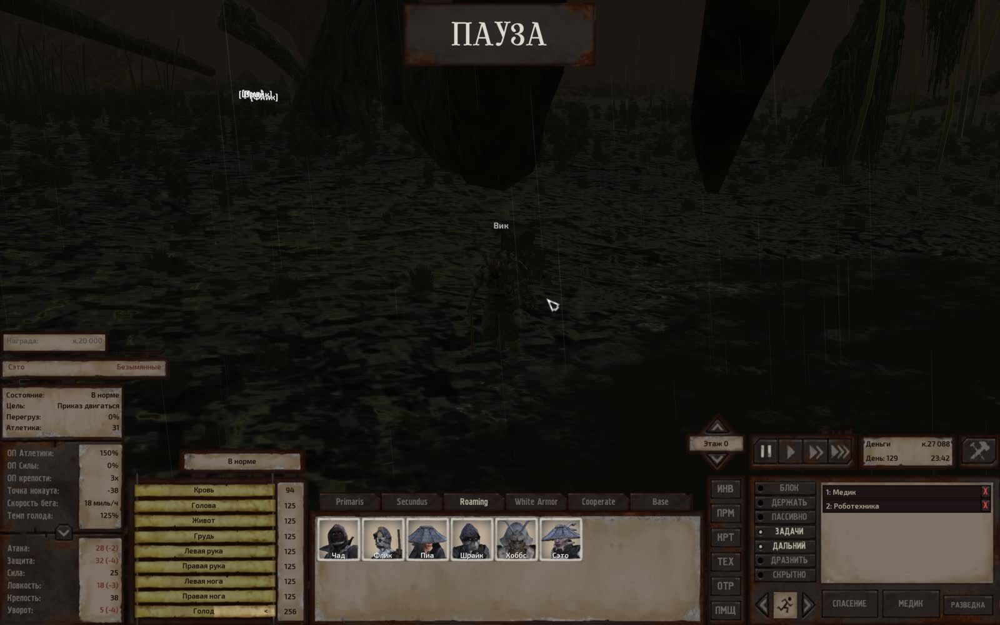

---

### Серия 19 (1 кадр)

- **Файловое время**: с `2026-11-03T02:12:10Z` по `2026-11-03T02:12:10Z`
- **Игровое время (OCR)**: `День 130, 06:55`
- **Локация (OCR)**: Не зафиксирована в UI
- **Персонажи в UI (OCR)**: Вьючный бык

**Кадры серии:**
- [screenshot_402-43871cf0.jpg](screenshot_402-43871cf0.jpg) ([GitHub](https://github.com/asaf1n/Kenshi-Compain/blob/main/published/screenshots/screenshot_402-43871cf0.jpg) | [Raw](https://raw.githubusercontent.com/asaf1n/Kenshi-Compain/main/published/screenshots/screenshot_402-43871cf0.jpg))

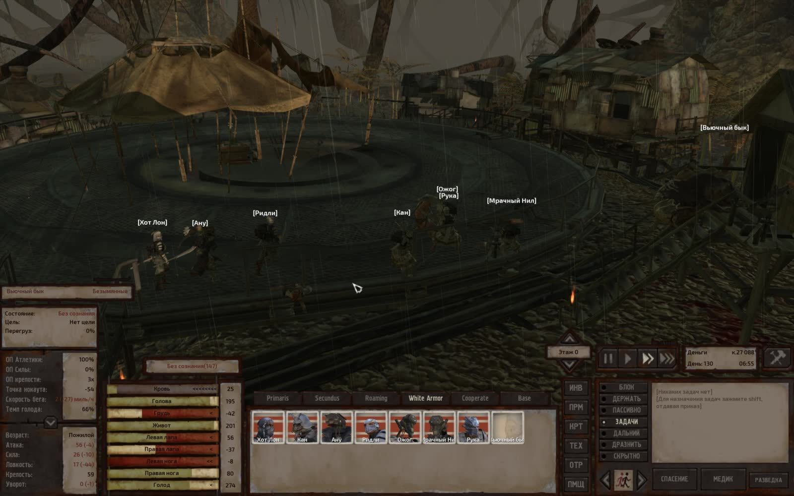

---

### Серия 20 (1 кадр)

- **Файловое время**: с `2026-11-03T02:45:39Z` по `2026-11-03T02:45:39Z`
- **Игровое время (OCR)**: `День 130, 09:35`
- **Локация (OCR)**: Не зафиксирована в UI
- **Персонажи в UI (OCR)**: флик
- **Задачи/предметы в UI**: Быть рядом: Хот Лон, Охранять: Хот Лон

**Кадры серии:**
- [screenshot_413-d041bb81.jpg](screenshot_413-d041bb81.jpg) ([GitHub](https://github.com/asaf1n/Kenshi-Compain/blob/main/published/screenshots/screenshot_413-d041bb81.jpg) | [Raw](https://raw.githubusercontent.com/asaf1n/Kenshi-Compain/main/published/screenshots/screenshot_413-d041bb81.jpg))

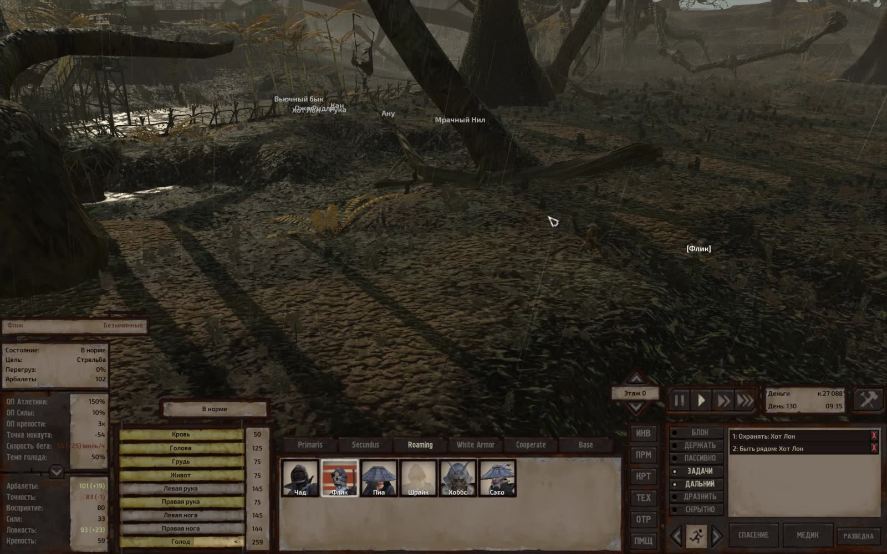

---

### Серия 21 (1 кадр)

- **Файловое время**: с `2026-11-03T06:40:05Z` по `2026-11-03T06:40:05Z`
- **Игровое время (OCR)**: `День 131, 02:52`
- **Локация (OCR)**: Не зафиксирована в UI
- **Персонажи в UI (OCR)**: Не зафиксированы в UI
- **Задачи/предметы в UI**: Быть рядом: Хот Лон, Медик, Роботехника

**Кадры серии:**
- [screenshot_423-044ef2f1.jpg](screenshot_423-044ef2f1.jpg) ([GitHub](https://github.com/asaf1n/Kenshi-Compain/blob/main/published/screenshots/screenshot_423-044ef2f1.jpg) | [Raw](https://raw.githubusercontent.com/asaf1n/Kenshi-Compain/main/published/screenshots/screenshot_423-044ef2f1.jpg))

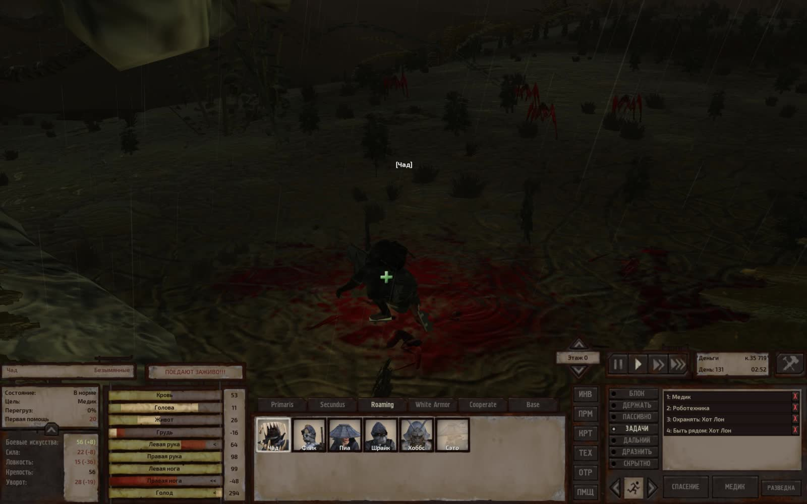

---

### Серия 22 (1 кадр)

- **Файловое время**: с `2026-11-04T20:49:42Z` по `2026-11-04T20:49:42Z`
- **Игровое время (OCR)**: `День 133, 05:09`
- **Локация (OCR)**: Не зафиксирована в UI
- **Персонажи в UI (OCR)**: Не зафиксированы в UI
- **Задачи/предметы в UI**: Быть рядом: Хот Лон, Медик, Роботехника

**Кадры серии:**
- [screenshot_444-fa464e38.jpg](screenshot_444-fa464e38.jpg) ([GitHub](https://github.com/asaf1n/Kenshi-Compain/blob/main/published/screenshots/screenshot_444-fa464e38.jpg) | [Raw](https://raw.githubusercontent.com/asaf1n/Kenshi-Compain/main/published/screenshots/screenshot_444-fa464e38.jpg))

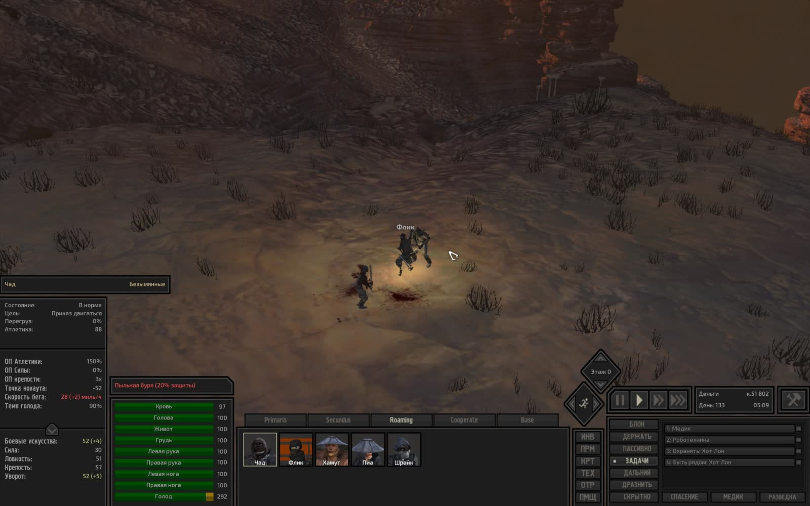

---

### Серия 23 (1 кадр)

- **Файловое время**: с `2026-11-06T00:22:15Z` по `2026-11-06T00:22:15Z`
- **Игровое время (OCR)**: `День 133, 12:35`
- **Локация (OCR)**: Не зафиксирована в UI
- **Персонажи в UI (OCR)**: Пиа
- **Задачи/предметы в UI**: Медик, Роботехника

**Кадры серии:**
- [screenshot_457-371c1c7a.jpg](screenshot_457-371c1c7a.jpg) ([GitHub](https://github.com/asaf1n/Kenshi-Compain/blob/main/published/screenshots/screenshot_457-371c1c7a.jpg) | [Raw](https://raw.githubusercontent.com/asaf1n/Kenshi-Compain/main/published/screenshots/screenshot_457-371c1c7a.jpg))

---

### Серия 24 (1 кадр)

- **Файловое время**: с `2026-11-06T00:31:34Z` по `2026-11-06T00:31:34Z`
- **Игровое время (OCR)**: `День 133, 15:18`
- **Локация (OCR)**: Не зафиксирована в UI
- **Персонажи в UI (OCR)**: Не зафиксированы в UI
- **Задачи/предметы в UI**: Быть рядом: Хот Лон, Охранять: Хот Лон

**Кадры серии:**
- [screenshot_469-94f74eea.jpg](screenshot_469-94f74eea.jpg) ([GitHub](https://github.com/asaf1n/Kenshi-Compain/blob/main/published/screenshots/screenshot_469-94f74eea.jpg) | [Raw](https://raw.githubusercontent.com/asaf1n/Kenshi-Compain/main/published/screenshots/screenshot_469-94f74eea.jpg))

---

### Серия 25 (1 кадр)

- **Файловое время**: с `2026-11-06T01:18:24Z` по `2026-11-06T01:18:24Z`
- **Игровое время (OCR)**: `День 134, 03:03`
- **Локация (OCR)**: Не зафиксирована в UI
- **Персонажи в UI (OCR)**: Вынос мозга
- **Задачи/предметы в UI**: Быть рядом: Мью, Охранять: Мью, Роботехника

**Кадры серии:**
- [screenshot_479-7a049502.jpg](screenshot_479-7a049502.jpg) ([GitHub](https://github.com/asaf1n/Kenshi-Compain/blob/main/published/screenshots/screenshot_479-7a049502.jpg) | [Raw](https://raw.githubusercontent.com/asaf1n/Kenshi-Compain/main/published/screenshots/screenshot_479-7a049502.jpg))

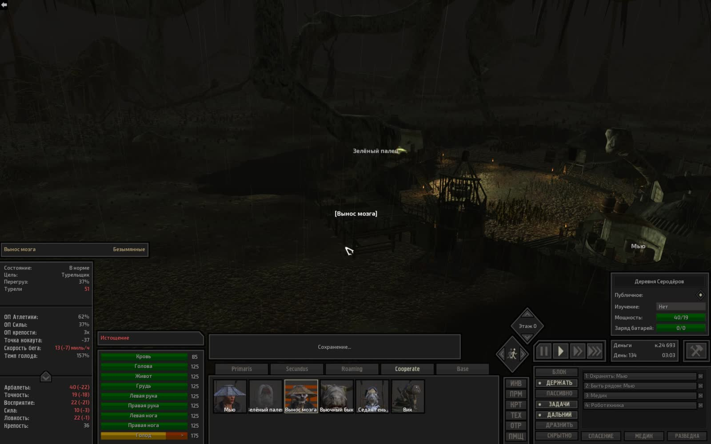

---

### Серия 26 (1 кадр)

- **Файловое время**: с `2026-11-06T14:25:16Z` по `2026-11-06T14:25:16Z`
- **Игровое время (OCR)**: `День 134, 11:46`
- **Локация (OCR)**: Не зафиксирована в UI
- **Персонажи в UI (OCR)**: Не зафиксированы в UI

**Кадры серии:**
- [screenshot_488-78a1f13f.jpg](screenshot_488-78a1f13f.jpg) ([GitHub](https://github.com/asaf1n/Kenshi-Compain/blob/main/published/screenshots/screenshot_488-78a1f13f.jpg) | [Raw](https://raw.githubusercontent.com/asaf1n/Kenshi-Compain/main/published/screenshots/screenshot_488-78a1f13f.jpg))

---

### Серия 27 (1 кадр)

- **Файловое время**: с `2026-11-06T20:51:25Z` по `2026-11-06T20:51:25Z`
- **Игровое время (OCR)**: `День 734`
- **Локация (OCR)**: Не зафиксирована в UI
- **Персонажи в UI (OCR)**: Не зафиксированы в UI
- **Задачи/предметы в UI**: Быть рядом: Хот Лон, Медик, Роботехника

**Кадры серии:**
- [screenshot_495-31d25d9b.jpg](screenshot_495-31d25d9b.jpg) ([GitHub](https://github.com/asaf1n/Kenshi-Compain/blob/main/published/screenshots/screenshot_495-31d25d9b.jpg) | [Raw](https://raw.githubusercontent.com/asaf1n/Kenshi-Compain/main/published/screenshots/screenshot_495-31d25d9b.jpg))

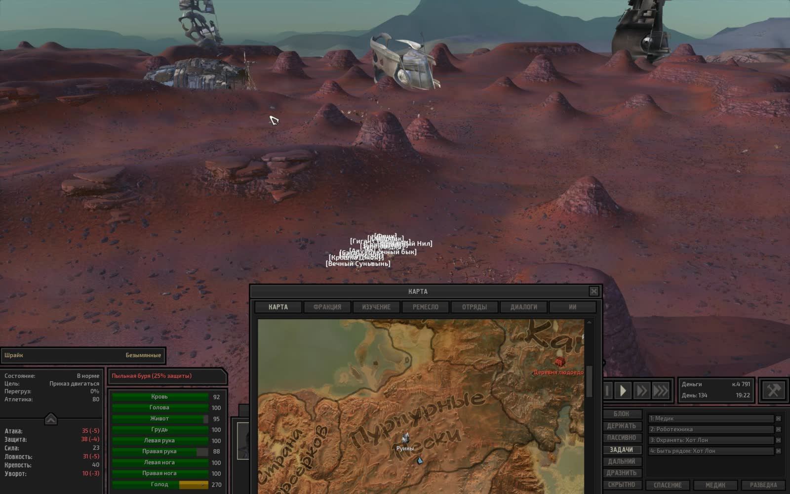

---

### Серия 28 (1 кадр)

- **Файловое время**: с `2026-11-06T20:51:38Z` по `2026-11-06T20:51:38Z`
- **Игровое время (OCR)**: `День 134, 19:25`
- **Локация (OCR)**: Не зафиксирована в UI
- **Персонажи в UI (OCR)**: Не зафиксированы в UI
- **Задачи/предметы в UI**: Быть рядом: Хот Лон, Медик, Роботехника

**Кадры серии:**
- [screenshot_496-9419f34a.jpg](screenshot_496-9419f34a.jpg) ([GitHub](https://github.com/asaf1n/Kenshi-Compain/blob/main/published/screenshots/screenshot_496-9419f34a.jpg) | [Raw](https://raw.githubusercontent.com/asaf1n/Kenshi-Compain/main/published/screenshots/screenshot_496-9419f34a.jpg))

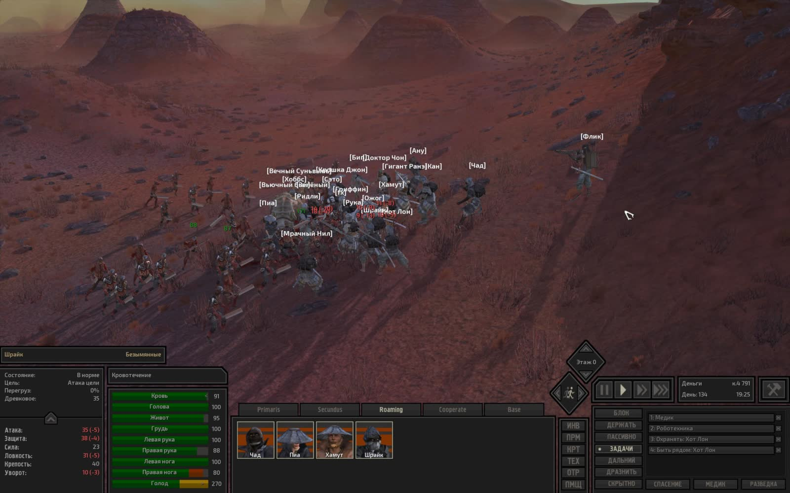

---

### Серия 29 (1 кадр)

- **Файловое время**: с `2026-11-06T20:52:08Z` по `2026-11-06T20:52:08Z`
- **Игровое время (OCR)**: `День 134, 19:41`
- **Локация (OCR)**: Не зафиксирована в UI
- **Персонажи в UI (OCR)**: Не зафиксированы в UI
- **Задачи/предметы в UI**: Быть рядом: Хот Лон, Охранять: Хот Лон

**Кадры серии:**
- [screenshot_497-79329064.jpg](screenshot_497-79329064.jpg) ([GitHub](https://github.com/asaf1n/Kenshi-Compain/blob/main/published/screenshots/screenshot_497-79329064.jpg) | [Raw](https://raw.githubusercontent.com/asaf1n/Kenshi-Compain/main/published/screenshots/screenshot_497-79329064.jpg))

---

### Серия 30 (1 кадр)

- **Файловое время**: с `2026-11-06T20:53:03Z` по `2026-11-06T20:53:03Z`
- **Игровое время (OCR)**: `Не зафиксировано в UI`
- **Локация (OCR)**: Не зафиксирована в UI
- **Персонажи в UI (OCR)**: Не зафиксированы в UI
- **Задачи/предметы в UI**: Быть рядом: Хот Лон, Медик, Роботехника

**Кадры серии:**
- [screenshot_498-2fde89d1.jpg](screenshot_498-2fde89d1.jpg) ([GitHub](https://github.com/asaf1n/Kenshi-Compain/blob/main/published/screenshots/screenshot_498-2fde89d1.jpg) | [Raw](https://raw.githubusercontent.com/asaf1n/Kenshi-Compain/main/published/screenshots/screenshot_498-2fde89d1.jpg))

---
