# Техническая лента скриншотов Kenshi

- **Сформировано**: `2026-11-04T20:56:59Z`
- **Окно выборки**: последние 7 суток (с `2026-10-28T20:56:59Z` по `2026-11-04T20:56:59Z`)
- **Всего скриншотов в окне**: 30
- **Сгруппировано серий/кадров**: 30

Техническая лента сгруппированных по сходству кадров с извлеченным текстом интерфейса (OCR). Интерпретация происходящего в игре полностью принадлежит LLM-компаньону по оригинальным изображениям.

---

### Серия 1 (1 кадр)

- **Файловое время**: с `2026-10-29T04:48:39Z` по `2026-10-29T04:48:39Z`
- **Игровое время (OCR)**: `День 99, 16:35`
- **Локация (OCR)**: Не зафиксирована в UI
- **Персонажи в UI (OCR)**: Не зафиксированы в UI

**Кадры серии:**
- [screenshot_120-1735176e.jpg](screenshot_120-1735176e.jpg) ([GitHub](https://github.com/asaf1n/Kenshi-Compain/blob/main/published/screenshots/screenshot_120-1735176e.jpg) | [Raw](https://raw.githubusercontent.com/asaf1n/Kenshi-Compain/main/published/screenshots/screenshot_120-1735176e.jpg))

---

### Серия 2 (1 кадр)

- **Файловое время**: с `2026-10-29T06:45:33Z` по `2026-10-29T06:45:33Z`
- **Игровое время (OCR)**: `День 100, 15:20`
- **Локация (OCR)**: Не зафиксирована в UI
- **Персонажи в UI (OCR)**: Ану
- **Задачи/предметы в UI**: Медик, Роботехника

**Кадры серии:**
- [screenshot_130-85d9d008.jpg](screenshot_130-85d9d008.jpg) ([GitHub](https://github.com/asaf1n/Kenshi-Compain/blob/main/published/screenshots/screenshot_130-85d9d008.jpg) | [Raw](https://raw.githubusercontent.com/asaf1n/Kenshi-Compain/main/published/screenshots/screenshot_130-85d9d008.jpg))

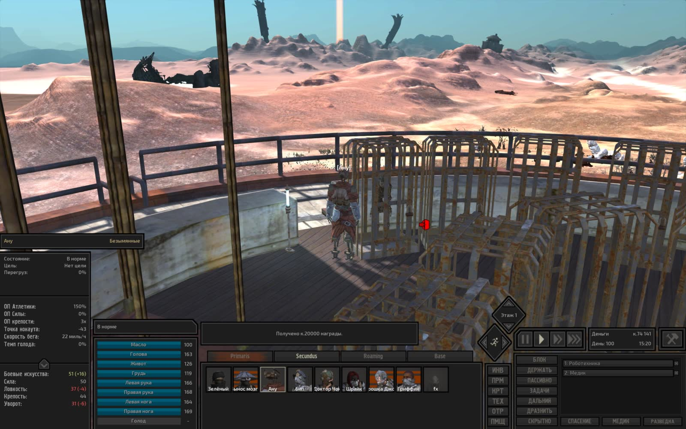

---

### Серия 3 (1 кадр)

- **Файловое время**: с `2026-10-29T14:27:51Z` по `2026-10-29T14:27:51Z`
- **Игровое время (OCR)**: `День 104, 02:01`
- **Локация (OCR)**: Не зафиксирована в UI
- **Персонажи в UI (OCR)**: Хот Лон
- **Задачи/предметы в UI**: Медик, Роботехника

**Кадры серии:**
- [screenshot_144-985b52b1.jpg](screenshot_144-985b52b1.jpg) ([GitHub](https://github.com/asaf1n/Kenshi-Compain/blob/main/published/screenshots/screenshot_144-985b52b1.jpg) | [Raw](https://raw.githubusercontent.com/asaf1n/Kenshi-Compain/main/published/screenshots/screenshot_144-985b52b1.jpg))

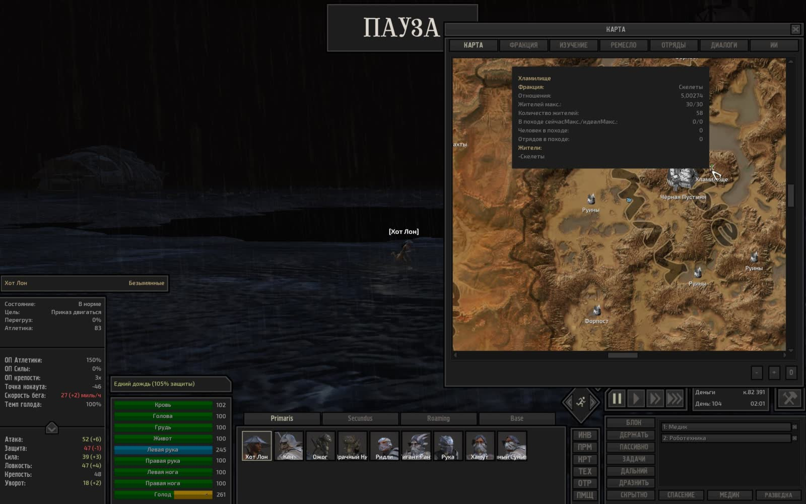

---

### Серия 4 (1 кадр)

- **Файловое время**: с `2026-10-30T04:39:23Z` по `2026-10-30T04:39:23Z`
- **Игровое время (OCR)**: `День 108, 05:04`
- **Локация (OCR)**: Не зафиксирована в UI
- **Персонажи в UI (OCR)**: Не зафиксированы в UI
- **Задачи/предметы в UI**: Быть рядом: Хот Лон, Медик, Роботехника

**Кадры серии:**
- [screenshot_156-e26a05f2.jpg](screenshot_156-e26a05f2.jpg) ([GitHub](https://github.com/asaf1n/Kenshi-Compain/blob/main/published/screenshots/screenshot_156-e26a05f2.jpg) | [Raw](https://raw.githubusercontent.com/asaf1n/Kenshi-Compain/main/published/screenshots/screenshot_156-e26a05f2.jpg))

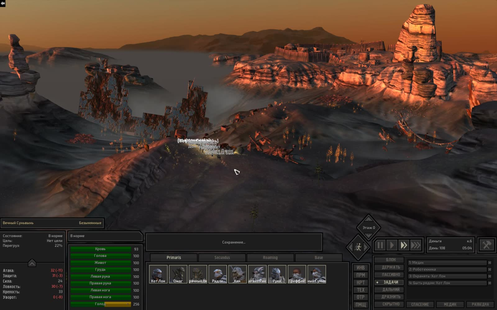

---

### Серия 5 (1 кадр)

- **Файловое время**: с `2026-10-30T08:00:21Z` по `2026-10-30T08:00:21Z`
- **Игровое время (OCR)**: `Не зафиксировано в UI`
- **Локация (OCR)**: Не зафиксирована в UI
- **Персонажи в UI (OCR)**: Хот Лон

**Кадры серии:**
- [screenshot_169-2f9ce32c.jpg](screenshot_169-2f9ce32c.jpg) ([GitHub](https://github.com/asaf1n/Kenshi-Compain/blob/main/published/screenshots/screenshot_169-2f9ce32c.jpg) | [Raw](https://raw.githubusercontent.com/asaf1n/Kenshi-Compain/main/published/screenshots/screenshot_169-2f9ce32c.jpg))

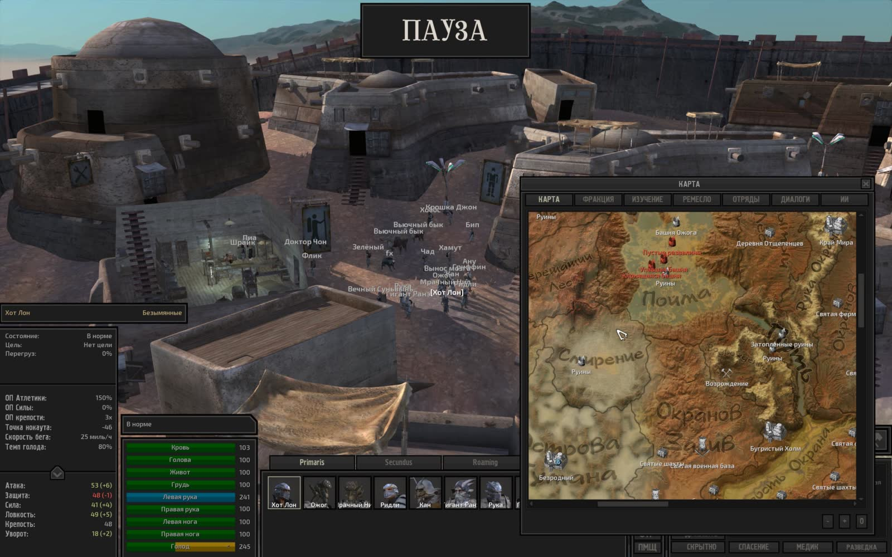

---

### Серия 6 (1 кадр)

- **Файловое время**: с `2026-10-30T13:11:05Z` по `2026-10-30T13:11:05Z`
- **Игровое время (OCR)**: `День 111, 21:26`
- **Локация (OCR)**: Не зафиксирована в UI
- **Персонажи в UI (OCR)**: Не зафиксированы в UI

**Кадры серии:**
- [screenshot_180-e8178bc5.jpg](screenshot_180-e8178bc5.jpg) ([GitHub](https://github.com/asaf1n/Kenshi-Compain/blob/main/published/screenshots/screenshot_180-e8178bc5.jpg) | [Raw](https://raw.githubusercontent.com/asaf1n/Kenshi-Compain/main/published/screenshots/screenshot_180-e8178bc5.jpg))

---

### Серия 7 (1 кадр)

- **Файловое время**: с `2026-10-30T16:45:03Z` по `2026-10-30T16:45:03Z`
- **Игровое время (OCR)**: `День 114, 08:04`
- **Локация (OCR)**: Не зафиксирована в UI
- **Персонажи в UI (OCR)**: Не зафиксированы в UI
- **Задачи/предметы в UI**: Работа с машиной: Пеньковая ферма 1-, Работа с машиной: Пеньковая ферма L

**Кадры серии:**
- [screenshot_191-f57f4429.jpg](screenshot_191-f57f4429.jpg) ([GitHub](https://github.com/asaf1n/Kenshi-Compain/blob/main/published/screenshots/screenshot_191-f57f4429.jpg) | [Raw](https://raw.githubusercontent.com/asaf1n/Kenshi-Compain/main/published/screenshots/screenshot_191-f57f4429.jpg))

---

### Серия 8 (1 кадр)

- **Файловое время**: с `2026-10-31T02:09:42Z` по `2026-10-31T02:09:42Z`
- **Игровое время (OCR)**: `День 116, 17:50`
- **Локация (OCR)**: Не зафиксирована в UI
- **Персонажи в UI (OCR)**: Не зафиксированы в UI

**Кадры серии:**
- [screenshot_202-326033fa.jpg](screenshot_202-326033fa.jpg) ([GitHub](https://github.com/asaf1n/Kenshi-Compain/blob/main/published/screenshots/screenshot_202-326033fa.jpg) | [Raw](https://raw.githubusercontent.com/asaf1n/Kenshi-Compain/main/published/screenshots/screenshot_202-326033fa.jpg))

---

### Серия 9 (1 кадр)

- **Файловое время**: с `2026-10-31T05:15:39Z` по `2026-10-31T05:15:39Z`
- **Игровое время (OCR)**: `День 117, 12:48`
- **Локация (OCR)**: Не зафиксирована в UI
- **Персонажи в UI (OCR)**: Бип
- **Задачи/предметы в UI**: Медик, Охранять: Хоббс

**Кадры серии:**
- [screenshot_213-86e8cd4b.jpg](screenshot_213-86e8cd4b.jpg) ([GitHub](https://github.com/asaf1n/Kenshi-Compain/blob/main/published/screenshots/screenshot_213-86e8cd4b.jpg) | [Raw](https://raw.githubusercontent.com/asaf1n/Kenshi-Compain/main/published/screenshots/screenshot_213-86e8cd4b.jpg))

---

### Серия 10 (1 кадр)

- **Файловое время**: с `2026-10-31T08:42:24Z` по `2026-10-31T08:42:24Z`
- **Игровое время (OCR)**: `Не зафиксировано в UI`
- **Локация (OCR)**: Не зафиксирована в UI
- **Персонажи в UI (OCR)**: Не зафиксированы в UI

**Кадры серии:**
- [screenshot_223-4f55f3a6.jpg](screenshot_223-4f55f3a6.jpg) ([GitHub](https://github.com/asaf1n/Kenshi-Compain/blob/main/published/screenshots/screenshot_223-4f55f3a6.jpg) | [Raw](https://raw.githubusercontent.com/asaf1n/Kenshi-Compain/main/published/screenshots/screenshot_223-4f55f3a6.jpg))

---

### Серия 11 (1 кадр)

- **Файловое время**: с `2026-10-31T12:18:35Z` по `2026-10-31T12:18:35Z`
- **Игровое время (OCR)**: `День 118, 06:41`
- **Локация (OCR)**: Не зафиксирована в UI
- **Персонажи в UI (OCR)**: Пиа

**Кадры серии:**
- [screenshot_233-0b6b3b83.jpg](screenshot_233-0b6b3b83.jpg) ([GitHub](https://github.com/asaf1n/Kenshi-Compain/blob/main/published/screenshots/screenshot_233-0b6b3b83.jpg) | [Raw](https://raw.githubusercontent.com/asaf1n/Kenshi-Compain/main/published/screenshots/screenshot_233-0b6b3b83.jpg))

---

### Серия 12 (1 кадр)

- **Файловое время**: с `2026-10-31T15:02:53Z` по `2026-10-31T15:02:53Z`
- **Игровое время (OCR)**: `День 119, 15:26`
- **Локация (OCR)**: Не зафиксирована в UI
- **Персонажи в UI (OCR)**: Не зафиксированы в UI

**Кадры серии:**
- [screenshot_245-a1ae4829.jpg](screenshot_245-a1ae4829.jpg) ([GitHub](https://github.com/asaf1n/Kenshi-Compain/blob/main/published/screenshots/screenshot_245-a1ae4829.jpg) | [Raw](https://raw.githubusercontent.com/asaf1n/Kenshi-Compain/main/published/screenshots/screenshot_245-a1ae4829.jpg))

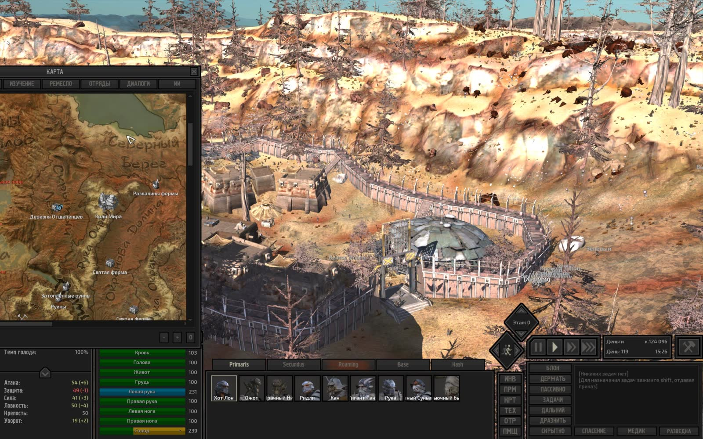

---

### Серия 13 (1 кадр)

- **Файловое время**: с `2026-11-01T01:23:18Z` по `2026-11-01T01:23:18Z`
- **Игровое время (OCR)**: `День 120, 11:26`
- **Локация (OCR)**: Не зафиксирована в UI
- **Персонажи в UI (OCR)**: Седая тень
- **Задачи/предметы в UI**: Работа с машиной, Тащить в

**Кадры серии:**
- [screenshot_255-1bd0bcd3.jpg](screenshot_255-1bd0bcd3.jpg) ([GitHub](https://github.com/asaf1n/Kenshi-Compain/blob/main/published/screenshots/screenshot_255-1bd0bcd3.jpg) | [Raw](https://raw.githubusercontent.com/asaf1n/Kenshi-Compain/main/published/screenshots/screenshot_255-1bd0bcd3.jpg))

---

### Серия 14 (1 кадр)

- **Файловое время**: с `2026-11-01T04:29:42Z` по `2026-11-01T04:29:42Z`
- **Игровое время (OCR)**: `День 121, 06:58`
- **Локация (OCR)**: Не зафиксирована в UI
- **Персонажи в UI (OCR)**: Не зафиксированы в UI
- **Задачи/предметы в UI**: Быть рядом: Хот Лон, Медик, Роботехника

**Кадры серии:**
- [screenshot_265-aae09eac.jpg](screenshot_265-aae09eac.jpg) ([GitHub](https://github.com/asaf1n/Kenshi-Compain/blob/main/published/screenshots/screenshot_265-aae09eac.jpg) | [Raw](https://raw.githubusercontent.com/asaf1n/Kenshi-Compain/main/published/screenshots/screenshot_265-aae09eac.jpg))

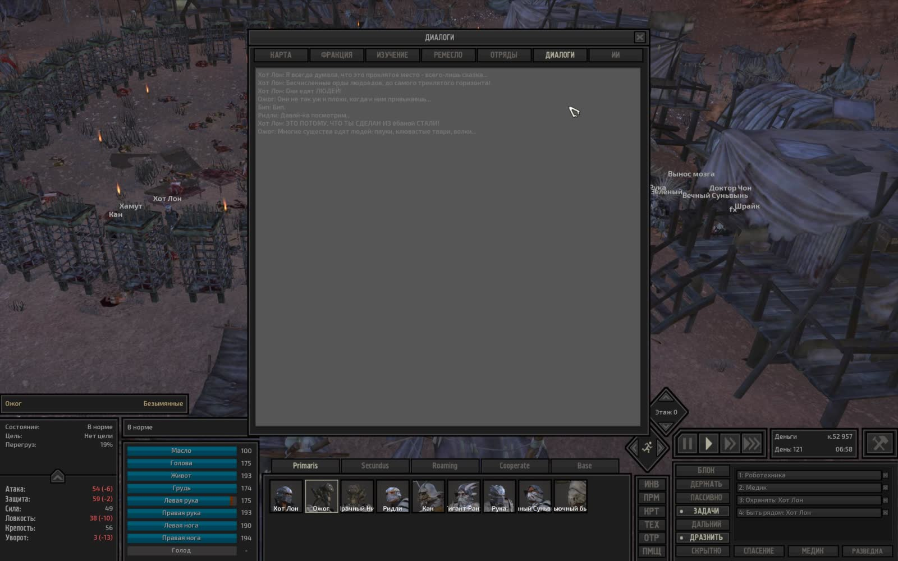

---

### Серия 15 (1 кадр)

- **Файловое время**: с `2026-11-01T05:21:36Z` по `2026-11-01T05:21:36Z`
- **Игровое время (OCR)**: `День 121, 23:11`
- **Локация (OCR)**: Не зафиксирована в UI
- **Персонажи в UI (OCR)**: Хот Лон

**Кадры серии:**
- [screenshot_277-eeba239c.jpg](screenshot_277-eeba239c.jpg) ([GitHub](https://github.com/asaf1n/Kenshi-Compain/blob/main/published/screenshots/screenshot_277-eeba239c.jpg) | [Raw](https://raw.githubusercontent.com/asaf1n/Kenshi-Compain/main/published/screenshots/screenshot_277-eeba239c.jpg))

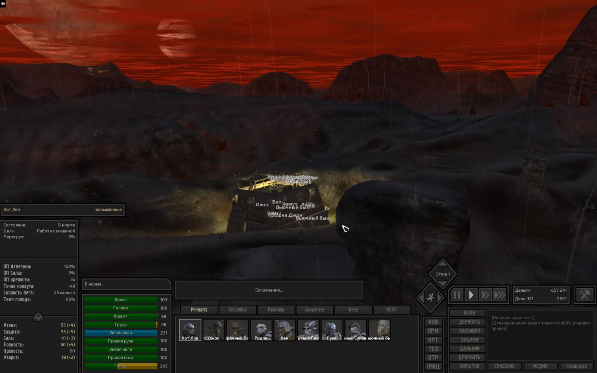

---

### Серия 16 (1 кадр)

- **Файловое время**: с `2026-11-01T10:27:41Z` по `2026-11-01T10:27:41Z`
- **Игровое время (OCR)**: `День 122, 14:08`
- **Локация (OCR)**: Не зафиксирована в UI
- **Персонажи в UI (OCR)**: Мрачный Нил
- **Задачи/предметы в UI**: Быть рядом: Хот Лон, Медик, Роботехника

**Кадры серии:**
- [screenshot_288-5535f30d.jpg](screenshot_288-5535f30d.jpg) ([GitHub](https://github.com/asaf1n/Kenshi-Compain/blob/main/published/screenshots/screenshot_288-5535f30d.jpg) | [Raw](https://raw.githubusercontent.com/asaf1n/Kenshi-Compain/main/published/screenshots/screenshot_288-5535f30d.jpg))

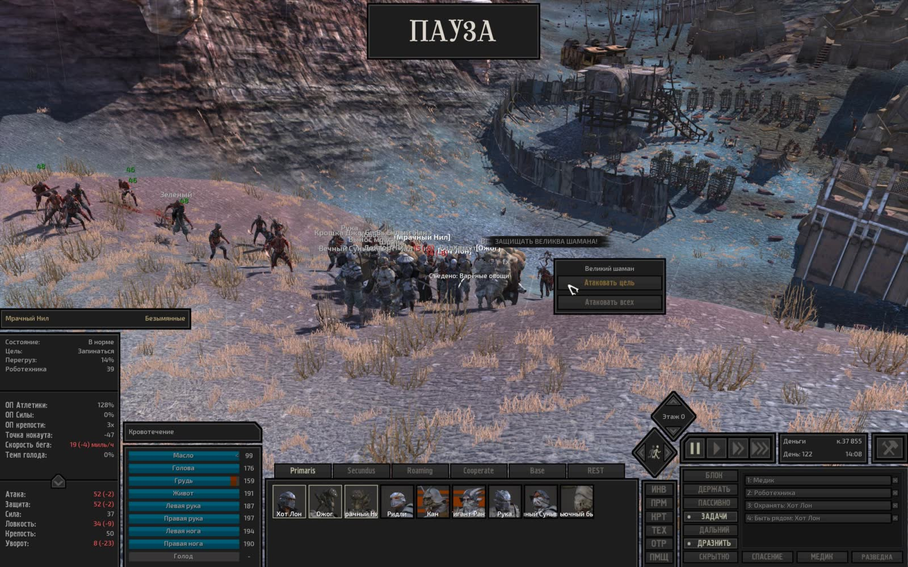

---

### Серия 17 (1 кадр)

- **Файловое время**: с `2026-11-01T10:58:01Z` по `2026-11-01T10:58:01Z`
- **Игровое время (OCR)**: `День 123, 04:17`
- **Локация (OCR)**: Не зафиксирована в UI
- **Персонажи в UI (OCR)**: вик
- **Задачи/предметы в UI**: Быть рядом: Мью, Инженер, Медик, Охранять: Мью

**Кадры серии:**
- [screenshot_299-65c5e3ee.jpg](screenshot_299-65c5e3ee.jpg) ([GitHub](https://github.com/asaf1n/Kenshi-Compain/blob/main/published/screenshots/screenshot_299-65c5e3ee.jpg) | [Raw](https://raw.githubusercontent.com/asaf1n/Kenshi-Compain/main/published/screenshots/screenshot_299-65c5e3ee.jpg))

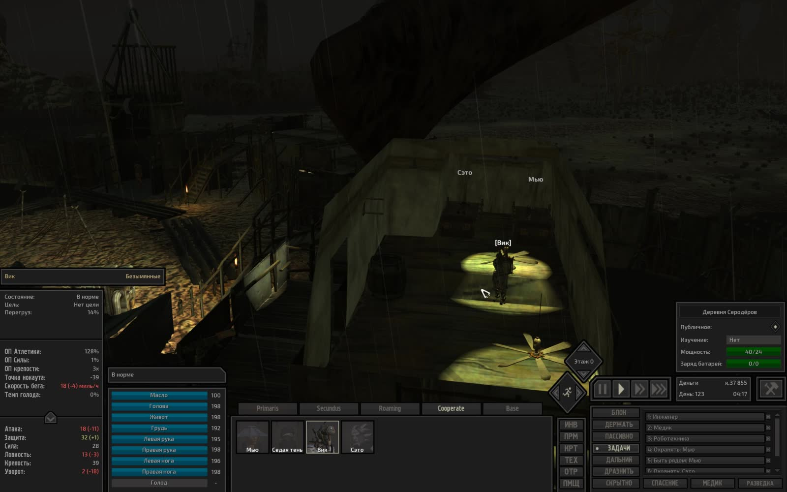

---

### Серия 18 (1 кадр)

- **Файловое время**: с `2026-11-01T11:56:05Z` по `2026-11-01T11:56:05Z`
- **Игровое время (OCR)**: `День 123, 21:37`
- **Локация (OCR)**: Не зафиксирована в UI
- **Персонажи в UI (OCR)**: Йонин
- **Задачи/предметы в UI**: Медик, Разделка животных

**Кадры серии:**
- [screenshot_309-9d766e52.jpg](screenshot_309-9d766e52.jpg) ([GitHub](https://github.com/asaf1n/Kenshi-Compain/blob/main/published/screenshots/screenshot_309-9d766e52.jpg) | [Raw](https://raw.githubusercontent.com/asaf1n/Kenshi-Compain/main/published/screenshots/screenshot_309-9d766e52.jpg))

---

### Серия 19 (1 кадр)

- **Файловое время**: с `2026-11-01T12:39:07Z` по `2026-11-01T12:39:07Z`
- **Игровое время (OCR)**: `День 124, 08:06`
- **Локация (OCR)**: Не зафиксирована в UI
- **Персонажи в UI (OCR)**: Вьючный бык
- **Задачи/предметы в UI**: Быть рядом: Хот Лон, Охранять: Хот Лон

**Кадры серии:**
- [screenshot_319-19eff87a.jpg](screenshot_319-19eff87a.jpg) ([GitHub](https://github.com/asaf1n/Kenshi-Compain/blob/main/published/screenshots/screenshot_319-19eff87a.jpg) | [Raw](https://raw.githubusercontent.com/asaf1n/Kenshi-Compain/main/published/screenshots/screenshot_319-19eff87a.jpg))

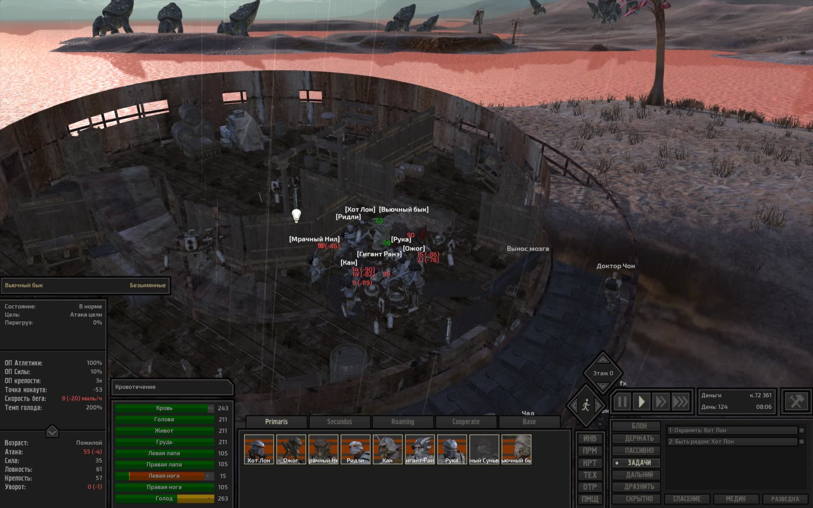

---

### Серия 20 (1 кадр)

- **Файловое время**: с `2026-11-01T13:15:51Z` по `2026-11-01T13:15:51Z`
- **Игровое время (OCR)**: `День 124, 19:54`
- **Локация (OCR)**: Не зафиксирована в UI
- **Персонажи в UI (OCR)**: Хот Лон

**Кадры серии:**
- [screenshot_333-6e12760c.jpg](screenshot_333-6e12760c.jpg) ([GitHub](https://github.com/asaf1n/Kenshi-Compain/blob/main/published/screenshots/screenshot_333-6e12760c.jpg) | [Raw](https://raw.githubusercontent.com/asaf1n/Kenshi-Compain/main/published/screenshots/screenshot_333-6e12760c.jpg))

---

### Серия 21 (1 кадр)

- **Файловое время**: с `2026-11-01T16:21:03Z` по `2026-11-01T16:21:03Z`
- **Игровое время (OCR)**: `День 125, 18:52`
- **Локация (OCR)**: Не зафиксирована в UI
- **Персонажи в UI (OCR)**: Флик
- **Задачи/предметы в UI**: Быть рядом: Вьючный бык, Медик, Роботехника

**Кадры серии:**
- [screenshot_343-bafed3e6.jpg](screenshot_343-bafed3e6.jpg) ([GitHub](https://github.com/asaf1n/Kenshi-Compain/blob/main/published/screenshots/screenshot_343-bafed3e6.jpg) | [Raw](https://raw.githubusercontent.com/asaf1n/Kenshi-Compain/main/published/screenshots/screenshot_343-bafed3e6.jpg))

---

### Серия 22 (1 кадр)

- **Файловое время**: с `2026-11-01T17:53:37Z` по `2026-11-01T17:53:37Z`
- **Игровое время (OCR)**: `День 127, 03:13`
- **Локация (OCR)**: Не зафиксирована в UI
- **Персонажи в UI (OCR)**: Не зафиксированы в UI
- **Задачи/предметы в UI**: Работа с машиной, Тащить в

**Кадры серии:**
- [screenshot_354-6bfd6720.jpg](screenshot_354-6bfd6720.jpg) ([GitHub](https://github.com/asaf1n/Kenshi-Compain/blob/main/published/screenshots/screenshot_354-6bfd6720.jpg) | [Raw](https://raw.githubusercontent.com/asaf1n/Kenshi-Compain/main/published/screenshots/screenshot_354-6bfd6720.jpg))

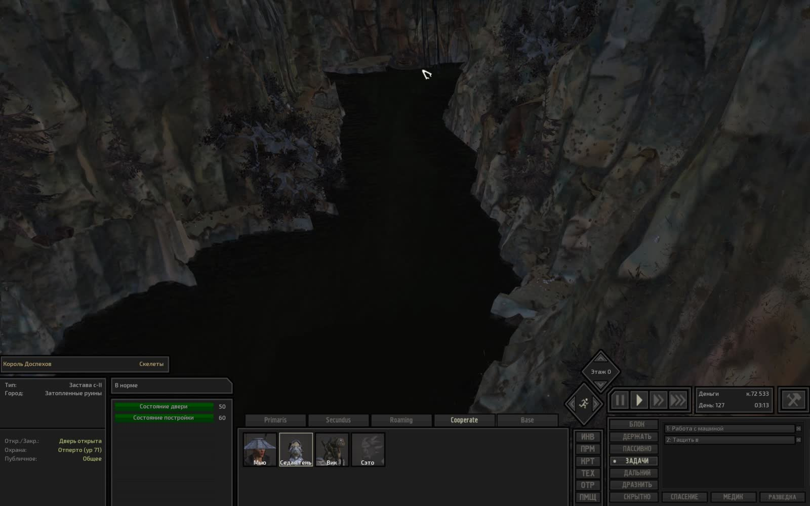

---

### Серия 23 (1 кадр)

- **Файловое время**: с `2026-11-02T00:39:11Z` по `2026-11-02T00:39:11Z`
- **Игровое время (OCR)**: `День 127, 17:18`
- **Локация (OCR)**: Не зафиксирована в UI
- **Персонажи в UI (OCR)**: Ану
- **Задачи/предметы в UI**: Быть рядом: Седая тень, Медик, Роботехника

**Кадры серии:**
- [screenshot_366-82207940.jpg](screenshot_366-82207940.jpg) ([GitHub](https://github.com/asaf1n/Kenshi-Compain/blob/main/published/screenshots/screenshot_366-82207940.jpg) | [Raw](https://raw.githubusercontent.com/asaf1n/Kenshi-Compain/main/published/screenshots/screenshot_366-82207940.jpg))

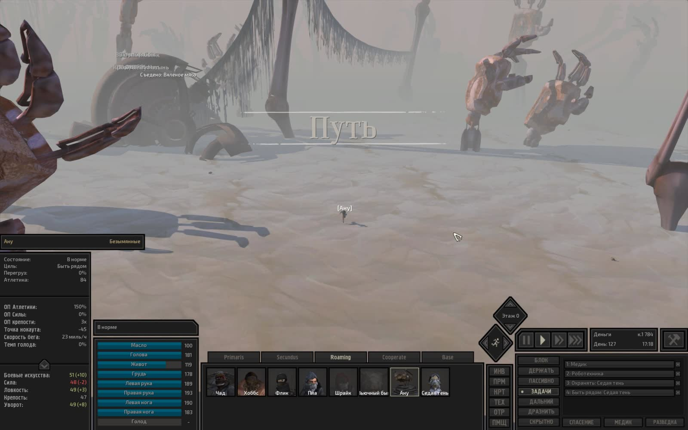

---

### Серия 24 (1 кадр)

- **Файловое время**: с `2026-11-03T01:07:21Z` по `2026-11-03T01:07:21Z`
- **Игровое время (OCR)**: `День 129, 15:35`
- **Локация (OCR)**: Не зафиксирована в UI
- **Персонажи в UI (OCR)**: Трактирщик

**Кадры серии:**
- [screenshot_376-ee4b5ad2.jpg](screenshot_376-ee4b5ad2.jpg) ([GitHub](https://github.com/asaf1n/Kenshi-Compain/blob/main/published/screenshots/screenshot_376-ee4b5ad2.jpg) | [Raw](https://raw.githubusercontent.com/asaf1n/Kenshi-Compain/main/published/screenshots/screenshot_376-ee4b5ad2.jpg))

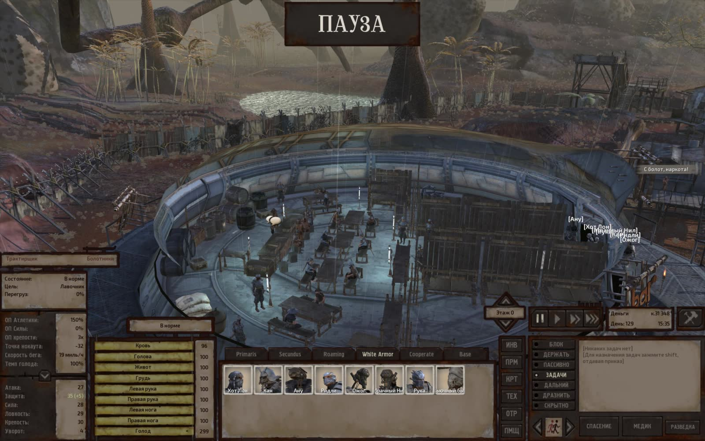

---

### Серия 25 (1 кадр)

- **Файловое время**: с `2026-11-03T01:29:43Z` по `2026-11-03T01:29:43Z`
- **Игровое время (OCR)**: `День 129, 22:23`
- **Локация (OCR)**: Не зафиксирована в UI
- **Персонажи в UI (OCR)**: Ану
- **Задачи/предметы в UI**: Медик, Найти и нести в койку, Роботехника

**Кадры серии:**
- [screenshot_386-2cb52246.jpg](screenshot_386-2cb52246.jpg) ([GitHub](https://github.com/asaf1n/Kenshi-Compain/blob/main/published/screenshots/screenshot_386-2cb52246.jpg) | [Raw](https://raw.githubusercontent.com/asaf1n/Kenshi-Compain/main/published/screenshots/screenshot_386-2cb52246.jpg))

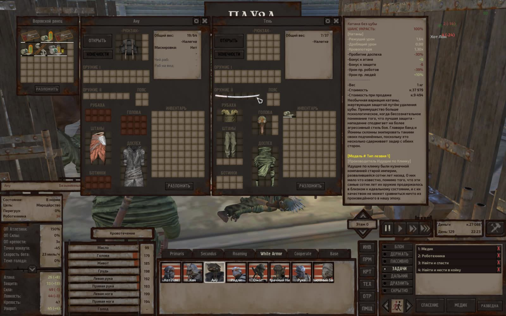

---

### Серия 26 (1 кадр)

- **Файловое время**: с `2026-11-03T02:10:47Z` по `2026-11-03T02:10:47Z`
- **Игровое время (OCR)**: `День 130, 06:13`
- **Локация (OCR)**: Не зафиксирована в UI
- **Персонажи в UI (OCR)**: туз эл

**Кадры серии:**
- [screenshot_399-e2338c27.jpg](screenshot_399-e2338c27.jpg) ([GitHub](https://github.com/asaf1n/Kenshi-Compain/blob/main/published/screenshots/screenshot_399-e2338c27.jpg) | [Raw](https://raw.githubusercontent.com/asaf1n/Kenshi-Compain/main/published/screenshots/screenshot_399-e2338c27.jpg))

---

### Серия 27 (1 кадр)

- **Файловое время**: с `2026-11-03T02:44:53Z` по `2026-11-03T02:44:53Z`
- **Игровое время (OCR)**: `День 130, 09:15`
- **Локация (OCR)**: Не зафиксирована в UI
- **Персонажи в UI (OCR)**: флик
- **Задачи/предметы в UI**: Быть рядом: Хот Лон, Охранять: Хот Лон

**Кадры серии:**
- [screenshot_411-04780b1d.jpg](screenshot_411-04780b1d.jpg) ([GitHub](https://github.com/asaf1n/Kenshi-Compain/blob/main/published/screenshots/screenshot_411-04780b1d.jpg) | [Raw](https://raw.githubusercontent.com/asaf1n/Kenshi-Compain/main/published/screenshots/screenshot_411-04780b1d.jpg))

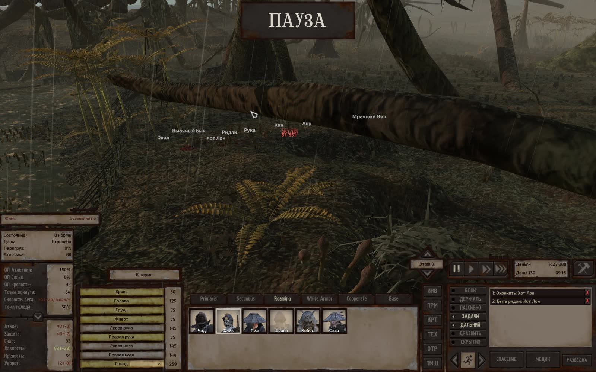

---

### Серия 28 (1 кадр)

- **Файловое время**: с `2026-11-03T06:38:17Z` по `2026-11-03T06:38:17Z`
- **Игровое время (OCR)**: `День 131, 01:54`
- **Локация (OCR)**: Не зафиксирована в UI
- **Персонажи в UI (OCR)**: Не зафиксированы в UI
- **Задачи/предметы в UI**: Медик, Роботехника

**Кадры серии:**
- [screenshot_421-2b56bbf7.jpg](screenshot_421-2b56bbf7.jpg) ([GitHub](https://github.com/asaf1n/Kenshi-Compain/blob/main/published/screenshots/screenshot_421-2b56bbf7.jpg) | [Raw](https://raw.githubusercontent.com/asaf1n/Kenshi-Compain/main/published/screenshots/screenshot_421-2b56bbf7.jpg))

---

### Серия 29 (1 кадр)

- **Файловое время**: с `2026-11-04T08:46:30Z` по `2026-11-04T08:46:30Z`
- **Игровое время (OCR)**: `День 132, 10:48`
- **Локация (OCR)**: Не зафиксирована в UI
- **Персонажи в UI (OCR)**: флик
- **Задачи/предметы в UI**: Медик, Роботехника

**Кадры серии:**
- [screenshot_433-bb49cf2e.jpg](screenshot_433-bb49cf2e.jpg) ([GitHub](https://github.com/asaf1n/Kenshi-Compain/blob/main/published/screenshots/screenshot_433-bb49cf2e.jpg) | [Raw](https://raw.githubusercontent.com/asaf1n/Kenshi-Compain/main/published/screenshots/screenshot_433-bb49cf2e.jpg))

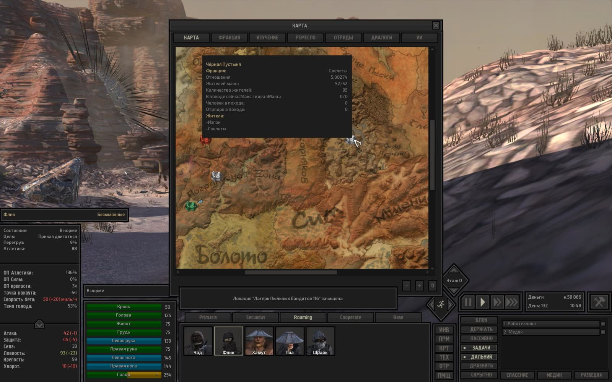

---

### Серия 30 (1 кадр)

- **Файловое время**: с `2026-11-04T20:49:42Z` по `2026-11-04T20:49:42Z`
- **Игровое время (OCR)**: `День 133, 05:09`
- **Локация (OCR)**: Не зафиксирована в UI
- **Персонажи в UI (OCR)**: Не зафиксированы в UI
- **Задачи/предметы в UI**: Быть рядом: Хот Лон, Медик, Роботехника

**Кадры серии:**
- [screenshot_444-fa464e38.jpg](screenshot_444-fa464e38.jpg) ([GitHub](https://github.com/asaf1n/Kenshi-Compain/blob/main/published/screenshots/screenshot_444-fa464e38.jpg) | [Raw](https://raw.githubusercontent.com/asaf1n/Kenshi-Compain/main/published/screenshots/screenshot_444-fa464e38.jpg))

---
