# Техническая лента скриншотов Kenshi

- **Сформировано**: `2026-11-06T14:45:59Z`
- **Окно выборки**: последние 7 суток (с `2026-10-30T14:45:59Z` по `2026-11-06T14:45:59Z`)
- **Всего скриншотов в окне**: 30
- **Сгруппировано серий/кадров**: 30

Техническая лента сгруппированных по сходству кадров с извлеченным текстом интерфейса (OCR). Интерпретация происходящего в игре полностью принадлежит LLM-компаньону по оригинальным изображениям.

---

### Серия 1 (1 кадр)

- **Файловое время**: с `2026-10-30T16:43:26Z` по `2026-10-30T16:43:26Z`
- **Игровое время (OCR)**: `День 114, 06:31`
- **Локация (OCR)**: Не зафиксирована в UI
- **Персонажи в UI (OCR)**: Не зафиксированы в UI
- **Задачи/предметы в UI**: Инженер, Работа с машиной: Колодец, Тащить в: Водный бак

**Кадры серии:**
- [screenshot_190-83152ab7.jpg](screenshot_190-83152ab7.jpg) ([GitHub](https://github.com/asaf1n/Kenshi-Compain/blob/main/published/screenshots/screenshot_190-83152ab7.jpg) | [Raw](https://raw.githubusercontent.com/asaf1n/Kenshi-Compain/main/published/screenshots/screenshot_190-83152ab7.jpg))

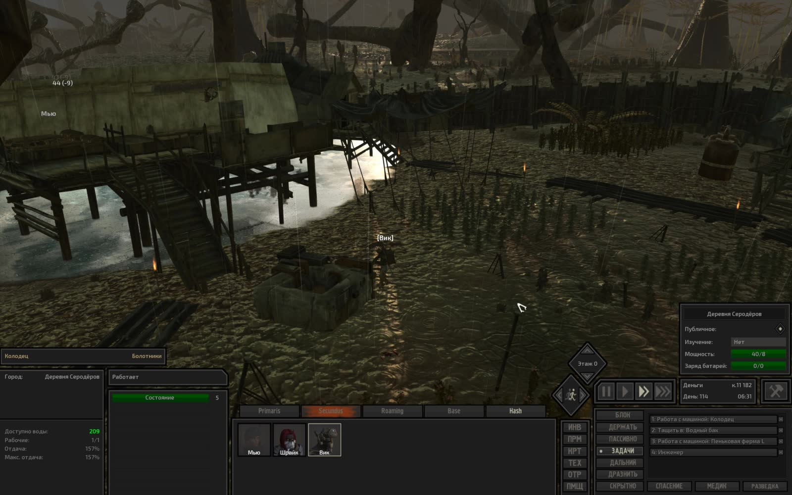

---

### Серия 2 (1 кадр)

- **Файловое время**: с `2026-10-31T02:09:06Z` по `2026-10-31T02:09:06Z`
- **Игровое время (OCR)**: `День 116, 17:31`
- **Локация (OCR)**: Не зафиксирована в UI
- **Персонажи в UI (OCR)**: Не зафиксированы в UI
- **Задачи/предметы в UI**: Работа с машиной: Переработка пеньки

**Кадры серии:**
- [screenshot_201-1372aa12.jpg](screenshot_201-1372aa12.jpg) ([GitHub](https://github.com/asaf1n/Kenshi-Compain/blob/main/published/screenshots/screenshot_201-1372aa12.jpg) | [Raw](https://raw.githubusercontent.com/asaf1n/Kenshi-Compain/main/published/screenshots/screenshot_201-1372aa12.jpg))

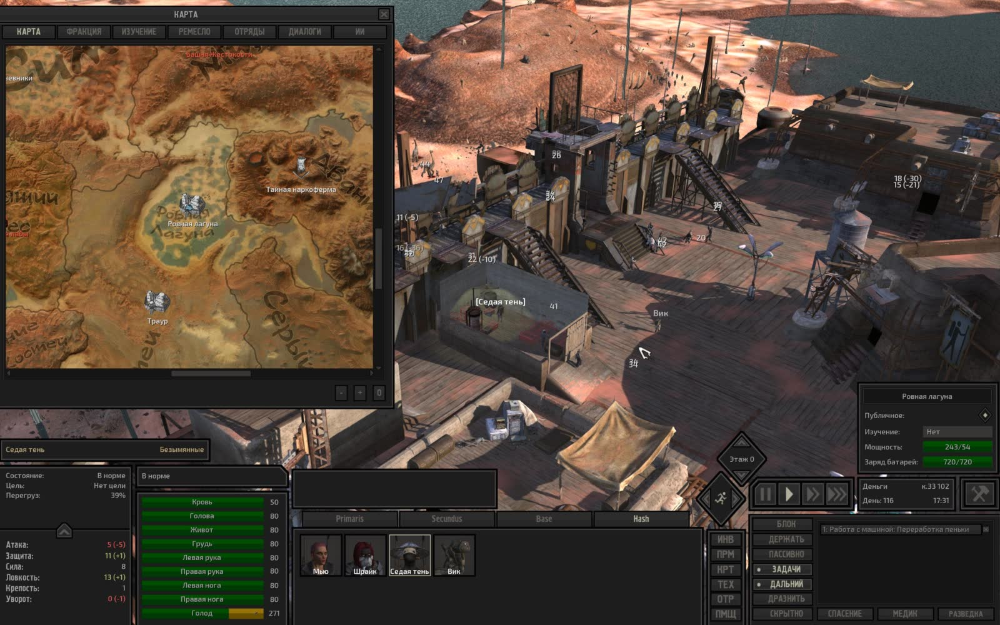

---

### Серия 3 (1 кадр)

- **Файловое время**: с `2026-10-31T08:39:44Z` по `2026-10-31T08:39:44Z`
- **Игровое время (OCR)**: `Не зафиксировано в UI`
- **Локация (OCR)**: Не зафиксирована в UI
- **Персонажи в UI (OCR)**: Не зафиксированы в UI

**Кадры серии:**
- [screenshot_220-bdee71c5.jpg](screenshot_220-bdee71c5.jpg) ([GitHub](https://github.com/asaf1n/Kenshi-Compain/blob/main/published/screenshots/screenshot_220-bdee71c5.jpg) | [Raw](https://raw.githubusercontent.com/asaf1n/Kenshi-Compain/main/published/screenshots/screenshot_220-bdee71c5.jpg))

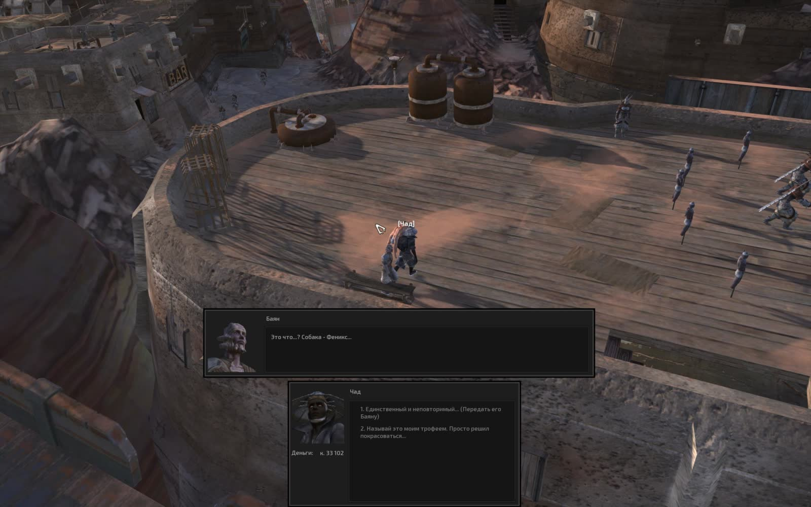

---

### Серия 4 (1 кадр)

- **Файловое время**: с `2026-10-31T11:59:09Z` по `2026-10-31T11:59:09Z`
- **Игровое время (OCR)**: `День 118, 01:00`
- **Локация (OCR)**: Не зафиксирована в UI
- **Персонажи в UI (OCR)**: Не зафиксированы в UI
- **Задачи/предметы в UI**: Работа с машиной: Переработка пеньки, Тащить в: Хранение: гашиш

**Кадры серии:**
- [screenshot_230-3708192b.jpg](screenshot_230-3708192b.jpg) ([GitHub](https://github.com/asaf1n/Kenshi-Compain/blob/main/published/screenshots/screenshot_230-3708192b.jpg) | [Raw](https://raw.githubusercontent.com/asaf1n/Kenshi-Compain/main/published/screenshots/screenshot_230-3708192b.jpg))

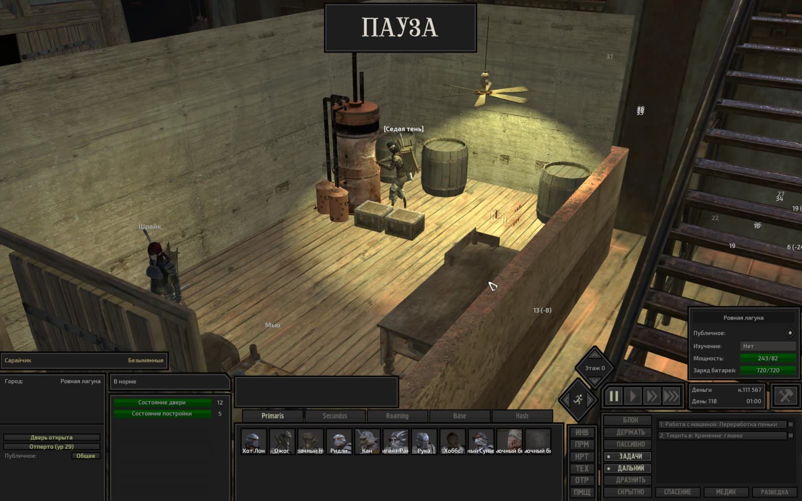

---

### Серия 5 (1 кадр)

- **Файловое время**: с `2026-10-31T18:38:56Z` по `2026-10-31T18:38:56Z`
- **Игровое время (OCR)**: `День 120, 05:37`
- **Локация (OCR)**: Не зафиксирована в UI
- **Персонажи в UI (OCR)**: Ану
- **Задачи/предметы в UI**: Медик, Роботехника

**Кадры серии:**
- [screenshot_251-7853805b.jpg](screenshot_251-7853805b.jpg) ([GitHub](https://github.com/asaf1n/Kenshi-Compain/blob/main/published/screenshots/screenshot_251-7853805b.jpg) | [Raw](https://raw.githubusercontent.com/asaf1n/Kenshi-Compain/main/published/screenshots/screenshot_251-7853805b.jpg))

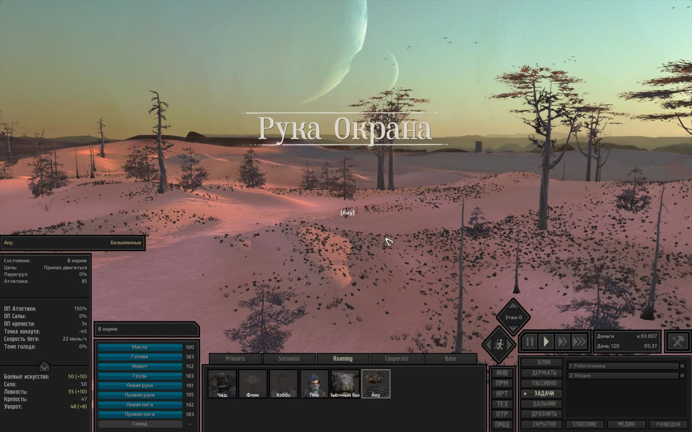

---

### Серия 6 (1 кадр)

- **Файловое время**: с `2026-11-01T01:55:58Z` по `2026-11-01T01:55:58Z`
- **Игровое время (OCR)**: `Не зафиксировано в UI`
- **Локация (OCR)**: Не зафиксирована в UI
- **Персонажи в UI (OCR)**: Не зафиксированы в UI

**Кадры серии:**
- [screenshot_260-aedcf2d7.jpg](screenshot_260-aedcf2d7.jpg) ([GitHub](https://github.com/asaf1n/Kenshi-Compain/blob/main/published/screenshots/screenshot_260-aedcf2d7.jpg) | [Raw](https://raw.githubusercontent.com/asaf1n/Kenshi-Compain/main/published/screenshots/screenshot_260-aedcf2d7.jpg))

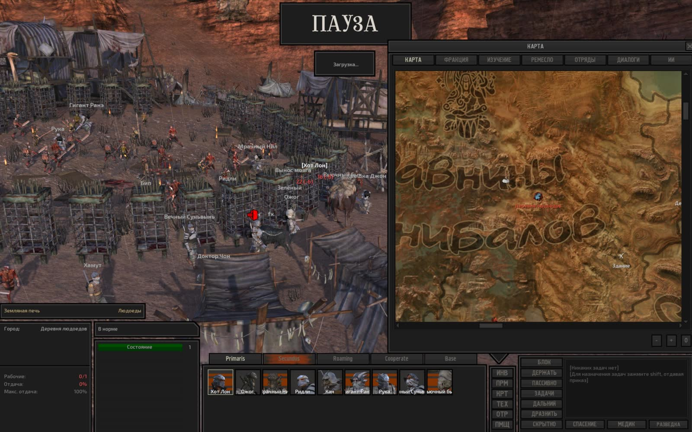

---

### Серия 7 (1 кадр)

- **Файловое время**: с `2026-11-01T04:58:26Z` по `2026-11-01T04:58:26Z`
- **Игровое время (OCR)**: `День 121, 17:09`
- **Локация (OCR)**: Не зафиксирована в UI
- **Персонажи в UI (OCR)**: Мью
- **Задачи/предметы в UI**: Работа с машиной: Колодец, Работа с машиной: Пеньковая ферма 1-, Тащить в: Хранение: пенька

**Кадры серии:**
- [screenshot_270-b496e523.jpg](screenshot_270-b496e523.jpg) ([GitHub](https://github.com/asaf1n/Kenshi-Compain/blob/main/published/screenshots/screenshot_270-b496e523.jpg) | [Raw](https://raw.githubusercontent.com/asaf1n/Kenshi-Compain/main/published/screenshots/screenshot_270-b496e523.jpg))

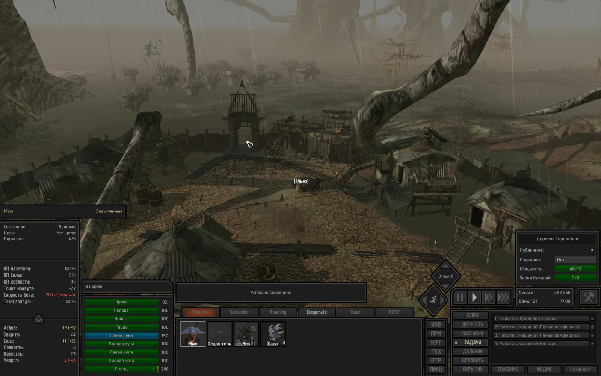

---

### Серия 8 (1 кадр)

- **Файловое время**: с `2026-11-01T10:29:55Z` по `2026-11-01T10:29:55Z`
- **Игровое время (OCR)**: `День 122, 14:49`
- **Локация (OCR)**: Не зафиксирована в UI
- **Персонажи в UI (OCR)**: Ожог
- **Задачи/предметы в UI**: Быть рядом: Хот Лон, Медик, Роботехника

**Кадры серии:**
- [screenshot_292-03f2e8d5.jpg](screenshot_292-03f2e8d5.jpg) ([GitHub](https://github.com/asaf1n/Kenshi-Compain/blob/main/published/screenshots/screenshot_292-03f2e8d5.jpg) | [Raw](https://raw.githubusercontent.com/asaf1n/Kenshi-Compain/main/published/screenshots/screenshot_292-03f2e8d5.jpg))

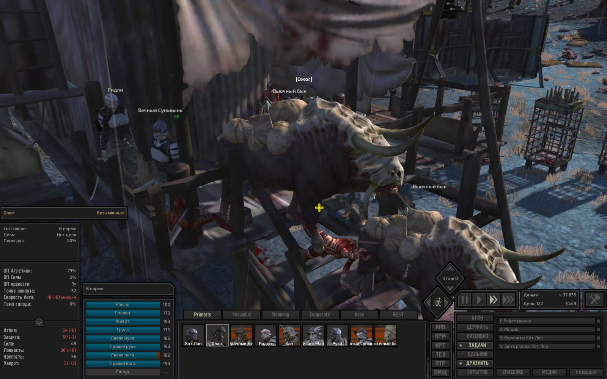

---

### Серия 9 (1 кадр)

- **Файловое время**: с `2026-11-01T11:00:00Z` по `2026-11-01T11:00:00Z`
- **Игровое время (OCR)**: `День 123, 05:21`
- **Локация (OCR)**: Не зафиксирована в UI
- **Персонажи в UI (OCR)**: Зелёный палец
- **Задачи/предметы в UI**: Работа с машиной: Небольшие залежи мех

**Кадры серии:**
- [screenshot_301-eeefc469.jpg](screenshot_301-eeefc469.jpg) ([GitHub](https://github.com/asaf1n/Kenshi-Compain/blob/main/published/screenshots/screenshot_301-eeefc469.jpg) | [Raw](https://raw.githubusercontent.com/asaf1n/Kenshi-Compain/main/published/screenshots/screenshot_301-eeefc469.jpg))

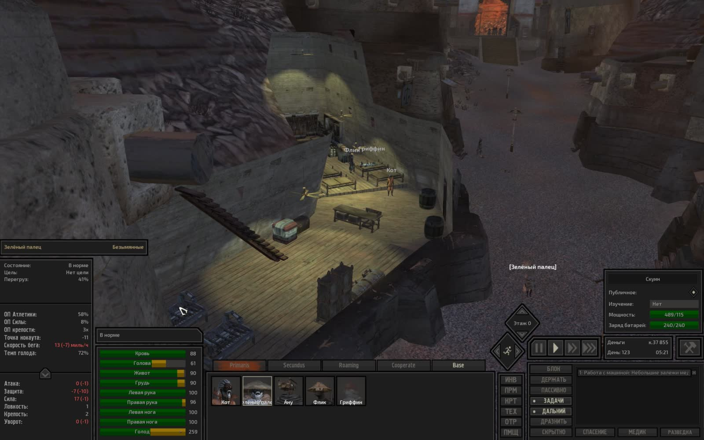

---

### Серия 10 (1 кадр)

- **Файловое время**: с `2026-11-01T12:41:26Z` по `2026-11-01T12:41:26Z`
- **Игровое время (OCR)**: `День 124, 08:44`
- **Локация (OCR)**: Не зафиксирована в UI
- **Персонажи в UI (OCR)**: Хот Лон

**Кадры серии:**
- [screenshot_321-538c3f89.jpg](screenshot_321-538c3f89.jpg) ([GitHub](https://github.com/asaf1n/Kenshi-Compain/blob/main/published/screenshots/screenshot_321-538c3f89.jpg) | [Raw](https://raw.githubusercontent.com/asaf1n/Kenshi-Compain/main/published/screenshots/screenshot_321-538c3f89.jpg))

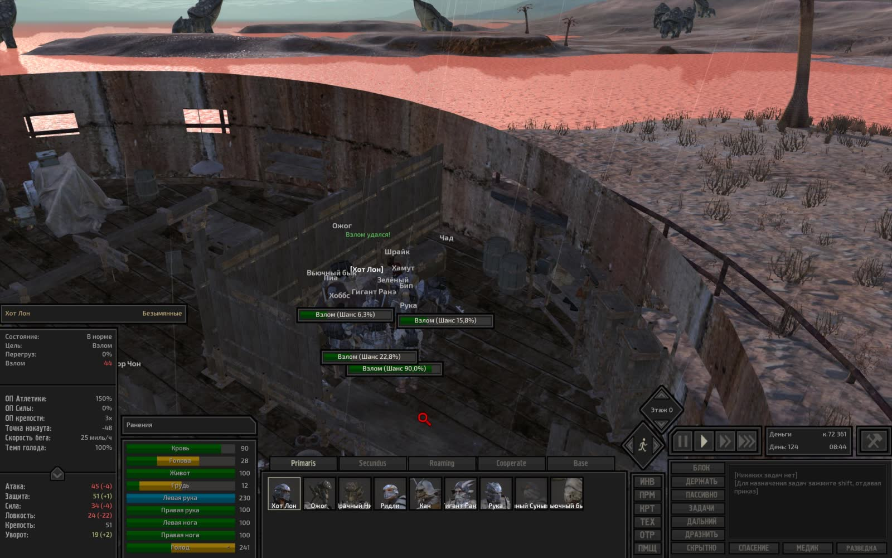

---

### Серия 11 (1 кадр)

- **Файловое время**: с `2026-11-01T13:24:08Z` по `2026-11-01T13:24:08Z`
- **Игровое время (OCR)**: `День 125, 00:41`
- **Локация (OCR)**: Не зафиксирована в UI
- **Персонажи в UI (OCR)**: Не зафиксированы в UI
- **Задачи/предметы в UI**: Быть рядом: Хот Лон, Охранять: Хот Лон

**Кадры серии:**
- [screenshot_334-da3d91e8.jpg](screenshot_334-da3d91e8.jpg) ([GitHub](https://github.com/asaf1n/Kenshi-Compain/blob/main/published/screenshots/screenshot_334-da3d91e8.jpg) | [Raw](https://raw.githubusercontent.com/asaf1n/Kenshi-Compain/main/published/screenshots/screenshot_334-da3d91e8.jpg))

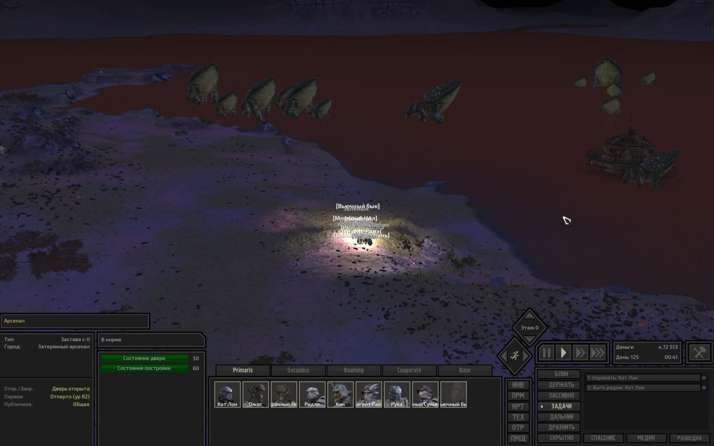

---

### Серия 12 (1 кадр)

- **Файловое время**: с `2026-11-01T16:21:03Z` по `2026-11-01T16:21:03Z`
- **Игровое время (OCR)**: `День 125, 18:52`
- **Локация (OCR)**: Не зафиксирована в UI
- **Персонажи в UI (OCR)**: Флик
- **Задачи/предметы в UI**: Быть рядом: Вьючный бык, Медик, Роботехника

**Кадры серии:**
- [screenshot_343-bafed3e6.jpg](screenshot_343-bafed3e6.jpg) ([GitHub](https://github.com/asaf1n/Kenshi-Compain/blob/main/published/screenshots/screenshot_343-bafed3e6.jpg) | [Raw](https://raw.githubusercontent.com/asaf1n/Kenshi-Compain/main/published/screenshots/screenshot_343-bafed3e6.jpg))

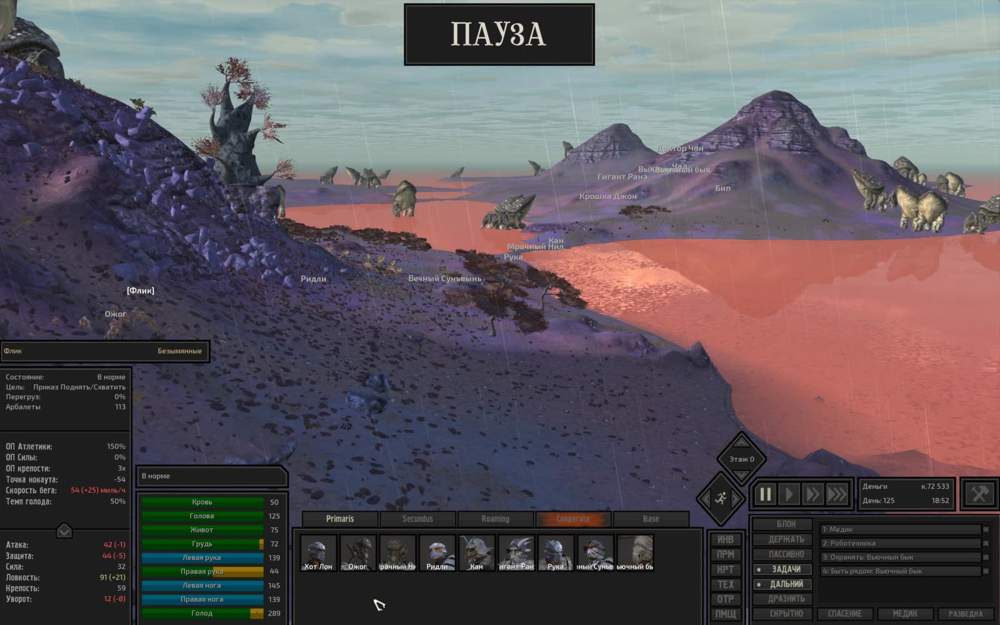

---

### Серия 13 (1 кадр)

- **Файловое время**: с `2026-11-02T00:35:11Z` по `2026-11-02T00:35:11Z`
- **Игровое время (OCR)**: `День 127, 17:06`
- **Локация (OCR)**: Не зафиксирована в UI
- **Персонажи в UI (OCR)**: Не зафиксированы в UI

**Кадры серии:**
- [screenshot_365-7175b352.jpg](screenshot_365-7175b352.jpg) ([GitHub](https://github.com/asaf1n/Kenshi-Compain/blob/main/published/screenshots/screenshot_365-7175b352.jpg) | [Raw](https://raw.githubusercontent.com/asaf1n/Kenshi-Compain/main/published/screenshots/screenshot_365-7175b352.jpg))

---

### Серия 14 (1 кадр)

- **Файловое время**: с `2026-11-03T01:07:08Z` по `2026-11-03T01:07:08Z`
- **Игровое время (OCR)**: `День 129, 15:24`
- **Локация (OCR)**: Не зафиксирована в UI
- **Персонажи в UI (OCR)**: Каменная крыса

**Кадры серии:**
- [screenshot_375-b77d3512.jpg](screenshot_375-b77d3512.jpg) ([GitHub](https://github.com/asaf1n/Kenshi-Compain/blob/main/published/screenshots/screenshot_375-b77d3512.jpg) | [Raw](https://raw.githubusercontent.com/asaf1n/Kenshi-Compain/main/published/screenshots/screenshot_375-b77d3512.jpg))

---

### Серия 15 (1 кадр)

- **Файловое время**: с `2026-11-03T02:06:49Z` по `2026-11-03T02:06:49Z`
- **Игровое время (OCR)**: `День 130, 04:54`
- **Локация (OCR)**: Не зафиксирована в UI
- **Персонажи в UI (OCR)**: Хот Лон
- **Задачи/предметы в UI**: Медик, Роботехника

**Кадры серии:**
- [screenshot_395-4a483f34.jpg](screenshot_395-4a483f34.jpg) ([GitHub](https://github.com/asaf1n/Kenshi-Compain/blob/main/published/screenshots/screenshot_395-4a483f34.jpg) | [Raw](https://raw.githubusercontent.com/asaf1n/Kenshi-Compain/main/published/screenshots/screenshot_395-4a483f34.jpg))

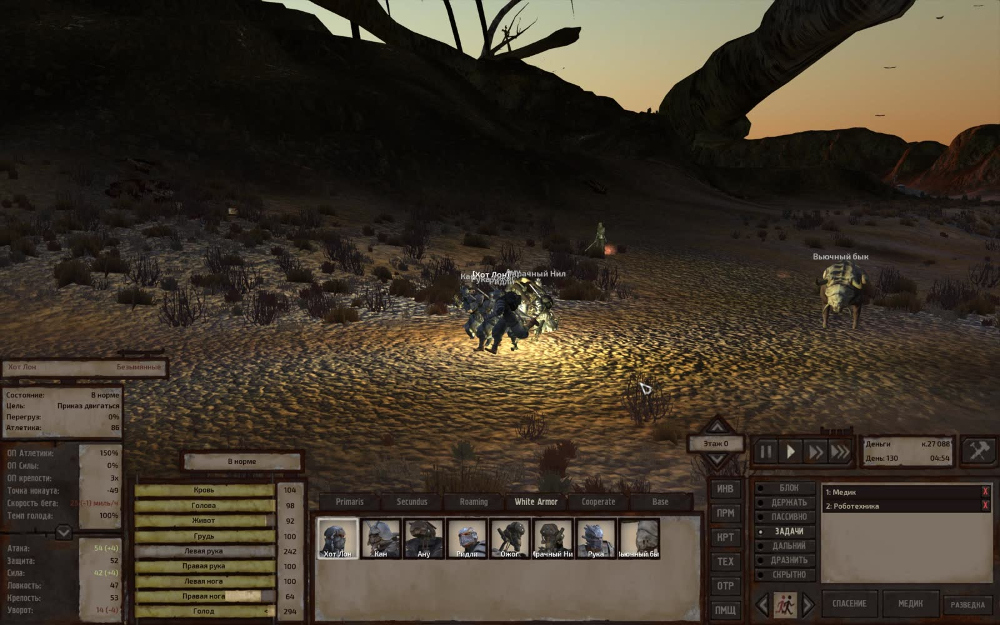

---

### Серия 16 (1 кадр)

- **Файловое время**: с `2026-11-03T02:34:20Z` по `2026-11-03T02:34:20Z`
- **Игровое время (OCR)**: `День 130, 06:51`
- **Локация (OCR)**: Не зафиксирована в UI
- **Персонажи в UI (OCR)**: Вьючный бык

**Кадры серии:**
- [screenshot_407-cfa38d08.jpg](screenshot_407-cfa38d08.jpg) ([GitHub](https://github.com/asaf1n/Kenshi-Compain/blob/main/published/screenshots/screenshot_407-cfa38d08.jpg) | [Raw](https://raw.githubusercontent.com/asaf1n/Kenshi-Compain/main/published/screenshots/screenshot_407-cfa38d08.jpg))

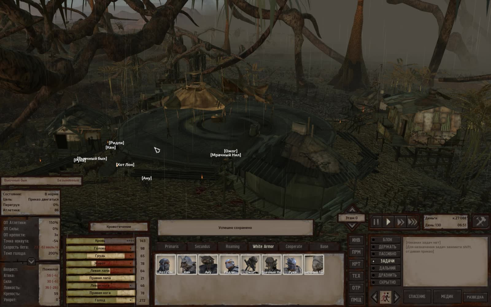

---

### Серия 17 (1 кадр)

- **Файловое время**: с `2026-11-03T02:56:07Z` по `2026-11-03T02:56:07Z`
- **Игровое время (OCR)**: `День 130, 08:35`
- **Локация (OCR)**: Не зафиксирована в UI
- **Персонажи в UI (OCR)**: туз эл
- **Задачи/предметы в UI**: Медик, Роботехника

**Кадры серии:**
- [screenshot_418-0fcab0ed.jpg](screenshot_418-0fcab0ed.jpg) ([GitHub](https://github.com/asaf1n/Kenshi-Compain/blob/main/published/screenshots/screenshot_418-0fcab0ed.jpg) | [Raw](https://raw.githubusercontent.com/asaf1n/Kenshi-Compain/main/published/screenshots/screenshot_418-0fcab0ed.jpg))

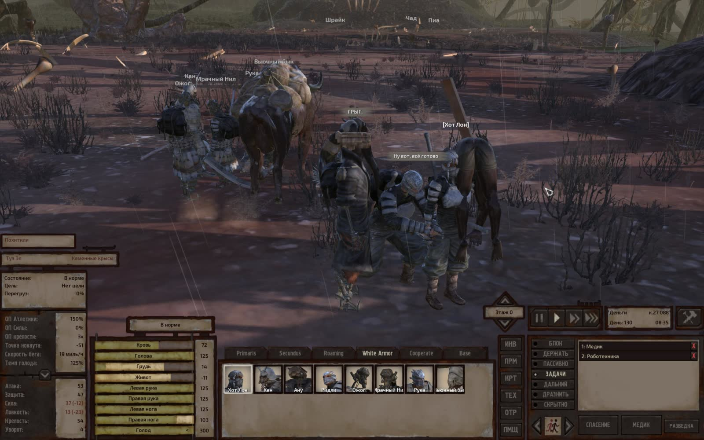

---

### Серия 18 (1 кадр)

- **Файловое время**: с `2026-11-04T16:41:25Z` по `2026-11-04T16:41:25Z`
- **Игровое время (OCR)**: `Не зафиксировано в UI`
- **Локация (OCR)**: Не зафиксирована в UI
- **Персонажи в UI (OCR)**: Не зафиксированы в UI

**Кадры серии:**
- [screenshot_438-a347c027.jpg](screenshot_438-a347c027.jpg) ([GitHub](https://github.com/asaf1n/Kenshi-Compain/blob/main/published/screenshots/screenshot_438-a347c027.jpg) | [Raw](https://raw.githubusercontent.com/asaf1n/Kenshi-Compain/main/published/screenshots/screenshot_438-a347c027.jpg))

---

### Серия 19 (1 кадр)

- **Файловое время**: с `2026-11-06T00:20:27Z` по `2026-11-06T00:20:27Z`
- **Игровое время (OCR)**: `День 133, 12:18`
- **Локация (OCR)**: Не зафиксирована в UI
- **Персонажи в UI (OCR)**: Не зафиксированы в UI
- **Задачи/предметы в UI**: Медик, Роботехника

**Кадры серии:**
- [screenshot_449-be991bca.jpg](screenshot_449-be991bca.jpg) ([GitHub](https://github.com/asaf1n/Kenshi-Compain/blob/main/published/screenshots/screenshot_449-be991bca.jpg) | [Raw](https://raw.githubusercontent.com/asaf1n/Kenshi-Compain/main/published/screenshots/screenshot_449-be991bca.jpg))

---

### Серия 20 (1 кадр)

- **Файловое время**: с `2026-11-06T00:51:48Z` по `2026-11-06T00:51:48Z`
- **Игровое время (OCR)**: `День 133, 17:19`
- **Локация (OCR)**: Не зафиксирована в UI
- **Персонажи в UI (OCR)**: Зелёный палец
- **Задачи/предметы в UI**: Работа с машиной: Пеньковая ферма, Работа с машиной: Рисовая ферма 1-, Тащить в: Хранение: пенька, Тащить в: Хранение: рис

**Кадры серии:**
- [screenshot_474-52bb0da7.jpg](screenshot_474-52bb0da7.jpg) ([GitHub](https://github.com/asaf1n/Kenshi-Compain/blob/main/published/screenshots/screenshot_474-52bb0da7.jpg) | [Raw](https://raw.githubusercontent.com/asaf1n/Kenshi-Compain/main/published/screenshots/screenshot_474-52bb0da7.jpg))

---

### Серия 21 (1 кадр)

- **Файловое время**: с `2026-11-06T01:42:12Z` по `2026-11-06T01:42:12Z`
- **Игровое время (OCR)**: `День 134, 08:21`
- **Локация (OCR)**: Не зафиксирована в UI
- **Персонажи в UI (OCR)**: Шрайк
- **Задачи/предметы в UI**: Быть рядом: Хот Лон, Медик, Роботехника

**Кадры серии:**
- [screenshot_484-f57d65fd.jpg](screenshot_484-f57d65fd.jpg) ([GitHub](https://github.com/asaf1n/Kenshi-Compain/blob/main/published/screenshots/screenshot_484-f57d65fd.jpg) | [Raw](https://raw.githubusercontent.com/asaf1n/Kenshi-Compain/main/published/screenshots/screenshot_484-f57d65fd.jpg))

---

### Серия 22 (1 кадр)

- **Файловое время**: с `2026-11-06T14:25:09Z` по `2026-11-06T14:25:09Z`
- **Игровое время (OCR)**: `День 134, 11:43`
- **Локация (OCR)**: Не зафиксирована в UI
- **Персонажи в UI (OCR)**: Не зафиксированы в UI

**Кадры серии:**
- [screenshot_486-7505944b.jpg](screenshot_486-7505944b.jpg) ([GitHub](https://github.com/asaf1n/Kenshi-Compain/blob/main/published/screenshots/screenshot_486-7505944b.jpg) | [Raw](https://raw.githubusercontent.com/asaf1n/Kenshi-Compain/main/published/screenshots/screenshot_486-7505944b.jpg))

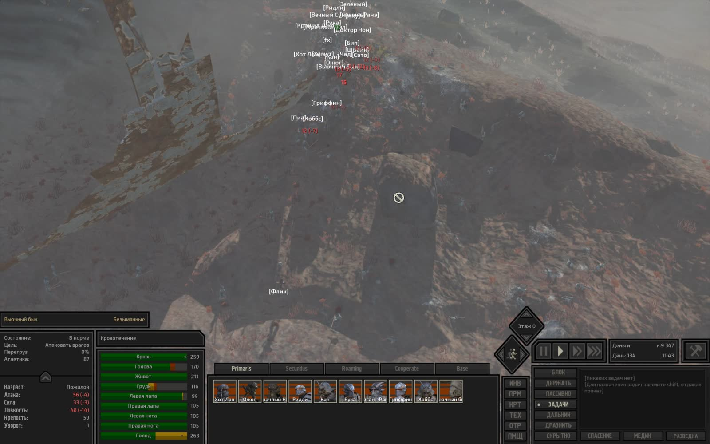

---

### Серия 23 (1 кадр)

- **Файловое время**: с `2026-11-06T14:25:11Z` по `2026-11-06T14:25:11Z`
- **Игровое время (OCR)**: `День 134, 11:43`
- **Локация (OCR)**: Не зафиксирована в UI
- **Персонажи в UI (OCR)**: Не зафиксированы в UI

**Кадры серии:**
- [screenshot_487-d52f7642.jpg](screenshot_487-d52f7642.jpg) ([GitHub](https://github.com/asaf1n/Kenshi-Compain/blob/main/published/screenshots/screenshot_487-d52f7642.jpg) | [Raw](https://raw.githubusercontent.com/asaf1n/Kenshi-Compain/main/published/screenshots/screenshot_487-d52f7642.jpg))

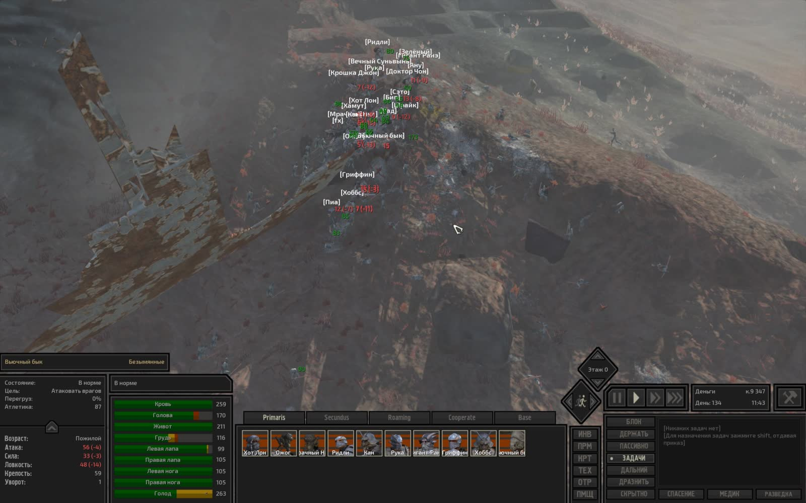

---

### Серия 24 (1 кадр)

- **Файловое время**: с `2026-11-06T14:25:16Z` по `2026-11-06T14:25:16Z`
- **Игровое время (OCR)**: `День 134, 11:46`
- **Локация (OCR)**: Не зафиксирована в UI
- **Персонажи в UI (OCR)**: Не зафиксированы в UI

**Кадры серии:**
- [screenshot_488-78a1f13f.jpg](screenshot_488-78a1f13f.jpg) ([GitHub](https://github.com/asaf1n/Kenshi-Compain/blob/main/published/screenshots/screenshot_488-78a1f13f.jpg) | [Raw](https://raw.githubusercontent.com/asaf1n/Kenshi-Compain/main/published/screenshots/screenshot_488-78a1f13f.jpg))

---

### Серия 25 (1 кадр)

- **Файловое время**: с `2026-11-06T14:26:23Z` по `2026-11-06T14:26:23Z`
- **Игровое время (OCR)**: `День 134, 12:18`
- **Локация (OCR)**: Не зафиксирована в UI
- **Персонажи в UI (OCR)**: Не зафиксированы в UI
- **Задачи/предметы в UI**: Быть рядом: Хот Лон, Медик, Роботехника

**Кадры серии:**
- [screenshot_489-f198feea.jpg](screenshot_489-f198feea.jpg) ([GitHub](https://github.com/asaf1n/Kenshi-Compain/blob/main/published/screenshots/screenshot_489-f198feea.jpg) | [Raw](https://raw.githubusercontent.com/asaf1n/Kenshi-Compain/main/published/screenshots/screenshot_489-f198feea.jpg))

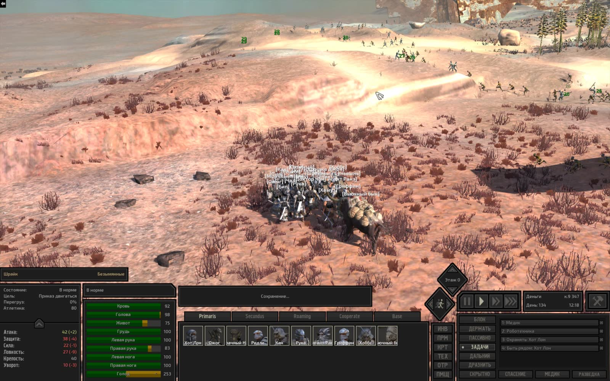

---

### Серия 26 (1 кадр)

- **Файловое время**: с `2026-11-06T14:26:29Z` по `2026-11-06T14:26:29Z`
- **Игровое время (OCR)**: `День 134, 12:19`
- **Локация (OCR)**: Не зафиксирована в UI
- **Персонажи в UI (OCR)**: Не зафиксированы в UI
- **Задачи/предметы в UI**: Быть рядом: Хот Лон, Медик, Роботехника

**Кадры серии:**
- [screenshot_490-62e8b529.jpg](screenshot_490-62e8b529.jpg) ([GitHub](https://github.com/asaf1n/Kenshi-Compain/blob/main/published/screenshots/screenshot_490-62e8b529.jpg) | [Raw](https://raw.githubusercontent.com/asaf1n/Kenshi-Compain/main/published/screenshots/screenshot_490-62e8b529.jpg))

---

### Серия 27 (1 кадр)

- **Файловое время**: с `2026-11-06T14:26:45Z` по `2026-11-06T14:26:45Z`
- **Игровое время (OCR)**: `День 134, 12:27`
- **Локация (OCR)**: Не зафиксирована в UI
- **Персонажи в UI (OCR)**: Не зафиксированы в UI
- **Задачи/предметы в UI**: Быть рядом: Хот Лон, Медик, Роботехника

**Кадры серии:**
- [screenshot_491-54bd775a.jpg](screenshot_491-54bd775a.jpg) ([GitHub](https://github.com/asaf1n/Kenshi-Compain/blob/main/published/screenshots/screenshot_491-54bd775a.jpg) | [Raw](https://raw.githubusercontent.com/asaf1n/Kenshi-Compain/main/published/screenshots/screenshot_491-54bd775a.jpg))

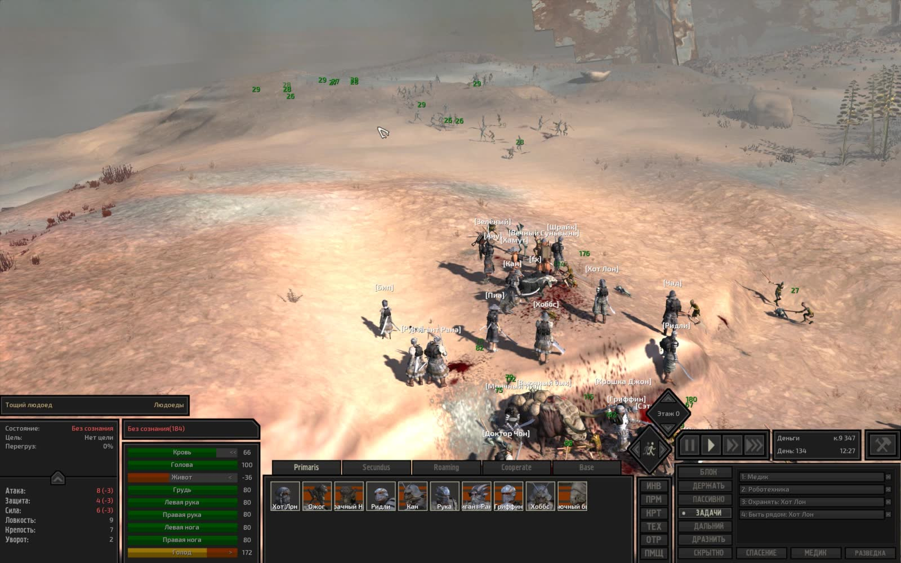

---

### Серия 28 (1 кадр)

- **Файловое время**: с `2026-11-06T14:30:53Z` по `2026-11-06T14:30:53Z`
- **Игровое время (OCR)**: `День 134, 14:19`
- **Локация (OCR)**: Не зафиксирована в UI
- **Персонажи в UI (OCR)**: Шрайк
- **Задачи/предметы в UI**: Быть рядом: Хот Лон, Медик, Роботехника

**Кадры серии:**
- [screenshot_492-a754c5d0.jpg](screenshot_492-a754c5d0.jpg) ([GitHub](https://github.com/asaf1n/Kenshi-Compain/blob/main/published/screenshots/screenshot_492-a754c5d0.jpg) | [Raw](https://raw.githubusercontent.com/asaf1n/Kenshi-Compain/main/published/screenshots/screenshot_492-a754c5d0.jpg))

---

### Серия 29 (1 кадр)

- **Файловое время**: с `2026-11-06T14:37:06Z` по `2026-11-06T14:37:06Z`
- **Игровое время (OCR)**: `День 134, 16:54`
- **Локация (OCR)**: Не зафиксирована в UI
- **Персонажи в UI (OCR)**: Бандит
- **Задачи/предметы в UI**: Быть рядом: Хот Лон, Медик, Роботехника

**Кадры серии:**
- [screenshot_493-50f6c74d.jpg](screenshot_493-50f6c74d.jpg) ([GitHub](https://github.com/asaf1n/Kenshi-Compain/blob/main/published/screenshots/screenshot_493-50f6c74d.jpg) | [Raw](https://raw.githubusercontent.com/asaf1n/Kenshi-Compain/main/published/screenshots/screenshot_493-50f6c74d.jpg))

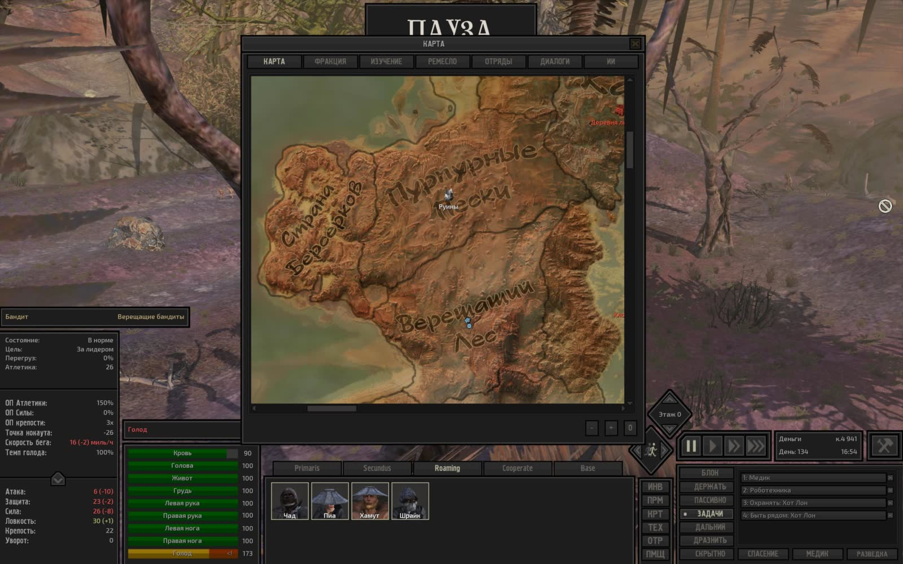

---

### Серия 30 (1 кадр)

- **Файловое время**: с `2026-11-06T14:45:10Z` по `2026-11-06T14:45:10Z`
- **Игровое время (OCR)**: `День 134, 16:54`
- **Локация (OCR)**: Не зафиксирована в UI
- **Персонажи в UI (OCR)**: Бандит
- **Задачи/предметы в UI**: Быть рядом: Хот Лон, Медик, Роботехника

**Кадры серии:**
- [screenshot_494-10df7063.jpg](screenshot_494-10df7063.jpg) ([GitHub](https://github.com/asaf1n/Kenshi-Compain/blob/main/published/screenshots/screenshot_494-10df7063.jpg) | [Raw](https://raw.githubusercontent.com/asaf1n/Kenshi-Compain/main/published/screenshots/screenshot_494-10df7063.jpg))

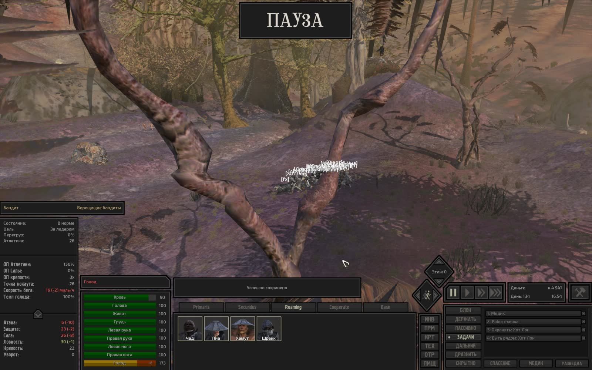

---
