# Техническая лента скриншотов Kenshi

- **Сформировано**: `2026-11-11T09:13:13Z`
- **Окно выборки**: последние 7 суток (с `2026-11-04T09:13:13Z` по `2026-11-11T09:13:13Z`)
- **Всего скриншотов в окне**: 30
- **Сгруппировано серий/кадров**: 30

Техническая лента сгруппированных по сходству кадров с извлеченным текстом интерфейса (OCR). Интерпретация происходящего в игре полностью принадлежит LLM-компаньону по оригинальным изображениям.

---

### Серия 1 (1 кадр)

- **Файловое время**: с `2026-11-04T16:38:17Z` по `2026-11-04T16:38:17Z`
- **Игровое время (OCR)**: `Не зафиксировано в UI`
- **Локация (OCR)**: Не зафиксирована в UI
- **Персонажи в UI (OCR)**: Не зафиксированы в UI

**Кадры серии:**
- [screenshot_436-2ef3fde8.jpg](screenshot_436-2ef3fde8.jpg) ([GitHub](https://github.com/asaf1n/Kenshi-Compain/blob/main/published/screenshots/screenshot_436-2ef3fde8.jpg) | [Raw](https://raw.githubusercontent.com/asaf1n/Kenshi-Compain/main/published/screenshots/screenshot_436-2ef3fde8.jpg))

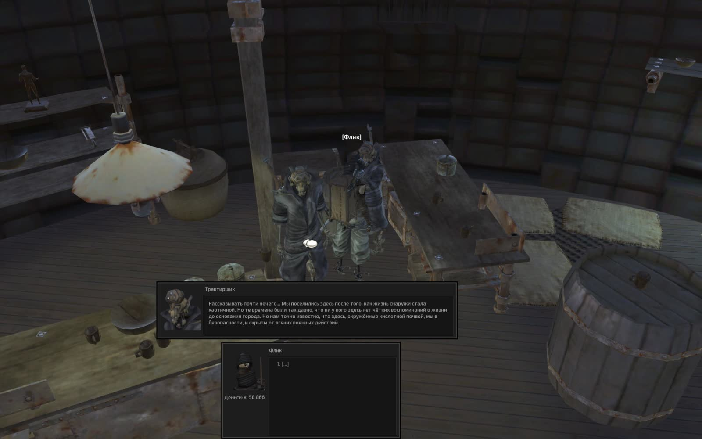

---

### Серия 2 (1 кадр)

- **Файловое время**: с `2026-11-04T16:48:52Z` по `2026-11-04T16:48:52Z`
- **Игровое время (OCR)**: `День 132, 18:22`
- **Локация (OCR)**: Не зафиксирована в UI
- **Персонажи в UI (OCR)**: Седая тень
- **Задачи/предметы в UI**: Быть рядом: Вьючный бык, Охранять: Вьючный бык

**Кадры серии:**
- [screenshot_439-98a2cb8e.jpg](screenshot_439-98a2cb8e.jpg) ([GitHub](https://github.com/asaf1n/Kenshi-Compain/blob/main/published/screenshots/screenshot_439-98a2cb8e.jpg) | [Raw](https://raw.githubusercontent.com/asaf1n/Kenshi-Compain/main/published/screenshots/screenshot_439-98a2cb8e.jpg))

---

### Серия 3 (1 кадр)

- **Файловое время**: с `2026-11-04T20:49:42Z` по `2026-11-04T20:49:42Z`
- **Игровое время (OCR)**: `День 133, 05:09`
- **Локация (OCR)**: Не зафиксирована в UI
- **Персонажи в UI (OCR)**: Не зафиксированы в UI
- **Задачи/предметы в UI**: Быть рядом: Хот Лон, Медик, Роботехника

**Кадры серии:**
- [screenshot_444-fa464e38.jpg](screenshot_444-fa464e38.jpg) ([GitHub](https://github.com/asaf1n/Kenshi-Compain/blob/main/published/screenshots/screenshot_444-fa464e38.jpg) | [Raw](https://raw.githubusercontent.com/asaf1n/Kenshi-Compain/main/published/screenshots/screenshot_444-fa464e38.jpg))

---

### Серия 4 (1 кадр)

- **Файловое время**: с `2026-11-06T00:19:10Z` по `2026-11-06T00:19:10Z`
- **Игровое время (OCR)**: `День 133, 11:40`
- **Локация (OCR)**: Не зафиксирована в UI
- **Персонажи в UI (OCR)**: Пиа
- **Задачи/предметы в UI**: Медик, Роботехника

**Кадры серии:**
- [screenshot_447-62a59c4e.jpg](screenshot_447-62a59c4e.jpg) ([GitHub](https://github.com/asaf1n/Kenshi-Compain/blob/main/published/screenshots/screenshot_447-62a59c4e.jpg) | [Raw](https://raw.githubusercontent.com/asaf1n/Kenshi-Compain/main/published/screenshots/screenshot_447-62a59c4e.jpg))

---

### Серия 5 (1 кадр)

- **Файловое время**: с `2026-11-06T00:20:56Z` по `2026-11-06T00:20:56Z`
- **Игровое время (OCR)**: `День 133, 12:27`
- **Локация (OCR)**: Не зафиксирована в UI
- **Персонажи в UI (OCR)**: Инквизитор Сэта
- **Задачи/предметы в UI**: Медик, Роботехника

**Кадры серии:**
- [screenshot_451-414dccf2.jpg](screenshot_451-414dccf2.jpg) ([GitHub](https://github.com/asaf1n/Kenshi-Compain/blob/main/published/screenshots/screenshot_451-414dccf2.jpg) | [Raw](https://raw.githubusercontent.com/asaf1n/Kenshi-Compain/main/published/screenshots/screenshot_451-414dccf2.jpg))

---

### Серия 6 (1 кадр)

- **Файловое время**: с `2026-11-06T00:22:15Z` по `2026-11-06T00:22:15Z`
- **Игровое время (OCR)**: `День 133, 12:35`
- **Локация (OCR)**: Не зафиксирована в UI
- **Персонажи в UI (OCR)**: Пиа
- **Задачи/предметы в UI**: Медик, Роботехника

**Кадры серии:**
- [screenshot_457-371c1c7a.jpg](screenshot_457-371c1c7a.jpg) ([GitHub](https://github.com/asaf1n/Kenshi-Compain/blob/main/published/screenshots/screenshot_457-371c1c7a.jpg) | [Raw](https://raw.githubusercontent.com/asaf1n/Kenshi-Compain/main/published/screenshots/screenshot_457-371c1c7a.jpg))

---

### Серия 7 (1 кадр)

- **Файловое время**: с `2026-11-06T00:27:39Z` по `2026-11-06T00:27:39Z`
- **Игровое время (OCR)**: `День 133, 14:24`
- **Локация (OCR)**: Не зафиксирована в UI
- **Персонажи в UI (OCR)**: Мью
- **Задачи/предметы в UI**: Работа с машиной: Кухонная плита, Работа с машиной: Рисовая ферма 1-, Работа с машиной: Рисовая ферма L, Тащить в: Хранение: еда

**Кадры серии:**
- [screenshot_463-701918e2.jpg](screenshot_463-701918e2.jpg) ([GitHub](https://github.com/asaf1n/Kenshi-Compain/blob/main/published/screenshots/screenshot_463-701918e2.jpg) | [Raw](https://raw.githubusercontent.com/asaf1n/Kenshi-Compain/main/published/screenshots/screenshot_463-701918e2.jpg))

---

### Серия 8 (1 кадр)

- **Файловое время**: с `2026-11-06T00:29:39Z` по `2026-11-06T00:29:39Z`
- **Игровое время (OCR)**: `День 133, 15:02`
- **Локация (OCR)**: Не зафиксирована в UI
- **Персонажи в UI (OCR)**: Шрайк
- **Задачи/предметы в UI**: Быть рядом: Хот Лон, Медик, Роботехника

**Кадры серии:**
- [screenshot_467-44779d9b.jpg](screenshot_467-44779d9b.jpg) ([GitHub](https://github.com/asaf1n/Kenshi-Compain/blob/main/published/screenshots/screenshot_467-44779d9b.jpg) | [Raw](https://raw.githubusercontent.com/asaf1n/Kenshi-Compain/main/published/screenshots/screenshot_467-44779d9b.jpg))

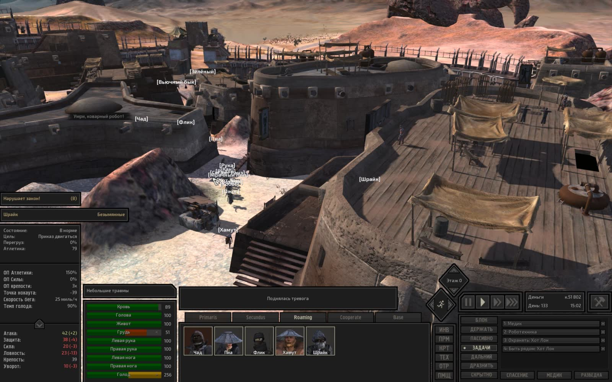

---

### Серия 9 (1 кадр)

- **Файловое время**: с `2026-11-06T00:37:39Z` по `2026-11-06T00:37:39Z`
- **Игровое время (OCR)**: `День 133, 15:41`
- **Локация (OCR)**: Не зафиксирована в UI
- **Персонажи в UI (OCR)**: Инквизитор Сэта
- **Задачи/предметы в UI**: Быть рядом: Зелёный, Быть рядом: Хот Лон, Охранять: Зелёный

**Кадры серии:**
- [screenshot_471-48e12177.jpg](screenshot_471-48e12177.jpg) ([GitHub](https://github.com/asaf1n/Kenshi-Compain/blob/main/published/screenshots/screenshot_471-48e12177.jpg) | [Raw](https://raw.githubusercontent.com/asaf1n/Kenshi-Compain/main/published/screenshots/screenshot_471-48e12177.jpg))

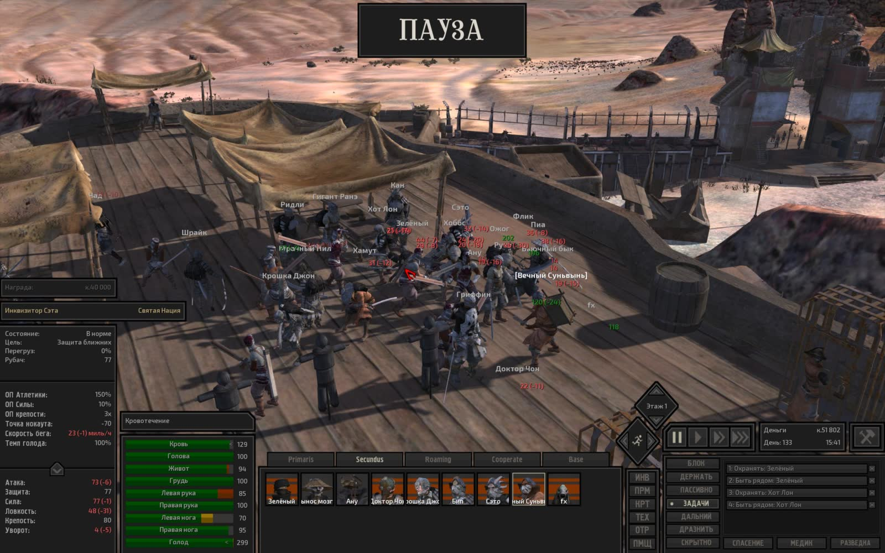

---

### Серия 10 (1 кадр)

- **Файловое время**: с `2026-11-06T00:51:48Z` по `2026-11-06T00:51:48Z`
- **Игровое время (OCR)**: `День 133, 17:19`
- **Локация (OCR)**: Не зафиксирована в UI
- **Персонажи в UI (OCR)**: Зелёный палец
- **Задачи/предметы в UI**: Работа с машиной: Пеньковая ферма, Работа с машиной: Рисовая ферма 1-, Тащить в: Хранение: пенька, Тащить в: Хранение: рис

**Кадры серии:**
- [screenshot_474-52bb0da7.jpg](screenshot_474-52bb0da7.jpg) ([GitHub](https://github.com/asaf1n/Kenshi-Compain/blob/main/published/screenshots/screenshot_474-52bb0da7.jpg) | [Raw](https://raw.githubusercontent.com/asaf1n/Kenshi-Compain/main/published/screenshots/screenshot_474-52bb0da7.jpg))

---

### Серия 11 (1 кадр)

- **Файловое время**: с `2026-11-06T01:08:32Z` по `2026-11-06T01:08:32Z`
- **Игровое время (OCR)**: `День 133, 23:25`
- **Локация (OCR)**: Не зафиксирована в UI
- **Персонажи в UI (OCR)**: Стражница
- **Задачи/предметы в UI**: Быть рядом: Хот Лон, Медик, Роботехника

**Кадры серии:**
- [screenshot_477-c108555d.jpg](screenshot_477-c108555d.jpg) ([GitHub](https://github.com/asaf1n/Kenshi-Compain/blob/main/published/screenshots/screenshot_477-c108555d.jpg) | [Raw](https://raw.githubusercontent.com/asaf1n/Kenshi-Compain/main/published/screenshots/screenshot_477-c108555d.jpg))

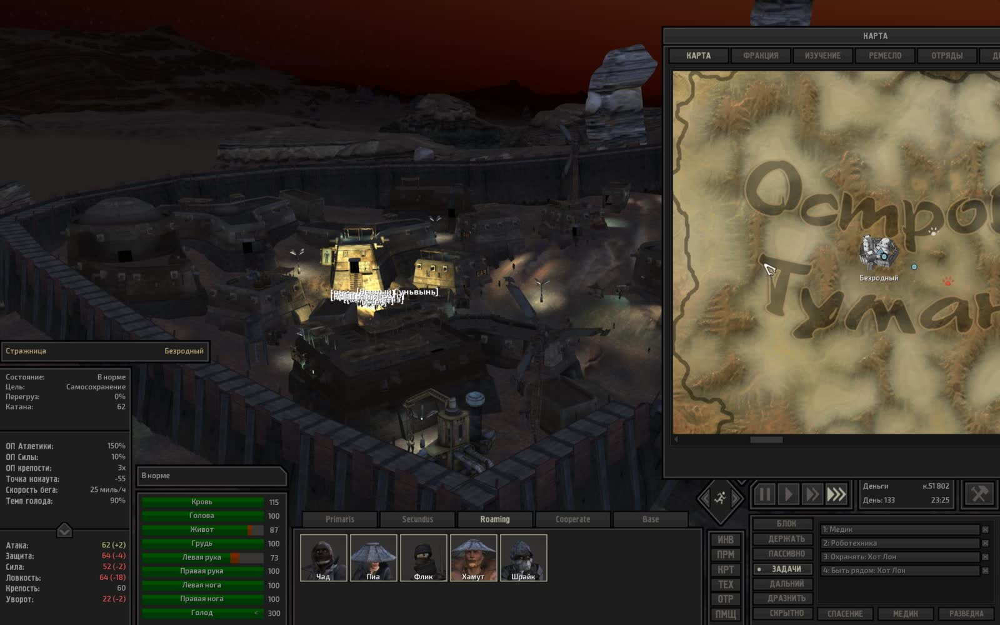

---

### Серия 12 (1 кадр)

- **Файловое время**: с `2026-11-06T01:31:14Z` по `2026-11-06T01:31:14Z`
- **Игровое время (OCR)**: `День 134, 05:53`
- **Локация (OCR)**: Не зафиксирована в UI
- **Персонажи в UI (OCR)**: Шрайк
- **Задачи/предметы в UI**: Быть рядом: Хот Лон, Медик, Роботехника

**Кадры серии:**
- [screenshot_481-ae3e5601.jpg](screenshot_481-ae3e5601.jpg) ([GitHub](https://github.com/asaf1n/Kenshi-Compain/blob/main/published/screenshots/screenshot_481-ae3e5601.jpg) | [Raw](https://raw.githubusercontent.com/asaf1n/Kenshi-Compain/main/published/screenshots/screenshot_481-ae3e5601.jpg))

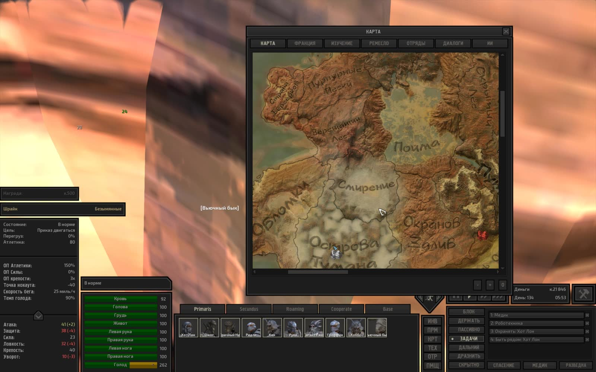

---

### Серия 13 (1 кадр)

- **Файловое время**: с `2026-11-06T01:42:12Z` по `2026-11-06T01:42:12Z`
- **Игровое время (OCR)**: `День 134, 08:21`
- **Локация (OCR)**: Не зафиксирована в UI
- **Персонажи в UI (OCR)**: Шрайк
- **Задачи/предметы в UI**: Быть рядом: Хот Лон, Медик, Роботехника

**Кадры серии:**
- [screenshot_484-f57d65fd.jpg](screenshot_484-f57d65fd.jpg) ([GitHub](https://github.com/asaf1n/Kenshi-Compain/blob/main/published/screenshots/screenshot_484-f57d65fd.jpg) | [Raw](https://raw.githubusercontent.com/asaf1n/Kenshi-Compain/main/published/screenshots/screenshot_484-f57d65fd.jpg))

---

### Серия 14 (1 кадр)

- **Файловое время**: с `2026-11-06T14:25:16Z` по `2026-11-06T14:25:16Z`
- **Игровое время (OCR)**: `День 134, 11:46`
- **Локация (OCR)**: Не зафиксирована в UI
- **Персонажи в UI (OCR)**: Не зафиксированы в UI

**Кадры серии:**
- [screenshot_488-78a1f13f.jpg](screenshot_488-78a1f13f.jpg) ([GitHub](https://github.com/asaf1n/Kenshi-Compain/blob/main/published/screenshots/screenshot_488-78a1f13f.jpg) | [Raw](https://raw.githubusercontent.com/asaf1n/Kenshi-Compain/main/published/screenshots/screenshot_488-78a1f13f.jpg))

---

### Серия 15 (1 кадр)

- **Файловое время**: с `2026-11-06T14:26:45Z` по `2026-11-06T14:26:45Z`
- **Игровое время (OCR)**: `День 134, 12:27`
- **Локация (OCR)**: Не зафиксирована в UI
- **Персонажи в UI (OCR)**: Не зафиксированы в UI
- **Задачи/предметы в UI**: Быть рядом: Хот Лон, Медик, Роботехника

**Кадры серии:**
- [screenshot_491-54bd775a.jpg](screenshot_491-54bd775a.jpg) ([GitHub](https://github.com/asaf1n/Kenshi-Compain/blob/main/published/screenshots/screenshot_491-54bd775a.jpg) | [Raw](https://raw.githubusercontent.com/asaf1n/Kenshi-Compain/main/published/screenshots/screenshot_491-54bd775a.jpg))

---

### Серия 16 (1 кадр)

- **Файловое время**: с `2026-11-06T20:51:25Z` по `2026-11-06T20:51:25Z`
- **Игровое время (OCR)**: `День 734`
- **Локация (OCR)**: Не зафиксирована в UI
- **Персонажи в UI (OCR)**: Не зафиксированы в UI
- **Задачи/предметы в UI**: Быть рядом: Хот Лон, Медик, Роботехника

**Кадры серии:**
- [screenshot_495-31d25d9b.jpg](screenshot_495-31d25d9b.jpg) ([GitHub](https://github.com/asaf1n/Kenshi-Compain/blob/main/published/screenshots/screenshot_495-31d25d9b.jpg) | [Raw](https://raw.githubusercontent.com/asaf1n/Kenshi-Compain/main/published/screenshots/screenshot_495-31d25d9b.jpg))

---

### Серия 17 (1 кадр)

- **Файловое время**: с `2026-11-06T20:53:03Z` по `2026-11-06T20:53:03Z`
- **Игровое время (OCR)**: `Не зафиксировано в UI`
- **Локация (OCR)**: Не зафиксирована в UI
- **Персонажи в UI (OCR)**: Не зафиксированы в UI
- **Задачи/предметы в UI**: Быть рядом: Хот Лон, Медик, Роботехника

**Кадры серии:**
- [screenshot_498-2fde89d1.jpg](screenshot_498-2fde89d1.jpg) ([GitHub](https://github.com/asaf1n/Kenshi-Compain/blob/main/published/screenshots/screenshot_498-2fde89d1.jpg) | [Raw](https://raw.githubusercontent.com/asaf1n/Kenshi-Compain/main/published/screenshots/screenshot_498-2fde89d1.jpg))

---

### Серия 18 (1 кадр)

- **Файловое время**: с `2026-11-06T22:48:59Z` по `2026-11-06T22:48:59Z`
- **Игровое время (OCR)**: `День 135, 04:19`
- **Локация (OCR)**: Не зафиксирована в UI
- **Персонажи в UI (OCR)**: Не зафиксированы в UI
- **Задачи/предметы в UI**: Работа с машиной: Кухонная плита, Работа с машиной: Рисовая ферма 1-, Тащить в: Хранение: еда, Тащить в: Хранение: рис

**Кадры серии:**
- [screenshot_502-d40116c4.jpg](screenshot_502-d40116c4.jpg) ([GitHub](https://github.com/asaf1n/Kenshi-Compain/blob/main/published/screenshots/screenshot_502-d40116c4.jpg) | [Raw](https://raw.githubusercontent.com/asaf1n/Kenshi-Compain/main/published/screenshots/screenshot_502-d40116c4.jpg))

---

### Серия 19 (1 кадр)

- **Файловое время**: с `2026-11-06T22:53:08Z` по `2026-11-06T22:53:08Z`
- **Игровое время (OCR)**: `День 135, 06:01`
- **Локация (OCR)**: Не зафиксирована в UI
- **Персонажи в UI (OCR)**: Не зафиксированы в UI

**Кадры серии:**
- [screenshot_505-1a244c42.jpg](screenshot_505-1a244c42.jpg) ([GitHub](https://github.com/asaf1n/Kenshi-Compain/blob/main/published/screenshots/screenshot_505-1a244c42.jpg) | [Raw](https://raw.githubusercontent.com/asaf1n/Kenshi-Compain/main/published/screenshots/screenshot_505-1a244c42.jpg))

---

### Серия 20 (1 кадр)

- **Файловое время**: с `2026-11-09T04:11:48Z` по `2026-11-09T04:11:48Z`
- **Игровое время (OCR)**: `День 135, 11:52`
- **Локация (OCR)**: Не зафиксирована в UI
- **Персонажи в UI (OCR)**: Не зафиксированы в UI

**Кадры серии:**
- [screenshot_542-725ff73c.jpg](screenshot_542-725ff73c.jpg) ([GitHub](https://github.com/asaf1n/Kenshi-Compain/blob/main/published/screenshots/screenshot_542-725ff73c.jpg) | [Raw](https://raw.githubusercontent.com/asaf1n/Kenshi-Compain/main/published/screenshots/screenshot_542-725ff73c.jpg))

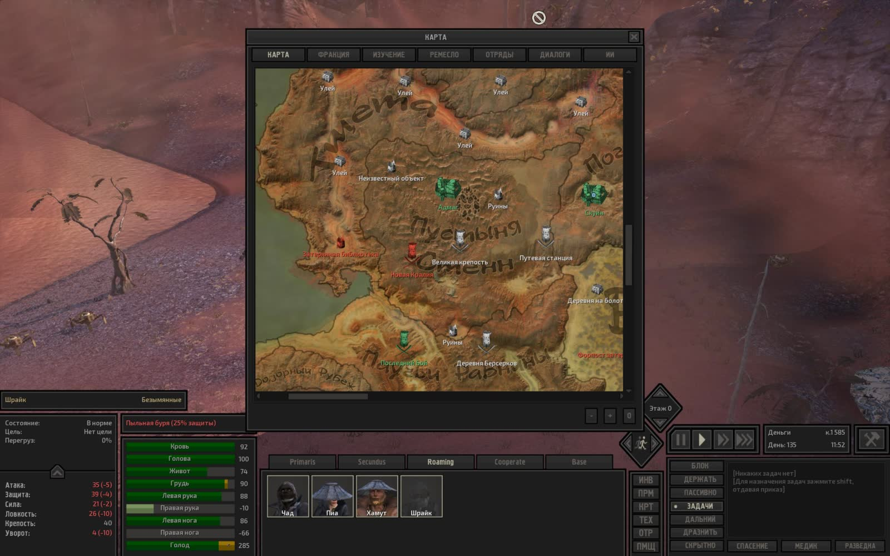

---

### Серия 21 (1 кадр)

- **Файловое время**: с `2026-11-09T04:45:16Z` по `2026-11-09T04:45:16Z`
- **Игровое время (OCR)**: `День 135, 16:05`
- **Локация (OCR)**: Не зафиксирована в UI
- **Персонажи в UI (OCR)**: Не зафиксированы в UI

**Кадры серии:**
- [screenshot_545-1c41c891.jpg](screenshot_545-1c41c891.jpg) ([GitHub](https://github.com/asaf1n/Kenshi-Compain/blob/main/published/screenshots/screenshot_545-1c41c891.jpg) | [Raw](https://raw.githubusercontent.com/asaf1n/Kenshi-Compain/main/published/screenshots/screenshot_545-1c41c891.jpg))

---

### Серия 22 (1 кадр)

- **Файловое время**: с `2026-11-09T05:04:26Z` по `2026-11-09T05:04:26Z`
- **Игровое время (OCR)**: `День 135, 18:48`
- **Локация (OCR)**: Не зафиксирована в UI
- **Персонажи в UI (OCR)**: Не зафиксированы в UI
- **Задачи/предметы в UI**: Медик, Роботехника

**Кадры серии:**
- [screenshot_548-e7fc970b.jpg](screenshot_548-e7fc970b.jpg) ([GitHub](https://github.com/asaf1n/Kenshi-Compain/blob/main/published/screenshots/screenshot_548-e7fc970b.jpg) | [Raw](https://raw.githubusercontent.com/asaf1n/Kenshi-Compain/main/published/screenshots/screenshot_548-e7fc970b.jpg))

---

### Серия 23 (1 кадр)

- **Файловое время**: с `2026-11-09T23:03:28Z` по `2026-11-09T23:03:28Z`
- **Игровое время (OCR)**: `День 136, 00:03`
- **Локация (OCR)**: Не зафиксирована в UI
- **Персонажи в UI (OCR)**: Не зафиксированы в UI
- **Задачи/предметы в UI**: Медик, Охранять: Вик

**Кадры серии:**
- [screenshot_552-3e994ccb.jpg](screenshot_552-3e994ccb.jpg) ([GitHub](https://github.com/asaf1n/Kenshi-Compain/blob/main/published/screenshots/screenshot_552-3e994ccb.jpg) | [Raw](https://raw.githubusercontent.com/asaf1n/Kenshi-Compain/main/published/screenshots/screenshot_552-3e994ccb.jpg))

---

### Серия 24 (1 кадр)

- **Файловое время**: с `2026-11-09T23:30:59Z` по `2026-11-09T23:30:59Z`
- **Игровое время (OCR)**: `День 136, 01:42`
- **Локация (OCR)**: Не зафиксирована в UI
- **Персонажи в UI (OCR)**: Страж Сотни
- **Задачи/предметы в UI**: Медик, Роботехника

**Кадры серии:**
- [screenshot_555-75f3f188.jpg](screenshot_555-75f3f188.jpg) ([GitHub](https://github.com/asaf1n/Kenshi-Compain/blob/main/published/screenshots/screenshot_555-75f3f188.jpg) | [Raw](https://raw.githubusercontent.com/asaf1n/Kenshi-Compain/main/published/screenshots/screenshot_555-75f3f188.jpg))

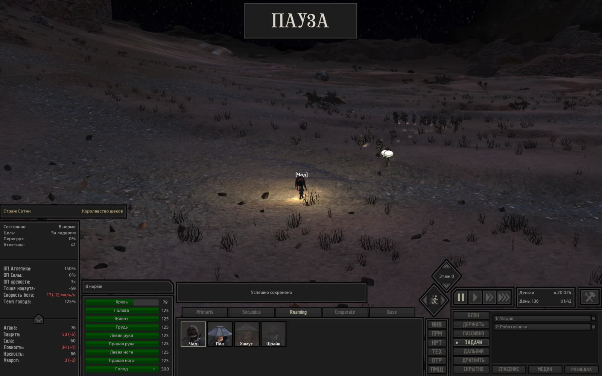

---

### Серия 25 (1 кадр)

- **Файловое время**: с `2026-11-09T23:44:05Z` по `2026-11-09T23:44:05Z`
- **Игровое время (OCR)**: `День 136, 06:16`
- **Локация (OCR)**: Не зафиксирована в UI
- **Персонажи в UI (OCR)**: Кот
- **Задачи/предметы в UI**: Медик, Охранять: Вик

**Кадры серии:**
- [screenshot_559-ae903570.jpg](screenshot_559-ae903570.jpg) ([GitHub](https://github.com/asaf1n/Kenshi-Compain/blob/main/published/screenshots/screenshot_559-ae903570.jpg) | [Raw](https://raw.githubusercontent.com/asaf1n/Kenshi-Compain/main/published/screenshots/screenshot_559-ae903570.jpg))

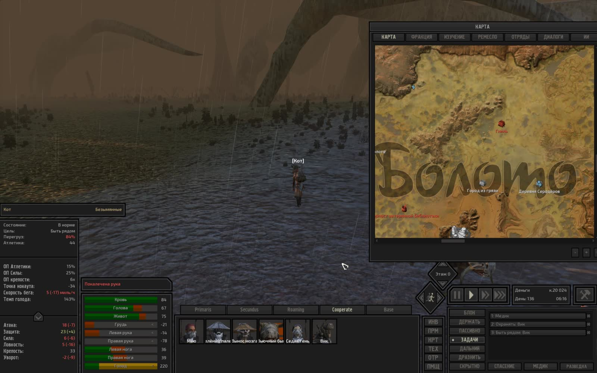

---

### Серия 26 (1 кадр)

- **Файловое время**: с `2026-11-09T23:59:18Z` по `2026-11-09T23:59:18Z`
- **Игровое время (OCR)**: `День 136, 10:14`
- **Локация (OCR)**: Не зафиксирована в UI
- **Персонажи в UI (OCR)**: Паладин
- **Задачи/предметы в UI**: Медик, Роботехника

**Кадры серии:**
- [screenshot_562-1f9f8ef2.jpg](screenshot_562-1f9f8ef2.jpg) ([GitHub](https://github.com/asaf1n/Kenshi-Compain/blob/main/published/screenshots/screenshot_562-1f9f8ef2.jpg) | [Raw](https://raw.githubusercontent.com/asaf1n/Kenshi-Compain/main/published/screenshots/screenshot_562-1f9f8ef2.jpg))

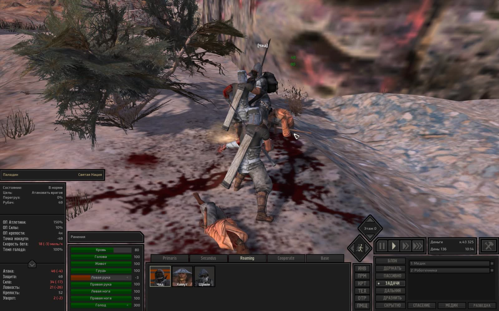

---

### Серия 27 (1 кадр)

- **Файловое время**: с `2026-11-10T00:16:25Z` по `2026-11-10T00:16:25Z`
- **Игровое время (OCR)**: `День 136, 16:16`
- **Локация (OCR)**: Не зафиксирована в UI
- **Персонажи в UI (OCR)**: Кот
- **Задачи/предметы в UI**: Медик, Охранять: Вик

**Кадры серии:**
- [screenshot_566-402013fe.jpg](screenshot_566-402013fe.jpg) ([GitHub](https://github.com/asaf1n/Kenshi-Compain/blob/main/published/screenshots/screenshot_566-402013fe.jpg) | [Raw](https://raw.githubusercontent.com/asaf1n/Kenshi-Compain/main/published/screenshots/screenshot_566-402013fe.jpg))

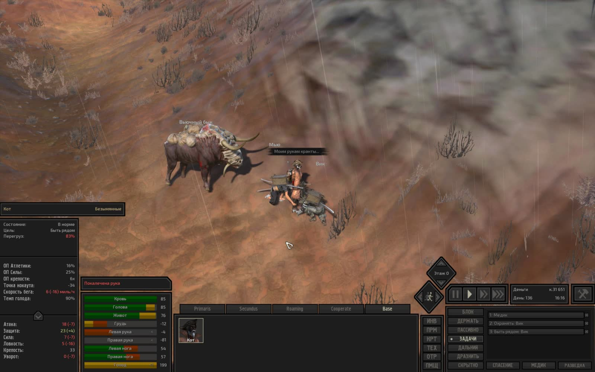

---

### Серия 28 (1 кадр)

- **Файловое время**: с `2026-11-10T00:24:49Z` по `2026-11-10T00:24:49Z`
- **Игровое время (OCR)**: `День 136, 17:24`
- **Локация (OCR)**: Не зафиксирована в UI
- **Персонажи в UI (OCR)**: Не зафиксированы в UI
- **Задачи/предметы в UI**: Быть рядом: Зелёный, Охранять: Зелёный

**Кадры серии:**
- [screenshot_569-a4ddd76e.jpg](screenshot_569-a4ddd76e.jpg) ([GitHub](https://github.com/asaf1n/Kenshi-Compain/blob/main/published/screenshots/screenshot_569-a4ddd76e.jpg) | [Raw](https://raw.githubusercontent.com/asaf1n/Kenshi-Compain/main/published/screenshots/screenshot_569-a4ddd76e.jpg))

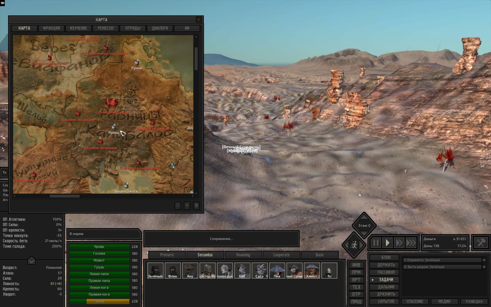

---

### Серия 29 (1 кадр)

- **Файловое время**: с `2026-11-10T05:41:40Z` по `2026-11-10T05:41:40Z`
- **Игровое время (OCR)**: `День 136, 18:50`
- **Локация (OCR)**: Не зафиксирована в UI
- **Персонажи в UI (OCR)**: Не зафиксированы в UI
- **Задачи/предметы в UI**: Работа с машиной: Переработка пеньки, Тащить в: Хранение: гашиш

**Кадры серии:**
- [screenshot_573-884f030a.jpg](screenshot_573-884f030a.jpg) ([GitHub](https://github.com/asaf1n/Kenshi-Compain/blob/main/published/screenshots/screenshot_573-884f030a.jpg) | [Raw](https://raw.githubusercontent.com/asaf1n/Kenshi-Compain/main/published/screenshots/screenshot_573-884f030a.jpg))

---

### Серия 30 (1 кадр)

- **Файловое время**: с `2026-11-10T05:44:53Z` по `2026-11-10T05:44:53Z`
- **Игровое время (OCR)**: `День 136, 20:07`
- **Локация (OCR)**: Не зафиксирована в UI
- **Персонажи в UI (OCR)**: Не зафиксированы в UI
- **Задачи/предметы в UI**: Медик, Роботехника

**Кадры серии:**
- [screenshot_576-2755813b.jpg](screenshot_576-2755813b.jpg) ([GitHub](https://github.com/asaf1n/Kenshi-Compain/blob/main/published/screenshots/screenshot_576-2755813b.jpg) | [Raw](https://raw.githubusercontent.com/asaf1n/Kenshi-Compain/main/published/screenshots/screenshot_576-2755813b.jpg))

---
