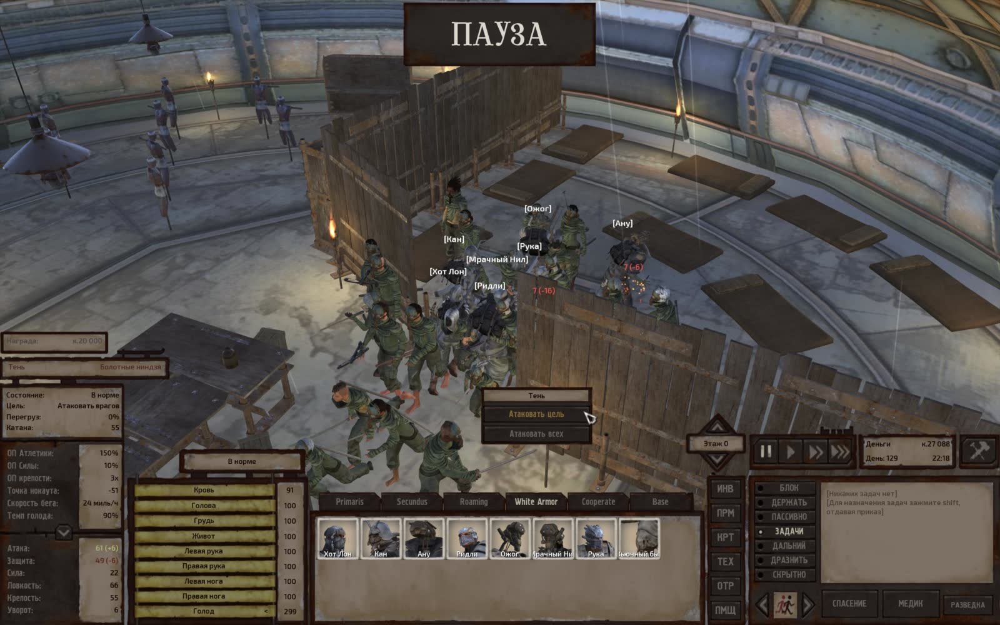
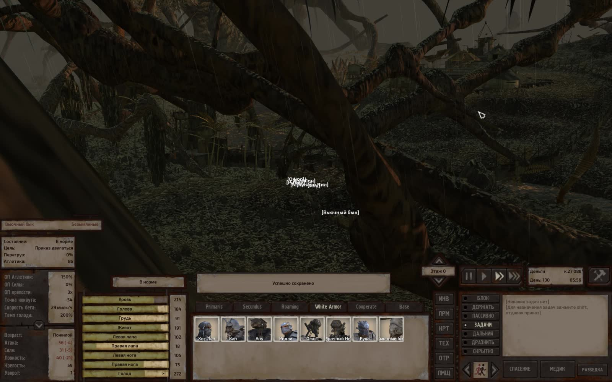
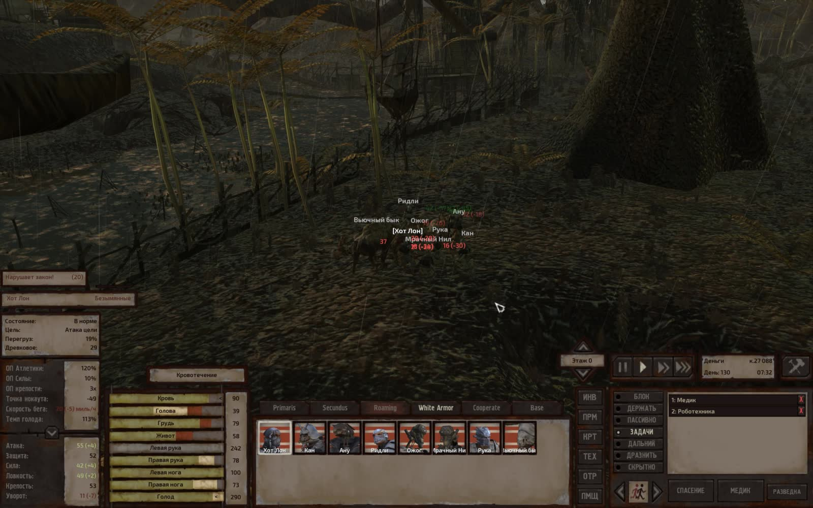
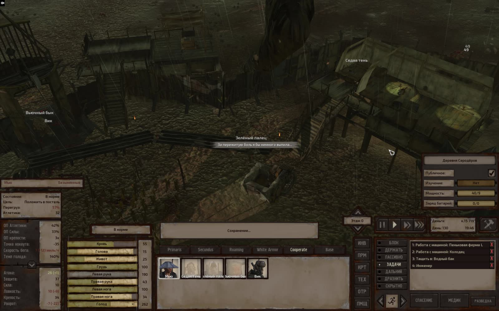
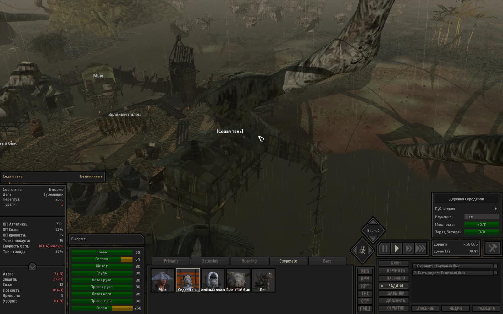
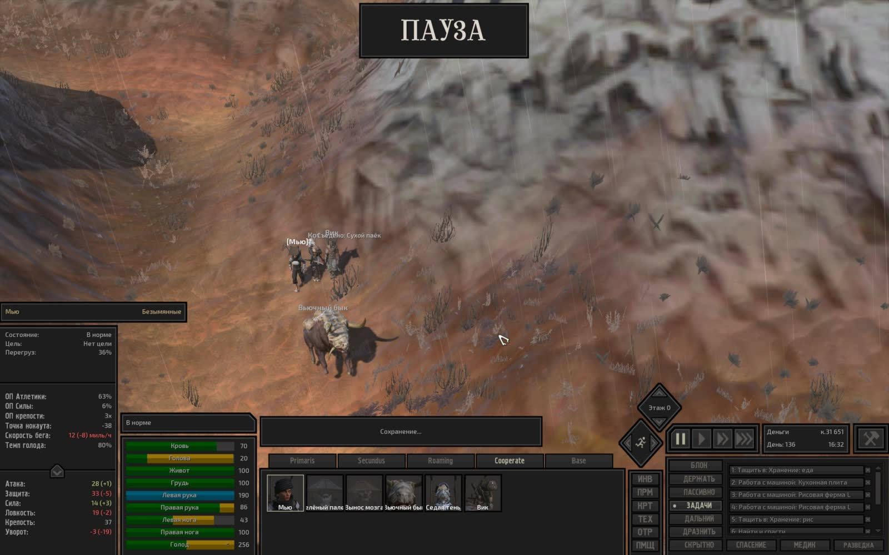

# Техническая лента скриншотов Kenshi

- **Сформировано**: `2026-11-10T00:25:40Z`
- **Окно выборки**: последние 7 суток (с `2026-11-03T00:25:40Z` по `2026-11-10T00:25:40Z`)
- **Всего скриншотов в окне**: 30
- **Сгруппировано серий/кадров**: 30

Техническая лента сгруппированных по сходству кадров с извлеченным текстом интерфейса (OCR). Интерпретация происходящего в игре полностью принадлежит LLM-компаньону по оригинальным изображениям.

---

### Серия 1 (1 кадр)

- **Файловое время**: с `2026-11-03T01:03:27Z` по `2026-11-03T01:03:27Z`
- **Игровое время (OCR)**: `День 129, 13:48`
- **Локация (OCR)**: Не зафиксирована в UI
- **Персонажи в UI (OCR)**: Вьючный бык

**Кадры серии:**
- [screenshot_374-122c74fa.jpg](screenshot_374-122c74fa.jpg) ([GitHub](https://github.com/asaf1n/Kenshi-Compain/blob/main/published/screenshots/screenshot_374-122c74fa.jpg) | [Raw](https://raw.githubusercontent.com/asaf1n/Kenshi-Compain/main/published/screenshots/screenshot_374-122c74fa.jpg))

---

### Серия 2 (1 кадр)

- **Файловое время**: с `2026-11-03T01:29:02Z` по `2026-11-03T01:29:02Z`
- **Игровое время (OCR)**: `День 129, 22:18`
- **Локация (OCR)**: Не зафиксирована в UI
- **Персонажи в UI (OCR)**: Тень

**Кадры серии:**
- [screenshot_384-5a23b089.jpg](screenshot_384-5a23b089.jpg) ([GitHub](https://github.com/asaf1n/Kenshi-Compain/blob/main/published/screenshots/screenshot_384-5a23b089.jpg) | [Raw](https://raw.githubusercontent.com/asaf1n/Kenshi-Compain/main/published/screenshots/screenshot_384-5a23b089.jpg))

---

### Серия 3 (1 кадр)

- **Файловое время**: с `2026-11-03T02:08:32Z` по `2026-11-03T02:08:32Z`
- **Игровое время (OCR)**: `День 130, 05:56`
- **Локация (OCR)**: Не зафиксирована в UI
- **Персонажи в UI (OCR)**: Вьючный бык

**Кадры серии:**
- [screenshot_397-842d5efe.jpg](screenshot_397-842d5efe.jpg) ([GitHub](https://github.com/asaf1n/Kenshi-Compain/blob/main/published/screenshots/screenshot_397-842d5efe.jpg) | [Raw](https://raw.githubusercontent.com/asaf1n/Kenshi-Compain/main/published/screenshots/screenshot_397-842d5efe.jpg))

---

### Серия 4 (1 кадр)

- **Файловое время**: с `2026-11-03T02:41:09Z` по `2026-11-03T02:41:09Z`
- **Игровое время (OCR)**: `День 130, 07:32`
- **Локация (OCR)**: Не зафиксирована в UI
- **Персонажи в UI (OCR)**: Хот Лон
- **Задачи/предметы в UI**: Медик, Роботехника

**Кадры серии:**
- [screenshot_408-ac1a048a.jpg](screenshot_408-ac1a048a.jpg) ([GitHub](https://github.com/asaf1n/Kenshi-Compain/blob/main/published/screenshots/screenshot_408-ac1a048a.jpg) | [Raw](https://raw.githubusercontent.com/asaf1n/Kenshi-Compain/main/published/screenshots/screenshot_408-ac1a048a.jpg))

---

### Серия 5 (1 кадр)

- **Файловое время**: с `2026-11-03T03:57:33Z` по `2026-11-03T03:57:33Z`
- **Игровое время (OCR)**: `День 130, 19:46`
- **Локация (OCR)**: Не зафиксирована в UI
- **Персонажи в UI (OCR)**: Мью
- **Задачи/предметы в UI**: Инженер, Работа с машиной: Колодец, Работа с машиной: Пеньковая ферма 1-

**Кадры серии:**
- [screenshot_419-dbdc5e2e.jpg](screenshot_419-dbdc5e2e.jpg) ([GitHub](https://github.com/asaf1n/Kenshi-Compain/blob/main/published/screenshots/screenshot_419-dbdc5e2e.jpg) | [Raw](https://raw.githubusercontent.com/asaf1n/Kenshi-Compain/main/published/screenshots/screenshot_419-dbdc5e2e.jpg))

---

### Серия 6 (1 кадр)

- **Файловое время**: с `2026-11-04T08:43:53Z` по `2026-11-04T08:43:53Z`
- **Игровое время (OCR)**: `День 132, 09:41`
- **Локация (OCR)**: Не зафиксирована в UI
- **Персонажи в UI (OCR)**: Седая тень
- **Задачи/предметы в UI**: Быть рядом: Вьючный бык, Охранять: Вьючный бык

**Кадры серии:**
- [screenshot_431-f31f45c9.jpg](screenshot_431-f31f45c9.jpg) ([GitHub](https://github.com/asaf1n/Kenshi-Compain/blob/main/published/screenshots/screenshot_431-f31f45c9.jpg) | [Raw](https://raw.githubusercontent.com/asaf1n/Kenshi-Compain/main/published/screenshots/screenshot_431-f31f45c9.jpg))

---

### Серия 7 (1 кадр)

- **Файловое время**: с `2026-11-04T16:53:01Z` по `2026-11-04T16:53:01Z`
- **Игровое время (OCR)**: `День 132, 20:38`
- **Локация (OCR)**: Не зафиксирована в UI
- **Персонажи в UI (OCR)**: Флик
- **Задачи/предметы в UI**: Медик, Роботехника

**Кадры серии:**
- [screenshot_442-4e97aecf.jpg](screenshot_442-4e97aecf.jpg) ([GitHub](https://github.com/asaf1n/Kenshi-Compain/blob/main/published/screenshots/screenshot_442-4e97aecf.jpg) | [Raw](https://raw.githubusercontent.com/asaf1n/Kenshi-Compain/main/published/screenshots/screenshot_442-4e97aecf.jpg))

---

### Серия 8 (1 кадр)

- **Файловое время**: с `2026-11-06T00:21:21Z` по `2026-11-06T00:21:21Z`
- **Игровое время (OCR)**: `День 133, 12:27`
- **Локация (OCR)**: Не зафиксирована в UI
- **Персонажи в UI (OCR)**: Инквизитор
- **Задачи/предметы в UI**: Медик, Роботехника

**Кадры серии:**
- [screenshot_454-a2e60550.jpg](screenshot_454-a2e60550.jpg) ([GitHub](https://github.com/asaf1n/Kenshi-Compain/blob/main/published/screenshots/screenshot_454-a2e60550.jpg) | [Raw](https://raw.githubusercontent.com/asaf1n/Kenshi-Compain/main/published/screenshots/screenshot_454-a2e60550.jpg))

---

### Серия 9 (1 кадр)

- **Файловое время**: с `2026-11-06T00:31:34Z` по `2026-11-06T00:31:34Z`
- **Игровое время (OCR)**: `День 133, 15:18`
- **Локация (OCR)**: Не зафиксирована в UI
- **Персонажи в UI (OCR)**: Не зафиксированы в UI
- **Задачи/предметы в UI**: Быть рядом: Хот Лон, Охранять: Хот Лон

**Кадры серии:**
- [screenshot_469-94f74eea.jpg](screenshot_469-94f74eea.jpg) ([GitHub](https://github.com/asaf1n/Kenshi-Compain/blob/main/published/screenshots/screenshot_469-94f74eea.jpg) | [Raw](https://raw.githubusercontent.com/asaf1n/Kenshi-Compain/main/published/screenshots/screenshot_469-94f74eea.jpg))

---

### Серия 10 (1 кадр)

- **Файловое время**: с `2026-11-06T01:18:24Z` по `2026-11-06T01:18:24Z`
- **Игровое время (OCR)**: `День 134, 03:03`
- **Локация (OCR)**: Не зафиксирована в UI
- **Персонажи в UI (OCR)**: Вынос мозга
- **Задачи/предметы в UI**: Быть рядом: Мью, Охранять: Мью, Роботехника

**Кадры серии:**
- [screenshot_479-7a049502.jpg](screenshot_479-7a049502.jpg) ([GitHub](https://github.com/asaf1n/Kenshi-Compain/blob/main/published/screenshots/screenshot_479-7a049502.jpg) | [Raw](https://raw.githubusercontent.com/asaf1n/Kenshi-Compain/main/published/screenshots/screenshot_479-7a049502.jpg))

---

### Серия 11 (1 кадр)

- **Файловое время**: с `2026-11-06T14:26:23Z` по `2026-11-06T14:26:23Z`
- **Игровое время (OCR)**: `День 134, 12:18`
- **Локация (OCR)**: Не зафиксирована в UI
- **Персонажи в UI (OCR)**: Не зафиксированы в UI
- **Задачи/предметы в UI**: Быть рядом: Хот Лон, Медик, Роботехника

**Кадры серии:**
- [screenshot_489-f198feea.jpg](screenshot_489-f198feea.jpg) ([GitHub](https://github.com/asaf1n/Kenshi-Compain/blob/main/published/screenshots/screenshot_489-f198feea.jpg) | [Raw](https://raw.githubusercontent.com/asaf1n/Kenshi-Compain/main/published/screenshots/screenshot_489-f198feea.jpg))

---

### Серия 12 (1 кадр)

- **Файловое время**: с `2026-11-06T22:43:48Z` по `2026-11-06T22:43:48Z`
- **Игровое время (OCR)**: `День 134, 23:16`
- **Локация (OCR)**: Не зафиксирована в UI
- **Персонажи в UI (OCR)**: Не зафиксированы в UI
- **Задачи/предметы в UI**: Медик, Турель, охрана: Арбалет-турель Mkll [свет [8]

**Кадры серии:**
- [screenshot_500-8d631a9c.jpg](screenshot_500-8d631a9c.jpg) ([GitHub](https://github.com/asaf1n/Kenshi-Compain/blob/main/published/screenshots/screenshot_500-8d631a9c.jpg) | [Raw](https://raw.githubusercontent.com/asaf1n/Kenshi-Compain/main/published/screenshots/screenshot_500-8d631a9c.jpg))

---

### Серия 13 (1 кадр)

- **Файловое время**: с `2026-11-09T04:12:25Z` по `2026-11-09T04:12:25Z`
- **Игровое время (OCR)**: `День 135, 12:11`
- **Локация (OCR)**: Не зафиксирована в UI
- **Персонажи в UI (OCR)**: Не зафиксированы в UI
- **Задачи/предметы в UI**: Медик, Турель, охрана: Арбалет-турель МКП [све

**Кадры серии:**
- [screenshot_543-2ae1cfdd.jpg](screenshot_543-2ae1cfdd.jpg) ([GitHub](https://github.com/asaf1n/Kenshi-Compain/blob/main/published/screenshots/screenshot_543-2ae1cfdd.jpg) | [Raw](https://raw.githubusercontent.com/asaf1n/Kenshi-Compain/main/published/screenshots/screenshot_543-2ae1cfdd.jpg))

---

### Серия 14 (1 кадр)

- **Файловое время**: с `2026-11-09T23:05:14Z` по `2026-11-09T23:05:14Z`
- **Игровое время (OCR)**: `День 136, 00:07`
- **Локация (OCR)**: Не зафиксирована в UI
- **Персонажи в UI (OCR)**: Не зафиксированы в UI
- **Задачи/предметы в UI**: Атаковать врагов

**Кадры серии:**
- [screenshot_553-bb38c273.jpg](screenshot_553-bb38c273.jpg) ([GitHub](https://github.com/asaf1n/Kenshi-Compain/blob/main/published/screenshots/screenshot_553-bb38c273.jpg) | [Raw](https://raw.githubusercontent.com/asaf1n/Kenshi-Compain/main/published/screenshots/screenshot_553-bb38c273.jpg))

---

### Серия 15 (1 кадр)

- **Файловое время**: с `2026-11-09T23:11:29Z` по `2026-11-09T23:11:29Z`
- **Игровое время (OCR)**: `День 136, 01:37`
- **Локация (OCR)**: Не зафиксирована в UI
- **Персонажи в UI (OCR)**: Вынос мозга
- **Задачи/предметы в UI**: Медик, Турель, охрана: Арбалет-турель Mkll [свет [8]

**Кадры серии:**
- [screenshot_554-fb55ed37.jpg](screenshot_554-fb55ed37.jpg) ([GitHub](https://github.com/asaf1n/Kenshi-Compain/blob/main/published/screenshots/screenshot_554-fb55ed37.jpg) | [Raw](https://raw.githubusercontent.com/asaf1n/Kenshi-Compain/main/published/screenshots/screenshot_554-fb55ed37.jpg))

---

### Серия 16 (1 кадр)

- **Файловое время**: с `2026-11-09T23:30:59Z` по `2026-11-09T23:30:59Z`
- **Игровое время (OCR)**: `День 136, 01:42`
- **Локация (OCR)**: Не зафиксирована в UI
- **Персонажи в UI (OCR)**: Страж Сотни
- **Задачи/предметы в UI**: Медик, Роботехника

**Кадры серии:**
- [screenshot_555-75f3f188.jpg](screenshot_555-75f3f188.jpg) ([GitHub](https://github.com/asaf1n/Kenshi-Compain/blob/main/published/screenshots/screenshot_555-75f3f188.jpg) | [Raw](https://raw.githubusercontent.com/asaf1n/Kenshi-Compain/main/published/screenshots/screenshot_555-75f3f188.jpg))

---

### Серия 17 (1 кадр)

- **Файловое время**: с `2026-11-09T23:31:10Z` по `2026-11-09T23:31:10Z`
- **Игровое время (OCR)**: `День 136, 01:43`
- **Локация (OCR)**: Не зафиксирована в UI
- **Персонажи в UI (OCR)**: Страж Сотни
- **Задачи/предметы в UI**: Медик, Роботехника

**Кадры серии:**
- [screenshot_556-45b23315.jpg](screenshot_556-45b23315.jpg) ([GitHub](https://github.com/asaf1n/Kenshi-Compain/blob/main/published/screenshots/screenshot_556-45b23315.jpg) | [Raw](https://raw.githubusercontent.com/asaf1n/Kenshi-Compain/main/published/screenshots/screenshot_556-45b23315.jpg))

---

### Серия 18 (1 кадр)

- **Файловое время**: с `2026-11-09T23:41:00Z` по `2026-11-09T23:41:00Z`
- **Игровое время (OCR)**: `День 136, 04:48`
- **Локация (OCR)**: Не зафиксирована в UI
- **Персонажи в UI (OCR)**: Хот Лон
- **Задачи/предметы в UI**: Медик, Роботехника

**Кадры серии:**
- [screenshot_557-304c599c.jpg](screenshot_557-304c599c.jpg) ([GitHub](https://github.com/asaf1n/Kenshi-Compain/blob/main/published/screenshots/screenshot_557-304c599c.jpg) | [Raw](https://raw.githubusercontent.com/asaf1n/Kenshi-Compain/main/published/screenshots/screenshot_557-304c599c.jpg))

---

### Серия 19 (1 кадр)

- **Файловое время**: с `2026-11-09T23:42:40Z` по `2026-11-09T23:42:40Z`
- **Игровое время (OCR)**: `День 136, 05:39`
- **Локация (OCR)**: Не зафиксирована в UI
- **Персонажи в UI (OCR)**: Вьючный бык
- **Задачи/предметы в UI**: Быть рядом: Кот, Охранять: Кот

**Кадры серии:**
- [screenshot_558-6875fce2.jpg](screenshot_558-6875fce2.jpg) ([GitHub](https://github.com/asaf1n/Kenshi-Compain/blob/main/published/screenshots/screenshot_558-6875fce2.jpg) | [Raw](https://raw.githubusercontent.com/asaf1n/Kenshi-Compain/main/published/screenshots/screenshot_558-6875fce2.jpg))

---

### Серия 20 (1 кадр)

- **Файловое время**: с `2026-11-09T23:44:05Z` по `2026-11-09T23:44:05Z`
- **Игровое время (OCR)**: `День 136, 06:16`
- **Локация (OCR)**: Не зафиксирована в UI
- **Персонажи в UI (OCR)**: Кот
- **Задачи/предметы в UI**: Медик, Охранять: Вик

**Кадры серии:**
- [screenshot_559-ae903570.jpg](screenshot_559-ae903570.jpg) ([GitHub](https://github.com/asaf1n/Kenshi-Compain/blob/main/published/screenshots/screenshot_559-ae903570.jpg) | [Raw](https://raw.githubusercontent.com/asaf1n/Kenshi-Compain/main/published/screenshots/screenshot_559-ae903570.jpg))

---

### Серия 21 (1 кадр)

- **Файловое время**: с `2026-11-09T23:45:15Z` по `2026-11-09T23:45:15Z`
- **Игровое время (OCR)**: `День 136, 06:52`
- **Локация (OCR)**: Не зафиксирована в UI
- **Персонажи в UI (OCR)**: Хот Лон
- **Задачи/предметы в UI**: Медик, Роботехника

**Кадры серии:**
- [screenshot_560-b190f494.jpg](screenshot_560-b190f494.jpg) ([GitHub](https://github.com/asaf1n/Kenshi-Compain/blob/main/published/screenshots/screenshot_560-b190f494.jpg) | [Raw](https://raw.githubusercontent.com/asaf1n/Kenshi-Compain/main/published/screenshots/screenshot_560-b190f494.jpg))

---

### Серия 22 (1 кадр)

- **Файловое время**: с `2026-11-09T23:50:08Z` по `2026-11-09T23:50:08Z`
- **Игровое время (OCR)**: `День 136, 07:52`
- **Локация (OCR)**: Не зафиксирована в UI
- **Персонажи в UI (OCR)**: Не зафиксированы в UI
- **Задачи/предметы в UI**: Медик, Роботехника

**Кадры серии:**
- [screenshot_561-85abdeb1.jpg](screenshot_561-85abdeb1.jpg) ([GitHub](https://github.com/asaf1n/Kenshi-Compain/blob/main/published/screenshots/screenshot_561-85abdeb1.jpg) | [Raw](https://raw.githubusercontent.com/asaf1n/Kenshi-Compain/main/published/screenshots/screenshot_561-85abdeb1.jpg))

---

### Серия 23 (1 кадр)

- **Файловое время**: с `2026-11-09T23:59:18Z` по `2026-11-09T23:59:18Z`
- **Игровое время (OCR)**: `День 136, 10:14`
- **Локация (OCR)**: Не зафиксирована в UI
- **Персонажи в UI (OCR)**: Паладин
- **Задачи/предметы в UI**: Медик, Роботехника

**Кадры серии:**
- [screenshot_562-1f9f8ef2.jpg](screenshot_562-1f9f8ef2.jpg) ([GitHub](https://github.com/asaf1n/Kenshi-Compain/blob/main/published/screenshots/screenshot_562-1f9f8ef2.jpg) | [Raw](https://raw.githubusercontent.com/asaf1n/Kenshi-Compain/main/published/screenshots/screenshot_562-1f9f8ef2.jpg))

---

### Серия 24 (1 кадр)

- **Файловое время**: с `2026-11-10T00:00:31Z` по `2026-11-10T00:00:31Z`
- **Игровое время (OCR)**: `День 136, 10:53`
- **Локация (OCR)**: Не зафиксирована в UI
- **Персонажи в UI (OCR)**: Слуга
- **Задачи/предметы в UI**: Медик, Роботехника

**Кадры серии:**
- [screenshot_563-13dab785.jpg](screenshot_563-13dab785.jpg) ([GitHub](https://github.com/asaf1n/Kenshi-Compain/blob/main/published/screenshots/screenshot_563-13dab785.jpg) | [Raw](https://raw.githubusercontent.com/asaf1n/Kenshi-Compain/main/published/screenshots/screenshot_563-13dab785.jpg))

---

### Серия 25 (1 кадр)

- **Файловое время**: с `2026-11-10T00:07:01Z` по `2026-11-10T00:07:01Z`
- **Игровое время (OCR)**: `День 136, 12:11`
- **Локация (OCR)**: Не зафиксирована в UI
- **Персонажи в UI (OCR)**: Не зафиксированы в UI

**Кадры серии:**
- [screenshot_564-0a3df73e.jpg](screenshot_564-0a3df73e.jpg) ([GitHub](https://github.com/asaf1n/Kenshi-Compain/blob/main/published/screenshots/screenshot_564-0a3df73e.jpg) | [Raw](https://raw.githubusercontent.com/asaf1n/Kenshi-Compain/main/published/screenshots/screenshot_564-0a3df73e.jpg))

---

### Серия 26 (1 кадр)

- **Файловое время**: с `2026-11-10T00:11:31Z` по `2026-11-10T00:11:31Z`
- **Игровое время (OCR)**: `День 136, 14:14`
- **Локация (OCR)**: Не зафиксирована в UI
- **Персонажи в UI (OCR)**: вик

**Кадры серии:**
- [screenshot_565-e2df7c39.jpg](screenshot_565-e2df7c39.jpg) ([GitHub](https://github.com/asaf1n/Kenshi-Compain/blob/main/published/screenshots/screenshot_565-e2df7c39.jpg) | [Raw](https://raw.githubusercontent.com/asaf1n/Kenshi-Compain/main/published/screenshots/screenshot_565-e2df7c39.jpg))

---

### Серия 27 (1 кадр)

- **Файловое время**: с `2026-11-10T00:16:25Z` по `2026-11-10T00:16:25Z`
- **Игровое время (OCR)**: `День 136, 16:16`
- **Локация (OCR)**: Не зафиксирована в UI
- **Персонажи в UI (OCR)**: Кот
- **Задачи/предметы в UI**: Медик, Охранять: Вик

**Кадры серии:**
- [screenshot_566-402013fe.jpg](screenshot_566-402013fe.jpg) ([GitHub](https://github.com/asaf1n/Kenshi-Compain/blob/main/published/screenshots/screenshot_566-402013fe.jpg) | [Raw](https://raw.githubusercontent.com/asaf1n/Kenshi-Compain/main/published/screenshots/screenshot_566-402013fe.jpg))

---

### Серия 28 (1 кадр)

- **Файловое время**: с `2026-11-10T00:22:11Z` по `2026-11-10T00:22:11Z`
- **Игровое время (OCR)**: `День 136, 16:32`
- **Локация (OCR)**: Не зафиксирована в UI
- **Персонажи в UI (OCR)**: Мью
- **Задачи/предметы в UI**: Работа с машиной: Кухонная плита, Работа с машиной: Рисовая ферма 1-, Тащить в: Хранение: еда, Тащить в: Хранение: рис

**Кадры серии:**
- [screenshot_567-de8d8a3f.jpg](screenshot_567-de8d8a3f.jpg) ([GitHub](https://github.com/asaf1n/Kenshi-Compain/blob/main/published/screenshots/screenshot_567-de8d8a3f.jpg) | [Raw](https://raw.githubusercontent.com/asaf1n/Kenshi-Compain/main/published/screenshots/screenshot_567-de8d8a3f.jpg))

---

### Серия 29 (1 кадр)

- **Файловое время**: с `2026-11-10T00:22:59Z` по `2026-11-10T00:22:59Z`
- **Игровое время (OCR)**: `День 136, 16:41`
- **Локация (OCR)**: Не зафиксирована в UI
- **Персонажи в UI (OCR)**: Хот Лон
- **Задачи/предметы в UI**: Медик, Роботехника

**Кадры серии:**
- [screenshot_568-7869c401.jpg](screenshot_568-7869c401.jpg) ([GitHub](https://github.com/asaf1n/Kenshi-Compain/blob/main/published/screenshots/screenshot_568-7869c401.jpg) | [Raw](https://raw.githubusercontent.com/asaf1n/Kenshi-Compain/main/published/screenshots/screenshot_568-7869c401.jpg))

---

### Серия 30 (1 кадр)

- **Файловое время**: с `2026-11-10T00:24:49Z` по `2026-11-10T00:24:49Z`
- **Игровое время (OCR)**: `День 136, 17:24`
- **Локация (OCR)**: Не зафиксирована в UI
- **Персонажи в UI (OCR)**: Не зафиксированы в UI
- **Задачи/предметы в UI**: Быть рядом: Зелёный, Охранять: Зелёный

**Кадры серии:**
- [screenshot_569-a4ddd76e.jpg](screenshot_569-a4ddd76e.jpg) ([GitHub](https://github.com/asaf1n/Kenshi-Compain/blob/main/published/screenshots/screenshot_569-a4ddd76e.jpg) | [Raw](https://raw.githubusercontent.com/asaf1n/Kenshi-Compain/main/published/screenshots/screenshot_569-a4ddd76e.jpg))

---
