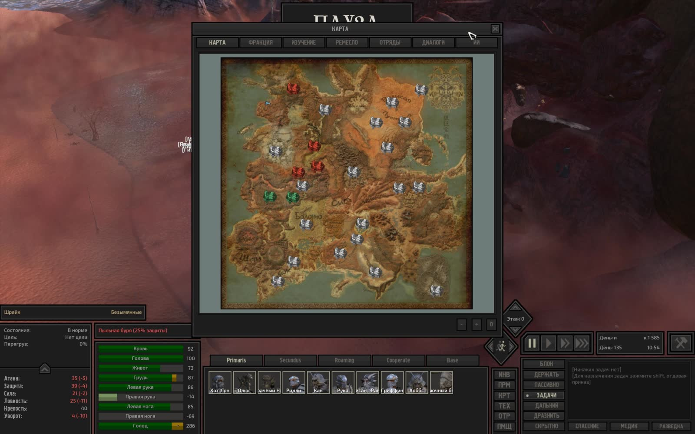
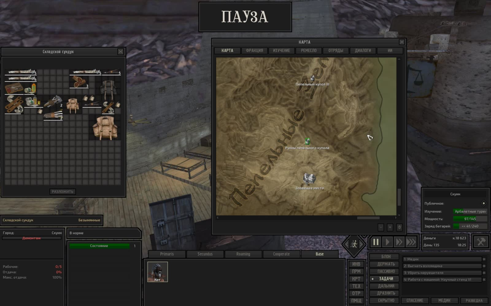
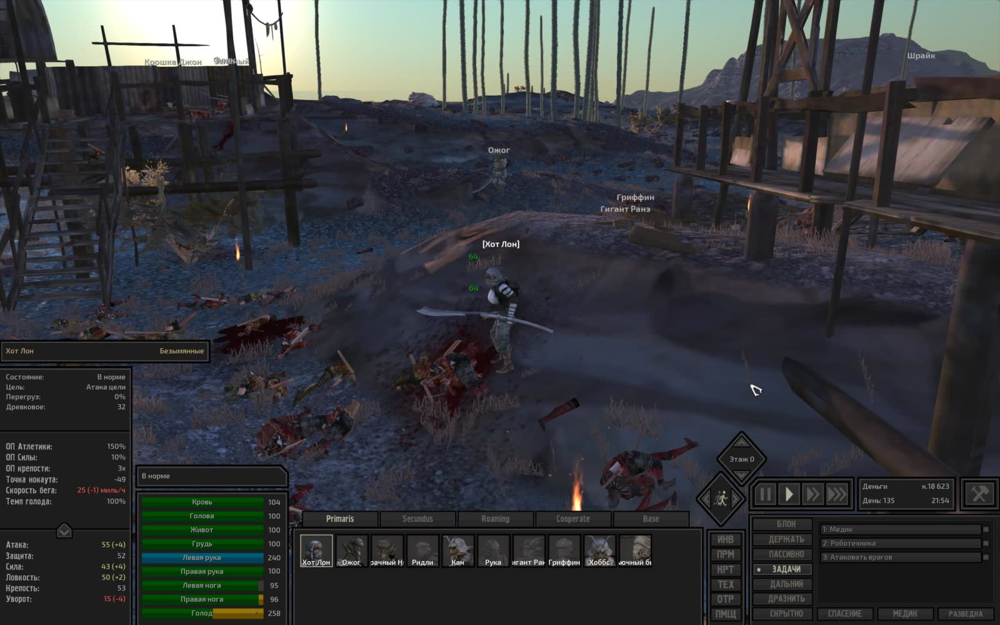

# Техническая лента скриншотов Kenshi

- **Сформировано**: `2026-11-09T05:45:42Z`
- **Окно выборки**: последние 7 суток (с `2026-11-02T05:45:42Z` по `2026-11-09T05:45:42Z`)
- **Всего скриншотов в окне**: 30
- **Сгруппировано серий/кадров**: 10

Техническая лента сгруппированных по сходству кадров с извлеченным текстом интерфейса (OCR). Интерпретация происходящего в игре полностью принадлежит LLM-компаньону по оригинальным изображениям.

---

### Серия 1 (15 кадров)

- **Файловое время**: с `2026-11-08T01:30:54Z` по `2026-11-08T01:35:53Z`
- **Игровое время (OCR)**: `День 135, 10:54`
- **Локация (OCR)**: Не зафиксирована в UI
- **Персонажи в UI (OCR)**: Не зафиксированы в UI

**Кадры серии:**
- [screenshot_507-87f174bc.jpg](screenshot_507-87f174bc.jpg) ([GitHub](https://github.com/asaf1n/Kenshi-Compain/blob/main/published/screenshots/screenshot_507-87f174bc.jpg) | [Raw](https://raw.githubusercontent.com/asaf1n/Kenshi-Compain/main/published/screenshots/screenshot_507-87f174bc.jpg))
- [screenshot_511-782b4021.jpg](screenshot_511-782b4021.jpg) ([GitHub](https://github.com/asaf1n/Kenshi-Compain/blob/main/published/screenshots/screenshot_511-782b4021.jpg) | [Raw](https://raw.githubusercontent.com/asaf1n/Kenshi-Compain/main/published/screenshots/screenshot_511-782b4021.jpg))
- [screenshot_513-cbf4bf48.jpg](screenshot_513-cbf4bf48.jpg) ([GitHub](https://github.com/asaf1n/Kenshi-Compain/blob/main/published/screenshots/screenshot_513-cbf4bf48.jpg) | [Raw](https://raw.githubusercontent.com/asaf1n/Kenshi-Compain/main/published/screenshots/screenshot_513-cbf4bf48.jpg))
- [screenshot_515-cdc8f21e.jpg](screenshot_515-cdc8f21e.jpg) ([GitHub](https://github.com/asaf1n/Kenshi-Compain/blob/main/published/screenshots/screenshot_515-cdc8f21e.jpg) | [Raw](https://raw.githubusercontent.com/asaf1n/Kenshi-Compain/main/published/screenshots/screenshot_515-cdc8f21e.jpg))
- [screenshot_516-a2da52de.jpg](screenshot_516-a2da52de.jpg) ([GitHub](https://github.com/asaf1n/Kenshi-Compain/blob/main/published/screenshots/screenshot_516-a2da52de.jpg) | [Raw](https://raw.githubusercontent.com/asaf1n/Kenshi-Compain/main/published/screenshots/screenshot_516-a2da52de.jpg))
- [screenshot_518-3f011925.jpg](screenshot_518-3f011925.jpg) ([GitHub](https://github.com/asaf1n/Kenshi-Compain/blob/main/published/screenshots/screenshot_518-3f011925.jpg) | [Raw](https://raw.githubusercontent.com/asaf1n/Kenshi-Compain/main/published/screenshots/screenshot_518-3f011925.jpg))
- [screenshot_521-f9f6e9da.jpg](screenshot_521-f9f6e9da.jpg) ([GitHub](https://github.com/asaf1n/Kenshi-Compain/blob/main/published/screenshots/screenshot_521-f9f6e9da.jpg) | [Raw](https://raw.githubusercontent.com/asaf1n/Kenshi-Compain/main/published/screenshots/screenshot_521-f9f6e9da.jpg))
- [screenshot_522-e19db90f.jpg](screenshot_522-e19db90f.jpg) ([GitHub](https://github.com/asaf1n/Kenshi-Compain/blob/main/published/screenshots/screenshot_522-e19db90f.jpg) | [Raw](https://raw.githubusercontent.com/asaf1n/Kenshi-Compain/main/published/screenshots/screenshot_522-e19db90f.jpg))
- [screenshot_523-d16fb80a.jpg](screenshot_523-d16fb80a.jpg) ([GitHub](https://github.com/asaf1n/Kenshi-Compain/blob/main/published/screenshots/screenshot_523-d16fb80a.jpg) | [Raw](https://raw.githubusercontent.com/asaf1n/Kenshi-Compain/main/published/screenshots/screenshot_523-d16fb80a.jpg))
- [screenshot_525-28ceaa35.jpg](screenshot_525-28ceaa35.jpg) ([GitHub](https://github.com/asaf1n/Kenshi-Compain/blob/main/published/screenshots/screenshot_525-28ceaa35.jpg) | [Raw](https://raw.githubusercontent.com/asaf1n/Kenshi-Compain/main/published/screenshots/screenshot_525-28ceaa35.jpg))
- [screenshot_526-4aa0e47e.jpg](screenshot_526-4aa0e47e.jpg) ([GitHub](https://github.com/asaf1n/Kenshi-Compain/blob/main/published/screenshots/screenshot_526-4aa0e47e.jpg) | [Raw](https://raw.githubusercontent.com/asaf1n/Kenshi-Compain/main/published/screenshots/screenshot_526-4aa0e47e.jpg))
- [screenshot_527-1dc1fdb3.jpg](screenshot_527-1dc1fdb3.jpg) ([GitHub](https://github.com/asaf1n/Kenshi-Compain/blob/main/published/screenshots/screenshot_527-1dc1fdb3.jpg) | [Raw](https://raw.githubusercontent.com/asaf1n/Kenshi-Compain/main/published/screenshots/screenshot_527-1dc1fdb3.jpg))
- [screenshot_529-26938f8f.jpg](screenshot_529-26938f8f.jpg) ([GitHub](https://github.com/asaf1n/Kenshi-Compain/blob/main/published/screenshots/screenshot_529-26938f8f.jpg) | [Raw](https://raw.githubusercontent.com/asaf1n/Kenshi-Compain/main/published/screenshots/screenshot_529-26938f8f.jpg))
- [screenshot_530-2c233c89.jpg](screenshot_530-2c233c89.jpg) ([GitHub](https://github.com/asaf1n/Kenshi-Compain/blob/main/published/screenshots/screenshot_530-2c233c89.jpg) | [Raw](https://raw.githubusercontent.com/asaf1n/Kenshi-Compain/main/published/screenshots/screenshot_530-2c233c89.jpg))
- [screenshot_531-fb5dd8bb.jpg](screenshot_531-fb5dd8bb.jpg) ([GitHub](https://github.com/asaf1n/Kenshi-Compain/blob/main/published/screenshots/screenshot_531-fb5dd8bb.jpg) | [Raw](https://raw.githubusercontent.com/asaf1n/Kenshi-Compain/main/published/screenshots/screenshot_531-fb5dd8bb.jpg))

---

### Серия 2 (7 кадров)

- **Файловое время**: с `2026-11-08T01:54:36Z` по `2026-11-08T01:58:18Z`
- **Игровое время (OCR)**: `День 135, 11:23`
- **Локация (OCR)**: Не зафиксирована в UI
- **Персонажи в UI (OCR)**: Не зафиксированы в UI

**Кадры серии:**
- [screenshot_533-4abbdb6d.jpg](screenshot_533-4abbdb6d.jpg) ([GitHub](https://github.com/asaf1n/Kenshi-Compain/blob/main/published/screenshots/screenshot_533-4abbdb6d.jpg) | [Raw](https://raw.githubusercontent.com/asaf1n/Kenshi-Compain/main/published/screenshots/screenshot_533-4abbdb6d.jpg))
- [screenshot_534-10d98006.jpg](screenshot_534-10d98006.jpg) ([GitHub](https://github.com/asaf1n/Kenshi-Compain/blob/main/published/screenshots/screenshot_534-10d98006.jpg) | [Raw](https://raw.githubusercontent.com/asaf1n/Kenshi-Compain/main/published/screenshots/screenshot_534-10d98006.jpg))
- [screenshot_535-e5f9739c.jpg](screenshot_535-e5f9739c.jpg) ([GitHub](https://github.com/asaf1n/Kenshi-Compain/blob/main/published/screenshots/screenshot_535-e5f9739c.jpg) | [Raw](https://raw.githubusercontent.com/asaf1n/Kenshi-Compain/main/published/screenshots/screenshot_535-e5f9739c.jpg))
- [screenshot_537-af23150c.jpg](screenshot_537-af23150c.jpg) ([GitHub](https://github.com/asaf1n/Kenshi-Compain/blob/main/published/screenshots/screenshot_537-af23150c.jpg) | [Raw](https://raw.githubusercontent.com/asaf1n/Kenshi-Compain/main/published/screenshots/screenshot_537-af23150c.jpg))
- [screenshot_538-27d23407.jpg](screenshot_538-27d23407.jpg) ([GitHub](https://github.com/asaf1n/Kenshi-Compain/blob/main/published/screenshots/screenshot_538-27d23407.jpg) | [Raw](https://raw.githubusercontent.com/asaf1n/Kenshi-Compain/main/published/screenshots/screenshot_538-27d23407.jpg))
- [screenshot_539-764e05a8.jpg](screenshot_539-764e05a8.jpg) ([GitHub](https://github.com/asaf1n/Kenshi-Compain/blob/main/published/screenshots/screenshot_539-764e05a8.jpg) | [Raw](https://raw.githubusercontent.com/asaf1n/Kenshi-Compain/main/published/screenshots/screenshot_539-764e05a8.jpg))
- [screenshot_541-796d1dea.jpg](screenshot_541-796d1dea.jpg) ([GitHub](https://github.com/asaf1n/Kenshi-Compain/blob/main/published/screenshots/screenshot_541-796d1dea.jpg) | [Raw](https://raw.githubusercontent.com/asaf1n/Kenshi-Compain/main/published/screenshots/screenshot_541-796d1dea.jpg))

---

### Серия 3 (1 кадр)

- **Файловое время**: с `2026-11-09T04:11:48Z` по `2026-11-09T04:11:48Z`
- **Игровое время (OCR)**: `День 135, 11:52`
- **Локация (OCR)**: Не зафиксирована в UI
- **Персонажи в UI (OCR)**: Не зафиксированы в UI

**Кадры серии:**
- [screenshot_542-725ff73c.jpg](screenshot_542-725ff73c.jpg) ([GitHub](https://github.com/asaf1n/Kenshi-Compain/blob/main/published/screenshots/screenshot_542-725ff73c.jpg) | [Raw](https://raw.githubusercontent.com/asaf1n/Kenshi-Compain/main/published/screenshots/screenshot_542-725ff73c.jpg))

---

### Серия 4 (1 кадр)

- **Файловое время**: с `2026-11-09T04:12:25Z` по `2026-11-09T04:12:25Z`
- **Игровое время (OCR)**: `День 135, 12:11`
- **Локация (OCR)**: Не зафиксирована в UI
- **Персонажи в UI (OCR)**: Не зафиксированы в UI
- **Задачи/предметы в UI**: Медик, Турель, охрана: Арбалет-турель МКП [све

**Кадры серии:**
- [screenshot_543-2ae1cfdd.jpg](screenshot_543-2ae1cfdd.jpg) ([GitHub](https://github.com/asaf1n/Kenshi-Compain/blob/main/published/screenshots/screenshot_543-2ae1cfdd.jpg) | [Raw](https://raw.githubusercontent.com/asaf1n/Kenshi-Compain/main/published/screenshots/screenshot_543-2ae1cfdd.jpg))

---

### Серия 5 (1 кадр)

- **Файловое время**: с `2026-11-09T04:16:01Z` по `2026-11-09T04:16:01Z`
- **Игровое время (OCR)**: `День 135, 13:21`
- **Локация (OCR)**: Не зафиксирована в UI
- **Персонажи в UI (OCR)**: Не зафиксированы в UI

**Кадры серии:**
- [screenshot_544-24e240fd.jpg](screenshot_544-24e240fd.jpg) ([GitHub](https://github.com/asaf1n/Kenshi-Compain/blob/main/published/screenshots/screenshot_544-24e240fd.jpg) | [Raw](https://raw.githubusercontent.com/asaf1n/Kenshi-Compain/main/published/screenshots/screenshot_544-24e240fd.jpg))

---

### Серия 6 (1 кадр)

- **Файловое время**: с `2026-11-09T04:54:47Z` по `2026-11-09T04:54:47Z`
- **Игровое время (OCR)**: `День 135, 18:25`
- **Локация (OCR)**: Не зафиксирована в UI
- **Персонажи в UI (OCR)**: Не зафиксированы в UI
- **Задачи/предметы в UI**: Выгнать взломщика, Медик, Работа с машиной: Научный стенд VI

**Кадры серии:**
- [screenshot_546-df7b24c7.jpg](screenshot_546-df7b24c7.jpg) ([GitHub](https://github.com/asaf1n/Kenshi-Compain/blob/main/published/screenshots/screenshot_546-df7b24c7.jpg) | [Raw](https://raw.githubusercontent.com/asaf1n/Kenshi-Compain/main/published/screenshots/screenshot_546-df7b24c7.jpg))

---

### Серия 7 (1 кадр)

- **Файловое время**: с `2026-11-09T05:03:45Z` по `2026-11-09T05:03:45Z`
- **Игровое время (OCR)**: `День 135, 18:31`
- **Локация (OCR)**: Не зафиксирована в UI
- **Персонажи в UI (OCR)**: Кот
- **Задачи/предметы в UI**: Медик, Охранять: Вик

**Кадры серии:**
- [screenshot_547-11b87cbc.jpg](screenshot_547-11b87cbc.jpg) ([GitHub](https://github.com/asaf1n/Kenshi-Compain/blob/main/published/screenshots/screenshot_547-11b87cbc.jpg) | [Raw](https://raw.githubusercontent.com/asaf1n/Kenshi-Compain/main/published/screenshots/screenshot_547-11b87cbc.jpg))

---

### Серия 8 (1 кадр)

- **Файловое время**: с `2026-11-09T05:04:26Z` по `2026-11-09T05:04:26Z`
- **Игровое время (OCR)**: `День 135, 18:48`
- **Локация (OCR)**: Не зафиксирована в UI
- **Персонажи в UI (OCR)**: Не зафиксированы в UI
- **Задачи/предметы в UI**: Медик, Роботехника

**Кадры серии:**
- [screenshot_548-e7fc970b.jpg](screenshot_548-e7fc970b.jpg) ([GitHub](https://github.com/asaf1n/Kenshi-Compain/blob/main/published/screenshots/screenshot_548-e7fc970b.jpg) | [Raw](https://raw.githubusercontent.com/asaf1n/Kenshi-Compain/main/published/screenshots/screenshot_548-e7fc970b.jpg))

---

### Серия 9 (1 кадр)

- **Файловое время**: с `2026-11-09T05:10:15Z` по `2026-11-09T05:10:15Z`
- **Игровое время (OCR)**: `День 135, 20:54`
- **Локация (OCR)**: Не зафиксирована в UI
- **Персонажи в UI (OCR)**: Пиа
- **Задачи/предметы в UI**: Атаковать врагов, Быть рядом: Хот Лон, Медик, Роботехника

**Кадры серии:**
- [screenshot_550-20aeb353.jpg](screenshot_550-20aeb353.jpg) ([GitHub](https://github.com/asaf1n/Kenshi-Compain/blob/main/published/screenshots/screenshot_550-20aeb353.jpg) | [Raw](https://raw.githubusercontent.com/asaf1n/Kenshi-Compain/main/published/screenshots/screenshot_550-20aeb353.jpg))

---

### Серия 10 (1 кадр)

- **Файловое время**: с `2026-11-09T05:12:33Z` по `2026-11-09T05:12:33Z`
- **Игровое время (OCR)**: `День 135, 21:54`
- **Локация (OCR)**: Не зафиксирована в UI
- **Персонажи в UI (OCR)**: Хот Лон
- **Задачи/предметы в UI**: Медик, Роботехника

**Кадры серии:**
- [screenshot_551-f241738f.jpg](screenshot_551-f241738f.jpg) ([GitHub](https://github.com/asaf1n/Kenshi-Compain/blob/main/published/screenshots/screenshot_551-f241738f.jpg) | [Raw](https://raw.githubusercontent.com/asaf1n/Kenshi-Compain/main/published/screenshots/screenshot_551-f241738f.jpg))

---
