# Техническая лента скриншотов Kenshi

- **Сформировано**: `2026-11-10T05:47:05Z`
- **Окно выборки**: последние 7 суток (с `2026-11-03T05:47:05Z` по `2026-11-10T05:47:05Z`)
- **Всего скриншотов в окне**: 30
- **Сгруппировано серий/кадров**: 30

Техническая лента сгруппированных по сходству кадров с извлеченным текстом интерфейса (OCR). Интерпретация происходящего в игре полностью принадлежит LLM-компаньону по оригинальным изображениям.

---

### Серия 1 (1 кадр)

- **Файловое время**: с `2026-11-03T06:38:17Z` по `2026-11-03T06:38:17Z`
- **Игровое время (OCR)**: `День 131, 01:54`
- **Локация (OCR)**: Не зафиксирована в UI
- **Персонажи в UI (OCR)**: Не зафиксированы в UI
- **Задачи/предметы в UI**: Медик, Роботехника

**Кадры серии:**
- [screenshot_421-2b56bbf7.jpg](screenshot_421-2b56bbf7.jpg) ([GitHub](https://github.com/asaf1n/Kenshi-Compain/blob/main/published/screenshots/screenshot_421-2b56bbf7.jpg) | [Raw](https://raw.githubusercontent.com/asaf1n/Kenshi-Compain/main/published/screenshots/screenshot_421-2b56bbf7.jpg))

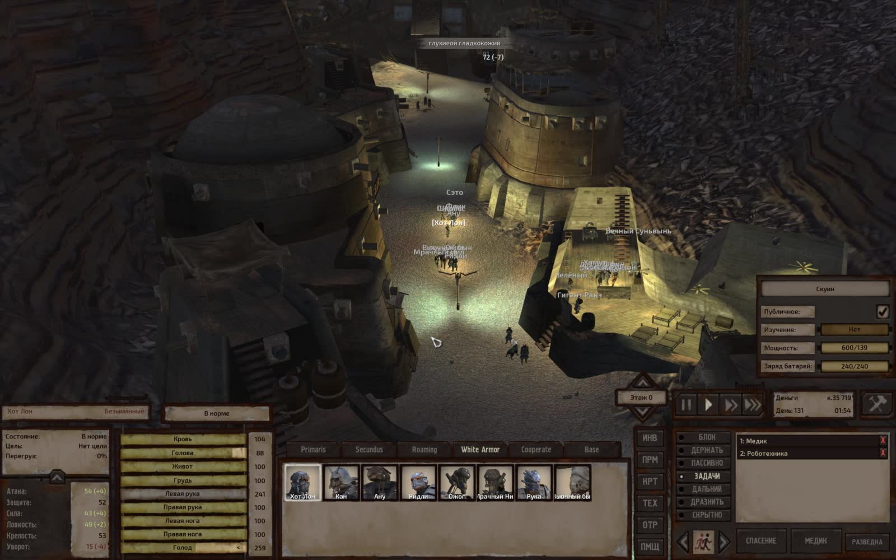

---

### Серия 2 (1 кадр)

- **Файловое время**: с `2026-11-03T07:30:48Z` по `2026-11-03T07:30:48Z`
- **Игровое время (OCR)**: `День 131, 08:39`
- **Локация (OCR)**: Не зафиксирована в UI
- **Персонажи в UI (OCR)**: Зелёный палец
- **Задачи/предметы в UI**: Работа с машиной: Кухонная плита, Работа с машиной: Рисовая ферма, Тащить в: Хранение: еда, Тащить в: Хранение: рис

**Кадры серии:**
- [screenshot_426-dca41523.jpg](screenshot_426-dca41523.jpg) ([GitHub](https://github.com/asaf1n/Kenshi-Compain/blob/main/published/screenshots/screenshot_426-dca41523.jpg) | [Raw](https://raw.githubusercontent.com/asaf1n/Kenshi-Compain/main/published/screenshots/screenshot_426-dca41523.jpg))

---

### Серия 3 (1 кадр)

- **Файловое время**: с `2026-11-04T08:43:01Z` по `2026-11-04T08:43:01Z`
- **Игровое время (OCR)**: `День 132, 09:13`
- **Локация (OCR)**: Не зафиксирована в UI
- **Персонажи в UI (OCR)**: вьючныи бык

**Кадры серии:**
- [screenshot_430-0b9d0d64.jpg](screenshot_430-0b9d0d64.jpg) ([GitHub](https://github.com/asaf1n/Kenshi-Compain/blob/main/published/screenshots/screenshot_430-0b9d0d64.jpg) | [Raw](https://raw.githubusercontent.com/asaf1n/Kenshi-Compain/main/published/screenshots/screenshot_430-0b9d0d64.jpg))

---

### Серия 4 (1 кадр)

- **Файловое время**: с `2026-11-04T16:41:25Z` по `2026-11-04T16:41:25Z`
- **Игровое время (OCR)**: `Не зафиксировано в UI`
- **Локация (OCR)**: Не зафиксирована в UI
- **Персонажи в UI (OCR)**: Не зафиксированы в UI

**Кадры серии:**
- [screenshot_438-a347c027.jpg](screenshot_438-a347c027.jpg) ([GitHub](https://github.com/asaf1n/Kenshi-Compain/blob/main/published/screenshots/screenshot_438-a347c027.jpg) | [Raw](https://raw.githubusercontent.com/asaf1n/Kenshi-Compain/main/published/screenshots/screenshot_438-a347c027.jpg))

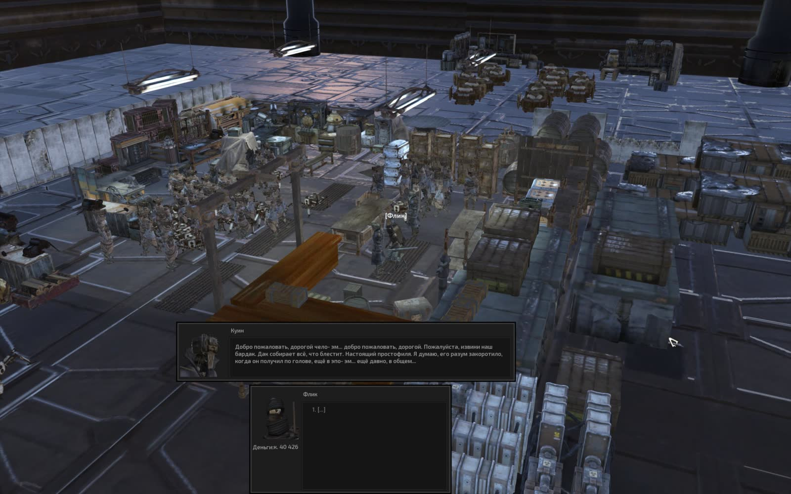

---

### Серия 5 (1 кадр)

- **Файловое время**: с `2026-11-04T16:53:43Z` по `2026-11-04T16:53:43Z`
- **Игровое время (OCR)**: `День 132, 21:23`
- **Локация (OCR)**: Не зафиксирована в UI
- **Персонажи в UI (OCR)**: Зелёный палец
- **Задачи/предметы в UI**: Работа с машиной: Пеньковая ферма, Работа с машиной: Пеньковая ферма 1-, Работа с машиной: Рисовая ферма L, Тащить в: Хранение: рис

**Кадры серии:**
- [screenshot_443-97b97dd4.jpg](screenshot_443-97b97dd4.jpg) ([GitHub](https://github.com/asaf1n/Kenshi-Compain/blob/main/published/screenshots/screenshot_443-97b97dd4.jpg) | [Raw](https://raw.githubusercontent.com/asaf1n/Kenshi-Compain/main/published/screenshots/screenshot_443-97b97dd4.jpg))

---

### Серия 6 (1 кадр)

- **Файловое время**: с `2026-11-06T00:19:10Z` по `2026-11-06T00:19:10Z`
- **Игровое время (OCR)**: `День 133, 11:40`
- **Локация (OCR)**: Не зафиксирована в UI
- **Персонажи в UI (OCR)**: Пиа
- **Задачи/предметы в UI**: Медик, Роботехника

**Кадры серии:**
- [screenshot_447-62a59c4e.jpg](screenshot_447-62a59c4e.jpg) ([GitHub](https://github.com/asaf1n/Kenshi-Compain/blob/main/published/screenshots/screenshot_447-62a59c4e.jpg) | [Raw](https://raw.githubusercontent.com/asaf1n/Kenshi-Compain/main/published/screenshots/screenshot_447-62a59c4e.jpg))

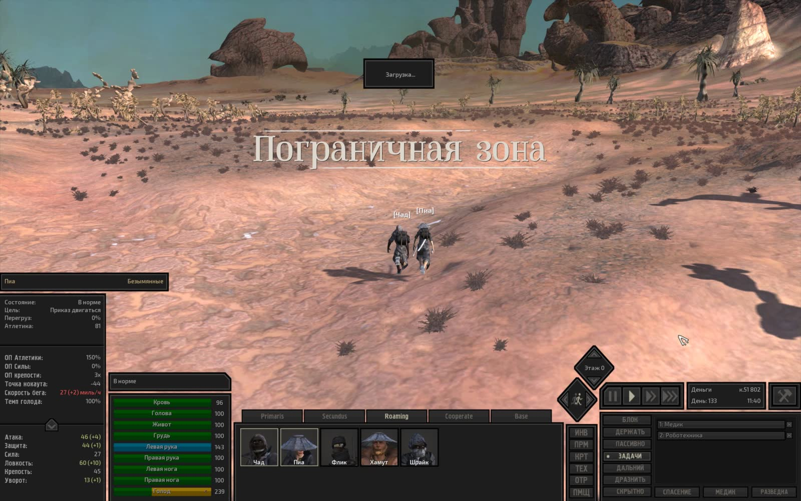

---

### Серия 7 (1 кадр)

- **Файловое время**: с `2026-11-06T00:20:56Z` по `2026-11-06T00:20:56Z`
- **Игровое время (OCR)**: `День 133, 12:27`
- **Локация (OCR)**: Не зафиксирована в UI
- **Персонажи в UI (OCR)**: Инквизитор Сэта
- **Задачи/предметы в UI**: Медик, Роботехника

**Кадры серии:**
- [screenshot_451-414dccf2.jpg](screenshot_451-414dccf2.jpg) ([GitHub](https://github.com/asaf1n/Kenshi-Compain/blob/main/published/screenshots/screenshot_451-414dccf2.jpg) | [Raw](https://raw.githubusercontent.com/asaf1n/Kenshi-Compain/main/published/screenshots/screenshot_451-414dccf2.jpg))

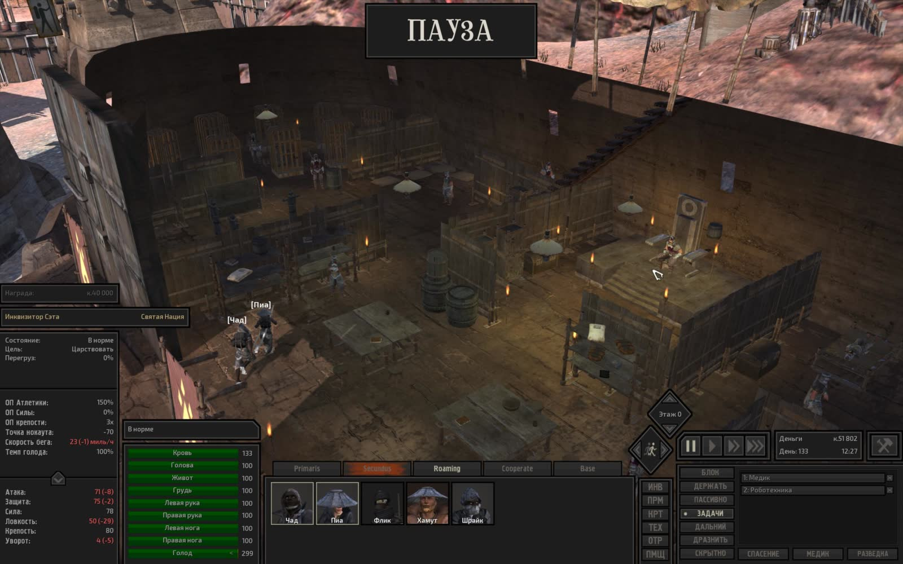

---

### Серия 8 (1 кадр)

- **Файловое время**: с `2026-11-06T00:27:39Z` по `2026-11-06T00:27:39Z`
- **Игровое время (OCR)**: `День 133, 14:24`
- **Локация (OCR)**: Не зафиксирована в UI
- **Персонажи в UI (OCR)**: Мью
- **Задачи/предметы в UI**: Работа с машиной: Кухонная плита, Работа с машиной: Рисовая ферма 1-, Работа с машиной: Рисовая ферма L, Тащить в: Хранение: еда

**Кадры серии:**
- [screenshot_463-701918e2.jpg](screenshot_463-701918e2.jpg) ([GitHub](https://github.com/asaf1n/Kenshi-Compain/blob/main/published/screenshots/screenshot_463-701918e2.jpg) | [Raw](https://raw.githubusercontent.com/asaf1n/Kenshi-Compain/main/published/screenshots/screenshot_463-701918e2.jpg))

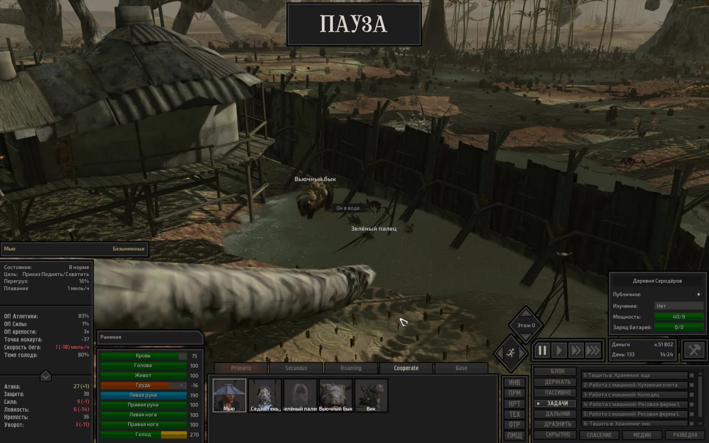

---

### Серия 9 (1 кадр)

- **Файловое время**: с `2026-11-06T00:30:23Z` по `2026-11-06T00:30:23Z`
- **Игровое время (OCR)**: `День 133, 15:07`
- **Локация (OCR)**: Не зафиксирована в UI
- **Персонажи в UI (OCR)**: Инквизитор Сэта
- **Задачи/предметы в UI**: Медик, Роботехника

**Кадры серии:**
- [screenshot_468-e8df2db2.jpg](screenshot_468-e8df2db2.jpg) ([GitHub](https://github.com/asaf1n/Kenshi-Compain/blob/main/published/screenshots/screenshot_468-e8df2db2.jpg) | [Raw](https://raw.githubusercontent.com/asaf1n/Kenshi-Compain/main/published/screenshots/screenshot_468-e8df2db2.jpg))

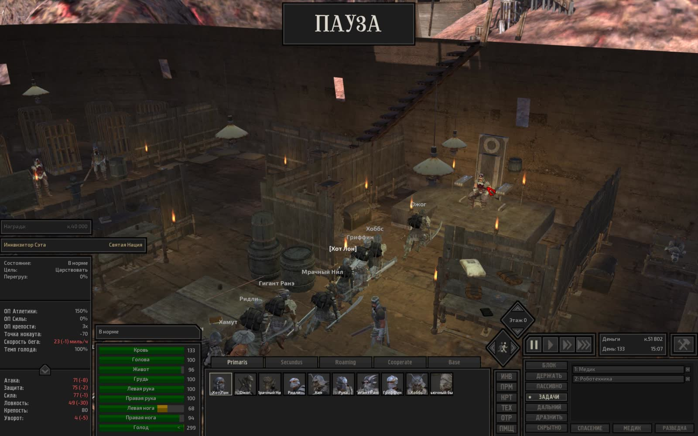

---

### Серия 10 (1 кадр)

- **Файловое время**: с `2026-11-06T00:38:43Z` по `2026-11-06T00:38:43Z`
- **Игровое время (OCR)**: `День 133, 15:53`
- **Локация (OCR)**: Не зафиксирована в UI
- **Персонажи в UI (OCR)**: Инквизитор
- **Задачи/предметы в UI**: Быть рядом: Зелёный, Охранять: Зелёный

**Кадры серии:**
- [screenshot_472-b2cf3be2.jpg](screenshot_472-b2cf3be2.jpg) ([GitHub](https://github.com/asaf1n/Kenshi-Compain/blob/main/published/screenshots/screenshot_472-b2cf3be2.jpg) | [Raw](https://raw.githubusercontent.com/asaf1n/Kenshi-Compain/main/published/screenshots/screenshot_472-b2cf3be2.jpg))

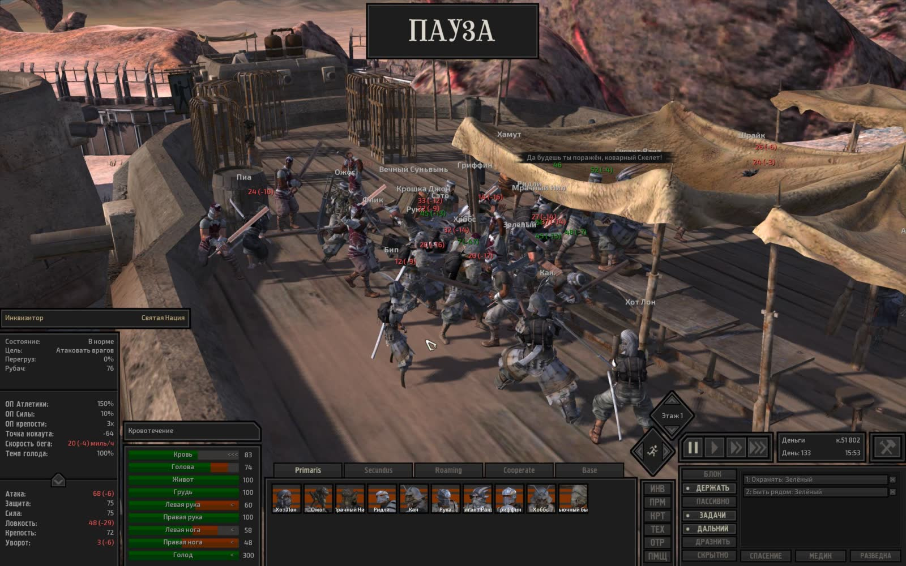

---

### Серия 11 (1 кадр)

- **Файловое время**: с `2026-11-06T01:02:47Z` по `2026-11-06T01:02:47Z`
- **Игровое время (OCR)**: `День 133, 20:18`
- **Локация (OCR)**: Не зафиксирована в UI
- **Персонажи в UI (OCR)**: Принц
- **Задачи/предметы в UI**: Быть рядом: Хот Лон, Медик, Роботехника

**Кадры серии:**
- [screenshot_476-e83427a7.jpg](screenshot_476-e83427a7.jpg) ([GitHub](https://github.com/asaf1n/Kenshi-Compain/blob/main/published/screenshots/screenshot_476-e83427a7.jpg) | [Raw](https://raw.githubusercontent.com/asaf1n/Kenshi-Compain/main/published/screenshots/screenshot_476-e83427a7.jpg))

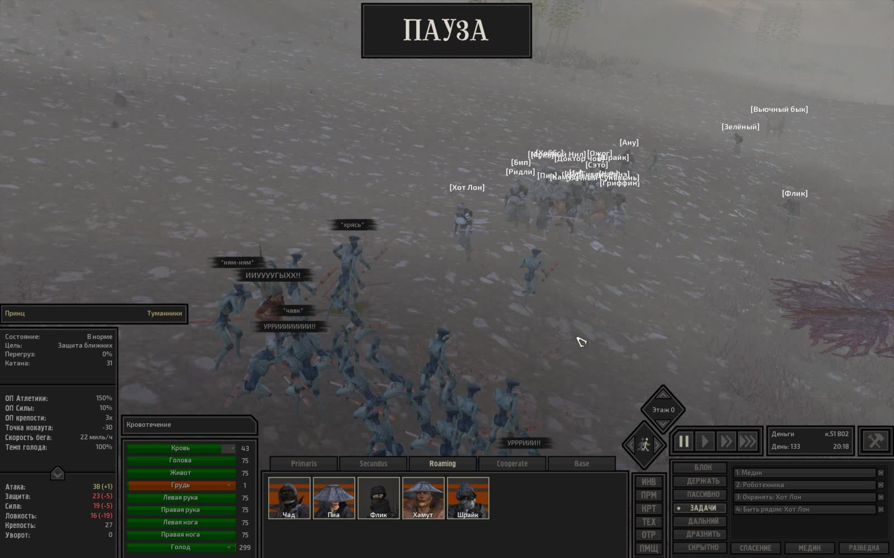

---

### Серия 12 (1 кадр)

- **Файловое время**: с `2026-11-06T01:42:12Z` по `2026-11-06T01:42:12Z`
- **Игровое время (OCR)**: `День 134, 08:21`
- **Локация (OCR)**: Не зафиксирована в UI
- **Персонажи в UI (OCR)**: Шрайк
- **Задачи/предметы в UI**: Быть рядом: Хот Лон, Медик, Роботехника

**Кадры серии:**
- [screenshot_484-f57d65fd.jpg](screenshot_484-f57d65fd.jpg) ([GitHub](https://github.com/asaf1n/Kenshi-Compain/blob/main/published/screenshots/screenshot_484-f57d65fd.jpg) | [Raw](https://raw.githubusercontent.com/asaf1n/Kenshi-Compain/main/published/screenshots/screenshot_484-f57d65fd.jpg))

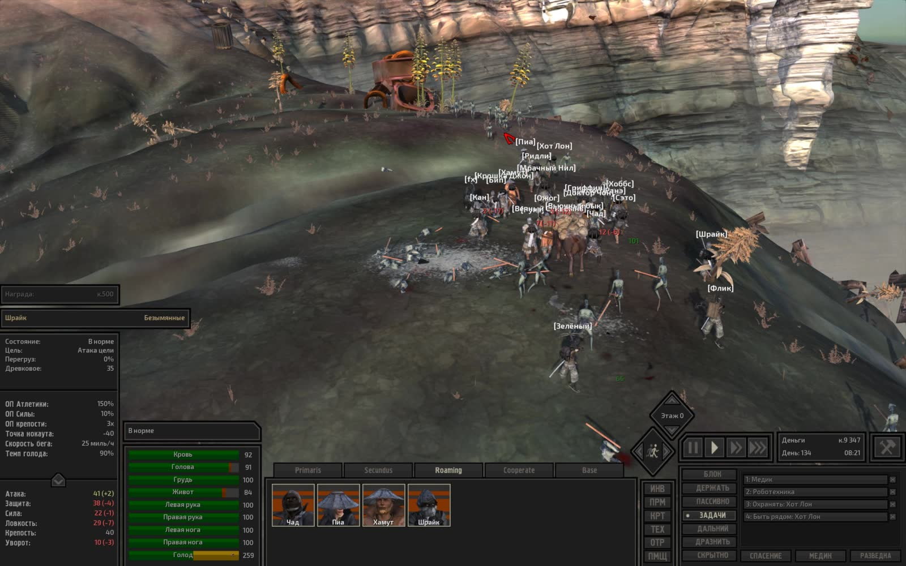

---

### Серия 13 (1 кадр)

- **Файловое время**: с `2026-11-06T14:25:16Z` по `2026-11-06T14:25:16Z`
- **Игровое время (OCR)**: `День 134, 11:46`
- **Локация (OCR)**: Не зафиксирована в UI
- **Персонажи в UI (OCR)**: Не зафиксированы в UI

**Кадры серии:**
- [screenshot_488-78a1f13f.jpg](screenshot_488-78a1f13f.jpg) ([GitHub](https://github.com/asaf1n/Kenshi-Compain/blob/main/published/screenshots/screenshot_488-78a1f13f.jpg) | [Raw](https://raw.githubusercontent.com/asaf1n/Kenshi-Compain/main/published/screenshots/screenshot_488-78a1f13f.jpg))

---

### Серия 14 (1 кадр)

- **Файловое время**: с `2026-11-06T14:30:53Z` по `2026-11-06T14:30:53Z`
- **Игровое время (OCR)**: `День 134, 14:19`
- **Локация (OCR)**: Не зафиксирована в UI
- **Персонажи в UI (OCR)**: Шрайк
- **Задачи/предметы в UI**: Быть рядом: Хот Лон, Медик, Роботехника

**Кадры серии:**
- [screenshot_492-a754c5d0.jpg](screenshot_492-a754c5d0.jpg) ([GitHub](https://github.com/asaf1n/Kenshi-Compain/blob/main/published/screenshots/screenshot_492-a754c5d0.jpg) | [Raw](https://raw.githubusercontent.com/asaf1n/Kenshi-Compain/main/published/screenshots/screenshot_492-a754c5d0.jpg))

---

### Серия 15 (1 кадр)

- **Файловое время**: с `2026-11-06T20:51:38Z` по `2026-11-06T20:51:38Z`
- **Игровое время (OCR)**: `День 134, 19:25`
- **Локация (OCR)**: Не зафиксирована в UI
- **Персонажи в UI (OCR)**: Не зафиксированы в UI
- **Задачи/предметы в UI**: Быть рядом: Хот Лон, Медик, Роботехника

**Кадры серии:**
- [screenshot_496-9419f34a.jpg](screenshot_496-9419f34a.jpg) ([GitHub](https://github.com/asaf1n/Kenshi-Compain/blob/main/published/screenshots/screenshot_496-9419f34a.jpg) | [Raw](https://raw.githubusercontent.com/asaf1n/Kenshi-Compain/main/published/screenshots/screenshot_496-9419f34a.jpg))

---

### Серия 16 (1 кадр)

- **Файловое время**: с `2026-11-06T22:43:48Z` по `2026-11-06T22:43:48Z`
- **Игровое время (OCR)**: `День 134, 23:16`
- **Локация (OCR)**: Не зафиксирована в UI
- **Персонажи в UI (OCR)**: Не зафиксированы в UI
- **Задачи/предметы в UI**: Медик, Турель, охрана: Арбалет-турель Mkll [свет [8]

**Кадры серии:**
- [screenshot_500-8d631a9c.jpg](screenshot_500-8d631a9c.jpg) ([GitHub](https://github.com/asaf1n/Kenshi-Compain/blob/main/published/screenshots/screenshot_500-8d631a9c.jpg) | [Raw](https://raw.githubusercontent.com/asaf1n/Kenshi-Compain/main/published/screenshots/screenshot_500-8d631a9c.jpg))

---

### Серия 17 (1 кадр)

- **Файловое время**: с `2026-11-08T01:54:36Z` по `2026-11-08T01:54:36Z`
- **Игровое время (OCR)**: `День 135, 11:23`
- **Локация (OCR)**: Не зафиксирована в UI
- **Персонажи в UI (OCR)**: Не зафиксированы в UI

**Кадры серии:**
- [screenshot_533-4abbdb6d.jpg](screenshot_533-4abbdb6d.jpg) ([GitHub](https://github.com/asaf1n/Kenshi-Compain/blob/main/published/screenshots/screenshot_533-4abbdb6d.jpg) | [Raw](https://raw.githubusercontent.com/asaf1n/Kenshi-Compain/main/published/screenshots/screenshot_533-4abbdb6d.jpg))

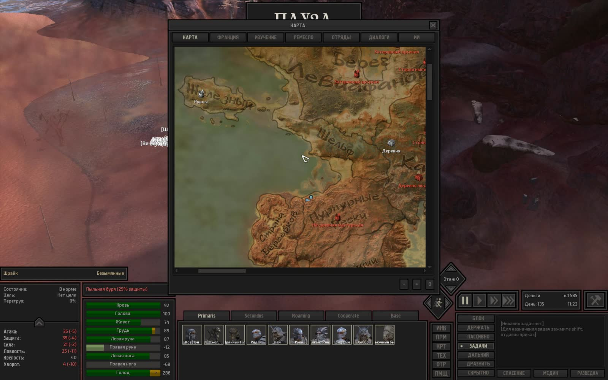

---

### Серия 18 (1 кадр)

- **Файловое время**: с `2026-11-09T04:45:16Z` по `2026-11-09T04:45:16Z`
- **Игровое время (OCR)**: `День 135, 16:05`
- **Локация (OCR)**: Не зафиксирована в UI
- **Персонажи в UI (OCR)**: Не зафиксированы в UI

**Кадры серии:**
- [screenshot_545-1c41c891.jpg](screenshot_545-1c41c891.jpg) ([GitHub](https://github.com/asaf1n/Kenshi-Compain/blob/main/published/screenshots/screenshot_545-1c41c891.jpg) | [Raw](https://raw.githubusercontent.com/asaf1n/Kenshi-Compain/main/published/screenshots/screenshot_545-1c41c891.jpg))

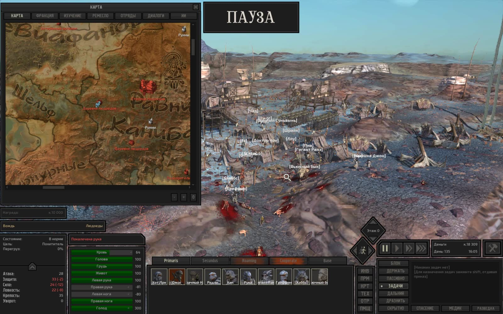

---

### Серия 19 (1 кадр)

- **Файловое время**: с `2026-11-09T05:04:26Z` по `2026-11-09T05:04:26Z`
- **Игровое время (OCR)**: `День 135, 18:48`
- **Локация (OCR)**: Не зафиксирована в UI
- **Персонажи в UI (OCR)**: Не зафиксированы в UI
- **Задачи/предметы в UI**: Медик, Роботехника

**Кадры серии:**
- [screenshot_548-e7fc970b.jpg](screenshot_548-e7fc970b.jpg) ([GitHub](https://github.com/asaf1n/Kenshi-Compain/blob/main/published/screenshots/screenshot_548-e7fc970b.jpg) | [Raw](https://raw.githubusercontent.com/asaf1n/Kenshi-Compain/main/published/screenshots/screenshot_548-e7fc970b.jpg))

---

### Серия 20 (1 кадр)

- **Файловое время**: с `2026-11-09T23:03:28Z` по `2026-11-09T23:03:28Z`
- **Игровое время (OCR)**: `День 136, 00:03`
- **Локация (OCR)**: Не зафиксирована в UI
- **Персонажи в UI (OCR)**: Не зафиксированы в UI
- **Задачи/предметы в UI**: Медик, Охранять: Вик

**Кадры серии:**
- [screenshot_552-3e994ccb.jpg](screenshot_552-3e994ccb.jpg) ([GitHub](https://github.com/asaf1n/Kenshi-Compain/blob/main/published/screenshots/screenshot_552-3e994ccb.jpg) | [Raw](https://raw.githubusercontent.com/asaf1n/Kenshi-Compain/main/published/screenshots/screenshot_552-3e994ccb.jpg))

---

### Серия 21 (1 кадр)

- **Файловое время**: с `2026-11-09T23:45:15Z` по `2026-11-09T23:45:15Z`
- **Игровое время (OCR)**: `День 136, 06:52`
- **Локация (OCR)**: Не зафиксирована в UI
- **Персонажи в UI (OCR)**: Хот Лон
- **Задачи/предметы в UI**: Медик, Роботехника

**Кадры серии:**
- [screenshot_560-b190f494.jpg](screenshot_560-b190f494.jpg) ([GitHub](https://github.com/asaf1n/Kenshi-Compain/blob/main/published/screenshots/screenshot_560-b190f494.jpg) | [Raw](https://raw.githubusercontent.com/asaf1n/Kenshi-Compain/main/published/screenshots/screenshot_560-b190f494.jpg))

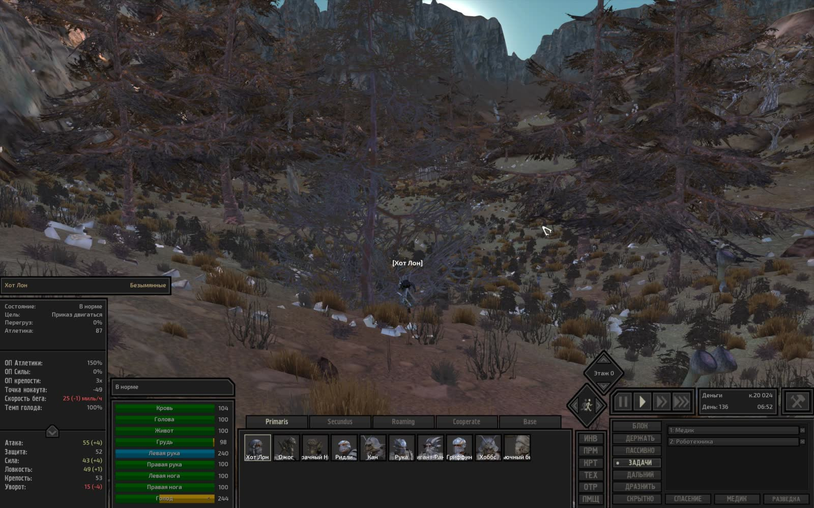

---

### Серия 22 (1 кадр)

- **Файловое время**: с `2026-11-10T00:07:01Z` по `2026-11-10T00:07:01Z`
- **Игровое время (OCR)**: `День 136, 12:11`
- **Локация (OCR)**: Не зафиксирована в UI
- **Персонажи в UI (OCR)**: Не зафиксированы в UI

**Кадры серии:**
- [screenshot_564-0a3df73e.jpg](screenshot_564-0a3df73e.jpg) ([GitHub](https://github.com/asaf1n/Kenshi-Compain/blob/main/published/screenshots/screenshot_564-0a3df73e.jpg) | [Raw](https://raw.githubusercontent.com/asaf1n/Kenshi-Compain/main/published/screenshots/screenshot_564-0a3df73e.jpg))

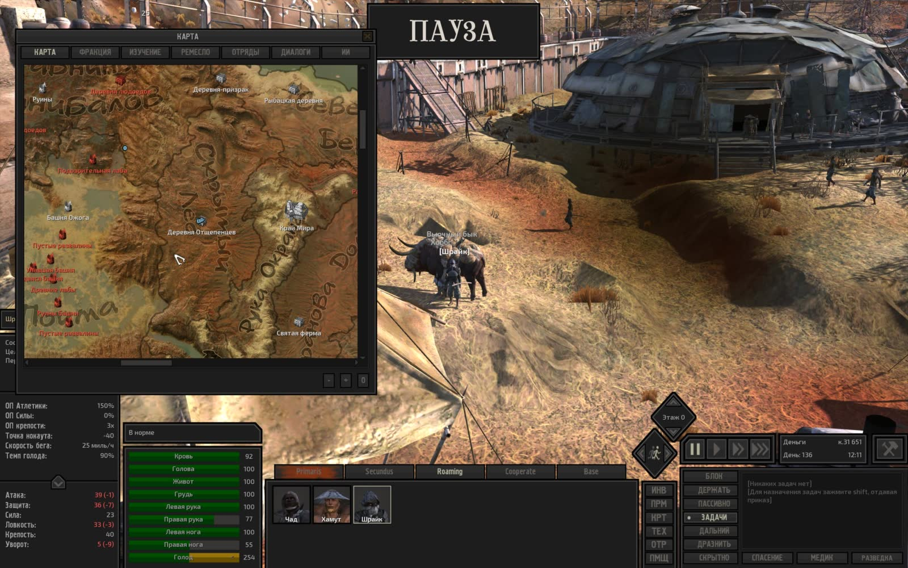

---

### Серия 23 (1 кадр)

- **Файловое время**: с `2026-11-10T00:22:59Z` по `2026-11-10T00:22:59Z`
- **Игровое время (OCR)**: `День 136, 16:41`
- **Локация (OCR)**: Не зафиксирована в UI
- **Персонажи в UI (OCR)**: Хот Лон
- **Задачи/предметы в UI**: Медик, Роботехника

**Кадры серии:**
- [screenshot_568-7869c401.jpg](screenshot_568-7869c401.jpg) ([GitHub](https://github.com/asaf1n/Kenshi-Compain/blob/main/published/screenshots/screenshot_568-7869c401.jpg) | [Raw](https://raw.githubusercontent.com/asaf1n/Kenshi-Compain/main/published/screenshots/screenshot_568-7869c401.jpg))

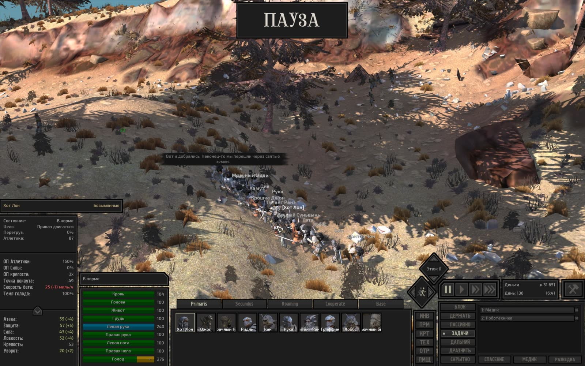

---

### Серия 24 (1 кадр)

- **Файловое время**: с `2026-11-10T05:40:18Z` по `2026-11-10T05:40:18Z`
- **Игровое время (OCR)**: `День 136, 18:30`
- **Локация (OCR)**: Не зафиксирована в UI
- **Персонажи в UI (OCR)**: Хот Лон
- **Задачи/предметы в UI**: Медик, Роботехника

**Кадры серии:**
- [screenshot_570-5e80da27.jpg](screenshot_570-5e80da27.jpg) ([GitHub](https://github.com/asaf1n/Kenshi-Compain/blob/main/published/screenshots/screenshot_570-5e80da27.jpg) | [Raw](https://raw.githubusercontent.com/asaf1n/Kenshi-Compain/main/published/screenshots/screenshot_570-5e80da27.jpg))

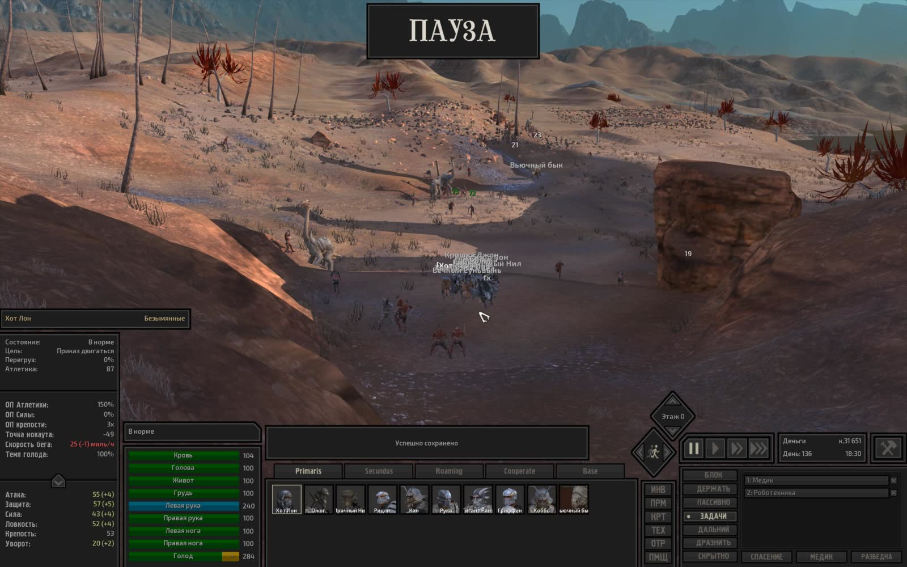

---

### Серия 25 (1 кадр)

- **Файловое время**: с `2026-11-10T05:40:27Z` по `2026-11-10T05:40:27Z`
- **Игровое время (OCR)**: `День 136, 18:30`
- **Локация (OCR)**: Не зафиксирована в UI
- **Персонажи в UI (OCR)**: Чад
- **Задачи/предметы в UI**: Медик, Роботехника

**Кадры серии:**
- [screenshot_571-bc6bf6e8.jpg](screenshot_571-bc6bf6e8.jpg) ([GitHub](https://github.com/asaf1n/Kenshi-Compain/blob/main/published/screenshots/screenshot_571-bc6bf6e8.jpg) | [Raw](https://raw.githubusercontent.com/asaf1n/Kenshi-Compain/main/published/screenshots/screenshot_571-bc6bf6e8.jpg))

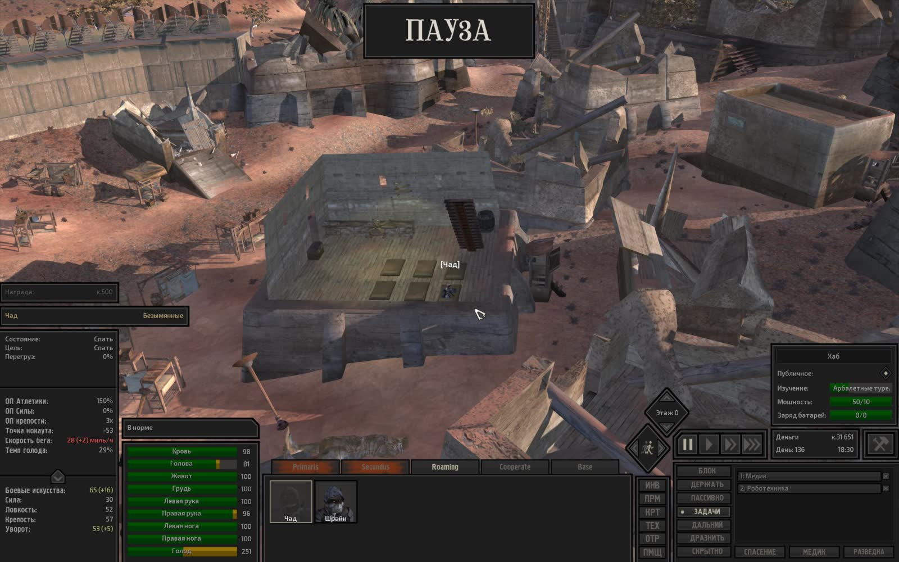

---

### Серия 26 (1 кадр)

- **Файловое время**: с `2026-11-10T05:40:53Z` по `2026-11-10T05:40:53Z`
- **Игровое время (OCR)**: `День 136, 18:30`
- **Локация (OCR)**: Не зафиксирована в UI
- **Персонажи в UI (OCR)**: Не зафиксированы в UI
- **Задачи/предметы в UI**: Быть рядом: Вьючный бык, Охранять: Вьючный бык

**Кадры серии:**
- [screenshot_572-d3b8fb0f.jpg](screenshot_572-d3b8fb0f.jpg) ([GitHub](https://github.com/asaf1n/Kenshi-Compain/blob/main/published/screenshots/screenshot_572-d3b8fb0f.jpg) | [Raw](https://raw.githubusercontent.com/asaf1n/Kenshi-Compain/main/published/screenshots/screenshot_572-d3b8fb0f.jpg))

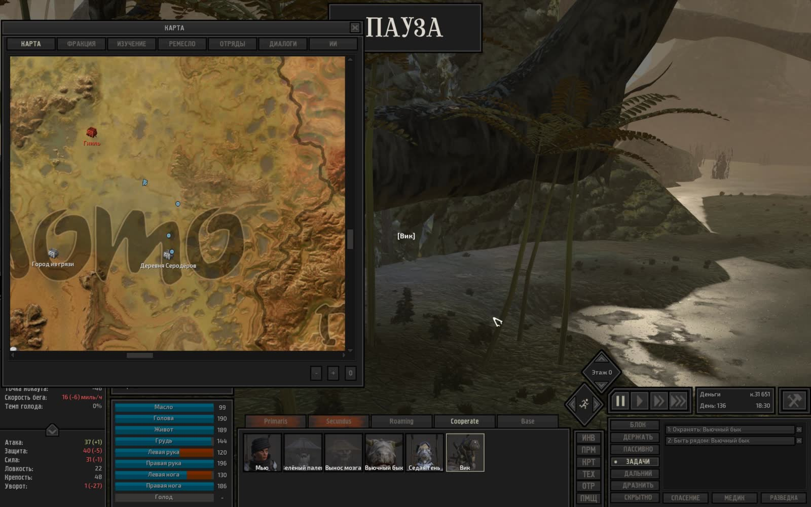

---

### Серия 27 (1 кадр)

- **Файловое время**: с `2026-11-10T05:41:40Z` по `2026-11-10T05:41:40Z`
- **Игровое время (OCR)**: `День 136, 18:50`
- **Локация (OCR)**: Не зафиксирована в UI
- **Персонажи в UI (OCR)**: Не зафиксированы в UI
- **Задачи/предметы в UI**: Работа с машиной: Переработка пеньки, Тащить в: Хранение: гашиш

**Кадры серии:**
- [screenshot_573-884f030a.jpg](screenshot_573-884f030a.jpg) ([GitHub](https://github.com/asaf1n/Kenshi-Compain/blob/main/published/screenshots/screenshot_573-884f030a.jpg) | [Raw](https://raw.githubusercontent.com/asaf1n/Kenshi-Compain/main/published/screenshots/screenshot_573-884f030a.jpg))

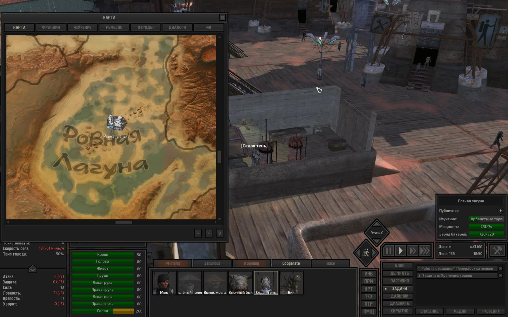

---

### Серия 28 (1 кадр)

- **Файловое время**: с `2026-11-10T05:42:25Z` по `2026-11-10T05:42:25Z`
- **Игровое время (OCR)**: `День 136, 19:14`
- **Локация (OCR)**: Не зафиксирована в UI
- **Персонажи в UI (OCR)**: Не зафиксированы в UI
- **Задачи/предметы в UI**: Медик

**Кадры серии:**
- [screenshot_574-7d5bd7c9.jpg](screenshot_574-7d5bd7c9.jpg) ([GitHub](https://github.com/asaf1n/Kenshi-Compain/blob/main/published/screenshots/screenshot_574-7d5bd7c9.jpg) | [Raw](https://raw.githubusercontent.com/asaf1n/Kenshi-Compain/main/published/screenshots/screenshot_574-7d5bd7c9.jpg))

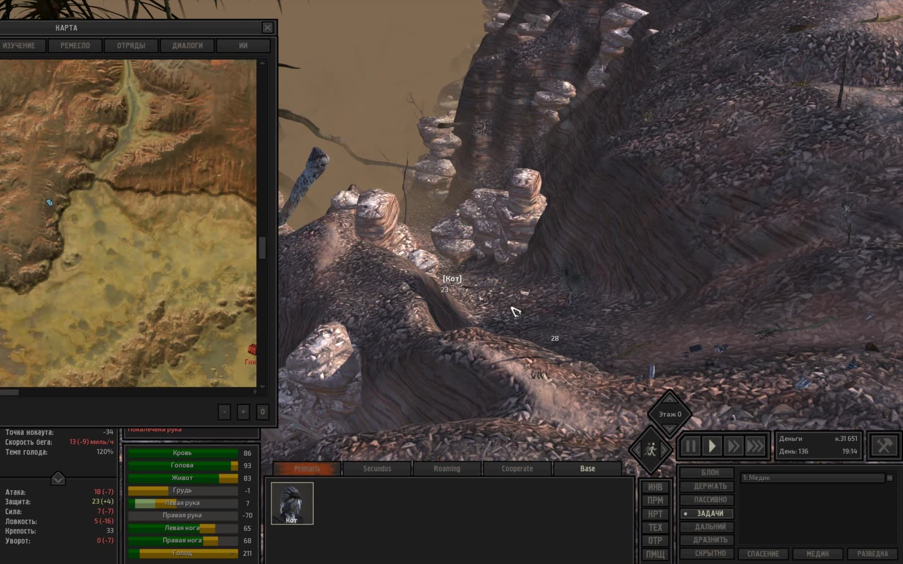

---

### Серия 29 (1 кадр)

- **Файловое время**: с `2026-11-10T05:42:32Z` по `2026-11-10T05:42:32Z`
- **Игровое время (OCR)**: `День 136, 19:17`
- **Локация (OCR)**: Не зафиксирована в UI
- **Персонажи в UI (OCR)**: Не зафиксированы в UI
- **Задачи/предметы в UI**: Медик, Роботехника

**Кадры серии:**
- [screenshot_575-3193b0ad.jpg](screenshot_575-3193b0ad.jpg) ([GitHub](https://github.com/asaf1n/Kenshi-Compain/blob/main/published/screenshots/screenshot_575-3193b0ad.jpg) | [Raw](https://raw.githubusercontent.com/asaf1n/Kenshi-Compain/main/published/screenshots/screenshot_575-3193b0ad.jpg))

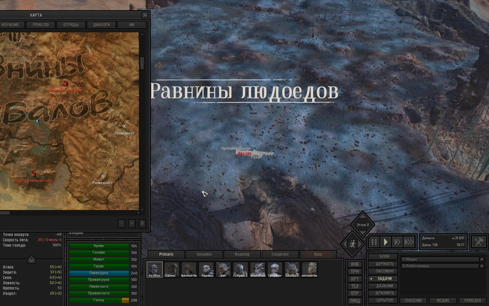

---

### Серия 30 (1 кадр)

- **Файловое время**: с `2026-11-10T05:44:53Z` по `2026-11-10T05:44:53Z`
- **Игровое время (OCR)**: `День 136, 20:07`
- **Локация (OCR)**: Не зафиксирована в UI
- **Персонажи в UI (OCR)**: Не зафиксированы в UI
- **Задачи/предметы в UI**: Медик, Роботехника

**Кадры серии:**
- [screenshot_576-2755813b.jpg](screenshot_576-2755813b.jpg) ([GitHub](https://github.com/asaf1n/Kenshi-Compain/blob/main/published/screenshots/screenshot_576-2755813b.jpg) | [Raw](https://raw.githubusercontent.com/asaf1n/Kenshi-Compain/main/published/screenshots/screenshot_576-2755813b.jpg))

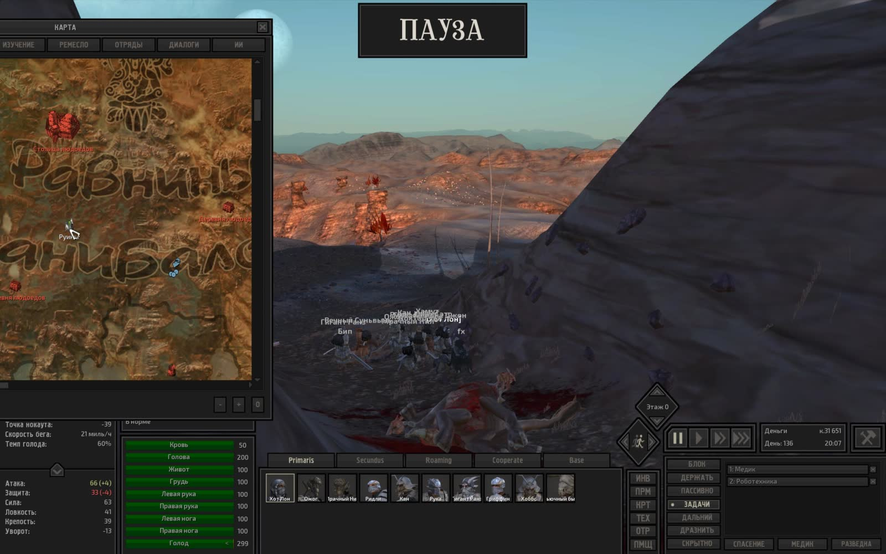

---
