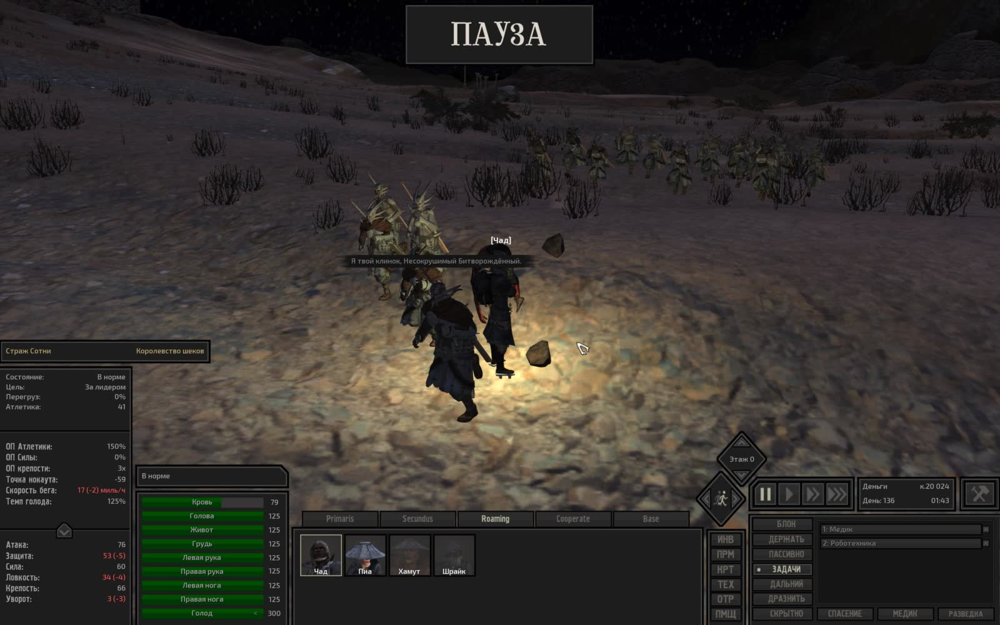

# Техническая лента скриншотов Kenshi

- **Сформировано**: `2026-11-13T04:54:25Z`
- **Окно выборки**: последние 7 суток (с `2026-11-06T04:54:25Z` по `2026-11-13T04:54:25Z`)
- **Всего скриншотов в окне**: 30
- **Сгруппировано серий/кадров**: 30

Техническая лента сгруппированных по сходству кадров с извлеченным текстом интерфейса (OCR).

---

### Серия 1 (1 кадр)

- **Файловое время**: с `2026-11-06T14:25:09Z` по `2026-11-06T14:25:09Z`
- **Игровое время (OCR)**: `День 134, 11:43`
- **Локация (OCR)**: Не зафиксирована в UI
- **Персонажи в UI (OCR)**: Не зафиксированы в UI

**Кадры серии:**
- [screenshot_486-7505944b.jpg](screenshot_486-7505944b.jpg) ([GitHub](https://github.com/asaf1n/Kenshi-Compain/blob/main/published/screenshots/screenshot_486-7505944b.jpg) | [Raw](https://raw.githubusercontent.com/asaf1n/Kenshi-Compain/main/published/screenshots/screenshot_486-7505944b.jpg))

---

### Серия 2 (1 кадр)

- **Файловое время**: с `2026-11-06T14:25:16Z` по `2026-11-06T14:25:16Z`
- **Игровое время (OCR)**: `День 134, 11:46`
- **Локация (OCR)**: Не зафиксирована в UI
- **Персонажи в UI (OCR)**: Не зафиксированы в UI

**Кадры серии:**
- [screenshot_488-78a1f13f.jpg](screenshot_488-78a1f13f.jpg) ([GitHub](https://github.com/asaf1n/Kenshi-Compain/blob/main/published/screenshots/screenshot_488-78a1f13f.jpg) | [Raw](https://raw.githubusercontent.com/asaf1n/Kenshi-Compain/main/published/screenshots/screenshot_488-78a1f13f.jpg))

---

### Серия 3 (1 кадр)

- **Файловое время**: с `2026-11-06T14:26:29Z` по `2026-11-06T14:26:29Z`
- **Игровое время (OCR)**: `День 134, 12:19`
- **Локация (OCR)**: Не зафиксирована в UI
- **Персонажи в UI (OCR)**: Не зафиксированы в UI
- **Задачи/предметы в UI**: Быть рядом: Хот Лон, Медик, Роботехника

**Кадры серии:**
- [screenshot_490-62e8b529.jpg](screenshot_490-62e8b529.jpg) ([GitHub](https://github.com/asaf1n/Kenshi-Compain/blob/main/published/screenshots/screenshot_490-62e8b529.jpg) | [Raw](https://raw.githubusercontent.com/asaf1n/Kenshi-Compain/main/published/screenshots/screenshot_490-62e8b529.jpg))

---

### Серия 4 (1 кадр)

- **Файловое время**: с `2026-11-06T14:30:53Z` по `2026-11-06T14:30:53Z`
- **Игровое время (OCR)**: `День 134, 14:19`
- **Локация (OCR)**: Не зафиксирована в UI
- **Персонажи в UI (OCR)**: Шрайк
- **Задачи/предметы в UI**: Быть рядом: Хот Лон, Медик, Роботехника

**Кадры серии:**
- [screenshot_492-a754c5d0.jpg](screenshot_492-a754c5d0.jpg) ([GitHub](https://github.com/asaf1n/Kenshi-Compain/blob/main/published/screenshots/screenshot_492-a754c5d0.jpg) | [Raw](https://raw.githubusercontent.com/asaf1n/Kenshi-Compain/main/published/screenshots/screenshot_492-a754c5d0.jpg))

---

### Серия 5 (1 кадр)

- **Файловое время**: с `2026-11-06T14:45:10Z` по `2026-11-06T14:45:10Z`
- **Игровое время (OCR)**: `День 134, 16:54`
- **Локация (OCR)**: Не зафиксирована в UI
- **Персонажи в UI (OCR)**: Бандит
- **Задачи/предметы в UI**: Быть рядом: Хот Лон, Медик, Роботехника

**Кадры серии:**
- [screenshot_494-10df7063.jpg](screenshot_494-10df7063.jpg) ([GitHub](https://github.com/asaf1n/Kenshi-Compain/blob/main/published/screenshots/screenshot_494-10df7063.jpg) | [Raw](https://raw.githubusercontent.com/asaf1n/Kenshi-Compain/main/published/screenshots/screenshot_494-10df7063.jpg))

---

### Серия 6 (1 кадр)

- **Файловое время**: с `2026-11-06T20:51:38Z` по `2026-11-06T20:51:38Z`
- **Игровое время (OCR)**: `День 134, 19:25`
- **Локация (OCR)**: Не зафиксирована в UI
- **Персонажи в UI (OCR)**: Не зафиксированы в UI
- **Задачи/предметы в UI**: Быть рядом: Хот Лон, Медик, Роботехника

**Кадры серии:**
- [screenshot_496-9419f34a.jpg](screenshot_496-9419f34a.jpg) ([GitHub](https://github.com/asaf1n/Kenshi-Compain/blob/main/published/screenshots/screenshot_496-9419f34a.jpg) | [Raw](https://raw.githubusercontent.com/asaf1n/Kenshi-Compain/main/published/screenshots/screenshot_496-9419f34a.jpg))

---

### Серия 7 (1 кадр)

- **Файловое время**: с `2026-11-06T20:53:03Z` по `2026-11-06T20:53:03Z`
- **Игровое время (OCR)**: `Не зафиксировано в UI`
- **Локация (OCR)**: Не зафиксирована в UI
- **Персонажи в UI (OCR)**: Не зафиксированы в UI
- **Задачи/предметы в UI**: Быть рядом: Хот Лон, Медик, Роботехника

**Кадры серии:**
- [screenshot_498-2fde89d1.jpg](screenshot_498-2fde89d1.jpg) ([GitHub](https://github.com/asaf1n/Kenshi-Compain/blob/main/published/screenshots/screenshot_498-2fde89d1.jpg) | [Raw](https://raw.githubusercontent.com/asaf1n/Kenshi-Compain/main/published/screenshots/screenshot_498-2fde89d1.jpg))

---

### Серия 8 (1 кадр)

- **Файловое время**: с `2026-11-06T22:43:48Z` по `2026-11-06T22:43:48Z`
- **Игровое время (OCR)**: `День 134, 23:16`
- **Локация (OCR)**: Не зафиксирована в UI
- **Персонажи в UI (OCR)**: Не зафиксированы в UI
- **Задачи/предметы в UI**: Медик, Турель, охрана: Арбалет-турель Mkll [свет [8]

**Кадры серии:**
- [screenshot_500-8d631a9c.jpg](screenshot_500-8d631a9c.jpg) ([GitHub](https://github.com/asaf1n/Kenshi-Compain/blob/main/published/screenshots/screenshot_500-8d631a9c.jpg) | [Raw](https://raw.githubusercontent.com/asaf1n/Kenshi-Compain/main/published/screenshots/screenshot_500-8d631a9c.jpg))

---

### Серия 9 (1 кадр)

- **Файловое время**: с `2026-11-06T22:48:59Z` по `2026-11-06T22:48:59Z`
- **Игровое время (OCR)**: `День 135, 04:19`
- **Локация (OCR)**: Не зафиксирована в UI
- **Персонажи в UI (OCR)**: Не зафиксированы в UI
- **Задачи/предметы в UI**: Работа с машиной: Кухонная плита, Работа с машиной: Рисовая ферма 1-, Тащить в: Хранение: еда, Тащить в: Хранение: рис

**Кадры серии:**
- [screenshot_502-d40116c4.jpg](screenshot_502-d40116c4.jpg) ([GitHub](https://github.com/asaf1n/Kenshi-Compain/blob/main/published/screenshots/screenshot_502-d40116c4.jpg) | [Raw](https://raw.githubusercontent.com/asaf1n/Kenshi-Compain/main/published/screenshots/screenshot_502-d40116c4.jpg))

---

### Серия 10 (1 кадр)

- **Файловое время**: с `2026-11-06T22:52:22Z` по `2026-11-06T22:52:22Z`
- **Игровое время (OCR)**: `День 135, 05:45`
- **Локация (OCR)**: Не зафиксирована в UI
- **Персонажи в UI (OCR)**: Не зафиксированы в UI
- **Задачи/предметы в UI**: Быть рядом: Хот Лон, Медик, Роботехника

**Кадры серии:**
- [screenshot_504-55362c6c.jpg](screenshot_504-55362c6c.jpg) ([GitHub](https://github.com/asaf1n/Kenshi-Compain/blob/main/published/screenshots/screenshot_504-55362c6c.jpg) | [Raw](https://raw.githubusercontent.com/asaf1n/Kenshi-Compain/main/published/screenshots/screenshot_504-55362c6c.jpg))

---

### Серия 11 (1 кадр)

- **Файловое время**: с `2026-11-06T22:59:55Z` по `2026-11-06T22:59:55Z`
- **Игровое время (OCR)**: `День 135, 08:55`
- **Локация (OCR)**: Не зафиксирована в UI
- **Персонажи в UI (OCR)**: Генин
- **Задачи/предметы в UI**: Работа с машиной: Кухонная плита, Работа с машиной: Рисовая ферма 1-, Тащить в: Хранение: еда, Тащить в: Хранение: рис

**Кадры серии:**
- [screenshot_506-996d742f.jpg](screenshot_506-996d742f.jpg) ([GitHub](https://github.com/asaf1n/Kenshi-Compain/blob/main/published/screenshots/screenshot_506-996d742f.jpg) | [Raw](https://raw.githubusercontent.com/asaf1n/Kenshi-Compain/main/published/screenshots/screenshot_506-996d742f.jpg))

---

### Серия 12 (1 кадр)

- **Файловое время**: с `2026-11-08T01:54:36Z` по `2026-11-08T01:54:36Z`
- **Игровое время (OCR)**: `День 135, 11:23`
- **Локация (OCR)**: Не зафиксирована в UI
- **Персонажи в UI (OCR)**: Не зафиксированы в UI

**Кадры серии:**
- [screenshot_533-4abbdb6d.jpg](screenshot_533-4abbdb6d.jpg) ([GitHub](https://github.com/asaf1n/Kenshi-Compain/blob/main/published/screenshots/screenshot_533-4abbdb6d.jpg) | [Raw](https://raw.githubusercontent.com/asaf1n/Kenshi-Compain/main/published/screenshots/screenshot_533-4abbdb6d.jpg))

---

### Серия 13 (1 кадр)

- **Файловое время**: с `2026-11-09T04:12:25Z` по `2026-11-09T04:12:25Z`
- **Игровое время (OCR)**: `День 135, 12:11`
- **Локация (OCR)**: Не зафиксирована в UI
- **Персонажи в UI (OCR)**: Не зафиксированы в UI
- **Задачи/предметы в UI**: Медик, Турель, охрана: Арбалет-турель МКП [све

**Кадры серии:**
- [screenshot_543-2ae1cfdd.jpg](screenshot_543-2ae1cfdd.jpg) ([GitHub](https://github.com/asaf1n/Kenshi-Compain/blob/main/published/screenshots/screenshot_543-2ae1cfdd.jpg) | [Raw](https://raw.githubusercontent.com/asaf1n/Kenshi-Compain/main/published/screenshots/screenshot_543-2ae1cfdd.jpg))

---

### Серия 14 (1 кадр)

- **Файловое время**: с `2026-11-09T04:45:16Z` по `2026-11-09T04:45:16Z`
- **Игровое время (OCR)**: `День 135, 16:05`
- **Локация (OCR)**: Не зафиксирована в UI
- **Персонажи в UI (OCR)**: Не зафиксированы в UI

**Кадры серии:**
- [screenshot_545-1c41c891.jpg](screenshot_545-1c41c891.jpg) ([GitHub](https://github.com/asaf1n/Kenshi-Compain/blob/main/published/screenshots/screenshot_545-1c41c891.jpg) | [Raw](https://raw.githubusercontent.com/asaf1n/Kenshi-Compain/main/published/screenshots/screenshot_545-1c41c891.jpg))

---

### Серия 15 (1 кадр)

- **Файловое время**: с `2026-11-09T05:03:45Z` по `2026-11-09T05:03:45Z`
- **Игровое время (OCR)**: `День 135, 18:31`
- **Локация (OCR)**: Не зафиксирована в UI
- **Персонажи в UI (OCR)**: Кот
- **Задачи/предметы в UI**: Медик, Охранять: Вик

**Кадры серии:**
- [screenshot_547-11b87cbc.jpg](screenshot_547-11b87cbc.jpg) ([GitHub](https://github.com/asaf1n/Kenshi-Compain/blob/main/published/screenshots/screenshot_547-11b87cbc.jpg) | [Raw](https://raw.githubusercontent.com/asaf1n/Kenshi-Compain/main/published/screenshots/screenshot_547-11b87cbc.jpg))

---

### Серия 16 (1 кадр)

- **Файловое время**: с `2026-11-09T05:04:26Z` по `2026-11-09T05:04:26Z`
- **Игровое время (OCR)**: `День 135, 18:48`
- **Локация (OCR)**: Не зафиксирована в UI
- **Персонажи в UI (OCR)**: Не зафиксированы в UI
- **Задачи/предметы в UI**: Медик, Роботехника

**Кадры серии:**
- [screenshot_548-e7fc970b.jpg](screenshot_548-e7fc970b.jpg) ([GitHub](https://github.com/asaf1n/Kenshi-Compain/blob/main/published/screenshots/screenshot_548-e7fc970b.jpg) | [Raw](https://raw.githubusercontent.com/asaf1n/Kenshi-Compain/main/published/screenshots/screenshot_548-e7fc970b.jpg))

---

### Серия 17 (1 кадр)

- **Файловое время**: с `2026-11-09T05:10:15Z` по `2026-11-09T05:10:15Z`
- **Игровое время (OCR)**: `День 135, 20:54`
- **Локация (OCR)**: Не зафиксирована в UI
- **Персонажи в UI (OCR)**: Пиа
- **Задачи/предметы в UI**: Атаковать врагов, Быть рядом: Хот Лон, Медик, Роботехника

**Кадры серии:**
- [screenshot_550-20aeb353.jpg](screenshot_550-20aeb353.jpg) ([GitHub](https://github.com/asaf1n/Kenshi-Compain/blob/main/published/screenshots/screenshot_550-20aeb353.jpg) | [Raw](https://raw.githubusercontent.com/asaf1n/Kenshi-Compain/main/published/screenshots/screenshot_550-20aeb353.jpg))

---

### Серия 18 (1 кадр)

- **Файловое время**: с `2026-11-09T23:03:28Z` по `2026-11-09T23:03:28Z`
- **Игровое время (OCR)**: `День 136, 00:03`
- **Локация (OCR)**: Не зафиксирована в UI
- **Персонажи в UI (OCR)**: Не зафиксированы в UI
- **Задачи/предметы в UI**: Медик, Охранять: Вик

**Кадры серии:**
- [screenshot_552-3e994ccb.jpg](screenshot_552-3e994ccb.jpg) ([GitHub](https://github.com/asaf1n/Kenshi-Compain/blob/main/published/screenshots/screenshot_552-3e994ccb.jpg) | [Raw](https://raw.githubusercontent.com/asaf1n/Kenshi-Compain/main/published/screenshots/screenshot_552-3e994ccb.jpg))

---

### Серия 19 (1 кадр)

- **Файловое время**: с `2026-11-09T23:11:29Z` по `2026-11-09T23:11:29Z`
- **Игровое время (OCR)**: `День 136, 01:37`
- **Локация (OCR)**: Не зафиксирована в UI
- **Персонажи в UI (OCR)**: Вынос мозга
- **Задачи/предметы в UI**: Медик, Турель, охрана: Арбалет-турель Mkll [свет [8]

**Кадры серии:**
- [screenshot_554-fb55ed37.jpg](screenshot_554-fb55ed37.jpg) ([GitHub](https://github.com/asaf1n/Kenshi-Compain/blob/main/published/screenshots/screenshot_554-fb55ed37.jpg) | [Raw](https://raw.githubusercontent.com/asaf1n/Kenshi-Compain/main/published/screenshots/screenshot_554-fb55ed37.jpg))

---

### Серия 20 (1 кадр)

- **Файловое время**: с `2026-11-09T23:31:10Z` по `2026-11-09T23:31:10Z`
- **Игровое время (OCR)**: `День 136, 01:43`
- **Локация (OCR)**: Не зафиксирована в UI
- **Персонажи в UI (OCR)**: Страж Сотни
- **Задачи/предметы в UI**: Медик, Роботехника

**Кадры серии:**
- [screenshot_556-45b23315.jpg](screenshot_556-45b23315.jpg) ([GitHub](https://github.com/asaf1n/Kenshi-Compain/blob/main/published/screenshots/screenshot_556-45b23315.jpg) | [Raw](https://raw.githubusercontent.com/asaf1n/Kenshi-Compain/main/published/screenshots/screenshot_556-45b23315.jpg))

---

### Серия 21 (1 кадр)

- **Файловое время**: с `2026-11-09T23:42:40Z` по `2026-11-09T23:42:40Z`
- **Игровое время (OCR)**: `День 136, 05:39`
- **Локация (OCR)**: Не зафиксирована в UI
- **Персонажи в UI (OCR)**: Вьючный бык
- **Задачи/предметы в UI**: Быть рядом: Кот, Охранять: Кот

**Кадры серии:**
- [screenshot_558-6875fce2.jpg](screenshot_558-6875fce2.jpg) ([GitHub](https://github.com/asaf1n/Kenshi-Compain/blob/main/published/screenshots/screenshot_558-6875fce2.jpg) | [Raw](https://raw.githubusercontent.com/asaf1n/Kenshi-Compain/main/published/screenshots/screenshot_558-6875fce2.jpg))

---

### Серия 22 (1 кадр)

- **Файловое время**: с `2026-11-09T23:45:15Z` по `2026-11-09T23:45:15Z`
- **Игровое время (OCR)**: `День 136, 06:52`
- **Локация (OCR)**: Не зафиксирована в UI
- **Персонажи в UI (OCR)**: Хот Лон
- **Задачи/предметы в UI**: Медик, Роботехника

**Кадры серии:**
- [screenshot_560-b190f494.jpg](screenshot_560-b190f494.jpg) ([GitHub](https://github.com/asaf1n/Kenshi-Compain/blob/main/published/screenshots/screenshot_560-b190f494.jpg) | [Raw](https://raw.githubusercontent.com/asaf1n/Kenshi-Compain/main/published/screenshots/screenshot_560-b190f494.jpg))

---

### Серия 23 (1 кадр)

- **Файловое время**: с `2026-11-09T23:59:18Z` по `2026-11-09T23:59:18Z`
- **Игровое время (OCR)**: `День 136, 10:14`
- **Локация (OCR)**: Не зафиксирована в UI
- **Персонажи в UI (OCR)**: Паладин
- **Задачи/предметы в UI**: Медик, Роботехника

**Кадры серии:**
- [screenshot_562-1f9f8ef2.jpg](screenshot_562-1f9f8ef2.jpg) ([GitHub](https://github.com/asaf1n/Kenshi-Compain/blob/main/published/screenshots/screenshot_562-1f9f8ef2.jpg) | [Raw](https://raw.githubusercontent.com/asaf1n/Kenshi-Compain/main/published/screenshots/screenshot_562-1f9f8ef2.jpg))

---

### Серия 24 (1 кадр)

- **Файловое время**: с `2026-11-10T00:07:01Z` по `2026-11-10T00:07:01Z`
- **Игровое время (OCR)**: `День 136, 12:11`
- **Локация (OCR)**: Не зафиксирована в UI
- **Персонажи в UI (OCR)**: Не зафиксированы в UI

**Кадры серии:**
- [screenshot_564-0a3df73e.jpg](screenshot_564-0a3df73e.jpg) ([GitHub](https://github.com/asaf1n/Kenshi-Compain/blob/main/published/screenshots/screenshot_564-0a3df73e.jpg) | [Raw](https://raw.githubusercontent.com/asaf1n/Kenshi-Compain/main/published/screenshots/screenshot_564-0a3df73e.jpg))

---

### Серия 25 (1 кадр)

- **Файловое время**: с `2026-11-10T00:16:25Z` по `2026-11-10T00:16:25Z`
- **Игровое время (OCR)**: `День 136, 16:16`
- **Локация (OCR)**: Не зафиксирована в UI
- **Персонажи в UI (OCR)**: Кот
- **Задачи/предметы в UI**: Медик, Охранять: Вик

**Кадры серии:**
- [screenshot_566-402013fe.jpg](screenshot_566-402013fe.jpg) ([GitHub](https://github.com/asaf1n/Kenshi-Compain/blob/main/published/screenshots/screenshot_566-402013fe.jpg) | [Raw](https://raw.githubusercontent.com/asaf1n/Kenshi-Compain/main/published/screenshots/screenshot_566-402013fe.jpg))

---

### Серия 26 (1 кадр)

- **Файловое время**: с `2026-11-10T00:22:59Z` по `2026-11-10T00:22:59Z`
- **Игровое время (OCR)**: `День 136, 16:41`
- **Локация (OCR)**: Не зафиксирована в UI
- **Персонажи в UI (OCR)**: Хот Лон
- **Задачи/предметы в UI**: Медик, Роботехника

**Кадры серии:**
- [screenshot_568-7869c401.jpg](screenshot_568-7869c401.jpg) ([GitHub](https://github.com/asaf1n/Kenshi-Compain/blob/main/published/screenshots/screenshot_568-7869c401.jpg) | [Raw](https://raw.githubusercontent.com/asaf1n/Kenshi-Compain/main/published/screenshots/screenshot_568-7869c401.jpg))

---

### Серия 27 (1 кадр)

- **Файловое время**: с `2026-11-10T05:40:18Z` по `2026-11-10T05:40:18Z`
- **Игровое время (OCR)**: `День 136, 18:30`
- **Локация (OCR)**: Не зафиксирована в UI
- **Персонажи в UI (OCR)**: Хот Лон
- **Задачи/предметы в UI**: Медик, Роботехника

**Кадры серии:**
- [screenshot_570-5e80da27.jpg](screenshot_570-5e80da27.jpg) ([GitHub](https://github.com/asaf1n/Kenshi-Compain/blob/main/published/screenshots/screenshot_570-5e80da27.jpg) | [Raw](https://raw.githubusercontent.com/asaf1n/Kenshi-Compain/main/published/screenshots/screenshot_570-5e80da27.jpg))

---

### Серия 28 (1 кадр)

- **Файловое время**: с `2026-11-10T05:40:53Z` по `2026-11-10T05:40:53Z`
- **Игровое время (OCR)**: `День 136, 18:30`
- **Локация (OCR)**: Не зафиксирована в UI
- **Персонажи в UI (OCR)**: Не зафиксированы в UI
- **Задачи/предметы в UI**: Быть рядом: Вьючный бык, Охранять: Вьючный бык

**Кадры серии:**
- [screenshot_572-d3b8fb0f.jpg](screenshot_572-d3b8fb0f.jpg) ([GitHub](https://github.com/asaf1n/Kenshi-Compain/blob/main/published/screenshots/screenshot_572-d3b8fb0f.jpg) | [Raw](https://raw.githubusercontent.com/asaf1n/Kenshi-Compain/main/published/screenshots/screenshot_572-d3b8fb0f.jpg))

---

### Серия 29 (1 кадр)

- **Файловое время**: с `2026-11-10T05:42:25Z` по `2026-11-10T05:42:25Z`
- **Игровое время (OCR)**: `День 136, 19:14`
- **Локация (OCR)**: Не зафиксирована в UI
- **Персонажи в UI (OCR)**: Не зафиксированы в UI
- **Задачи/предметы в UI**: Медик

**Кадры серии:**
- [screenshot_574-7d5bd7c9.jpg](screenshot_574-7d5bd7c9.jpg) ([GitHub](https://github.com/asaf1n/Kenshi-Compain/blob/main/published/screenshots/screenshot_574-7d5bd7c9.jpg) | [Raw](https://raw.githubusercontent.com/asaf1n/Kenshi-Compain/main/published/screenshots/screenshot_574-7d5bd7c9.jpg))

---

### Серия 30 (1 кадр)

- **Файловое время**: с `2026-11-10T05:44:53Z` по `2026-11-10T05:44:53Z`
- **Игровое время (OCR)**: `День 136, 20:07`
- **Локация (OCR)**: Не зафиксирована в UI
- **Персонажи в UI (OCR)**: Не зафиксированы в UI
- **Задачи/предметы в UI**: Медик, Роботехника

**Кадры серии:**
- [screenshot_576-2755813b.jpg](screenshot_576-2755813b.jpg) ([GitHub](https://github.com/asaf1n/Kenshi-Compain/blob/main/published/screenshots/screenshot_576-2755813b.jpg) | [Raw](https://raw.githubusercontent.com/asaf1n/Kenshi-Compain/main/published/screenshots/screenshot_576-2755813b.jpg))

---
