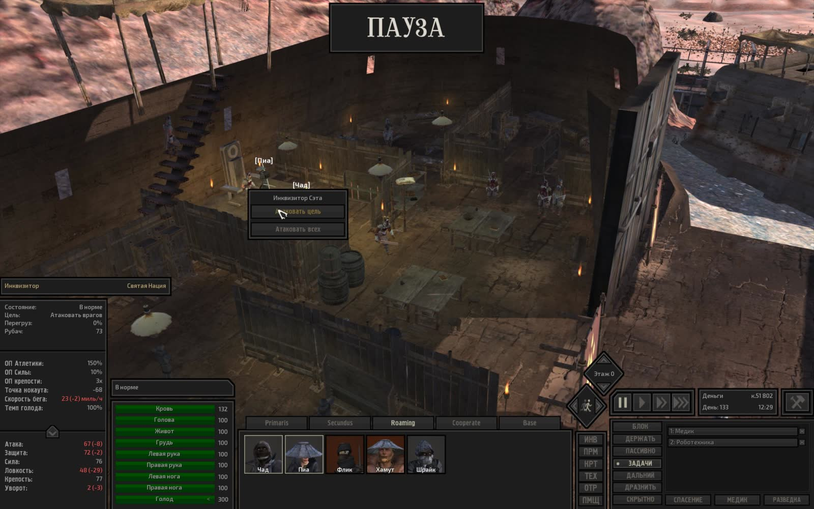
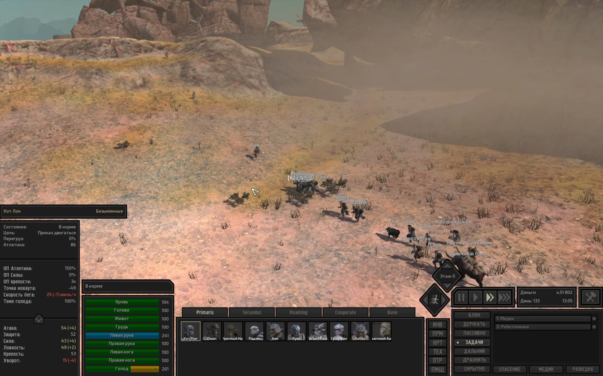
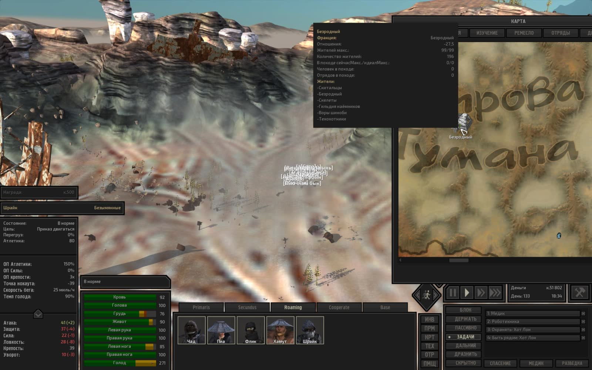
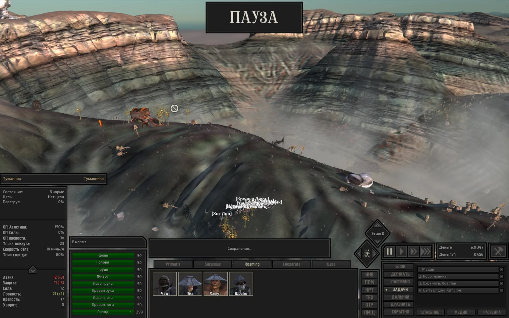

# Техническая лента скриншотов Kenshi

- **Сформировано**: `2026-11-06T01:47:14Z`
- **Окно выборки**: последние 7 суток (с `2026-10-30T01:47:14Z` по `2026-11-06T01:47:14Z`)
- **Всего скриншотов в окне**: 30
- **Сгруппировано серий/кадров**: 28

Техническая лента сгруппированных по сходству кадров с извлеченным текстом интерфейса (OCR). Интерпретация происходящего в игре полностью принадлежит LLM-компаньону по оригинальным изображениям.

---

### Серия 1 (1 кадр)

- **Файловое время**: с `2026-11-06T00:18:17Z` по `2026-11-06T00:18:17Z`
- **Игровое время (OCR)**: `День 133, 11:03`
- **Локация (OCR)**: Не зафиксирована в UI
- **Персонажи в UI (OCR)**: Чад
- **Задачи/предметы в UI**: Быть рядом: Хот Лон, Медик, Роботехника

**Кадры серии:**
- [screenshot_445-38e83b28.jpg](screenshot_445-38e83b28.jpg) ([GitHub](https://github.com/asaf1n/Kenshi-Compain/blob/main/published/screenshots/screenshot_445-38e83b28.jpg) | [Raw](https://raw.githubusercontent.com/asaf1n/Kenshi-Compain/main/published/screenshots/screenshot_445-38e83b28.jpg))

---

### Серия 2 (1 кадр)

- **Файловое время**: с `2026-11-06T00:18:43Z` по `2026-11-06T00:18:43Z`
- **Игровое время (OCR)**: `День 133, 11:26`
- **Локация (OCR)**: Не зафиксирована в UI
- **Персонажи в UI (OCR)**: Чад
- **Задачи/предметы в UI**: Быть рядом: Хот Лон, Медик, Роботехника

**Кадры серии:**
- [screenshot_446-6fac47f5.jpg](screenshot_446-6fac47f5.jpg) ([GitHub](https://github.com/asaf1n/Kenshi-Compain/blob/main/published/screenshots/screenshot_446-6fac47f5.jpg) | [Raw](https://raw.githubusercontent.com/asaf1n/Kenshi-Compain/main/published/screenshots/screenshot_446-6fac47f5.jpg))

---

### Серия 3 (1 кадр)

- **Файловое время**: с `2026-11-06T00:19:36Z` по `2026-11-06T00:19:36Z`
- **Игровое время (OCR)**: `День 133, 12:01`
- **Локация (OCR)**: Не зафиксирована в UI
- **Персонажи в UI (OCR)**: Пиа
- **Задачи/предметы в UI**: Медик, Роботехника

**Кадры серии:**
- [screenshot_448-cf2a421d.jpg](screenshot_448-cf2a421d.jpg) ([GitHub](https://github.com/asaf1n/Kenshi-Compain/blob/main/published/screenshots/screenshot_448-cf2a421d.jpg) | [Raw](https://raw.githubusercontent.com/asaf1n/Kenshi-Compain/main/published/screenshots/screenshot_448-cf2a421d.jpg))

---

### Серия 4 (1 кадр)

- **Файловое время**: с `2026-11-06T00:20:27Z` по `2026-11-06T00:20:27Z`
- **Игровое время (OCR)**: `День 133, 12:18`
- **Локация (OCR)**: Не зафиксирована в UI
- **Персонажи в UI (OCR)**: Не зафиксированы в UI
- **Задачи/предметы в UI**: Медик, Роботехника

**Кадры серии:**
- [screenshot_449-be991bca.jpg](screenshot_449-be991bca.jpg) ([GitHub](https://github.com/asaf1n/Kenshi-Compain/blob/main/published/screenshots/screenshot_449-be991bca.jpg) | [Raw](https://raw.githubusercontent.com/asaf1n/Kenshi-Compain/main/published/screenshots/screenshot_449-be991bca.jpg))

---

### Серия 5 (3 кадра)

- **Файловое время**: с `2026-11-06T00:20:56Z` по `2026-11-06T00:21:06Z`
- **Игровое время (OCR)**: `День 133, 12:27`
- **Локация (OCR)**: Не зафиксирована в UI
- **Персонажи в UI (OCR)**: Инквизитор, Инквизитор Сэта, Паладин
- **Задачи/предметы в UI**: Медик, Роботехника

**Кадры серии:**
- [screenshot_451-414dccf2.jpg](screenshot_451-414dccf2.jpg) ([GitHub](https://github.com/asaf1n/Kenshi-Compain/blob/main/published/screenshots/screenshot_451-414dccf2.jpg) | [Raw](https://raw.githubusercontent.com/asaf1n/Kenshi-Compain/main/published/screenshots/screenshot_451-414dccf2.jpg))
- [screenshot_452-8106abf7.jpg](screenshot_452-8106abf7.jpg) ([GitHub](https://github.com/asaf1n/Kenshi-Compain/blob/main/published/screenshots/screenshot_452-8106abf7.jpg) | [Raw](https://raw.githubusercontent.com/asaf1n/Kenshi-Compain/main/published/screenshots/screenshot_452-8106abf7.jpg))
- [screenshot_453-ff33f429.jpg](screenshot_453-ff33f429.jpg) ([GitHub](https://github.com/asaf1n/Kenshi-Compain/blob/main/published/screenshots/screenshot_453-ff33f429.jpg) | [Raw](https://raw.githubusercontent.com/asaf1n/Kenshi-Compain/main/published/screenshots/screenshot_453-ff33f429.jpg))

---

### Серия 6 (1 кадр)

- **Файловое время**: с `2026-11-06T00:21:30Z` по `2026-11-06T00:21:30Z`
- **Игровое время (OCR)**: `День 133, 12:29`
- **Локация (OCR)**: Не зафиксирована в UI
- **Персонажи в UI (OCR)**: Инквизитор
- **Задачи/предметы в UI**: Медик, Роботехника

**Кадры серии:**
- [screenshot_455-92303891.jpg](screenshot_455-92303891.jpg) ([GitHub](https://github.com/asaf1n/Kenshi-Compain/blob/main/published/screenshots/screenshot_455-92303891.jpg) | [Raw](https://raw.githubusercontent.com/asaf1n/Kenshi-Compain/main/published/screenshots/screenshot_455-92303891.jpg))

---

### Серия 7 (1 кадр)

- **Файловое время**: с `2026-11-06T00:21:45Z` по `2026-11-06T00:21:45Z`
- **Игровое время (OCR)**: `День 133, 12:30`
- **Локация (OCR)**: Не зафиксирована в UI
- **Персонажи в UI (OCR)**: Инквизитор Сэта
- **Задачи/предметы в UI**: Медик, Роботехника

**Кадры серии:**
- [screenshot_456-9ef153b1.jpg](screenshot_456-9ef153b1.jpg) ([GitHub](https://github.com/asaf1n/Kenshi-Compain/blob/main/published/screenshots/screenshot_456-9ef153b1.jpg) | [Raw](https://raw.githubusercontent.com/asaf1n/Kenshi-Compain/main/published/screenshots/screenshot_456-9ef153b1.jpg))

---

### Серия 8 (1 кадр)

- **Файловое время**: с `2026-11-06T00:22:15Z` по `2026-11-06T00:22:15Z`
- **Игровое время (OCR)**: `День 133, 12:35`
- **Локация (OCR)**: Не зафиксирована в UI
- **Персонажи в UI (OCR)**: Пиа
- **Задачи/предметы в UI**: Медик, Роботехника

**Кадры серии:**
- [screenshot_457-371c1c7a.jpg](screenshot_457-371c1c7a.jpg) ([GitHub](https://github.com/asaf1n/Kenshi-Compain/blob/main/published/screenshots/screenshot_457-371c1c7a.jpg) | [Raw](https://raw.githubusercontent.com/asaf1n/Kenshi-Compain/main/published/screenshots/screenshot_457-371c1c7a.jpg))

---

### Серия 9 (1 кадр)

- **Файловое время**: с `2026-11-06T00:22:48Z` по `2026-11-06T00:22:48Z`
- **Игровое время (OCR)**: `День 133`
- **Локация (OCR)**: Не зафиксирована в UI
- **Персонажи в UI (OCR)**: Вьючный бык

**Кадры серии:**
- [screenshot_459-85481b63.jpg](screenshot_459-85481b63.jpg) ([GitHub](https://github.com/asaf1n/Kenshi-Compain/blob/main/published/screenshots/screenshot_459-85481b63.jpg) | [Raw](https://raw.githubusercontent.com/asaf1n/Kenshi-Compain/main/published/screenshots/screenshot_459-85481b63.jpg))

---

### Серия 10 (1 кадр)

- **Файловое время**: с `2026-11-06T00:24:54Z` по `2026-11-06T00:24:54Z`
- **Игровое время (OCR)**: `День 133, 13:05`
- **Локация (OCR)**: Не зафиксирована в UI
- **Персонажи в UI (OCR)**: Хот Лон
- **Задачи/предметы в UI**: Медик, Роботехника

**Кадры серии:**
- [screenshot_460-e80bf9a6.jpg](screenshot_460-e80bf9a6.jpg) ([GitHub](https://github.com/asaf1n/Kenshi-Compain/blob/main/published/screenshots/screenshot_460-e80bf9a6.jpg) | [Raw](https://raw.githubusercontent.com/asaf1n/Kenshi-Compain/main/published/screenshots/screenshot_460-e80bf9a6.jpg))

---

### Серия 11 (1 кадр)

- **Файловое время**: с `2026-11-06T00:25:51Z` по `2026-11-06T00:25:51Z`
- **Игровое время (OCR)**: `День 133, 13:43`
- **Локация (OCR)**: Не зафиксирована в UI
- **Персонажи в UI (OCR)**: Часовой

**Кадры серии:**
- [screenshot_462-a16a7655.jpg](screenshot_462-a16a7655.jpg) ([GitHub](https://github.com/asaf1n/Kenshi-Compain/blob/main/published/screenshots/screenshot_462-a16a7655.jpg) | [Raw](https://raw.githubusercontent.com/asaf1n/Kenshi-Compain/main/published/screenshots/screenshot_462-a16a7655.jpg))

---

### Серия 12 (1 кадр)

- **Файловое время**: с `2026-11-06T00:27:39Z` по `2026-11-06T00:27:39Z`
- **Игровое время (OCR)**: `День 133, 14:24`
- **Локация (OCR)**: Не зафиксирована в UI
- **Персонажи в UI (OCR)**: Мью
- **Задачи/предметы в UI**: Работа с машиной: Кухонная плита, Работа с машиной: Рисовая ферма 1-, Работа с машиной: Рисовая ферма L, Тащить в: Хранение: еда

**Кадры серии:**
- [screenshot_463-701918e2.jpg](screenshot_463-701918e2.jpg) ([GitHub](https://github.com/asaf1n/Kenshi-Compain/blob/main/published/screenshots/screenshot_463-701918e2.jpg) | [Raw](https://raw.githubusercontent.com/asaf1n/Kenshi-Compain/main/published/screenshots/screenshot_463-701918e2.jpg))

---

### Серия 13 (1 кадр)

- **Файловое время**: с `2026-11-06T00:28:07Z` по `2026-11-06T00:28:07Z`
- **Игровое время (OCR)**: `День 133`
- **Локация (OCR)**: Не зафиксирована в UI
- **Персонажи в UI (OCR)**: Седая тень
- **Задачи/предметы в UI**: Быть рядом: Вик, Охранять: Вик

**Кадры серии:**
- [screenshot_464-ebd23922.jpg](screenshot_464-ebd23922.jpg) ([GitHub](https://github.com/asaf1n/Kenshi-Compain/blob/main/published/screenshots/screenshot_464-ebd23922.jpg) | [Raw](https://raw.githubusercontent.com/asaf1n/Kenshi-Compain/main/published/screenshots/screenshot_464-ebd23922.jpg))

---

### Серия 14 (1 кадр)

- **Файловое время**: с `2026-11-06T00:28:56Z` по `2026-11-06T00:28:56Z`
- **Игровое время (OCR)**: `День 133, 14:44`
- **Локация (OCR)**: Не зафиксирована в UI
- **Персонажи в UI (OCR)**: Хот Лон
- **Задачи/предметы в UI**: Медик, Роботехника

**Кадры серии:**
- [screenshot_466-c71a4ff7.jpg](screenshot_466-c71a4ff7.jpg) ([GitHub](https://github.com/asaf1n/Kenshi-Compain/blob/main/published/screenshots/screenshot_466-c71a4ff7.jpg) | [Raw](https://raw.githubusercontent.com/asaf1n/Kenshi-Compain/main/published/screenshots/screenshot_466-c71a4ff7.jpg))

---

### Серия 15 (1 кадр)

- **Файловое время**: с `2026-11-06T00:29:39Z` по `2026-11-06T00:29:39Z`
- **Игровое время (OCR)**: `День 133, 15:02`
- **Локация (OCR)**: Не зафиксирована в UI
- **Персонажи в UI (OCR)**: Шрайк
- **Задачи/предметы в UI**: Быть рядом: Хот Лон, Медик, Роботехника

**Кадры серии:**
- [screenshot_467-44779d9b.jpg](screenshot_467-44779d9b.jpg) ([GitHub](https://github.com/asaf1n/Kenshi-Compain/blob/main/published/screenshots/screenshot_467-44779d9b.jpg) | [Raw](https://raw.githubusercontent.com/asaf1n/Kenshi-Compain/main/published/screenshots/screenshot_467-44779d9b.jpg))

---

### Серия 16 (1 кадр)

- **Файловое время**: с `2026-11-06T00:30:23Z` по `2026-11-06T00:30:23Z`
- **Игровое время (OCR)**: `День 133, 15:07`
- **Локация (OCR)**: Не зафиксирована в UI
- **Персонажи в UI (OCR)**: Инквизитор Сэта
- **Задачи/предметы в UI**: Медик, Роботехника

**Кадры серии:**
- [screenshot_468-e8df2db2.jpg](screenshot_468-e8df2db2.jpg) ([GitHub](https://github.com/asaf1n/Kenshi-Compain/blob/main/published/screenshots/screenshot_468-e8df2db2.jpg) | [Raw](https://raw.githubusercontent.com/asaf1n/Kenshi-Compain/main/published/screenshots/screenshot_468-e8df2db2.jpg))

---

### Серия 17 (1 кадр)

- **Файловое время**: с `2026-11-06T00:35:33Z` по `2026-11-06T00:35:33Z`
- **Игровое время (OCR)**: `День 133, 15:13`
- **Локация (OCR)**: Не зафиксирована в UI
- **Персонажи в UI (OCR)**: fx
- **Задачи/предметы в UI**: Быть рядом: Зелёный, Быть рядом: Хот Лон, Охранять: Зелёный

**Кадры серии:**
- [screenshot_470-957c2989.jpg](screenshot_470-957c2989.jpg) ([GitHub](https://github.com/asaf1n/Kenshi-Compain/blob/main/published/screenshots/screenshot_470-957c2989.jpg) | [Raw](https://raw.githubusercontent.com/asaf1n/Kenshi-Compain/main/published/screenshots/screenshot_470-957c2989.jpg))

---

### Серия 18 (1 кадр)

- **Файловое время**: с `2026-11-06T00:37:39Z` по `2026-11-06T00:37:39Z`
- **Игровое время (OCR)**: `День 133, 15:41`
- **Локация (OCR)**: Не зафиксирована в UI
- **Персонажи в UI (OCR)**: Инквизитор Сэта
- **Задачи/предметы в UI**: Быть рядом: Зелёный, Быть рядом: Хот Лон, Охранять: Зелёный

**Кадры серии:**
- [screenshot_471-48e12177.jpg](screenshot_471-48e12177.jpg) ([GitHub](https://github.com/asaf1n/Kenshi-Compain/blob/main/published/screenshots/screenshot_471-48e12177.jpg) | [Raw](https://raw.githubusercontent.com/asaf1n/Kenshi-Compain/main/published/screenshots/screenshot_471-48e12177.jpg))

---

### Серия 19 (1 кадр)

- **Файловое время**: с `2026-11-06T00:49:57Z` по `2026-11-06T00:49:57Z`
- **Игровое время (OCR)**: `День 133, 15:41`
- **Локация (OCR)**: Не зафиксирована в UI
- **Персонажи в UI (OCR)**: Беглый слуга
- **Задачи/предметы в UI**: Быть рядом: Хот Лон, Медик, Роботехника

**Кадры серии:**
- [screenshot_473-d827a2f8.jpg](screenshot_473-d827a2f8.jpg) ([GitHub](https://github.com/asaf1n/Kenshi-Compain/blob/main/published/screenshots/screenshot_473-d827a2f8.jpg) | [Raw](https://raw.githubusercontent.com/asaf1n/Kenshi-Compain/main/published/screenshots/screenshot_473-d827a2f8.jpg))

---

### Серия 20 (1 кадр)

- **Файловое время**: с `2026-11-06T00:51:48Z` по `2026-11-06T00:51:48Z`
- **Игровое время (OCR)**: `День 133, 17:19`
- **Локация (OCR)**: Не зафиксирована в UI
- **Персонажи в UI (OCR)**: Зелёный палец
- **Задачи/предметы в UI**: Работа с машиной: Пеньковая ферма, Работа с машиной: Рисовая ферма 1-, Тащить в: Хранение: пенька, Тащить в: Хранение: рис

**Кадры серии:**
- [screenshot_474-52bb0da7.jpg](screenshot_474-52bb0da7.jpg) ([GitHub](https://github.com/asaf1n/Kenshi-Compain/blob/main/published/screenshots/screenshot_474-52bb0da7.jpg) | [Raw](https://raw.githubusercontent.com/asaf1n/Kenshi-Compain/main/published/screenshots/screenshot_474-52bb0da7.jpg))

---

### Серия 21 (1 кадр)

- **Файловое время**: с `2026-11-06T01:00:32Z` по `2026-11-06T01:00:32Z`
- **Игровое время (OCR)**: `День 133, 18:34`
- **Локация (OCR)**: Не зафиксирована в UI
- **Персонажи в UI (OCR)**: Шрайк
- **Задачи/предметы в UI**: Быть рядом: Хот Лон, Медик, Роботехника

**Кадры серии:**
- [screenshot_475-e15a6b7f.jpg](screenshot_475-e15a6b7f.jpg) ([GitHub](https://github.com/asaf1n/Kenshi-Compain/blob/main/published/screenshots/screenshot_475-e15a6b7f.jpg) | [Raw](https://raw.githubusercontent.com/asaf1n/Kenshi-Compain/main/published/screenshots/screenshot_475-e15a6b7f.jpg))

---

### Серия 22 (1 кадр)

- **Файловое время**: с `2026-11-06T01:08:32Z` по `2026-11-06T01:08:32Z`
- **Игровое время (OCR)**: `День 133, 23:25`
- **Локация (OCR)**: Не зафиксирована в UI
- **Персонажи в UI (OCR)**: Стражница
- **Задачи/предметы в UI**: Быть рядом: Хот Лон, Медик, Роботехника

**Кадры серии:**
- [screenshot_477-c108555d.jpg](screenshot_477-c108555d.jpg) ([GitHub](https://github.com/asaf1n/Kenshi-Compain/blob/main/published/screenshots/screenshot_477-c108555d.jpg) | [Raw](https://raw.githubusercontent.com/asaf1n/Kenshi-Compain/main/published/screenshots/screenshot_477-c108555d.jpg))

---

### Серия 23 (1 кадр)

- **Файловое время**: с `2026-11-06T01:17:39Z` по `2026-11-06T01:17:39Z`
- **Игровое время (OCR)**: `День 134, 02:43`
- **Локация (OCR)**: Не зафиксирована в UI
- **Персонажи в UI (OCR)**: Вынос мозга
- **Задачи/предметы в UI**: Быть рядом: Мью, Охранять: Мью, Роботехника

**Кадры серии:**
- [screenshot_478-186bff12.jpg](screenshot_478-186bff12.jpg) ([GitHub](https://github.com/asaf1n/Kenshi-Compain/blob/main/published/screenshots/screenshot_478-186bff12.jpg) | [Raw](https://raw.githubusercontent.com/asaf1n/Kenshi-Compain/main/published/screenshots/screenshot_478-186bff12.jpg))

---

### Серия 24 (1 кадр)

- **Файловое время**: с `2026-11-06T01:18:24Z` по `2026-11-06T01:18:24Z`
- **Игровое время (OCR)**: `День 134, 03:03`
- **Локация (OCR)**: Не зафиксирована в UI
- **Персонажи в UI (OCR)**: Вынос мозга
- **Задачи/предметы в UI**: Быть рядом: Мью, Охранять: Мью, Роботехника

**Кадры серии:**
- [screenshot_479-7a049502.jpg](screenshot_479-7a049502.jpg) ([GitHub](https://github.com/asaf1n/Kenshi-Compain/blob/main/published/screenshots/screenshot_479-7a049502.jpg) | [Raw](https://raw.githubusercontent.com/asaf1n/Kenshi-Compain/main/published/screenshots/screenshot_479-7a049502.jpg))

---

### Серия 25 (1 кадр)

- **Файловое время**: с `2026-11-06T01:31:14Z` по `2026-11-06T01:31:14Z`
- **Игровое время (OCR)**: `День 134, 05:53`
- **Локация (OCR)**: Не зафиксирована в UI
- **Персонажи в UI (OCR)**: Шрайк
- **Задачи/предметы в UI**: Быть рядом: Хот Лон, Медик, Роботехника

**Кадры серии:**
- [screenshot_481-ae3e5601.jpg](screenshot_481-ae3e5601.jpg) ([GitHub](https://github.com/asaf1n/Kenshi-Compain/blob/main/published/screenshots/screenshot_481-ae3e5601.jpg) | [Raw](https://raw.githubusercontent.com/asaf1n/Kenshi-Compain/main/published/screenshots/screenshot_481-ae3e5601.jpg))

---

### Серия 26 (1 кадр)

- **Файловое время**: с `2026-11-06T01:40:29Z` по `2026-11-06T01:40:29Z`
- **Игровое время (OCR)**: `День 134, 07:56`
- **Локация (OCR)**: Не зафиксирована в UI
- **Персонажи в UI (OCR)**: Туманник
- **Задачи/предметы в UI**: Быть рядом: Хот Лон, Медик, Роботехника

**Кадры серии:**
- [screenshot_482-670fe5ac.jpg](screenshot_482-670fe5ac.jpg) ([GitHub](https://github.com/asaf1n/Kenshi-Compain/blob/main/published/screenshots/screenshot_482-670fe5ac.jpg) | [Raw](https://raw.githubusercontent.com/asaf1n/Kenshi-Compain/main/published/screenshots/screenshot_482-670fe5ac.jpg))

---

### Серия 27 (1 кадр)

- **Файловое время**: с `2026-11-06T01:42:12Z` по `2026-11-06T01:42:12Z`
- **Игровое время (OCR)**: `День 134, 08:21`
- **Локация (OCR)**: Не зафиксирована в UI
- **Персонажи в UI (OCR)**: Шрайк
- **Задачи/предметы в UI**: Быть рядом: Хот Лон, Медик, Роботехника

**Кадры серии:**
- [screenshot_484-f57d65fd.jpg](screenshot_484-f57d65fd.jpg) ([GitHub](https://github.com/asaf1n/Kenshi-Compain/blob/main/published/screenshots/screenshot_484-f57d65fd.jpg) | [Raw](https://raw.githubusercontent.com/asaf1n/Kenshi-Compain/main/published/screenshots/screenshot_484-f57d65fd.jpg))

---

### Серия 28 (1 кадр)

- **Файловое время**: с `2026-11-06T01:45:51Z` по `2026-11-06T01:45:51Z`
- **Игровое время (OCR)**: `Не зафиксировано в UI`
- **Локация (OCR)**: Не зафиксирована в UI
- **Персонажи в UI (OCR)**: Шрайк
- **Задачи/предметы в UI**: Быть рядом: Хот Лон, Медик, Роботехника

**Кадры серии:**
- [screenshot_485-c53ce4d8.jpg](screenshot_485-c53ce4d8.jpg) ([GitHub](https://github.com/asaf1n/Kenshi-Compain/blob/main/published/screenshots/screenshot_485-c53ce4d8.jpg) | [Raw](https://raw.githubusercontent.com/asaf1n/Kenshi-Compain/main/published/screenshots/screenshot_485-c53ce4d8.jpg))

---
