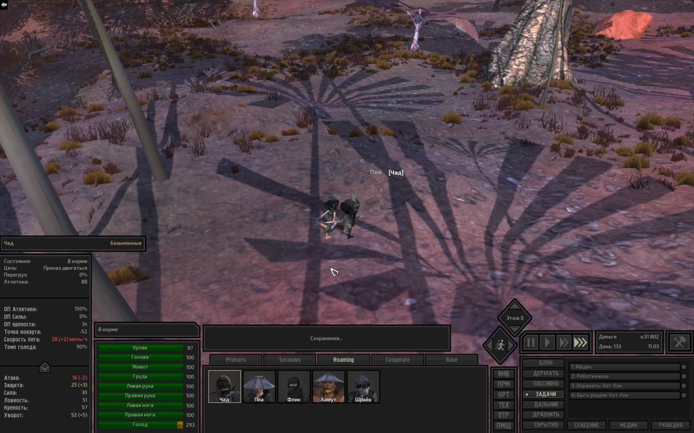
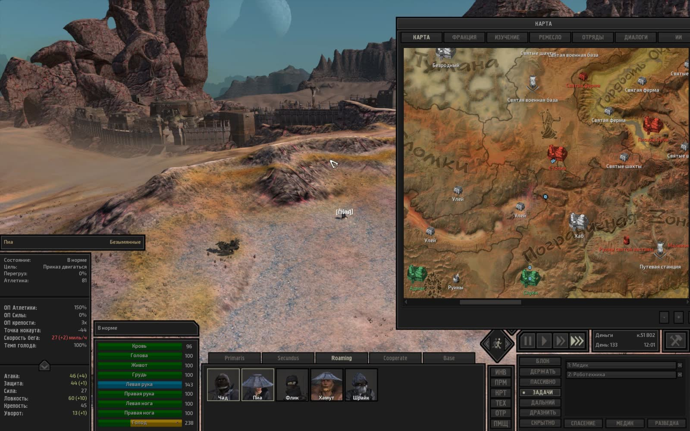
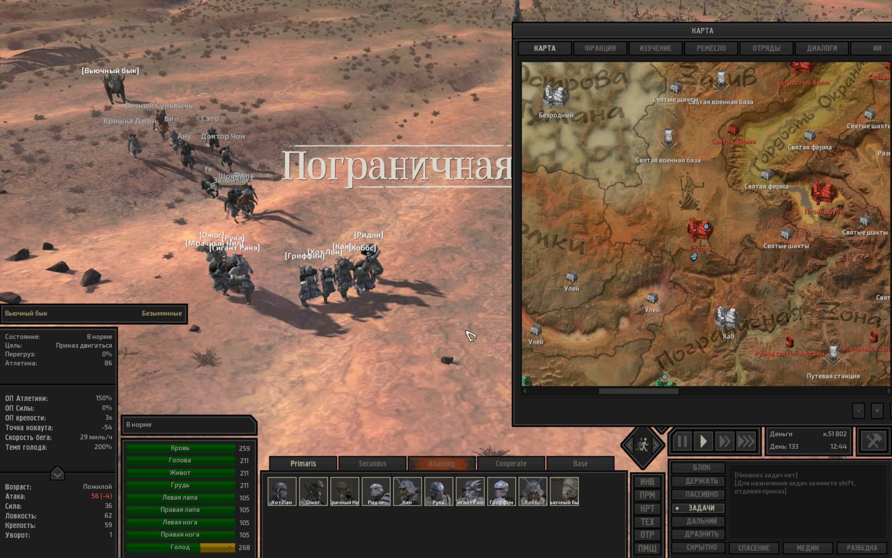
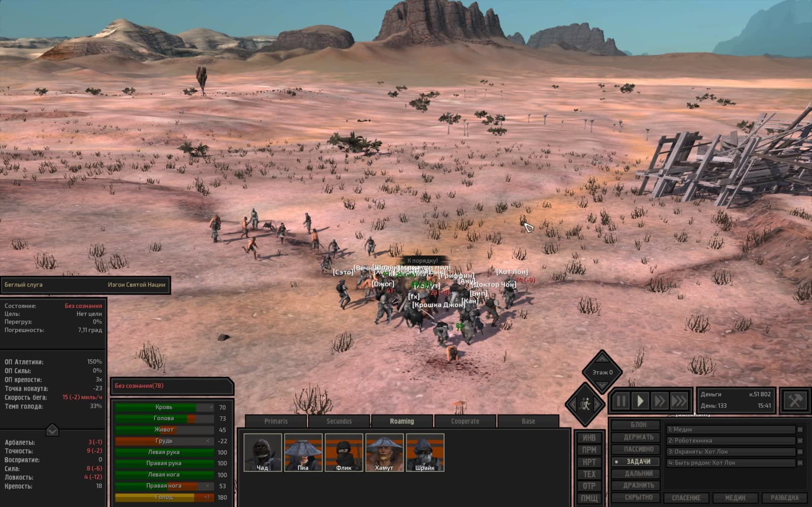
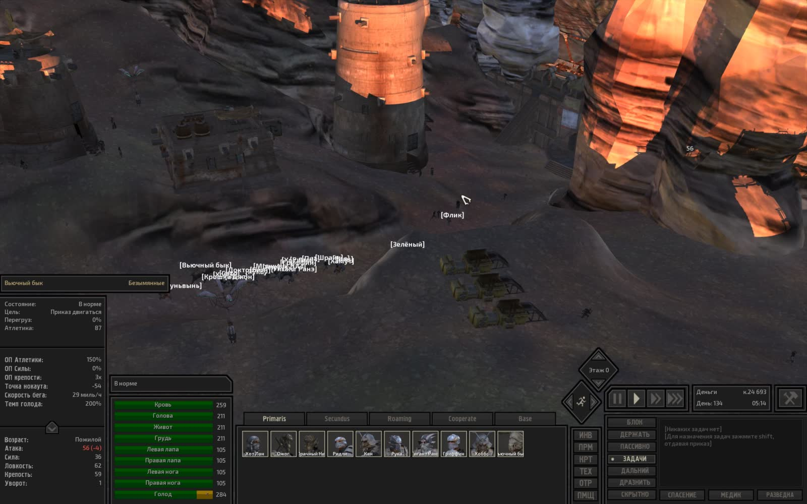
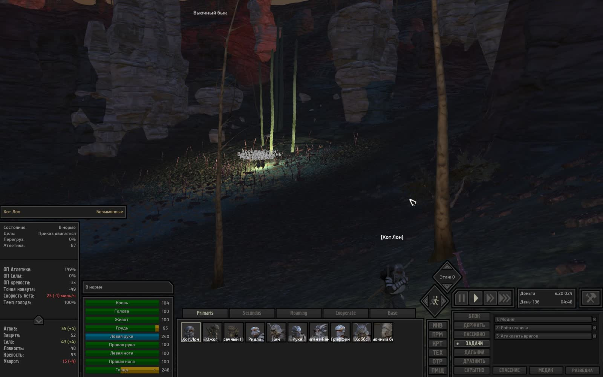
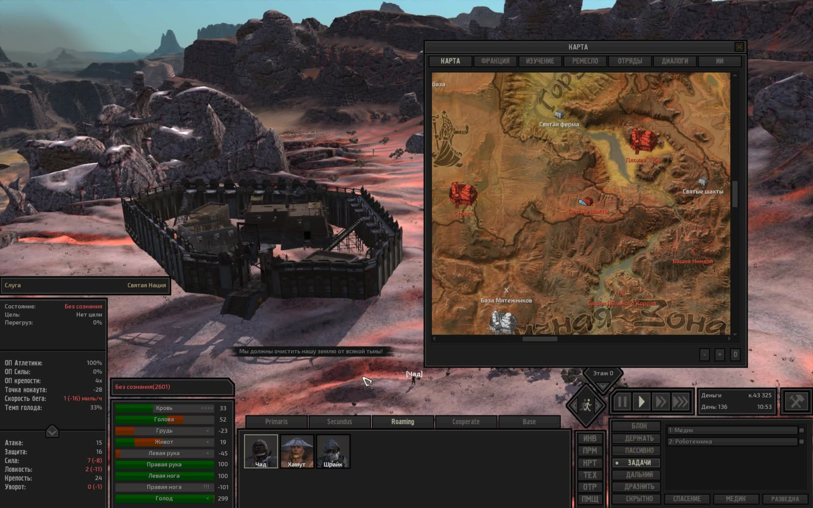

# Техническая лента скриншотов Kenshi

- **Сформировано**: `2026-11-11T23:20:10Z`
- **Окно выборки**: последние 7 суток (с `2026-11-04T23:20:10Z` по `2026-11-11T23:20:10Z`)
- **Всего скриншотов в окне**: 30
- **Сгруппировано серий/кадров**: 30

Техническая лента сгруппированных по сходству кадров с извлеченным текстом интерфейса (OCR).

---

### Серия 1 (1 кадр)

- **Файловое время**: с `2026-11-06T00:18:17Z` по `2026-11-06T00:18:17Z`
- **Игровое время (OCR)**: `День 133, 11:03`
- **Локация (OCR)**: Не зафиксирована в UI
- **Персонажи в UI (OCR)**: Чад
- **Задачи/предметы в UI**: Быть рядом: Хот Лон, Медик, Роботехника

**Кадры серии:**
- [screenshot_445-38e83b28.jpg](screenshot_445-38e83b28.jpg) ([GitHub](https://github.com/asaf1n/Kenshi-Compain/blob/main/published/screenshots/screenshot_445-38e83b28.jpg) | [Raw](https://raw.githubusercontent.com/asaf1n/Kenshi-Compain/main/published/screenshots/screenshot_445-38e83b28.jpg))

---

### Серия 2 (1 кадр)

- **Файловое время**: с `2026-11-06T00:19:36Z` по `2026-11-06T00:19:36Z`
- **Игровое время (OCR)**: `День 133, 12:01`
- **Локация (OCR)**: Не зафиксирована в UI
- **Персонажи в UI (OCR)**: Пиа
- **Задачи/предметы в UI**: Медик, Роботехника

**Кадры серии:**
- [screenshot_448-cf2a421d.jpg](screenshot_448-cf2a421d.jpg) ([GitHub](https://github.com/asaf1n/Kenshi-Compain/blob/main/published/screenshots/screenshot_448-cf2a421d.jpg) | [Raw](https://raw.githubusercontent.com/asaf1n/Kenshi-Compain/main/published/screenshots/screenshot_448-cf2a421d.jpg))

---

### Серия 3 (1 кадр)

- **Файловое время**: с `2026-11-06T00:20:56Z` по `2026-11-06T00:20:56Z`
- **Игровое время (OCR)**: `День 133, 12:27`
- **Локация (OCR)**: Не зафиксирована в UI
- **Персонажи в UI (OCR)**: Инквизитор Сэта
- **Задачи/предметы в UI**: Медик, Роботехника

**Кадры серии:**
- [screenshot_451-414dccf2.jpg](screenshot_451-414dccf2.jpg) ([GitHub](https://github.com/asaf1n/Kenshi-Compain/blob/main/published/screenshots/screenshot_451-414dccf2.jpg) | [Raw](https://raw.githubusercontent.com/asaf1n/Kenshi-Compain/main/published/screenshots/screenshot_451-414dccf2.jpg))

---

### Серия 4 (1 кадр)

- **Файловое время**: с `2026-11-06T00:22:48Z` по `2026-11-06T00:22:48Z`
- **Игровое время (OCR)**: `День 133`
- **Локация (OCR)**: Не зафиксирована в UI
- **Персонажи в UI (OCR)**: Вьючный бык

**Кадры серии:**
- [screenshot_459-85481b63.jpg](screenshot_459-85481b63.jpg) ([GitHub](https://github.com/asaf1n/Kenshi-Compain/blob/main/published/screenshots/screenshot_459-85481b63.jpg) | [Raw](https://raw.githubusercontent.com/asaf1n/Kenshi-Compain/main/published/screenshots/screenshot_459-85481b63.jpg))

---

### Серия 5 (1 кадр)

- **Файловое время**: с `2026-11-06T00:27:39Z` по `2026-11-06T00:27:39Z`
- **Игровое время (OCR)**: `День 133, 14:24`
- **Локация (OCR)**: Не зафиксирована в UI
- **Персонажи в UI (OCR)**: Мью
- **Задачи/предметы в UI**: Работа с машиной: Кухонная плита, Работа с машиной: Рисовая ферма 1-, Работа с машиной: Рисовая ферма L, Тащить в: Хранение: еда

**Кадры серии:**
- [screenshot_463-701918e2.jpg](screenshot_463-701918e2.jpg) ([GitHub](https://github.com/asaf1n/Kenshi-Compain/blob/main/published/screenshots/screenshot_463-701918e2.jpg) | [Raw](https://raw.githubusercontent.com/asaf1n/Kenshi-Compain/main/published/screenshots/screenshot_463-701918e2.jpg))

---

### Серия 6 (1 кадр)

- **Файловое время**: с `2026-11-06T00:29:39Z` по `2026-11-06T00:29:39Z`
- **Игровое время (OCR)**: `День 133, 15:02`
- **Локация (OCR)**: Не зафиксирована в UI
- **Персонажи в UI (OCR)**: Шрайк
- **Задачи/предметы в UI**: Быть рядом: Хот Лон, Медик, Роботехника

**Кадры серии:**
- [screenshot_467-44779d9b.jpg](screenshot_467-44779d9b.jpg) ([GitHub](https://github.com/asaf1n/Kenshi-Compain/blob/main/published/screenshots/screenshot_467-44779d9b.jpg) | [Raw](https://raw.githubusercontent.com/asaf1n/Kenshi-Compain/main/published/screenshots/screenshot_467-44779d9b.jpg))

---

### Серия 7 (1 кадр)

- **Файловое время**: с `2026-11-06T00:35:33Z` по `2026-11-06T00:35:33Z`
- **Игровое время (OCR)**: `День 133, 15:13`
- **Локация (OCR)**: Не зафиксирована в UI
- **Персонажи в UI (OCR)**: fx
- **Задачи/предметы в UI**: Быть рядом: Зелёный, Быть рядом: Хот Лон, Охранять: Зелёный

**Кадры серии:**
- [screenshot_470-957c2989.jpg](screenshot_470-957c2989.jpg) ([GitHub](https://github.com/asaf1n/Kenshi-Compain/blob/main/published/screenshots/screenshot_470-957c2989.jpg) | [Raw](https://raw.githubusercontent.com/asaf1n/Kenshi-Compain/main/published/screenshots/screenshot_470-957c2989.jpg))

---

### Серия 8 (1 кадр)

- **Файловое время**: с `2026-11-06T00:49:57Z` по `2026-11-06T00:49:57Z`
- **Игровое время (OCR)**: `День 133, 15:41`
- **Локация (OCR)**: Не зафиксирована в UI
- **Персонажи в UI (OCR)**: Беглый слуга
- **Задачи/предметы в UI**: Быть рядом: Хот Лон, Медик, Роботехника

**Кадры серии:**
- [screenshot_473-d827a2f8.jpg](screenshot_473-d827a2f8.jpg) ([GitHub](https://github.com/asaf1n/Kenshi-Compain/blob/main/published/screenshots/screenshot_473-d827a2f8.jpg) | [Raw](https://raw.githubusercontent.com/asaf1n/Kenshi-Compain/main/published/screenshots/screenshot_473-d827a2f8.jpg))

---

### Серия 9 (1 кадр)

- **Файловое время**: с `2026-11-06T01:02:47Z` по `2026-11-06T01:02:47Z`
- **Игровое время (OCR)**: `День 133, 20:18`
- **Локация (OCR)**: Не зафиксирована в UI
- **Персонажи в UI (OCR)**: Принц
- **Задачи/предметы в UI**: Быть рядом: Хот Лон, Медик, Роботехника

**Кадры серии:**
- [screenshot_476-e83427a7.jpg](screenshot_476-e83427a7.jpg) ([GitHub](https://github.com/asaf1n/Kenshi-Compain/blob/main/published/screenshots/screenshot_476-e83427a7.jpg) | [Raw](https://raw.githubusercontent.com/asaf1n/Kenshi-Compain/main/published/screenshots/screenshot_476-e83427a7.jpg))

---

### Серия 10 (1 кадр)

- **Файловое время**: с `2026-11-06T01:29:14Z` по `2026-11-06T01:29:14Z`
- **Игровое время (OCR)**: `День 134, 05:14`
- **Локация (OCR)**: Не зафиксирована в UI
- **Персонажи в UI (OCR)**: Вьючный бык

**Кадры серии:**
- [screenshot_480-facac25a.jpg](screenshot_480-facac25a.jpg) ([GitHub](https://github.com/asaf1n/Kenshi-Compain/blob/main/published/screenshots/screenshot_480-facac25a.jpg) | [Raw](https://raw.githubusercontent.com/asaf1n/Kenshi-Compain/main/published/screenshots/screenshot_480-facac25a.jpg))

---

### Серия 11 (1 кадр)

- **Файловое время**: с `2026-11-06T01:41:37Z` по `2026-11-06T01:41:37Z`
- **Игровое время (OCR)**: `День 134, 08:06`
- **Локация (OCR)**: Не зафиксирована в UI
- **Персонажи в UI (OCR)**: Вынос мозга
- **Задачи/предметы в UI**: Медик, Турель, охрана: Арбалет-турель МКП [све

**Кадры серии:**
- [screenshot_483-c1cdef7c.jpg](screenshot_483-c1cdef7c.jpg) ([GitHub](https://github.com/asaf1n/Kenshi-Compain/blob/main/published/screenshots/screenshot_483-c1cdef7c.jpg) | [Raw](https://raw.githubusercontent.com/asaf1n/Kenshi-Compain/main/published/screenshots/screenshot_483-c1cdef7c.jpg))

---

### Серия 12 (1 кадр)

- **Файловое время**: с `2026-11-06T14:25:09Z` по `2026-11-06T14:25:09Z`
- **Игровое время (OCR)**: `День 134, 11:43`
- **Локация (OCR)**: Не зафиксирована в UI
- **Персонажи в UI (OCR)**: Не зафиксированы в UI

**Кадры серии:**
- [screenshot_486-7505944b.jpg](screenshot_486-7505944b.jpg) ([GitHub](https://github.com/asaf1n/Kenshi-Compain/blob/main/published/screenshots/screenshot_486-7505944b.jpg) | [Raw](https://raw.githubusercontent.com/asaf1n/Kenshi-Compain/main/published/screenshots/screenshot_486-7505944b.jpg))

---

### Серия 13 (1 кадр)

- **Файловое время**: с `2026-11-06T14:26:23Z` по `2026-11-06T14:26:23Z`
- **Игровое время (OCR)**: `День 134, 12:18`
- **Локация (OCR)**: Не зафиксирована в UI
- **Персонажи в UI (OCR)**: Не зафиксированы в UI
- **Задачи/предметы в UI**: Быть рядом: Хот Лон, Медик, Роботехника

**Кадры серии:**
- [screenshot_489-f198feea.jpg](screenshot_489-f198feea.jpg) ([GitHub](https://github.com/asaf1n/Kenshi-Compain/blob/main/published/screenshots/screenshot_489-f198feea.jpg) | [Raw](https://raw.githubusercontent.com/asaf1n/Kenshi-Compain/main/published/screenshots/screenshot_489-f198feea.jpg))

---

### Серия 14 (1 кадр)

- **Файловое время**: с `2026-11-06T14:30:53Z` по `2026-11-06T14:30:53Z`
- **Игровое время (OCR)**: `День 134, 14:19`
- **Локация (OCR)**: Не зафиксирована в UI
- **Персонажи в UI (OCR)**: Шрайк
- **Задачи/предметы в UI**: Быть рядом: Хот Лон, Медик, Роботехника

**Кадры серии:**
- [screenshot_492-a754c5d0.jpg](screenshot_492-a754c5d0.jpg) ([GitHub](https://github.com/asaf1n/Kenshi-Compain/blob/main/published/screenshots/screenshot_492-a754c5d0.jpg) | [Raw](https://raw.githubusercontent.com/asaf1n/Kenshi-Compain/main/published/screenshots/screenshot_492-a754c5d0.jpg))

---

### Серия 15 (1 кадр)

- **Файловое время**: с `2026-11-06T20:51:25Z` по `2026-11-06T20:51:25Z`
- **Игровое время (OCR)**: `День 734`
- **Локация (OCR)**: Не зафиксирована в UI
- **Персонажи в UI (OCR)**: Не зафиксированы в UI
- **Задачи/предметы в UI**: Быть рядом: Хот Лон, Медик, Роботехника

**Кадры серии:**
- [screenshot_495-31d25d9b.jpg](screenshot_495-31d25d9b.jpg) ([GitHub](https://github.com/asaf1n/Kenshi-Compain/blob/main/published/screenshots/screenshot_495-31d25d9b.jpg) | [Raw](https://raw.githubusercontent.com/asaf1n/Kenshi-Compain/main/published/screenshots/screenshot_495-31d25d9b.jpg))

---

### Серия 16 (1 кадр)

- **Файловое время**: с `2026-11-06T22:41:40Z` по `2026-11-06T22:41:40Z`
- **Игровое время (OCR)**: `День 134, 22:07`
- **Локация (OCR)**: Не зафиксирована в UI
- **Персонажи в UI (OCR)**: Не зафиксированы в UI

**Кадры серии:**
- [screenshot_499-4d43d464.jpg](screenshot_499-4d43d464.jpg) ([GitHub](https://github.com/asaf1n/Kenshi-Compain/blob/main/published/screenshots/screenshot_499-4d43d464.jpg) | [Raw](https://raw.githubusercontent.com/asaf1n/Kenshi-Compain/main/published/screenshots/screenshot_499-4d43d464.jpg))

---

### Серия 17 (1 кадр)

- **Файловое время**: с `2026-11-06T22:48:59Z` по `2026-11-06T22:48:59Z`
- **Игровое время (OCR)**: `День 135, 04:19`
- **Локация (OCR)**: Не зафиксирована в UI
- **Персонажи в UI (OCR)**: Не зафиксированы в UI
- **Задачи/предметы в UI**: Работа с машиной: Кухонная плита, Работа с машиной: Рисовая ферма 1-, Тащить в: Хранение: еда, Тащить в: Хранение: рис

**Кадры серии:**
- [screenshot_502-d40116c4.jpg](screenshot_502-d40116c4.jpg) ([GitHub](https://github.com/asaf1n/Kenshi-Compain/blob/main/published/screenshots/screenshot_502-d40116c4.jpg) | [Raw](https://raw.githubusercontent.com/asaf1n/Kenshi-Compain/main/published/screenshots/screenshot_502-d40116c4.jpg))

---

### Серия 18 (1 кадр)

- **Файловое время**: с `2026-11-06T22:53:08Z` по `2026-11-06T22:53:08Z`
- **Игровое время (OCR)**: `День 135, 06:01`
- **Локация (OCR)**: Не зафиксирована в UI
- **Персонажи в UI (OCR)**: Не зафиксированы в UI

**Кадры серии:**
- [screenshot_505-1a244c42.jpg](screenshot_505-1a244c42.jpg) ([GitHub](https://github.com/asaf1n/Kenshi-Compain/blob/main/published/screenshots/screenshot_505-1a244c42.jpg) | [Raw](https://raw.githubusercontent.com/asaf1n/Kenshi-Compain/main/published/screenshots/screenshot_505-1a244c42.jpg))

---

### Серия 19 (1 кадр)

- **Файловое время**: с `2026-11-08T01:54:36Z` по `2026-11-08T01:54:36Z`
- **Игровое время (OCR)**: `День 135, 11:23`
- **Локация (OCR)**: Не зафиксирована в UI
- **Персонажи в UI (OCR)**: Не зафиксированы в UI

**Кадры серии:**
- [screenshot_533-4abbdb6d.jpg](screenshot_533-4abbdb6d.jpg) ([GitHub](https://github.com/asaf1n/Kenshi-Compain/blob/main/published/screenshots/screenshot_533-4abbdb6d.jpg) | [Raw](https://raw.githubusercontent.com/asaf1n/Kenshi-Compain/main/published/screenshots/screenshot_533-4abbdb6d.jpg))

---

### Серия 20 (1 кадр)

- **Файловое время**: с `2026-11-09T04:16:01Z` по `2026-11-09T04:16:01Z`
- **Игровое время (OCR)**: `День 135, 13:21`
- **Локация (OCR)**: Не зафиксирована в UI
- **Персонажи в UI (OCR)**: Не зафиксированы в UI

**Кадры серии:**
- [screenshot_544-24e240fd.jpg](screenshot_544-24e240fd.jpg) ([GitHub](https://github.com/asaf1n/Kenshi-Compain/blob/main/published/screenshots/screenshot_544-24e240fd.jpg) | [Raw](https://raw.githubusercontent.com/asaf1n/Kenshi-Compain/main/published/screenshots/screenshot_544-24e240fd.jpg))

---

### Серия 21 (1 кадр)

- **Файловое время**: с `2026-11-09T05:03:45Z` по `2026-11-09T05:03:45Z`
- **Игровое время (OCR)**: `День 135, 18:31`
- **Локация (OCR)**: Не зафиксирована в UI
- **Персонажи в UI (OCR)**: Кот
- **Задачи/предметы в UI**: Медик, Охранять: Вик

**Кадры серии:**
- [screenshot_547-11b87cbc.jpg](screenshot_547-11b87cbc.jpg) ([GitHub](https://github.com/asaf1n/Kenshi-Compain/blob/main/published/screenshots/screenshot_547-11b87cbc.jpg) | [Raw](https://raw.githubusercontent.com/asaf1n/Kenshi-Compain/main/published/screenshots/screenshot_547-11b87cbc.jpg))

---

### Серия 22 (1 кадр)

- **Файловое время**: с `2026-11-09T05:12:33Z` по `2026-11-09T05:12:33Z`
- **Игровое время (OCR)**: `День 135, 21:54`
- **Локация (OCR)**: Не зафиксирована в UI
- **Персонажи в UI (OCR)**: Хот Лон
- **Задачи/предметы в UI**: Медик, Роботехника

**Кадры серии:**
- [screenshot_551-f241738f.jpg](screenshot_551-f241738f.jpg) ([GitHub](https://github.com/asaf1n/Kenshi-Compain/blob/main/published/screenshots/screenshot_551-f241738f.jpg) | [Raw](https://raw.githubusercontent.com/asaf1n/Kenshi-Compain/main/published/screenshots/screenshot_551-f241738f.jpg))

---

### Серия 23 (1 кадр)

- **Файловое время**: с `2026-11-09T23:11:29Z` по `2026-11-09T23:11:29Z`
- **Игровое время (OCR)**: `День 136, 01:37`
- **Локация (OCR)**: Не зафиксирована в UI
- **Персонажи в UI (OCR)**: Вынос мозга
- **Задачи/предметы в UI**: Медик, Турель, охрана: Арбалет-турель Mkll [свет [8]

**Кадры серии:**
- [screenshot_554-fb55ed37.jpg](screenshot_554-fb55ed37.jpg) ([GitHub](https://github.com/asaf1n/Kenshi-Compain/blob/main/published/screenshots/screenshot_554-fb55ed37.jpg) | [Raw](https://raw.githubusercontent.com/asaf1n/Kenshi-Compain/main/published/screenshots/screenshot_554-fb55ed37.jpg))

---

### Серия 24 (1 кадр)

- **Файловое время**: с `2026-11-09T23:41:00Z` по `2026-11-09T23:41:00Z`
- **Игровое время (OCR)**: `День 136, 04:48`
- **Локация (OCR)**: Не зафиксирована в UI
- **Персонажи в UI (OCR)**: Хот Лон
- **Задачи/предметы в UI**: Медик, Роботехника

**Кадры серии:**
- [screenshot_557-304c599c.jpg](screenshot_557-304c599c.jpg) ([GitHub](https://github.com/asaf1n/Kenshi-Compain/blob/main/published/screenshots/screenshot_557-304c599c.jpg) | [Raw](https://raw.githubusercontent.com/asaf1n/Kenshi-Compain/main/published/screenshots/screenshot_557-304c599c.jpg))

---

### Серия 25 (1 кадр)

- **Файловое время**: с `2026-11-09T23:45:15Z` по `2026-11-09T23:45:15Z`
- **Игровое время (OCR)**: `День 136, 06:52`
- **Локация (OCR)**: Не зафиксирована в UI
- **Персонажи в UI (OCR)**: Хот Лон
- **Задачи/предметы в UI**: Медик, Роботехника

**Кадры серии:**
- [screenshot_560-b190f494.jpg](screenshot_560-b190f494.jpg) ([GitHub](https://github.com/asaf1n/Kenshi-Compain/blob/main/published/screenshots/screenshot_560-b190f494.jpg) | [Raw](https://raw.githubusercontent.com/asaf1n/Kenshi-Compain/main/published/screenshots/screenshot_560-b190f494.jpg))

---

### Серия 26 (1 кадр)

- **Файловое время**: с `2026-11-10T00:00:31Z` по `2026-11-10T00:00:31Z`
- **Игровое время (OCR)**: `День 136, 10:53`
- **Локация (OCR)**: Не зафиксирована в UI
- **Персонажи в UI (OCR)**: Слуга
- **Задачи/предметы в UI**: Медик, Роботехника

**Кадры серии:**
- [screenshot_563-13dab785.jpg](screenshot_563-13dab785.jpg) ([GitHub](https://github.com/asaf1n/Kenshi-Compain/blob/main/published/screenshots/screenshot_563-13dab785.jpg) | [Raw](https://raw.githubusercontent.com/asaf1n/Kenshi-Compain/main/published/screenshots/screenshot_563-13dab785.jpg))

---

### Серия 27 (1 кадр)

- **Файловое время**: с `2026-11-10T00:16:25Z` по `2026-11-10T00:16:25Z`
- **Игровое время (OCR)**: `День 136, 16:16`
- **Локация (OCR)**: Не зафиксирована в UI
- **Персонажи в UI (OCR)**: Кот
- **Задачи/предметы в UI**: Медик, Охранять: Вик

**Кадры серии:**
- [screenshot_566-402013fe.jpg](screenshot_566-402013fe.jpg) ([GitHub](https://github.com/asaf1n/Kenshi-Compain/blob/main/published/screenshots/screenshot_566-402013fe.jpg) | [Raw](https://raw.githubusercontent.com/asaf1n/Kenshi-Compain/main/published/screenshots/screenshot_566-402013fe.jpg))

---

### Серия 28 (1 кадр)

- **Файловое время**: с `2026-11-10T05:40:18Z` по `2026-11-10T05:40:18Z`
- **Игровое время (OCR)**: `День 136, 18:30`
- **Локация (OCR)**: Не зафиксирована в UI
- **Персонажи в UI (OCR)**: Хот Лон
- **Задачи/предметы в UI**: Медик, Роботехника

**Кадры серии:**
- [screenshot_570-5e80da27.jpg](screenshot_570-5e80da27.jpg) ([GitHub](https://github.com/asaf1n/Kenshi-Compain/blob/main/published/screenshots/screenshot_570-5e80da27.jpg) | [Raw](https://raw.githubusercontent.com/asaf1n/Kenshi-Compain/main/published/screenshots/screenshot_570-5e80da27.jpg))

---

### Серия 29 (1 кадр)

- **Файловое время**: с `2026-11-10T05:41:40Z` по `2026-11-10T05:41:40Z`
- **Игровое время (OCR)**: `День 136, 18:50`
- **Локация (OCR)**: Не зафиксирована в UI
- **Персонажи в UI (OCR)**: Не зафиксированы в UI
- **Задачи/предметы в UI**: Работа с машиной: Переработка пеньки, Тащить в: Хранение: гашиш

**Кадры серии:**
- [screenshot_573-884f030a.jpg](screenshot_573-884f030a.jpg) ([GitHub](https://github.com/asaf1n/Kenshi-Compain/blob/main/published/screenshots/screenshot_573-884f030a.jpg) | [Raw](https://raw.githubusercontent.com/asaf1n/Kenshi-Compain/main/published/screenshots/screenshot_573-884f030a.jpg))

---

### Серия 30 (1 кадр)

- **Файловое время**: с `2026-11-10T05:44:53Z` по `2026-11-10T05:44:53Z`
- **Игровое время (OCR)**: `День 136, 20:07`
- **Локация (OCR)**: Не зафиксирована в UI
- **Персонажи в UI (OCR)**: Не зафиксированы в UI
- **Задачи/предметы в UI**: Медик, Роботехника

**Кадры серии:**
- [screenshot_576-2755813b.jpg](screenshot_576-2755813b.jpg) ([GitHub](https://github.com/asaf1n/Kenshi-Compain/blob/main/published/screenshots/screenshot_576-2755813b.jpg) | [Raw](https://raw.githubusercontent.com/asaf1n/Kenshi-Compain/main/published/screenshots/screenshot_576-2755813b.jpg))

---
