# Техническая лента скриншотов Kenshi

- **Сформировано**: `2026-11-11T04:27:59Z`
- **Окно выборки**: последние 7 суток (с `2026-11-04T04:27:59Z` по `2026-11-11T04:27:59Z`)
- **Всего скриншотов в окне**: 30
- **Сгруппировано серий/кадров**: 30

Техническая лента сгруппированных по сходству кадров с извлеченным текстом интерфейса (OCR). Интерпретация происходящего в игре полностью принадлежит LLM-компаньону по оригинальным изображениям.

---

### Серия 1 (1 кадр)

- **Файловое время**: с `2026-11-04T08:43:01Z` по `2026-11-04T08:43:01Z`
- **Игровое время (OCR)**: `День 132, 09:13`
- **Локация (OCR)**: Не зафиксирована в UI
- **Персонажи в UI (OCR)**: вьючныи бык

**Кадры серии:**
- [screenshot_430-0b9d0d64.jpg](screenshot_430-0b9d0d64.jpg) ([GitHub](https://github.com/asaf1n/Kenshi-Compain/blob/main/published/screenshots/screenshot_430-0b9d0d64.jpg) | [Raw](https://raw.githubusercontent.com/asaf1n/Kenshi-Compain/main/published/screenshots/screenshot_430-0b9d0d64.jpg))

---

### Серия 2 (1 кадр)

- **Файловое время**: с `2026-11-04T08:46:48Z` по `2026-11-04T08:46:48Z`
- **Игровое время (OCR)**: `День 132, 10:57`
- **Локация (OCR)**: Не зафиксирована в UI
- **Персонажи в UI (OCR)**: Зелёный палец
- **Задачи/предметы в UI**: Работа с машиной: Пеньковая ферма 1-, Работа с машиной: Пеньковая ферма L, Работа с машиной: Рисовая ферма 1-, Тащить в: Хранение: рис

**Кадры серии:**
- [screenshot_434-6ff66e61.jpg](screenshot_434-6ff66e61.jpg) ([GitHub](https://github.com/asaf1n/Kenshi-Compain/blob/main/published/screenshots/screenshot_434-6ff66e61.jpg) | [Raw](https://raw.githubusercontent.com/asaf1n/Kenshi-Compain/main/published/screenshots/screenshot_434-6ff66e61.jpg))

---

### Серия 3 (1 кадр)

- **Файловое время**: с `2026-11-04T16:40:01Z` по `2026-11-04T16:40:01Z`
- **Игровое время (OCR)**: `День 132, 16:29`
- **Локация (OCR)**: Не зафиксирована в UI
- **Персонажи в UI (OCR)**: Не зафиксированы в UI
- **Задачи/предметы в UI**: Медик, Роботехника

**Кадры серии:**
- [screenshot_437-a704bc04.jpg](screenshot_437-a704bc04.jpg) ([GitHub](https://github.com/asaf1n/Kenshi-Compain/blob/main/published/screenshots/screenshot_437-a704bc04.jpg) | [Raw](https://raw.githubusercontent.com/asaf1n/Kenshi-Compain/main/published/screenshots/screenshot_437-a704bc04.jpg))

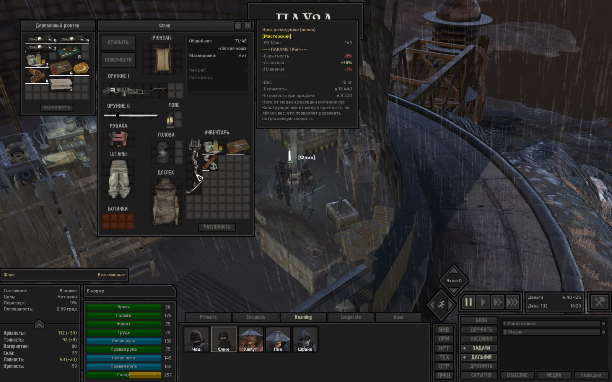

---

### Серия 4 (1 кадр)

- **Файловое время**: с `2026-11-04T16:53:01Z` по `2026-11-04T16:53:01Z`
- **Игровое время (OCR)**: `День 132, 20:38`
- **Локация (OCR)**: Не зафиксирована в UI
- **Персонажи в UI (OCR)**: Флик
- **Задачи/предметы в UI**: Медик, Роботехника

**Кадры серии:**
- [screenshot_442-4e97aecf.jpg](screenshot_442-4e97aecf.jpg) ([GitHub](https://github.com/asaf1n/Kenshi-Compain/blob/main/published/screenshots/screenshot_442-4e97aecf.jpg) | [Raw](https://raw.githubusercontent.com/asaf1n/Kenshi-Compain/main/published/screenshots/screenshot_442-4e97aecf.jpg))

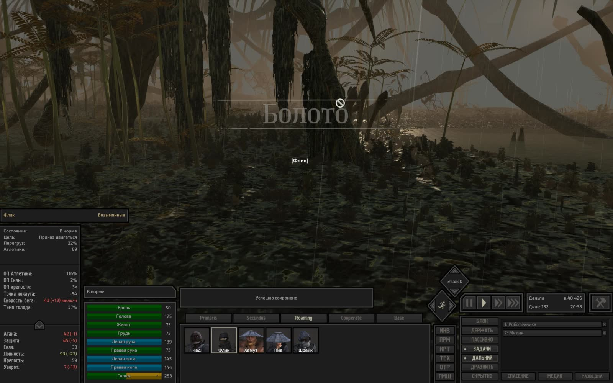

---

### Серия 5 (1 кадр)

- **Файловое время**: с `2026-11-06T00:18:43Z` по `2026-11-06T00:18:43Z`
- **Игровое время (OCR)**: `День 133, 11:26`
- **Локация (OCR)**: Не зафиксирована в UI
- **Персонажи в UI (OCR)**: Чад
- **Задачи/предметы в UI**: Быть рядом: Хот Лон, Медик, Роботехника

**Кадры серии:**
- [screenshot_446-6fac47f5.jpg](screenshot_446-6fac47f5.jpg) ([GitHub](https://github.com/asaf1n/Kenshi-Compain/blob/main/published/screenshots/screenshot_446-6fac47f5.jpg) | [Raw](https://raw.githubusercontent.com/asaf1n/Kenshi-Compain/main/published/screenshots/screenshot_446-6fac47f5.jpg))

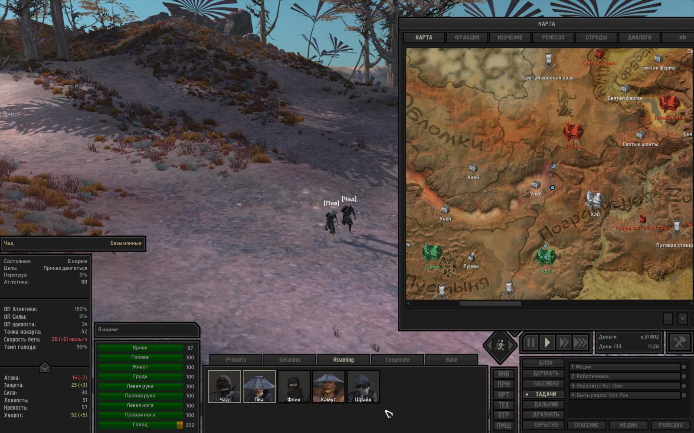

---

### Серия 6 (1 кадр)

- **Файловое время**: с `2026-11-06T00:20:27Z` по `2026-11-06T00:20:27Z`
- **Игровое время (OCR)**: `День 133, 12:18`
- **Локация (OCR)**: Не зафиксирована в UI
- **Персонажи в UI (OCR)**: Не зафиксированы в UI
- **Задачи/предметы в UI**: Медик, Роботехника

**Кадры серии:**
- [screenshot_449-be991bca.jpg](screenshot_449-be991bca.jpg) ([GitHub](https://github.com/asaf1n/Kenshi-Compain/blob/main/published/screenshots/screenshot_449-be991bca.jpg) | [Raw](https://raw.githubusercontent.com/asaf1n/Kenshi-Compain/main/published/screenshots/screenshot_449-be991bca.jpg))

---

### Серия 7 (1 кадр)

- **Файловое время**: с `2026-11-06T00:21:45Z` по `2026-11-06T00:21:45Z`
- **Игровое время (OCR)**: `День 133, 12:30`
- **Локация (OCR)**: Не зафиксирована в UI
- **Персонажи в UI (OCR)**: Инквизитор Сэта
- **Задачи/предметы в UI**: Медик, Роботехника

**Кадры серии:**
- [screenshot_456-9ef153b1.jpg](screenshot_456-9ef153b1.jpg) ([GitHub](https://github.com/asaf1n/Kenshi-Compain/blob/main/published/screenshots/screenshot_456-9ef153b1.jpg) | [Raw](https://raw.githubusercontent.com/asaf1n/Kenshi-Compain/main/published/screenshots/screenshot_456-9ef153b1.jpg))

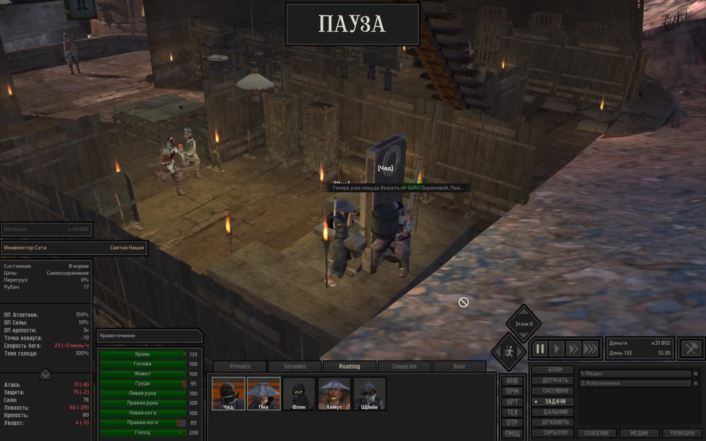

---

### Серия 8 (1 кадр)

- **Файловое время**: с `2026-11-06T00:25:51Z` по `2026-11-06T00:25:51Z`
- **Игровое время (OCR)**: `День 133, 13:43`
- **Локация (OCR)**: Не зафиксирована в UI
- **Персонажи в UI (OCR)**: Часовой

**Кадры серии:**
- [screenshot_462-a16a7655.jpg](screenshot_462-a16a7655.jpg) ([GitHub](https://github.com/asaf1n/Kenshi-Compain/blob/main/published/screenshots/screenshot_462-a16a7655.jpg) | [Raw](https://raw.githubusercontent.com/asaf1n/Kenshi-Compain/main/published/screenshots/screenshot_462-a16a7655.jpg))

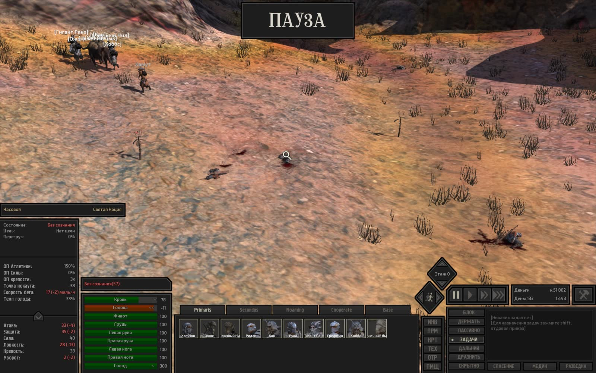

---

### Серия 9 (1 кадр)

- **Файловое время**: с `2026-11-06T00:28:56Z` по `2026-11-06T00:28:56Z`
- **Игровое время (OCR)**: `День 133, 14:44`
- **Локация (OCR)**: Не зафиксирована в UI
- **Персонажи в UI (OCR)**: Хот Лон
- **Задачи/предметы в UI**: Медик, Роботехника

**Кадры серии:**
- [screenshot_466-c71a4ff7.jpg](screenshot_466-c71a4ff7.jpg) ([GitHub](https://github.com/asaf1n/Kenshi-Compain/blob/main/published/screenshots/screenshot_466-c71a4ff7.jpg) | [Raw](https://raw.githubusercontent.com/asaf1n/Kenshi-Compain/main/published/screenshots/screenshot_466-c71a4ff7.jpg))

---

### Серия 10 (1 кадр)

- **Файловое время**: с `2026-11-06T00:35:33Z` по `2026-11-06T00:35:33Z`
- **Игровое время (OCR)**: `День 133, 15:13`
- **Локация (OCR)**: Не зафиксирована в UI
- **Персонажи в UI (OCR)**: fx
- **Задачи/предметы в UI**: Быть рядом: Зелёный, Быть рядом: Хот Лон, Охранять: Зелёный

**Кадры серии:**
- [screenshot_470-957c2989.jpg](screenshot_470-957c2989.jpg) ([GitHub](https://github.com/asaf1n/Kenshi-Compain/blob/main/published/screenshots/screenshot_470-957c2989.jpg) | [Raw](https://raw.githubusercontent.com/asaf1n/Kenshi-Compain/main/published/screenshots/screenshot_470-957c2989.jpg))

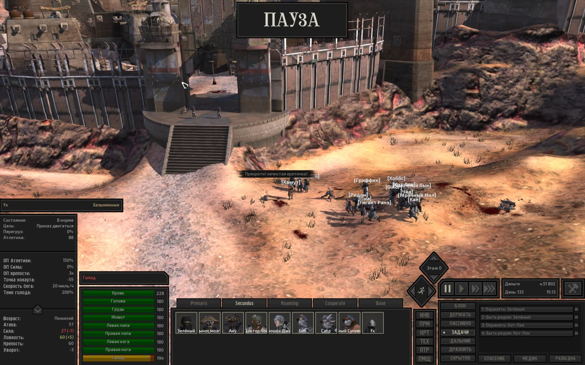

---

### Серия 11 (1 кадр)

- **Файловое время**: с `2026-11-06T00:51:48Z` по `2026-11-06T00:51:48Z`
- **Игровое время (OCR)**: `День 133, 17:19`
- **Локация (OCR)**: Не зафиксирована в UI
- **Персонажи в UI (OCR)**: Зелёный палец
- **Задачи/предметы в UI**: Работа с машиной: Пеньковая ферма, Работа с машиной: Рисовая ферма 1-, Тащить в: Хранение: пенька, Тащить в: Хранение: рис

**Кадры серии:**
- [screenshot_474-52bb0da7.jpg](screenshot_474-52bb0da7.jpg) ([GitHub](https://github.com/asaf1n/Kenshi-Compain/blob/main/published/screenshots/screenshot_474-52bb0da7.jpg) | [Raw](https://raw.githubusercontent.com/asaf1n/Kenshi-Compain/main/published/screenshots/screenshot_474-52bb0da7.jpg))

---

### Серия 12 (1 кадр)

- **Файловое время**: с `2026-11-06T01:08:32Z` по `2026-11-06T01:08:32Z`
- **Игровое время (OCR)**: `День 133, 23:25`
- **Локация (OCR)**: Не зафиксирована в UI
- **Персонажи в UI (OCR)**: Стражница
- **Задачи/предметы в UI**: Быть рядом: Хот Лон, Медик, Роботехника

**Кадры серии:**
- [screenshot_477-c108555d.jpg](screenshot_477-c108555d.jpg) ([GitHub](https://github.com/asaf1n/Kenshi-Compain/blob/main/published/screenshots/screenshot_477-c108555d.jpg) | [Raw](https://raw.githubusercontent.com/asaf1n/Kenshi-Compain/main/published/screenshots/screenshot_477-c108555d.jpg))

---

### Серия 13 (1 кадр)

- **Файловое время**: с `2026-11-06T01:31:14Z` по `2026-11-06T01:31:14Z`
- **Игровое время (OCR)**: `День 134, 05:53`
- **Локация (OCR)**: Не зафиксирована в UI
- **Персонажи в UI (OCR)**: Шрайк
- **Задачи/предметы в UI**: Быть рядом: Хот Лон, Медик, Роботехника

**Кадры серии:**
- [screenshot_481-ae3e5601.jpg](screenshot_481-ae3e5601.jpg) ([GitHub](https://github.com/asaf1n/Kenshi-Compain/blob/main/published/screenshots/screenshot_481-ae3e5601.jpg) | [Raw](https://raw.githubusercontent.com/asaf1n/Kenshi-Compain/main/published/screenshots/screenshot_481-ae3e5601.jpg))

---

### Серия 14 (1 кадр)

- **Файловое время**: с `2026-11-06T01:45:51Z` по `2026-11-06T01:45:51Z`
- **Игровое время (OCR)**: `Не зафиксировано в UI`
- **Локация (OCR)**: Не зафиксирована в UI
- **Персонажи в UI (OCR)**: Шрайк
- **Задачи/предметы в UI**: Быть рядом: Хот Лон, Медик, Роботехника

**Кадры серии:**
- [screenshot_485-c53ce4d8.jpg](screenshot_485-c53ce4d8.jpg) ([GitHub](https://github.com/asaf1n/Kenshi-Compain/blob/main/published/screenshots/screenshot_485-c53ce4d8.jpg) | [Raw](https://raw.githubusercontent.com/asaf1n/Kenshi-Compain/main/published/screenshots/screenshot_485-c53ce4d8.jpg))

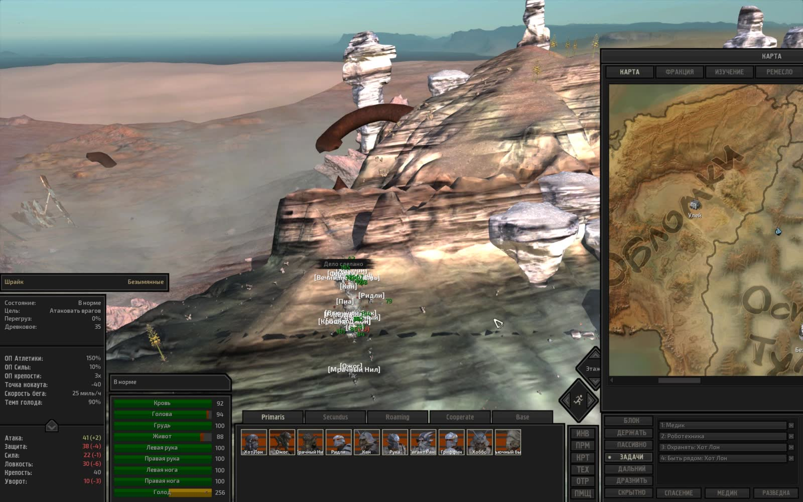

---

### Серия 15 (1 кадр)

- **Файловое время**: с `2026-11-06T14:25:16Z` по `2026-11-06T14:25:16Z`
- **Игровое время (OCR)**: `День 134, 11:46`
- **Локация (OCR)**: Не зафиксирована в UI
- **Персонажи в UI (OCR)**: Не зафиксированы в UI

**Кадры серии:**
- [screenshot_488-78a1f13f.jpg](screenshot_488-78a1f13f.jpg) ([GitHub](https://github.com/asaf1n/Kenshi-Compain/blob/main/published/screenshots/screenshot_488-78a1f13f.jpg) | [Raw](https://raw.githubusercontent.com/asaf1n/Kenshi-Compain/main/published/screenshots/screenshot_488-78a1f13f.jpg))

---

### Серия 16 (1 кадр)

- **Файловое время**: с `2026-11-06T14:30:53Z` по `2026-11-06T14:30:53Z`
- **Игровое время (OCR)**: `День 134, 14:19`
- **Локация (OCR)**: Не зафиксирована в UI
- **Персонажи в UI (OCR)**: Шрайк
- **Задачи/предметы в UI**: Быть рядом: Хот Лон, Медик, Роботехника

**Кадры серии:**
- [screenshot_492-a754c5d0.jpg](screenshot_492-a754c5d0.jpg) ([GitHub](https://github.com/asaf1n/Kenshi-Compain/blob/main/published/screenshots/screenshot_492-a754c5d0.jpg) | [Raw](https://raw.githubusercontent.com/asaf1n/Kenshi-Compain/main/published/screenshots/screenshot_492-a754c5d0.jpg))

---

### Серия 17 (1 кадр)

- **Файловое время**: с `2026-11-06T20:51:25Z` по `2026-11-06T20:51:25Z`
- **Игровое время (OCR)**: `День 734`
- **Локация (OCR)**: Не зафиксирована в UI
- **Персонажи в UI (OCR)**: Не зафиксированы в UI
- **Задачи/предметы в UI**: Быть рядом: Хот Лон, Медик, Роботехника

**Кадры серии:**
- [screenshot_495-31d25d9b.jpg](screenshot_495-31d25d9b.jpg) ([GitHub](https://github.com/asaf1n/Kenshi-Compain/blob/main/published/screenshots/screenshot_495-31d25d9b.jpg) | [Raw](https://raw.githubusercontent.com/asaf1n/Kenshi-Compain/main/published/screenshots/screenshot_495-31d25d9b.jpg))

---

### Серия 18 (1 кадр)

- **Файловое время**: с `2026-11-06T22:41:40Z` по `2026-11-06T22:41:40Z`
- **Игровое время (OCR)**: `День 134, 22:07`
- **Локация (OCR)**: Не зафиксирована в UI
- **Персонажи в UI (OCR)**: Не зафиксированы в UI

**Кадры серии:**
- [screenshot_499-4d43d464.jpg](screenshot_499-4d43d464.jpg) ([GitHub](https://github.com/asaf1n/Kenshi-Compain/blob/main/published/screenshots/screenshot_499-4d43d464.jpg) | [Raw](https://raw.githubusercontent.com/asaf1n/Kenshi-Compain/main/published/screenshots/screenshot_499-4d43d464.jpg))

---

### Серия 19 (1 кадр)

- **Файловое время**: с `2026-11-06T22:49:47Z` по `2026-11-06T22:49:47Z`
- **Игровое время (OCR)**: `День 135, 04:58`
- **Локация (OCR)**: Не зафиксирована в UI
- **Персонажи в UI (OCR)**: Не зафиксированы в UI
- **Задачи/предметы в UI**: Быть рядом: Хот Лон, Медик, Роботехника

**Кадры серии:**
- [screenshot_503-0202b292.jpg](screenshot_503-0202b292.jpg) ([GitHub](https://github.com/asaf1n/Kenshi-Compain/blob/main/published/screenshots/screenshot_503-0202b292.jpg) | [Raw](https://raw.githubusercontent.com/asaf1n/Kenshi-Compain/main/published/screenshots/screenshot_503-0202b292.jpg))

---

### Серия 20 (1 кадр)

- **Файловое время**: с `2026-11-06T22:59:55Z` по `2026-11-06T22:59:55Z`
- **Игровое время (OCR)**: `День 135, 08:55`
- **Локация (OCR)**: Не зафиксирована в UI
- **Персонажи в UI (OCR)**: Генин
- **Задачи/предметы в UI**: Работа с машиной: Кухонная плита, Работа с машиной: Рисовая ферма 1-, Тащить в: Хранение: еда, Тащить в: Хранение: рис

**Кадры серии:**
- [screenshot_506-996d742f.jpg](screenshot_506-996d742f.jpg) ([GitHub](https://github.com/asaf1n/Kenshi-Compain/blob/main/published/screenshots/screenshot_506-996d742f.jpg) | [Raw](https://raw.githubusercontent.com/asaf1n/Kenshi-Compain/main/published/screenshots/screenshot_506-996d742f.jpg))

---

### Серия 21 (1 кадр)

- **Файловое время**: с `2026-11-09T04:12:25Z` по `2026-11-09T04:12:25Z`
- **Игровое время (OCR)**: `День 135, 12:11`
- **Локация (OCR)**: Не зафиксирована в UI
- **Персонажи в UI (OCR)**: Не зафиксированы в UI
- **Задачи/предметы в UI**: Медик, Турель, охрана: Арбалет-турель МКП [све

**Кадры серии:**
- [screenshot_543-2ae1cfdd.jpg](screenshot_543-2ae1cfdd.jpg) ([GitHub](https://github.com/asaf1n/Kenshi-Compain/blob/main/published/screenshots/screenshot_543-2ae1cfdd.jpg) | [Raw](https://raw.githubusercontent.com/asaf1n/Kenshi-Compain/main/published/screenshots/screenshot_543-2ae1cfdd.jpg))

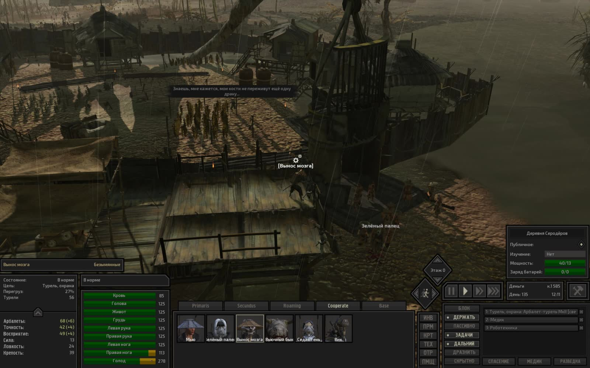

---

### Серия 22 (1 кадр)

- **Файловое время**: с `2026-11-09T05:03:45Z` по `2026-11-09T05:03:45Z`
- **Игровое время (OCR)**: `День 135, 18:31`
- **Локация (OCR)**: Не зафиксирована в UI
- **Персонажи в UI (OCR)**: Кот
- **Задачи/предметы в UI**: Медик, Охранять: Вик

**Кадры серии:**
- [screenshot_547-11b87cbc.jpg](screenshot_547-11b87cbc.jpg) ([GitHub](https://github.com/asaf1n/Kenshi-Compain/blob/main/published/screenshots/screenshot_547-11b87cbc.jpg) | [Raw](https://raw.githubusercontent.com/asaf1n/Kenshi-Compain/main/published/screenshots/screenshot_547-11b87cbc.jpg))

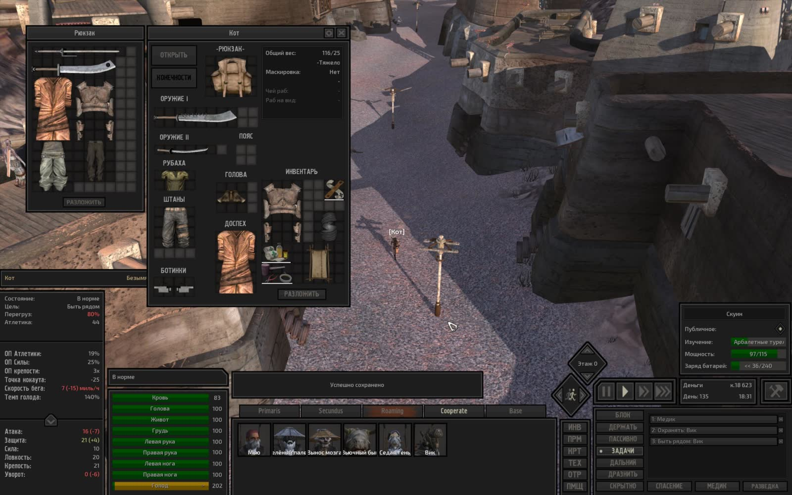

---

### Серия 23 (1 кадр)

- **Файловое время**: с `2026-11-09T05:10:15Z` по `2026-11-09T05:10:15Z`
- **Игровое время (OCR)**: `День 135, 20:54`
- **Локация (OCR)**: Не зафиксирована в UI
- **Персонажи в UI (OCR)**: Пиа
- **Задачи/предметы в UI**: Атаковать врагов, Быть рядом: Хот Лон, Медик, Роботехника

**Кадры серии:**
- [screenshot_550-20aeb353.jpg](screenshot_550-20aeb353.jpg) ([GitHub](https://github.com/asaf1n/Kenshi-Compain/blob/main/published/screenshots/screenshot_550-20aeb353.jpg) | [Raw](https://raw.githubusercontent.com/asaf1n/Kenshi-Compain/main/published/screenshots/screenshot_550-20aeb353.jpg))

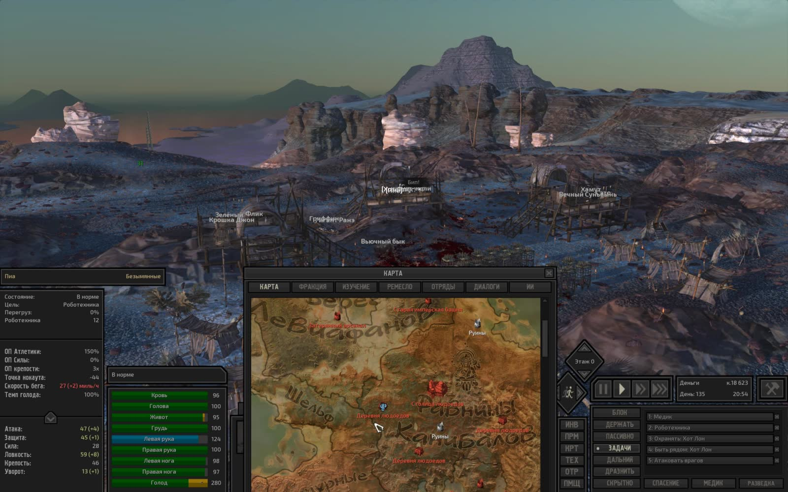

---

### Серия 24 (1 кадр)

- **Файловое время**: с `2026-11-09T23:11:29Z` по `2026-11-09T23:11:29Z`
- **Игровое время (OCR)**: `День 136, 01:37`
- **Локация (OCR)**: Не зафиксирована в UI
- **Персонажи в UI (OCR)**: Вынос мозга
- **Задачи/предметы в UI**: Медик, Турель, охрана: Арбалет-турель Mkll [свет [8]

**Кадры серии:**
- [screenshot_554-fb55ed37.jpg](screenshot_554-fb55ed37.jpg) ([GitHub](https://github.com/asaf1n/Kenshi-Compain/blob/main/published/screenshots/screenshot_554-fb55ed37.jpg) | [Raw](https://raw.githubusercontent.com/asaf1n/Kenshi-Compain/main/published/screenshots/screenshot_554-fb55ed37.jpg))

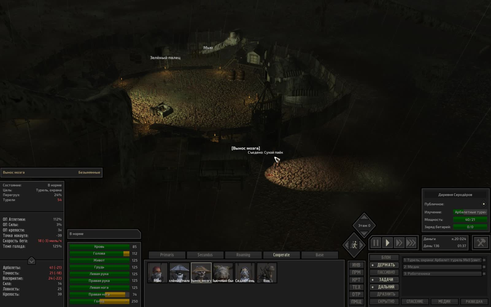

---

### Серия 25 (1 кадр)

- **Файловое время**: с `2026-11-09T23:42:40Z` по `2026-11-09T23:42:40Z`
- **Игровое время (OCR)**: `День 136, 05:39`
- **Локация (OCR)**: Не зафиксирована в UI
- **Персонажи в UI (OCR)**: Вьючный бык
- **Задачи/предметы в UI**: Быть рядом: Кот, Охранять: Кот

**Кадры серии:**
- [screenshot_558-6875fce2.jpg](screenshot_558-6875fce2.jpg) ([GitHub](https://github.com/asaf1n/Kenshi-Compain/blob/main/published/screenshots/screenshot_558-6875fce2.jpg) | [Raw](https://raw.githubusercontent.com/asaf1n/Kenshi-Compain/main/published/screenshots/screenshot_558-6875fce2.jpg))

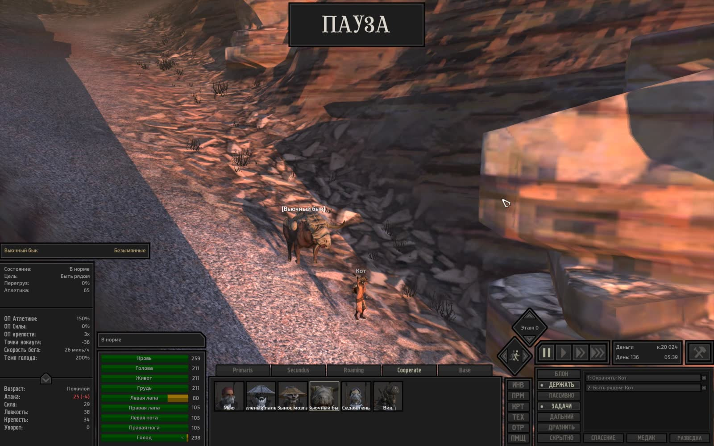

---

### Серия 26 (1 кадр)

- **Файловое время**: с `2026-11-09T23:50:08Z` по `2026-11-09T23:50:08Z`
- **Игровое время (OCR)**: `День 136, 07:52`
- **Локация (OCR)**: Не зафиксирована в UI
- **Персонажи в UI (OCR)**: Не зафиксированы в UI
- **Задачи/предметы в UI**: Медик, Роботехника

**Кадры серии:**
- [screenshot_561-85abdeb1.jpg](screenshot_561-85abdeb1.jpg) ([GitHub](https://github.com/asaf1n/Kenshi-Compain/blob/main/published/screenshots/screenshot_561-85abdeb1.jpg) | [Raw](https://raw.githubusercontent.com/asaf1n/Kenshi-Compain/main/published/screenshots/screenshot_561-85abdeb1.jpg))

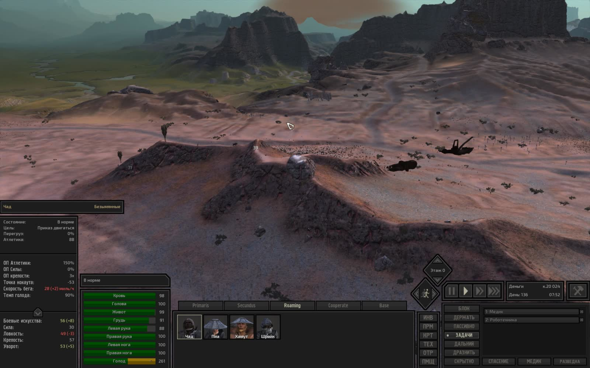

---

### Серия 27 (1 кадр)

- **Файловое время**: с `2026-11-10T00:11:31Z` по `2026-11-10T00:11:31Z`
- **Игровое время (OCR)**: `День 136, 14:14`
- **Локация (OCR)**: Не зафиксирована в UI
- **Персонажи в UI (OCR)**: вик

**Кадры серии:**
- [screenshot_565-e2df7c39.jpg](screenshot_565-e2df7c39.jpg) ([GitHub](https://github.com/asaf1n/Kenshi-Compain/blob/main/published/screenshots/screenshot_565-e2df7c39.jpg) | [Raw](https://raw.githubusercontent.com/asaf1n/Kenshi-Compain/main/published/screenshots/screenshot_565-e2df7c39.jpg))

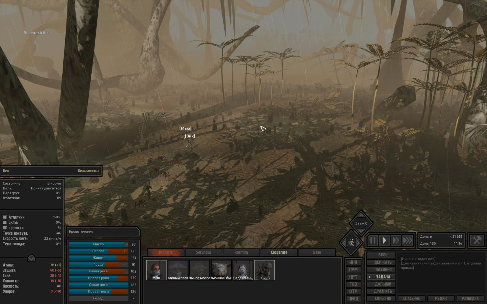

---

### Серия 28 (1 кадр)

- **Файловое время**: с `2026-11-10T00:24:49Z` по `2026-11-10T00:24:49Z`
- **Игровое время (OCR)**: `День 136, 17:24`
- **Локация (OCR)**: Не зафиксирована в UI
- **Персонажи в UI (OCR)**: Не зафиксированы в UI
- **Задачи/предметы в UI**: Быть рядом: Зелёный, Охранять: Зелёный

**Кадры серии:**
- [screenshot_569-a4ddd76e.jpg](screenshot_569-a4ddd76e.jpg) ([GitHub](https://github.com/asaf1n/Kenshi-Compain/blob/main/published/screenshots/screenshot_569-a4ddd76e.jpg) | [Raw](https://raw.githubusercontent.com/asaf1n/Kenshi-Compain/main/published/screenshots/screenshot_569-a4ddd76e.jpg))

---

### Серия 29 (1 кадр)

- **Файловое время**: с `2026-11-10T05:40:53Z` по `2026-11-10T05:40:53Z`
- **Игровое время (OCR)**: `День 136, 18:30`
- **Локация (OCR)**: Не зафиксирована в UI
- **Персонажи в UI (OCR)**: Не зафиксированы в UI
- **Задачи/предметы в UI**: Быть рядом: Вьючный бык, Охранять: Вьючный бык

**Кадры серии:**
- [screenshot_572-d3b8fb0f.jpg](screenshot_572-d3b8fb0f.jpg) ([GitHub](https://github.com/asaf1n/Kenshi-Compain/blob/main/published/screenshots/screenshot_572-d3b8fb0f.jpg) | [Raw](https://raw.githubusercontent.com/asaf1n/Kenshi-Compain/main/published/screenshots/screenshot_572-d3b8fb0f.jpg))

---

### Серия 30 (1 кадр)

- **Файловое время**: с `2026-11-10T05:44:53Z` по `2026-11-10T05:44:53Z`
- **Игровое время (OCR)**: `День 136, 20:07`
- **Локация (OCR)**: Не зафиксирована в UI
- **Персонажи в UI (OCR)**: Не зафиксированы в UI
- **Задачи/предметы в UI**: Медик, Роботехника

**Кадры серии:**
- [screenshot_576-2755813b.jpg](screenshot_576-2755813b.jpg) ([GitHub](https://github.com/asaf1n/Kenshi-Compain/blob/main/published/screenshots/screenshot_576-2755813b.jpg) | [Raw](https://raw.githubusercontent.com/asaf1n/Kenshi-Compain/main/published/screenshots/screenshot_576-2755813b.jpg))

---
