# Техническая лента скриншотов Kenshi

- **Сформировано**: `2026-11-05T21:43:04Z`
- **Окно выборки**: последние 7 суток (с `2026-10-29T21:43:04Z` по `2026-11-05T21:43:04Z`)
- **Всего скриншотов в окне**: 30
- **Сгруппировано серий/кадров**: 30

Техническая лента сгруппированных по сходству кадров с извлеченным текстом интерфейса (OCR). Интерпретация происходящего в игре полностью принадлежит LLM-компаньону по оригинальным изображениям.

---

### Серия 1 (1 кадр)

- **Файловое время**: с `2026-10-30T02:30:56Z` по `2026-10-30T02:30:56Z`
- **Игровое время (OCR)**: `День 107, 07:11`
- **Локация (OCR)**: Не зафиксирована в UI
- **Персонажи в UI (OCR)**: Хот Лон

**Кадры серии:**
- [screenshot_152-e0a03c21.jpg](screenshot_152-e0a03c21.jpg) ([GitHub](https://github.com/asaf1n/Kenshi-Compain/blob/main/published/screenshots/screenshot_152-e0a03c21.jpg) | [Raw](https://raw.githubusercontent.com/asaf1n/Kenshi-Compain/main/published/screenshots/screenshot_152-e0a03c21.jpg))

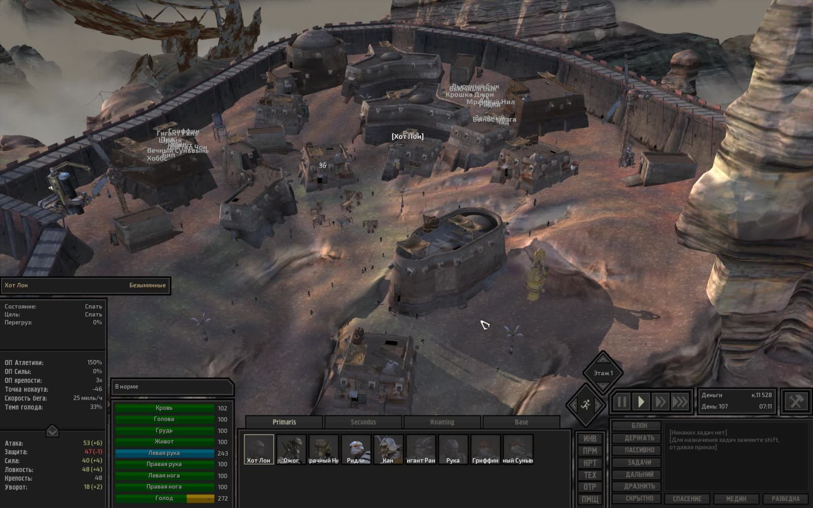

---

### Серия 2 (1 кадр)

- **Файловое время**: с `2026-10-30T04:53:46Z` по `2026-10-30T04:53:46Z`
- **Игровое время (OCR)**: `День 108, 11:44`
- **Локация (OCR)**: Не зафиксирована в UI
- **Персонажи в UI (OCR)**: Не зафиксированы в UI
- **Задачи/предметы в UI**: Быть рядом: Хот Лон, Медик, Роботехника

**Кадры серии:**
- [screenshot_163-be3c6513.jpg](screenshot_163-be3c6513.jpg) ([GitHub](https://github.com/asaf1n/Kenshi-Compain/blob/main/published/screenshots/screenshot_163-be3c6513.jpg) | [Raw](https://raw.githubusercontent.com/asaf1n/Kenshi-Compain/main/published/screenshots/screenshot_163-be3c6513.jpg))

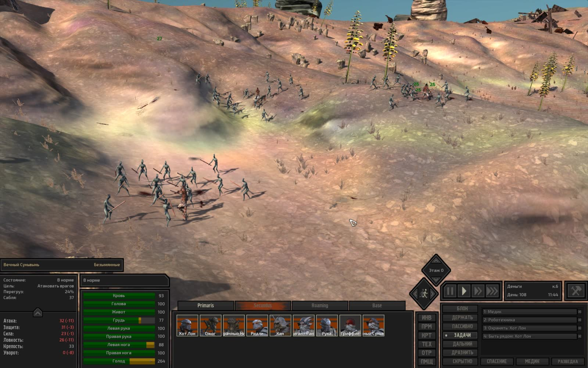

---

### Серия 3 (1 кадр)

- **Файловое время**: с `2026-10-30T09:57:44Z` по `2026-10-30T09:57:44Z`
- **Игровое время (OCR)**: `День 110, 19:44`
- **Локация (OCR)**: Не зафиксирована в UI
- **Персонажи в UI (OCR)**: Не зафиксированы в UI
- **Задачи/предметы в UI**: Быть рядом: Хот Лон, Медик, Роботехника

**Кадры серии:**
- [screenshot_174-98c1b915.jpg](screenshot_174-98c1b915.jpg) ([GitHub](https://github.com/asaf1n/Kenshi-Compain/blob/main/published/screenshots/screenshot_174-98c1b915.jpg) | [Raw](https://raw.githubusercontent.com/asaf1n/Kenshi-Compain/main/published/screenshots/screenshot_174-98c1b915.jpg))

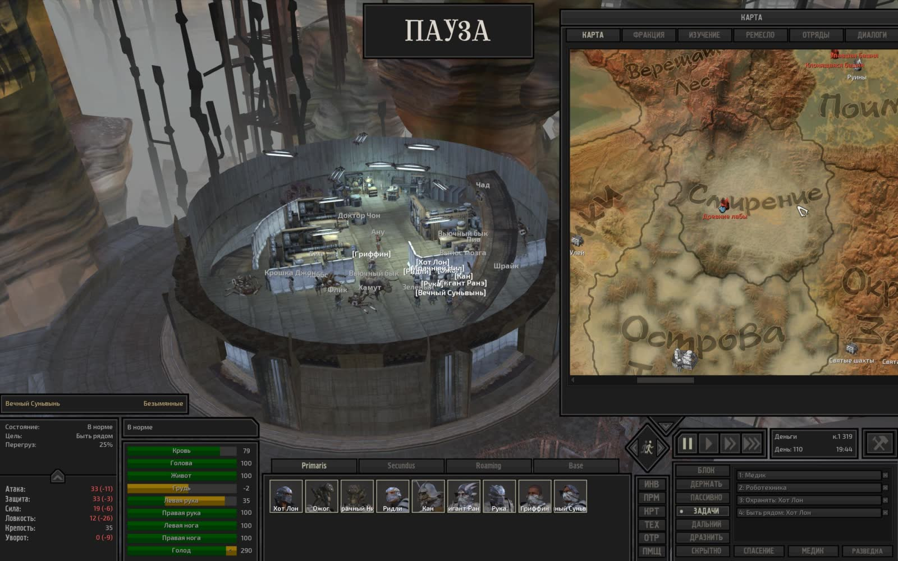

---

### Серия 4 (1 кадр)

- **Файловое время**: с `2026-10-30T14:22:56Z` по `2026-10-30T14:22:56Z`
- **Игровое время (OCR)**: `Не зафиксировано в UI`
- **Локация (OCR)**: Не зафиксирована в UI
- **Персонажи в UI (OCR)**: Ридли

**Кадры серии:**
- [screenshot_184-89caf868.jpg](screenshot_184-89caf868.jpg) ([GitHub](https://github.com/asaf1n/Kenshi-Compain/blob/main/published/screenshots/screenshot_184-89caf868.jpg) | [Raw](https://raw.githubusercontent.com/asaf1n/Kenshi-Compain/main/published/screenshots/screenshot_184-89caf868.jpg))

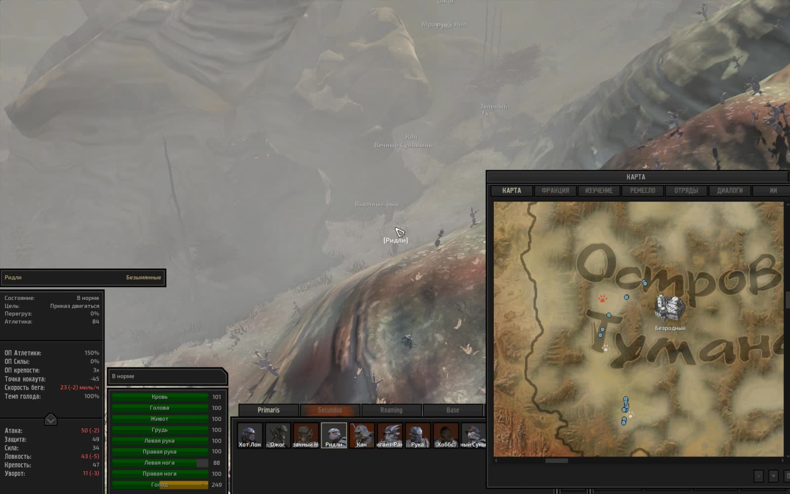

---

### Серия 5 (1 кадр)

- **Файловое время**: с `2026-10-30T18:09:18Z` по `2026-10-30T18:09:18Z`
- **Игровое время (OCR)**: `День 115, 07:37`
- **Локация (OCR)**: Не зафиксирована в UI
- **Персонажи в UI (OCR)**: вик
- **Задачи/предметы в UI**: Инженер, Медик

**Кадры серии:**
- [screenshot_194-2e1724e6.jpg](screenshot_194-2e1724e6.jpg) ([GitHub](https://github.com/asaf1n/Kenshi-Compain/blob/main/published/screenshots/screenshot_194-2e1724e6.jpg) | [Raw](https://raw.githubusercontent.com/asaf1n/Kenshi-Compain/main/published/screenshots/screenshot_194-2e1724e6.jpg))

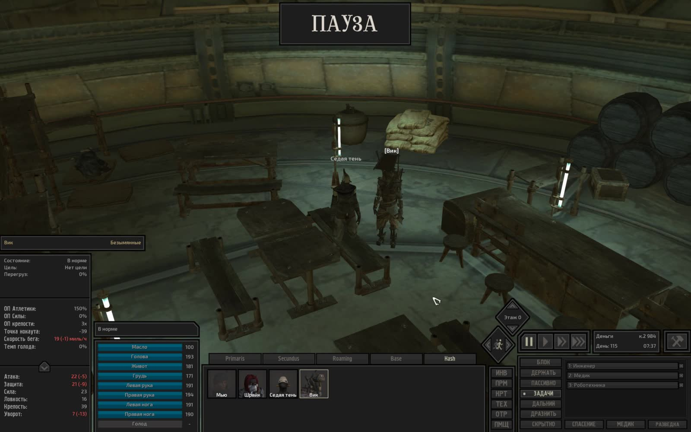

---

### Серия 6 (1 кадр)

- **Файловое время**: с `2026-10-31T02:34:25Z` по `2026-10-31T02:34:25Z`
- **Игровое время (OCR)**: `День 116, 21:25`
- **Локация (OCR)**: Не зафиксирована в UI
- **Персонажи в UI (OCR)**: Не зафиксированы в UI
- **Задачи/предметы в UI**: Медик, Роботехника, Тащить в: Хранение: пенька

**Кадры серии:**
- [screenshot_204-63a4c232.jpg](screenshot_204-63a4c232.jpg) ([GitHub](https://github.com/asaf1n/Kenshi-Compain/blob/main/published/screenshots/screenshot_204-63a4c232.jpg) | [Raw](https://raw.githubusercontent.com/asaf1n/Kenshi-Compain/main/published/screenshots/screenshot_204-63a4c232.jpg))

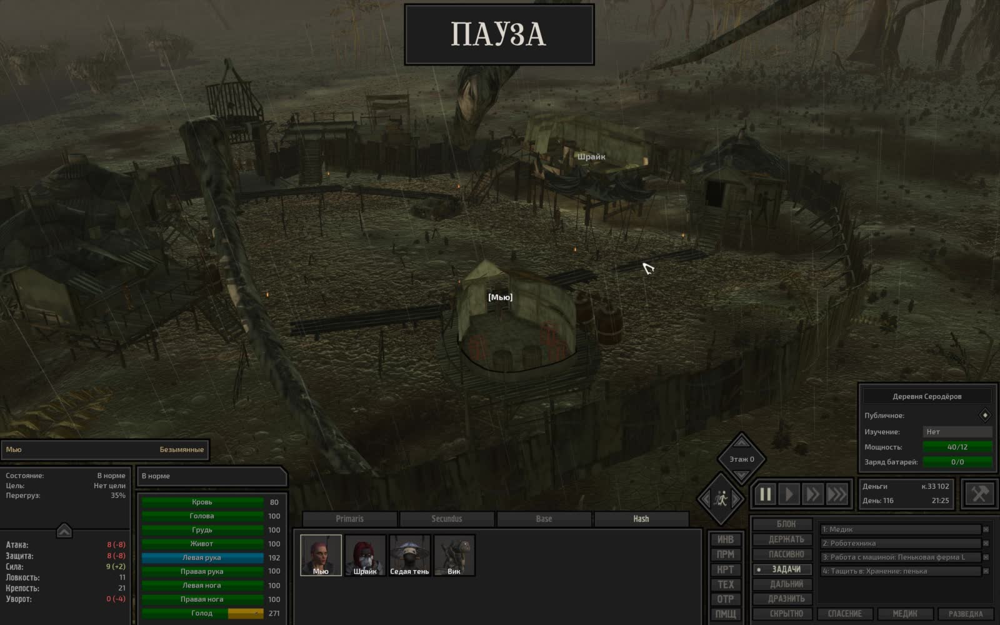

---

### Серия 7 (1 кадр)

- **Файловое время**: с `2026-10-31T05:15:39Z` по `2026-10-31T05:15:39Z`
- **Игровое время (OCR)**: `День 117, 12:48`
- **Локация (OCR)**: Не зафиксирована в UI
- **Персонажи в UI (OCR)**: Бип
- **Задачи/предметы в UI**: Медик, Охранять: Хоббс

**Кадры серии:**
- [screenshot_213-86e8cd4b.jpg](screenshot_213-86e8cd4b.jpg) ([GitHub](https://github.com/asaf1n/Kenshi-Compain/blob/main/published/screenshots/screenshot_213-86e8cd4b.jpg) | [Raw](https://raw.githubusercontent.com/asaf1n/Kenshi-Compain/main/published/screenshots/screenshot_213-86e8cd4b.jpg))

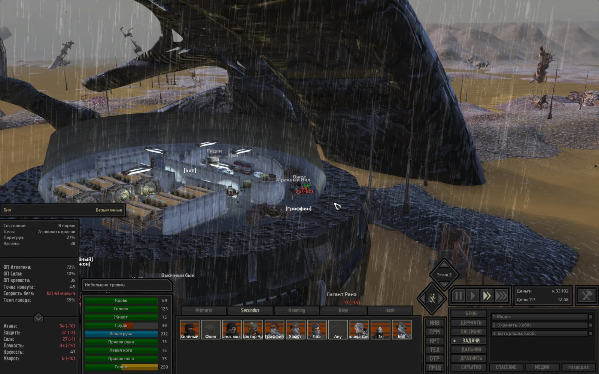

---

### Серия 8 (1 кадр)

- **Файловое время**: с `2026-10-31T08:42:24Z` по `2026-10-31T08:42:24Z`
- **Игровое время (OCR)**: `Не зафиксировано в UI`
- **Локация (OCR)**: Не зафиксирована в UI
- **Персонажи в UI (OCR)**: Не зафиксированы в UI

**Кадры серии:**
- [screenshot_223-4f55f3a6.jpg](screenshot_223-4f55f3a6.jpg) ([GitHub](https://github.com/asaf1n/Kenshi-Compain/blob/main/published/screenshots/screenshot_223-4f55f3a6.jpg) | [Raw](https://raw.githubusercontent.com/asaf1n/Kenshi-Compain/main/published/screenshots/screenshot_223-4f55f3a6.jpg))

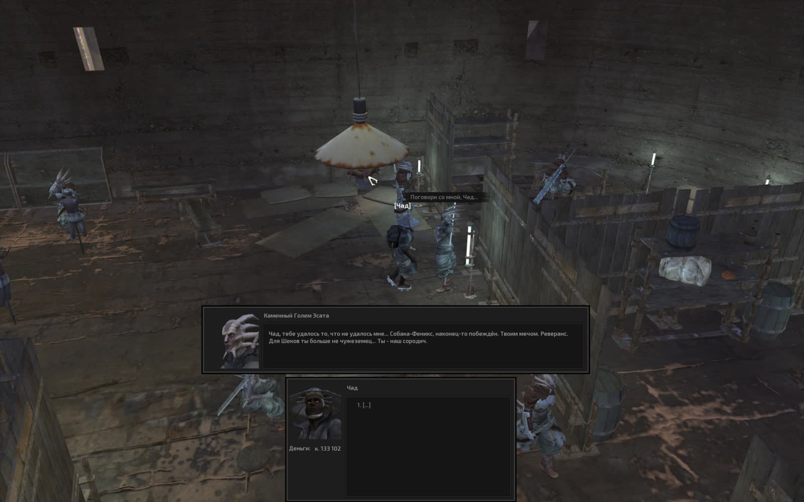

---

### Серия 9 (1 кадр)

- **Файловое время**: с `2026-10-31T12:17:33Z` по `2026-10-31T12:17:33Z`
- **Игровое время (OCR)**: `День 118, 06:09`
- **Локация (OCR)**: Не зафиксирована в UI
- **Персонажи в UI (OCR)**: Шрайк

**Кадры серии:**
- [screenshot_232-1dc315a6.jpg](screenshot_232-1dc315a6.jpg) ([GitHub](https://github.com/asaf1n/Kenshi-Compain/blob/main/published/screenshots/screenshot_232-1dc315a6.jpg) | [Raw](https://raw.githubusercontent.com/asaf1n/Kenshi-Compain/main/published/screenshots/screenshot_232-1dc315a6.jpg))

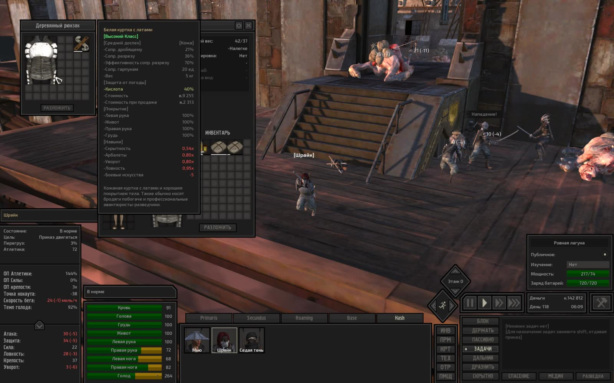

---

### Серия 10 (1 кадр)

- **Файловое время**: с `2026-10-31T13:54:34Z` по `2026-10-31T13:54:34Z`
- **Игровое время (OCR)**: `День 119, 05:49`
- **Локация (OCR)**: Не зафиксирована в UI
- **Персонажи в UI (OCR)**: Не зафиксированы в UI

**Кадры серии:**
- [screenshot_242-a7e14115.jpg](screenshot_242-a7e14115.jpg) ([GitHub](https://github.com/asaf1n/Kenshi-Compain/blob/main/published/screenshots/screenshot_242-a7e14115.jpg) | [Raw](https://raw.githubusercontent.com/asaf1n/Kenshi-Compain/main/published/screenshots/screenshot_242-a7e14115.jpg))

---

### Серия 11 (1 кадр)

- **Файловое время**: с `2026-10-31T18:47:05Z` по `2026-10-31T18:47:05Z`
- **Игровое время (OCR)**: `Не зафиксировано в UI`
- **Локация (OCR)**: Не зафиксирована в UI
- **Персонажи в UI (OCR)**: Не зафиксированы в UI

**Кадры серии:**
- [screenshot_252-fbcc5141.jpg](screenshot_252-fbcc5141.jpg) ([GitHub](https://github.com/asaf1n/Kenshi-Compain/blob/main/published/screenshots/screenshot_252-fbcc5141.jpg) | [Raw](https://raw.githubusercontent.com/asaf1n/Kenshi-Compain/main/published/screenshots/screenshot_252-fbcc5141.jpg))

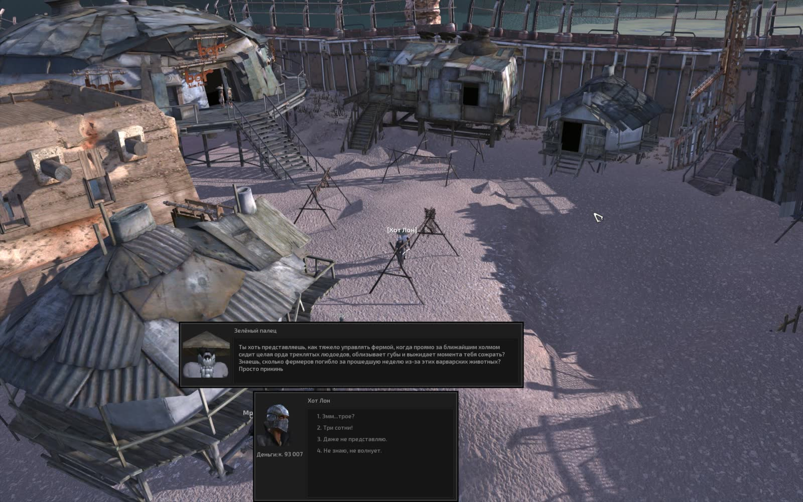

---

### Серия 12 (1 кадр)

- **Файловое время**: с `2026-11-01T04:27:01Z` по `2026-11-01T04:27:01Z`
- **Игровое время (OCR)**: `День 121, 06:40`
- **Локация (OCR)**: Не зафиксирована в UI
- **Персонажи в UI (OCR)**: Не зафиксированы в UI

**Кадры серии:**
- [screenshot_262-26d69f64.jpg](screenshot_262-26d69f64.jpg) ([GitHub](https://github.com/asaf1n/Kenshi-Compain/blob/main/published/screenshots/screenshot_262-26d69f64.jpg) | [Raw](https://raw.githubusercontent.com/asaf1n/Kenshi-Compain/main/published/screenshots/screenshot_262-26d69f64.jpg))

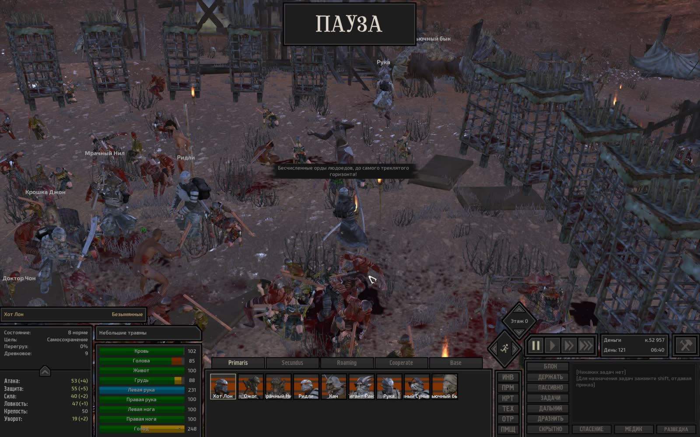

---

### Серия 13 (1 кадр)

- **Файловое время**: с `2026-11-01T05:00:17Z` по `2026-11-01T05:00:17Z`
- **Игровое время (OCR)**: `День 121, 18:03`
- **Локация (OCR)**: Не зафиксирована в UI
- **Персонажи в UI (OCR)**: Хот Лон

**Кадры серии:**
- [screenshot_271-4ac11f9c.jpg](screenshot_271-4ac11f9c.jpg) ([GitHub](https://github.com/asaf1n/Kenshi-Compain/blob/main/published/screenshots/screenshot_271-4ac11f9c.jpg) | [Raw](https://raw.githubusercontent.com/asaf1n/Kenshi-Compain/main/published/screenshots/screenshot_271-4ac11f9c.jpg))

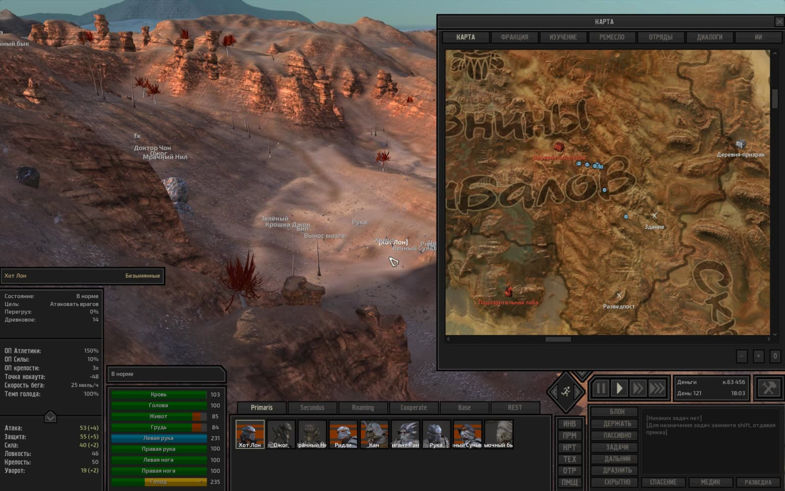

---

### Серия 14 (1 кадр)

- **Файловое время**: с `2026-11-01T09:45:40Z` по `2026-11-01T09:45:40Z`
- **Игровое время (OCR)**: `День 122, 08:15`
- **Локация (OCR)**: Не зафиксирована в UI
- **Персонажи в UI (OCR)**: вик
- **Задачи/предметы в UI**: Быть рядом: Мью, Инженер, Медик, Охранять: Мью

**Кадры серии:**
- [screenshot_281-98b7f0aa.jpg](screenshot_281-98b7f0aa.jpg) ([GitHub](https://github.com/asaf1n/Kenshi-Compain/blob/main/published/screenshots/screenshot_281-98b7f0aa.jpg) | [Raw](https://raw.githubusercontent.com/asaf1n/Kenshi-Compain/main/published/screenshots/screenshot_281-98b7f0aa.jpg))

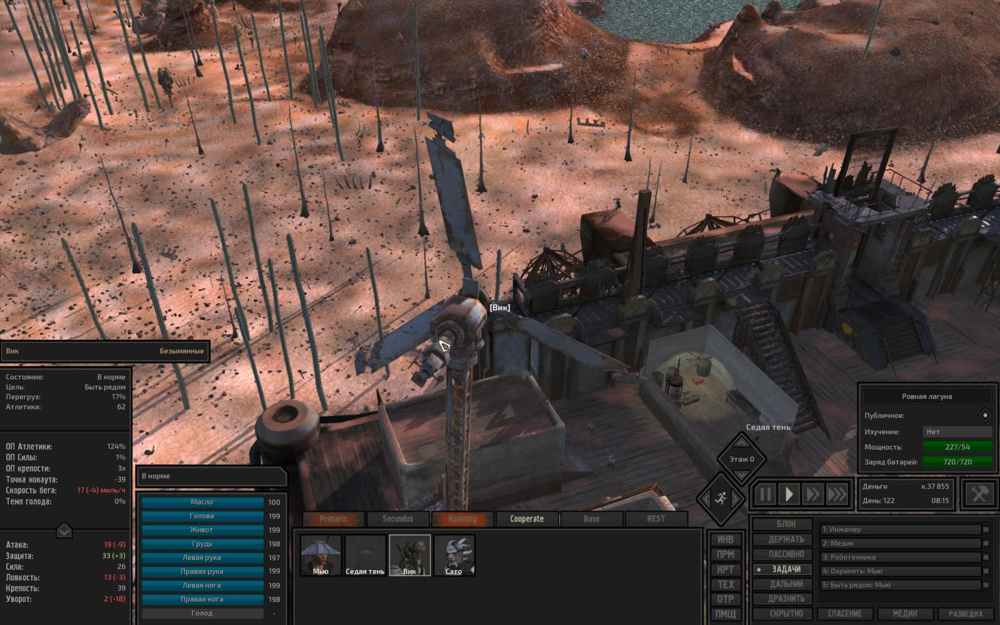

---

### Серия 15 (1 кадр)

- **Файловое время**: с `2026-11-01T10:29:55Z` по `2026-11-01T10:29:55Z`
- **Игровое время (OCR)**: `День 122, 14:49`
- **Локация (OCR)**: Не зафиксирована в UI
- **Персонажи в UI (OCR)**: Ожог
- **Задачи/предметы в UI**: Быть рядом: Хот Лон, Медик, Роботехника

**Кадры серии:**
- [screenshot_292-03f2e8d5.jpg](screenshot_292-03f2e8d5.jpg) ([GitHub](https://github.com/asaf1n/Kenshi-Compain/blob/main/published/screenshots/screenshot_292-03f2e8d5.jpg) | [Raw](https://raw.githubusercontent.com/asaf1n/Kenshi-Compain/main/published/screenshots/screenshot_292-03f2e8d5.jpg))

---

### Серия 16 (1 кадр)

- **Файловое время**: с `2026-11-01T11:00:00Z` по `2026-11-01T11:00:00Z`
- **Игровое время (OCR)**: `День 123, 05:21`
- **Локация (OCR)**: Не зафиксирована в UI
- **Персонажи в UI (OCR)**: Зелёный палец
- **Задачи/предметы в UI**: Работа с машиной: Небольшие залежи мех

**Кадры серии:**
- [screenshot_301-eeefc469.jpg](screenshot_301-eeefc469.jpg) ([GitHub](https://github.com/asaf1n/Kenshi-Compain/blob/main/published/screenshots/screenshot_301-eeefc469.jpg) | [Raw](https://raw.githubusercontent.com/asaf1n/Kenshi-Compain/main/published/screenshots/screenshot_301-eeefc469.jpg))

---

### Серия 17 (1 кадр)

- **Файловое время**: с `2026-11-01T11:57:12Z` по `2026-11-01T11:57:12Z`
- **Игровое время (OCR)**: `День 123, 22:07`
- **Локация (OCR)**: Не зафиксирована в UI
- **Персонажи в UI (OCR)**: Вьючный бык
- **Задачи/предметы в UI**: Быть рядом: Вьючный бык, Охранять: Вьючный бык

**Кадры серии:**
- [screenshot_311-20c83140.jpg](screenshot_311-20c83140.jpg) ([GitHub](https://github.com/asaf1n/Kenshi-Compain/blob/main/published/screenshots/screenshot_311-20c83140.jpg) | [Raw](https://raw.githubusercontent.com/asaf1n/Kenshi-Compain/main/published/screenshots/screenshot_311-20c83140.jpg))

---

### Серия 18 (1 кадр)

- **Файловое время**: с `2026-11-01T12:40:20Z` по `2026-11-01T12:40:20Z`
- **Игровое время (OCR)**: `День 124, 08:26`
- **Локация (OCR)**: Не зафиксирована в UI
- **Персонажи в UI (OCR)**: Хот Лон

**Кадры серии:**
- [screenshot_320-6369b4e1.jpg](screenshot_320-6369b4e1.jpg) ([GitHub](https://github.com/asaf1n/Kenshi-Compain/blob/main/published/screenshots/screenshot_320-6369b4e1.jpg) | [Raw](https://raw.githubusercontent.com/asaf1n/Kenshi-Compain/main/published/screenshots/screenshot_320-6369b4e1.jpg))

---

### Серия 19 (1 кадр)

- **Файловое время**: с `2026-11-01T13:14:00Z` по `2026-11-01T13:14:00Z`
- **Игровое время (OCR)**: `День 124, 18:46`
- **Локация (OCR)**: Не зафиксирована в UI
- **Персонажи в UI (OCR)**: Хот Лон

**Кадры серии:**
- [screenshot_332-fdeb0bad.jpg](screenshot_332-fdeb0bad.jpg) ([GitHub](https://github.com/asaf1n/Kenshi-Compain/blob/main/published/screenshots/screenshot_332-fdeb0bad.jpg) | [Raw](https://raw.githubusercontent.com/asaf1n/Kenshi-Compain/main/published/screenshots/screenshot_332-fdeb0bad.jpg))

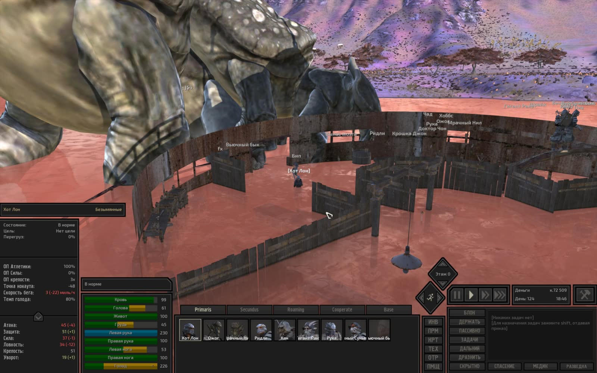

---

### Серия 20 (1 кадр)

- **Файловое время**: с `2026-11-01T15:56:55Z` по `2026-11-01T15:56:55Z`
- **Игровое время (OCR)**: `День 125, 17:17`
- **Локация (OCR)**: Не зафиксирована в UI
- **Персонажи в UI (OCR)**: Не зафиксированы в UI
- **Задачи/предметы в UI**: Быть рядом: Зелёный, Охранять: Зелёный

**Кадры серии:**
- [screenshot_342-42b0e53a.jpg](screenshot_342-42b0e53a.jpg) ([GitHub](https://github.com/asaf1n/Kenshi-Compain/blob/main/published/screenshots/screenshot_342-42b0e53a.jpg) | [Raw](https://raw.githubusercontent.com/asaf1n/Kenshi-Compain/main/published/screenshots/screenshot_342-42b0e53a.jpg))

---

### Серия 21 (1 кадр)

- **Файловое время**: с `2026-11-01T17:45:35Z` по `2026-11-01T17:45:35Z`
- **Игровое время (OCR)**: `День 126, 21:21`
- **Локация (OCR)**: Не зафиксирована в UI
- **Персонажи в UI (OCR)**: Сэто
- **Задачи/предметы в UI**: Медик, Разделка животных

**Кадры серии:**
- [screenshot_352-cffe0990.jpg](screenshot_352-cffe0990.jpg) ([GitHub](https://github.com/asaf1n/Kenshi-Compain/blob/main/published/screenshots/screenshot_352-cffe0990.jpg) | [Raw](https://raw.githubusercontent.com/asaf1n/Kenshi-Compain/main/published/screenshots/screenshot_352-cffe0990.jpg))

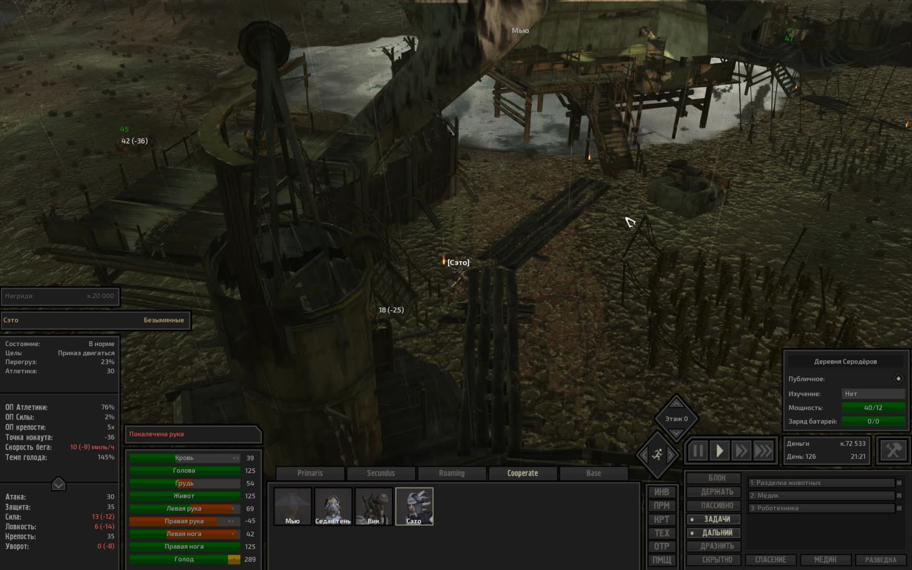

---

### Серия 22 (1 кадр)

- **Файловое время**: с `2026-11-02T00:12:36Z` по `2026-11-02T00:12:36Z`
- **Игровое время (OCR)**: `День 127, 15:25`
- **Локация (OCR)**: Не зафиксирована в UI
- **Персонажи в UI (OCR)**: Сэто
- **Задачи/предметы в UI**: Атаковать врагов, Медик, Разделка животных

**Кадры серии:**
- [screenshot_363-b8730d53.jpg](screenshot_363-b8730d53.jpg) ([GitHub](https://github.com/asaf1n/Kenshi-Compain/blob/main/published/screenshots/screenshot_363-b8730d53.jpg) | [Raw](https://raw.githubusercontent.com/asaf1n/Kenshi-Compain/main/published/screenshots/screenshot_363-b8730d53.jpg))

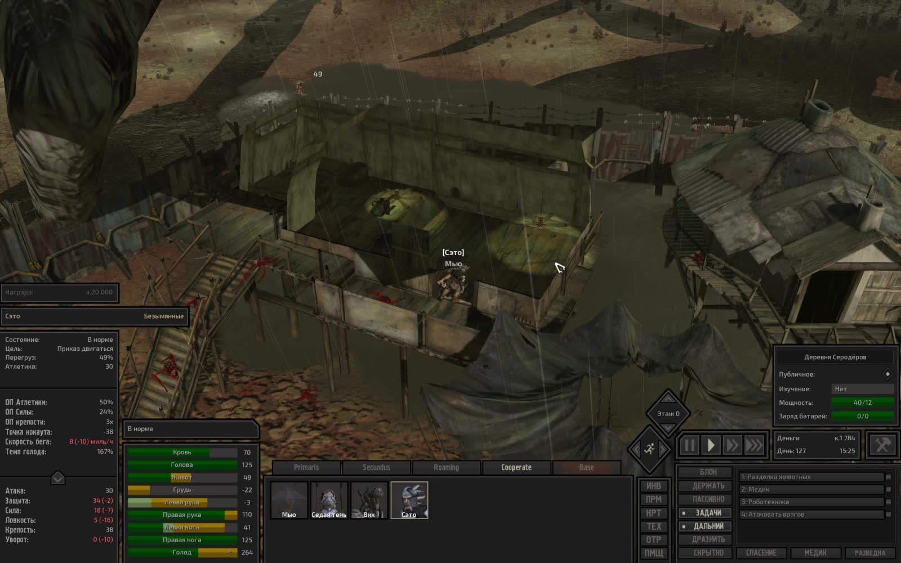

---

### Серия 23 (1 кадр)

- **Файловое время**: с `2026-11-02T06:33:56Z` по `2026-11-02T06:33:56Z`
- **Игровое время (OCR)**: `День 128, 15:32`
- **Локация (OCR)**: Не зафиксирована в UI
- **Персонажи в UI (OCR)**: Не зафиксированы в UI
- **Задачи/предметы в UI**: Быть рядом: Зелёный, Охранять: Зелёный

**Кадры серии:**
- [screenshot_372-1642db99.jpg](screenshot_372-1642db99.jpg) ([GitHub](https://github.com/asaf1n/Kenshi-Compain/blob/main/published/screenshots/screenshot_372-1642db99.jpg) | [Raw](https://raw.githubusercontent.com/asaf1n/Kenshi-Compain/main/published/screenshots/screenshot_372-1642db99.jpg))

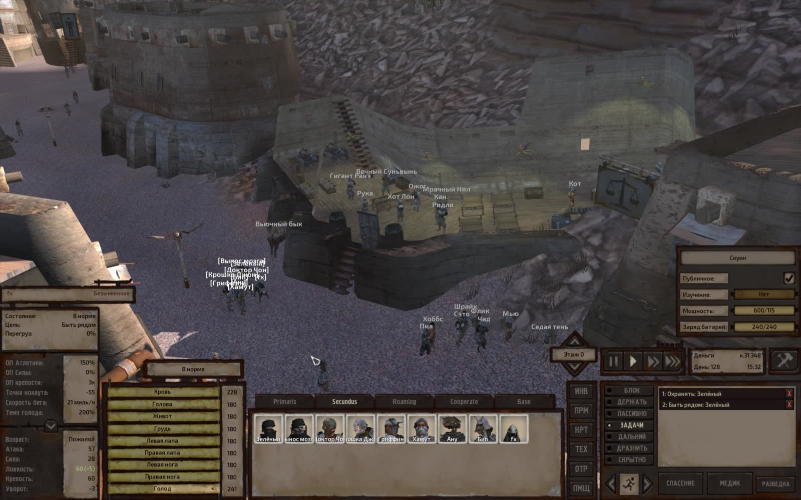

---

### Серия 24 (1 кадр)

- **Файловое время**: с `2026-11-03T01:26:34Z` по `2026-11-03T01:26:34Z`
- **Игровое время (OCR)**: `День 129, 21:36`
- **Локация (OCR)**: Не зафиксирована в UI
- **Персонажи в UI (OCR)**: Не зафиксированы в UI
- **Задачи/предметы в UI**: Медик, Роботехника

**Кадры серии:**
- [screenshot_382-b833ee70.jpg](screenshot_382-b833ee70.jpg) ([GitHub](https://github.com/asaf1n/Kenshi-Compain/blob/main/published/screenshots/screenshot_382-b833ee70.jpg) | [Raw](https://raw.githubusercontent.com/asaf1n/Kenshi-Compain/main/published/screenshots/screenshot_382-b833ee70.jpg))

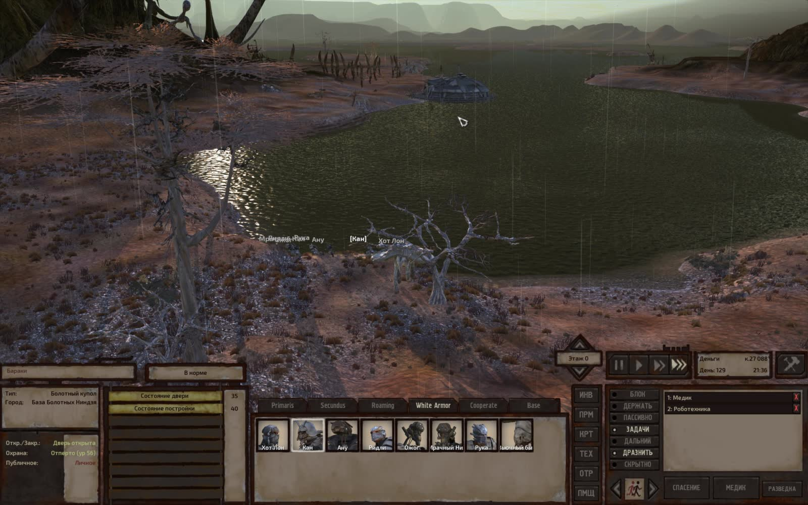

---

### Серия 25 (1 кадр)

- **Файловое время**: с `2026-11-03T01:35:29Z` по `2026-11-03T01:35:29Z`
- **Игровое время (OCR)**: `День 130, 00:04`
- **Локация (OCR)**: Не зафиксирована в UI
- **Персонажи в UI (OCR)**: Чад
- **Задачи/предметы в UI**: Медик, Роботехника

**Кадры серии:**
- [screenshot_392-3e87711b.jpg](screenshot_392-3e87711b.jpg) ([GitHub](https://github.com/asaf1n/Kenshi-Compain/blob/main/published/screenshots/screenshot_392-3e87711b.jpg) | [Raw](https://raw.githubusercontent.com/asaf1n/Kenshi-Compain/main/published/screenshots/screenshot_392-3e87711b.jpg))

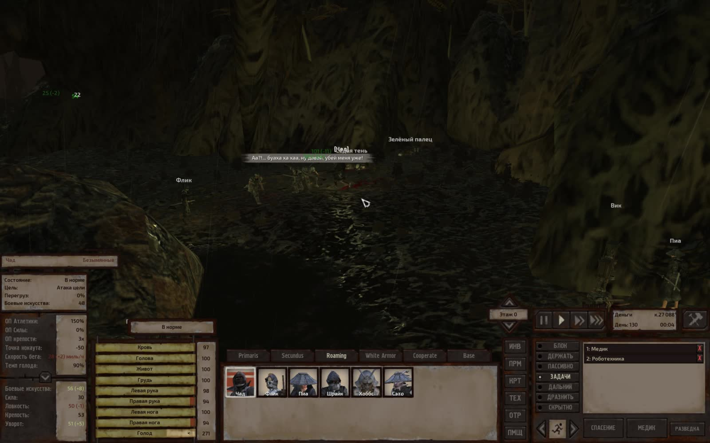

---

### Серия 26 (1 кадр)

- **Файловое время**: с `2026-11-03T02:24:41Z` по `2026-11-03T02:24:41Z`
- **Игровое время (OCR)**: `День 130, 06:18`
- **Локация (OCR)**: Не зафиксирована в UI
- **Персонажи в UI (OCR)**: туз эл
- **Задачи/предметы в UI**: Медик, Роботехника

**Кадры серии:**
- [screenshot_403-89c88504.jpg](screenshot_403-89c88504.jpg) ([GitHub](https://github.com/asaf1n/Kenshi-Compain/blob/main/published/screenshots/screenshot_403-89c88504.jpg) | [Raw](https://raw.githubusercontent.com/asaf1n/Kenshi-Compain/main/published/screenshots/screenshot_403-89c88504.jpg))

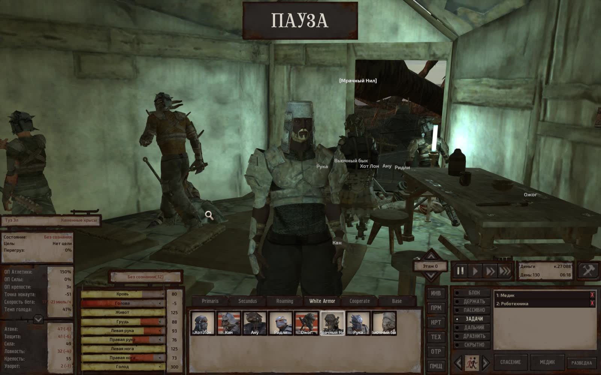

---

### Серия 27 (1 кадр)

- **Файловое время**: с `2026-11-03T02:46:01Z` по `2026-11-03T02:46:01Z`
- **Игровое время (OCR)**: `День 130, 09:46`
- **Локация (OCR)**: Не зафиксирована в UI
- **Персонажи в UI (OCR)**: Чад
- **Задачи/предметы в UI**: Быть рядом: Хот Лон, Медик, Роботехника

**Кадры серии:**
- [screenshot_414-8d0843ec.jpg](screenshot_414-8d0843ec.jpg) ([GitHub](https://github.com/asaf1n/Kenshi-Compain/blob/main/published/screenshots/screenshot_414-8d0843ec.jpg) | [Raw](https://raw.githubusercontent.com/asaf1n/Kenshi-Compain/main/published/screenshots/screenshot_414-8d0843ec.jpg))

---

### Серия 28 (1 кадр)

- **Файловое время**: с `2026-11-03T06:40:05Z` по `2026-11-03T06:40:05Z`
- **Игровое время (OCR)**: `День 131, 02:52`
- **Локация (OCR)**: Не зафиксирована в UI
- **Персонажи в UI (OCR)**: Не зафиксированы в UI
- **Задачи/предметы в UI**: Быть рядом: Хот Лон, Медик, Роботехника

**Кадры серии:**
- [screenshot_423-044ef2f1.jpg](screenshot_423-044ef2f1.jpg) ([GitHub](https://github.com/asaf1n/Kenshi-Compain/blob/main/published/screenshots/screenshot_423-044ef2f1.jpg) | [Raw](https://raw.githubusercontent.com/asaf1n/Kenshi-Compain/main/published/screenshots/screenshot_423-044ef2f1.jpg))

---

### Серия 29 (1 кадр)

- **Файловое время**: с `2026-11-04T08:46:48Z` по `2026-11-04T08:46:48Z`
- **Игровое время (OCR)**: `День 132, 10:57`
- **Локация (OCR)**: Не зафиксирована в UI
- **Персонажи в UI (OCR)**: Зелёный палец
- **Задачи/предметы в UI**: Работа с машиной: Пеньковая ферма 1-, Работа с машиной: Пеньковая ферма L, Работа с машиной: Рисовая ферма 1-, Тащить в: Хранение: рис

**Кадры серии:**
- [screenshot_434-6ff66e61.jpg](screenshot_434-6ff66e61.jpg) ([GitHub](https://github.com/asaf1n/Kenshi-Compain/blob/main/published/screenshots/screenshot_434-6ff66e61.jpg) | [Raw](https://raw.githubusercontent.com/asaf1n/Kenshi-Compain/main/published/screenshots/screenshot_434-6ff66e61.jpg))

---

### Серия 30 (1 кадр)

- **Файловое время**: с `2026-11-04T20:49:42Z` по `2026-11-04T20:49:42Z`
- **Игровое время (OCR)**: `День 133, 05:09`
- **Локация (OCR)**: Не зафиксирована в UI
- **Персонажи в UI (OCR)**: Не зафиксированы в UI
- **Задачи/предметы в UI**: Быть рядом: Хот Лон, Медик, Роботехника

**Кадры серии:**
- [screenshot_444-fa464e38.jpg](screenshot_444-fa464e38.jpg) ([GitHub](https://github.com/asaf1n/Kenshi-Compain/blob/main/published/screenshots/screenshot_444-fa464e38.jpg) | [Raw](https://raw.githubusercontent.com/asaf1n/Kenshi-Compain/main/published/screenshots/screenshot_444-fa464e38.jpg))

---
